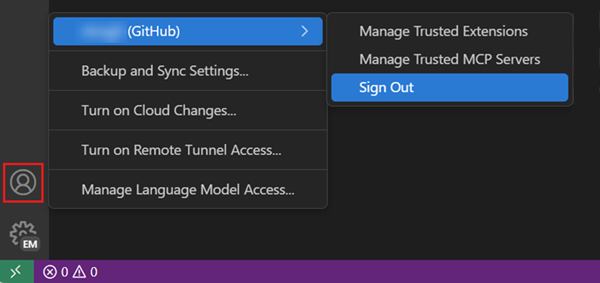
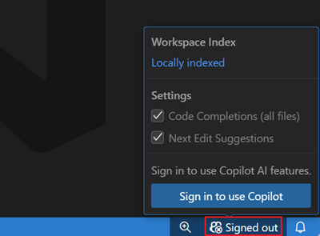
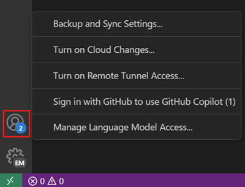

+++
title = "9.1 设置 GitHub Copilot"
date = 2026-11-06T07:53:25+08:00
weight = 1
type = "docs"
description = ""
isCJKLanguage = true
draft = false
+++


> 原文链接: [https://code.visualstudio.com/docs/setup/copilot](https://code.visualstudio.com/docs/setup/copilot)

# 9.1 设置 GitHub Copilot

　　本指南介绍如何在 Visual Studio Code 中登录 GitHub Copilot 并管理账户。如果你已有 Copilot 访问权限，请使用该 GitHub 账户登录。

　　如果使用其他访问方式，请按照 [2.3.2 选择智能体运行框架](../../ai-in-vs-code/choose-models-and-agents/2.3.2-ChooseAnAgentHarness/#claude)、[2.3.2 选择智能体运行框架](../../ai-in-vs-code/choose-models-and-agents/2.3.2-ChooseAnAgentHarness/#codex)或[2.3.1 选择和配置模型](../../ai-in-vs-code/choose-models-and-agents/2.3.1-ChooseAndConfigureModels/#bring-your-own-language-model-key)操作。这些方式有各自的要求，某些不使用 GitHub 登录的智能体工作流仍处于实验阶段。

> **注意**：当 [7.2 管理 AI 设置](../../enterprise/7.2-ManageAISettings/#claude-and-codex-availability)时，即使使用单独的提供商凭据，Claude 和 Codex 运行框架也会被禁用。请联系部署这些设置的 IT 团队。

## 开始之前 {#before-you-start}

　　在将项目内容发送给 AI 模型之前，请查看以下账户、用量和数据处理细节：

* **账户访问**：推荐的设置使用具有 Copilot 套餐的 GitHub 账户。如果你的雇主提供 Copilot，请使用组织的账户和策略。如果没有套餐，登录会将符合条件的账户注册到 Copilot Free。
* **用量和计费**：通过 GitHub Copilot 访问的模型会消耗 Copilot 套餐中的 AI 点数。通过其他提供商凭据访问则遵循该提供商的条款。请比较[2.3.2 选择智能体运行框架](../../ai-in-vs-code/choose-models-and-agents/2.3.2-ChooseAnAgentHarness/#requirements-and-setup)。
* **监控用量**：从 VS Code 状态栏打开 Copilot 状态仪表板，查看每月额度的使用百分比。了解[2.8.2.4 常见问题](../../ai-in-vs-code/reference-and-help/troubleshooting/2.8.2.4-FAQ/#how-can-i-monitor-my-copilot-usage)。
* **数据处理**：发送工作代码之前，请查看 [GitHub Copilot 信任中心](https://resources.github.com/copilot-trust-center/)和组织策略。使用第三方凭据或自带 API 密钥的模型遵循该提供商的条款。VS Code [3.3.11 遥测](../../editor/3.3-ConfigureTheEditor/3.3.11-Telemetry/)与 AI 提供商的数据处理相互独立。

　　BYOK 可以在没有 Copilot 套餐的情况下提供聊天访问，但不能替代 GitHub Copilot 服务的内联建议、语义搜索或嵌入。请查看[2.3.1 选择和配置模型](../../ai-in-vs-code/choose-models-and-agents/2.3.1-ChooseAndConfigureModels/#bring-your-own-language-model-key)。

## 设置 GitHub Copilot {#set-up-github-copilot}

1. 将鼠标悬停在状态栏中的 Copilot 图标上，选择 **使用 AI 功能**。

2. 选择一种登录方式并按照提示操作。

    * 如果你的账户已有 Copilot 订阅，VS Code 将使用该订阅。
    * 如果还没有 Copilot 订阅，系统会为你注册 [Copilot Free 套餐](https://github.com/github-copilot/signup)，并获得每月一定额度的内联建议和 AI 点数。详细了解不同的 [GitHub Copilot 套餐](https://docs.github.com/en/copilot/get-started/plans)。

3. 开始在 VS Code 中使用 Copilot。可以通过[1.1 智能体快速入门](../../get-started/1.1-AgentsQuickstart/)学习基础知识。

> **重要**：免费版 GitHub Copilot 中的遥测当前已启用。默认情况下，允许匹配公共代码的代码建议，包括 VS Code 和 github.com 体验中的代码引用。可以通过将 `telemetry.telemetryLevel` 设置为 `off` 来选择退出遥测数据收集，或在 [Copilot 设置](https://github.com/settings/copilot)中调整遥测和代码建议设置。

## 使用 GHE 账户的 Copilot {#use-copilot-with-a-ghe-account}

　　如果 Copilot 订阅与 GitHub Enterprise（GHE）账户关联，可以使用 GHE 凭据登录。

1. 将鼠标悬停在状态栏中的 Copilot 图标上，选择 **使用 AI 功能**。
2. 在登录对话框中选择 **使用 GHE.com 继续**，并提供 GHE 实例 URL 和凭据。

　　如果需要在 GitHub.com 账户和 GHE 账户之间切换，请参阅[为每个工作区或配置文件使用不同的 GitHub 账户](#use-a-different-github-account-per-workspace-or-profile)。

## 为 Copilot 使用其他 GitHub 账户 {#use-a-different-github-account-with-copilot}

1. 在活动栏中选择 **账户** 菜单，然后为当前登录的账户选择 **退出登录**。

    

2. 使用以下任一方式登录 GitHub 账户：

    * 在状态栏的 Copilot 菜单中选择 **登录以使用 Copilot**。

        

    * 在活动栏中选择 **账户** 菜单，然后选择 **使用 GitHub 登录以使用 GitHub Copilot**。

        

    * 在命令面板（`Ctrl + Shift + P`）中运行 **GitHub Copilot: Sign in** 命令。

## 为每个工作区或配置文件使用不同的 GitHub 账户 {#use-a-different-github-account-per-workspace-or-profile}

　　可以为每个 VS Code 工作区或配置文件使用不同的 GitHub 账户。此配置按工作区和配置文件保存。

* 对于 GitHub.com 账户：
    1. 在活动栏的账户菜单中选择 **管理扩展账户首选项**。
    2. 从扩展列表中选择 **GitHub Copilot Chat**。
    3. 选择当前工作区和配置文件要用于 Copilot 的 GitHub 账户。

* 对于 GHE.com 账户：
    1. 从命令面板运行 **Preferences: Open User Settings (JSON)** 或 **Preferences: Open Workspace Settings (JSON)**。
    2. 添加以下设置，将 GitHub Enterprise 指定为 Copilot 的身份验证提供程序：

        ```json
        "github.copilot.advanced": {
            "authProvider": "github-enterprise"
        }
        ```

    3. 如果尚未登录，请重新登录 GitHub Enterprise 账户。

## 从 VS Code 中移除 AI 功能 {#remove-ai-features-from-vs-code}

　　可以使用 `chat.disableAIFeatures` 设置禁用内置 AI 功能，与其他功能配置方式类似。此设置会禁用并隐藏聊天或内联建议等功能，并禁用 Copilot 扩展。可以在工作区或用户级别配置。

## 为工作区禁用 AI 功能 {#disable-ai-features-for-a-workspace}

　　要为特定工作区禁用 AI 功能，请在 工作区设置中配置 `chat.disableAIFeatures`。该设置可在设置编辑器（`Ctrl + ,`）中找到，也可以编辑工作区中的 `settings.json` 文件。

## 后续步骤 {#next-steps}

* 继续学习 [1.1 智能体快速入门](../../get-started/1.1-AgentsQuickstart/)，了解 VS Code 中 AI 辅助开发的关键功能。
