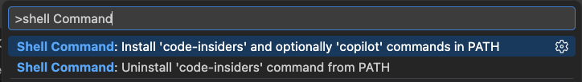
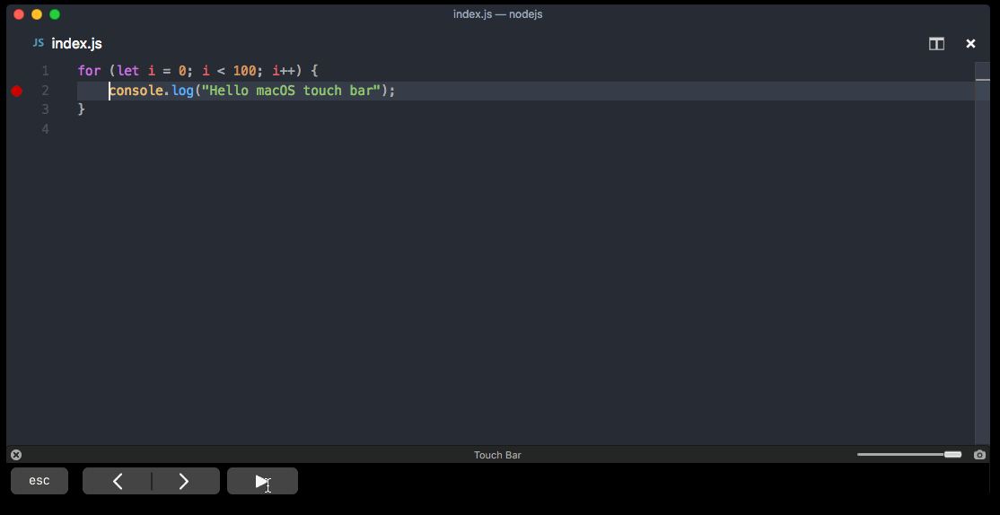

+++
title = "9.3 在 macOS 上安装"
date = 2026-11-06T07:53:25+08:00
weight = 3
type = "docs"
description = ""
isCJKLanguage = true
draft = false
+++


> 原文链接: [https://code.visualstudio.com/docs/setup/mac](https://code.visualstudio.com/docs/setup/mac)

# 9.3 在 macOS 上安装

　　Visual Studio Code 可通过可下载的磁盘映像在 macOS 上使用。VS Code 支持基于 Intel 的 Mac 和配备 Apple 芯片的 Mac。

## 在 macOS 上安装 VS Code {#install-vs-code-on-macos}

1. 下载适用于 macOS 的 [Visual Studio Code](https://go.microsoft.com/fwlink/?LinkID=534106)。
2. 打开下载的 `.dmg` 文件。
3. 将 **Visual Studio Code.app** 拖到 **Applications** 文件夹。
4. 从 **Applications** 文件夹双击图标打开 VS Code。
5. 要将 VS Code 保留在 Dock 中，请按住 Control 键单击 Dock 中的图标，然后选择 **选项** > **保留在 Dock 中**。

> **注意**：[下载 VS Code](https://code.visualstudio.com/download) 页面还列出了 Universal、Intel 芯片和 Apple 芯片版本。

## 从命令行启动 VS Code {#launch-vs-code-from-the-command-line}

　　要在终端中通过输入 `code` 运行 VS Code，请将其添加到 `$PATH` 环境变量。

### 使用 VS Code 配置 PATH {#configure-path-with-vs-code}

1. 启动 VS Code。
2. 打开**命令面板**（`Cmd + Shift + P`），输入 `shell command`，运行 **Shell Command: Install 'code' and optionally 'copilot' commands in PATH**。

    

3. 当提示是否也安装 GitHub Copilot CLI 时，选择：
    * **是**：在集成终端中开始安装 GitHub Copilot CLI，并继续将 `code` 添加到 PATH。
    * **否**：仅将 `code` 添加到 PATH。

    按 `Escape` 会关闭提示，不安装任何命令。

4. 如果选择 **是**，请按照终端中的安装说明操作，包括更新 shell 配置文件或 PATH 的说明。如果已经安装 Copilot CLI，则复用现有安装。Copilot CLI 安装与将 `code` 添加到 PATH 是分开运行的。`code` 的成功消息并不表示 Copilot CLI 安装完成。
5. 重新启动终端，使新的 `$PATH` 生效。在任意文件夹中运行 `code .` 即可开始编辑。如果安装了 Copilot CLI，运行 `copilot` 即可[2.2.11.1 ManageSessions](../../ai-in-vs-code/work-with-ai/sessions/2.2.11.1-ManageSessions/#use-copilot-cli-from-the-terminal)。

> **注意**：在 [Insiders](https://code.visualstudio.com/insiders) 中，命令使用 `code-insiders` 而不是 `code`。如果 AI 功能被隐藏，或组织禁用了 Copilot CLI 安装，命令会保留原标签，并且不会提供安装 Copilot CLI 的选项。

> **注意**：如果 `.bash_profile` 或等效 shell 配置文件中仍存在旧版 VS Code 的 `code` 别名，请删除它，然后重新运行 Shell Command 安装命令。

### 手动配置 PATH {#manually-configure-path}

**Zsh**：

```zsh
cat << EOF >> ~/.zprofile
# 添加 Visual Studio Code（code）
export PATH="\$PATH:/Applications/Visual Studio Code.app/Contents/Resources/app/bin"
EOF
```

**Bash**：

```bash
cat << EOF >> ~/.bash_profile
# 添加 Visual Studio Code（code）
export PATH="\$PATH:/Applications/Visual Studio Code.app/Contents/Resources/app/bin"
EOF
```

> **注意**：`\$PATH` 中的前导反斜杠可防止在拼接时展开 `$PATH`。如果直接在终端中运行 export 命令，请删除反斜杠。

　　启动新终端以应用更改。在任意文件夹中运行 `code .` 即可开始编辑。

## 更新 {#updates}

　　VS Code 每周发布[更新](https://code.visualstudio.com/updates)，并支持在有新版本时自动更新。收到更新提示时，接受提示即可安装新版本。

> **注意**：如果希望按自己的计划更新，请[禁用自动更新](https://code.visualstudio.com/docs/supporting/faq#how-do-i-opt-out-of-vs-code-auto-updates)。

## Touch Bar 支持 {#touch-bar-support}

　　在支持的 Mac 上，VS Code 会添加以下 Touch Bar 操作：

* 编辑器历史记录导航。
* 用于控制调试器的调试工具栏。



## 安装之后 {#after-installation}

* [9.8 其他组件](../9.8-AdditionalComponents/)，包括 Git、Node.js、TypeScript、语言运行时和命令行工具。
* 从 [Visual Studio Marketplace](https://marketplace.visualstudio.com/VSCode) 安装扩展，添加主题、格式化程序、调试器和语言支持。
* [9.1 设置 GitHub Copilot](../9.1-GitHubCopilotSetup/)，在 VS Code 中使用 AI 功能。
* [1.2 编辑器教程](../../get-started/1.2-EditorTutorial/)，动手了解用户界面和关键功能。

## 常见问题 {#common-questions}

<details>
<summary>为什么 VS Code 请求访问我的日历？</summary>

　　在 macOS Mojave 上，对话框可能显示“Visual Studio Code 想要访问你的日历、联系人或照片”。这些对话框来自 macOS 隐私保护，并非 VS Code 特有。请选择 **不允许**，因为 VS Code 不需要访问这些文件夹。

</details>

<details>
<summary>VS Code 更新失败</summary>

　　如果重新启动后 VS Code 没有更新，macOS 可能将其置于隔离状态。请按照 [issue #7426](https://github.com/microsoft/vscode/issues/7426#issuecomment-425093469) 中的步骤解决。

</details>

<details>
<summary>VS Code 可以在 Apple 芯片机器上运行吗？</summary>

　　可以。VS Code 支持在 Apple 芯片 Mac 上运行的 macOS Arm64 版本。请安装包含 Intel 和 Apple 芯片版本的 Universal 版本，或安装相应的平台专用版本。

</details>
