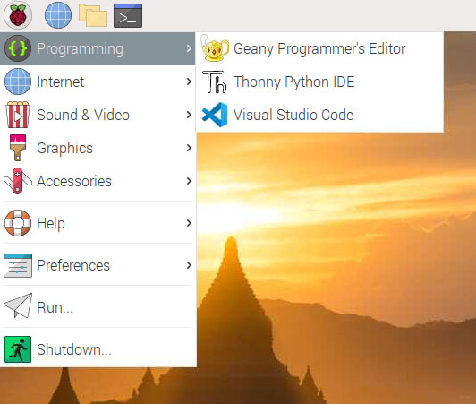

+++
title = "9.5 在树莓派上使用"
date = 2026-11-06T07:53:25+08:00
weight = 5
type = "docs"
description = ""
isCJKLanguage = true
draft = false
+++


> 原文链接: [https://code.visualstudio.com/docs/setup/raspberry-pi](https://code.visualstudio.com/docs/setup/raspberry-pi)

# 9.5 在树莓派上使用

　　虽然不受官方支持，但你可以在 [Raspberry Pi](https://www.raspberrypi.org) 设备上运行 Visual Studio Code。

[RPi Logo Landscape Reg SCREEN.png](./images/RPi-Logo-Landscape-Reg-SCREEN.png)](https://www.raspberrypi.org)

　　下载并使用 VS Code 即表示你同意[许可条款](https://code.visualstudio.com/license)和[隐私声明](https://go.microsoft.com/fwlink/?LinkID=528096&clcid=0x409)。

## 安装 {#installation}

　　VS Code 通过 [Raspberry Pi OS](https://www.raspberrypi.com/software/operating-systems/)（以前称为 Raspbian）APT 仓库正式分发，提供 32 位和 64 位版本。运行以下命令安装：

```bash
sudo apt update
sudo apt install code
```

### 运行 VS Code {#running-vs-code}

　　安装 VS Code 包后，可以在终端中输入 `code`，或通过 **编程** 菜单启动它。



## 更新 {#updates}

　　Raspberry Pi 应像系统上的其他软件包一样更新 VS Code：

```bash
sudo apt update
sudo apt upgrade code
```

　　可以在[更新](https://code.visualstudio.com/updates)页面查看新版本。

## 系统要求 {#system-requirements}

　　VS Code 在 Raspberry Pi 上不受官方支持。请查看[社区讨论](https://github.com/microsoft/vscode-discussions/discussions/2379)了解已知可用的平台信息。

## 后续步骤 {#next-steps}

* [9.8 其他组件](../9.8-AdditionalComponents/)：安装 Git、Node.js、TypeScript 和 Yeoman 等工具。
* [3.1.2 用户界面](../../editor/3.1-GettingStarted/3.1.2-UserInterface/)：快速了解 VS Code。
* [3.3.4 设置](../../editor/3.3-ConfigureTheEditor/3.3.4-Settings/)：通过设置自定义 VS Code。
