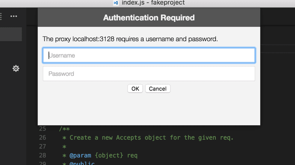

+++
title = "9.6 网络连接"
date = 2026-11-06T07:53:25+08:00
weight = 6
type = "docs"
description = ""
isCJKLanguage = true
draft = false
+++


> 原文链接: [https://code.visualstudio.com/docs/setup/network](https://code.visualstudio.com/docs/setup/network)

# 9.6 网络连接

　　Visual Studio Code 构建在 [Electron](https://www.electronjs.org) 之上，受益于 [Chromium](https://www.chromium.org/) 的所有网络堆栈能力，因此用户可以获得与 [Google Chrome](https://www.google.com/chrome/index.html) 类似的大量网络支持。

## 常用主机名 {#common-hostnames}

　　VS Code 中的一些功能需要网络通信，例如自动更新、查询和安装扩展以及遥测。要在代理环境中正常使用这些功能，必须正确配置产品。如果防火墙需要允许特定域，请允许以下主机名：

* `update.code.visualstudio.com`：VS Code 下载和更新服务器
* `code.visualstudio.com`：VS Code 文档
* `go.microsoft.com`：Microsoft 链接转发服务
* `marketplace.visualstudio.com`：Visual Studio Marketplace
* `*.gallery.vsassets.io`：Visual Studio Marketplace
* `*.gallerycdn.vsassets.io`：Visual Studio Marketplace
* `rink.hockeyapp.net`：崩溃报告服务
* `raw.githubusercontent.com`：GitHub 仓库原始文件访问
* `vsmarketplacebadges.dev`：Visual Studio Marketplace 徽章服务
* `*.vscode-cdn.net`：VS Code CDN
* `vscode.download.prss.microsoft.com`：VS Code 下载 CDN
* `download.visualstudio.microsoft.com`：Visual Studio 下载服务器，为某些扩展（C++、C#）提供依赖项
* `vscode-sync.trafficmanager.net`：VS Code 设置同步服务
* `vscode-sync-insiders.trafficmanager.net`：VS Code 设置同步服务（Insiders）
* `vscode.dev`：使用 GitHub 或 Microsoft 登录扩展或设置同步时的回退地址（仅 `vscode.dev/redirect`）
* `*.vscode-unpkg.net`：加载 Web 扩展时使用
* `default.exp-tas.com`：VS Code 实验服务，用于提供实验性用户体验

## 代理服务器支持 {#proxy-server-support}

　　VS Code 的代理服务器支持与 Google Chromium 完全相同。Chromium 网络堆栈使用系统网络设置，因此用户和管理员可以轻松控制所有应用程序的网络设置，包括代理设置、SSL/TLS 设置、证书吊销检查设置以及证书和私钥存储。这意味着代理设置应会自动获取。

　　也可以使用以下命令行参数控制代理设置：

```bash
# 禁用代理
--no-proxy-server

# 手动代理地址
--proxy-server=<scheme>=<uri>[:<port>][;...] | <uri>[:<port>] | "direct://"

# 手动 PAC 地址
--proxy-pac-url=<pac-file-url>

# 按主机禁用代理
--proxy-bypass-list=(<trailing_domain>|<ip-address>)[:<port>][;...]
```

### 需要身份验证的代理 {#authenticated-proxies}

　　需要身份验证的代理在 VS Code 中可以正常使用。支持 Basic、Digest、NTLM 和 Negotiate 身份验证。在需要身份验证的 HTTP 代理后面使用 VS Code 时，会出现身份验证弹窗。



　　目前尚未实现 SOCKS5 代理身份验证支持。

### SSL 证书 {#ssl-certificates}

　　HTTPS 代理经常会重写传入请求的 SSL 证书。如果遇到 SSL 信任问题，可以：

* 将代理证书添加到操作系统的信任链（首选）。
* 如果代理运行在 `localhost`，尝试 `--allow-insecure-localhost` 命令行标志。
* 作为最后手段，使用 `--ignore-certificate-errors` 忽略所有证书错误。**警告**：这很**危险**且**不建议**，会带来安全问题。

> **Linux 用户注意**：需要将代理证书添加到系统信任存储和 NSS 信任存储。Ubuntu/Debian 可将证书复制到 `/usr/local/share/ca-certificates/` 并运行 `sudo update-ca-certificates`；RHEL/CentOS/Fedora 可使用 `sudo trust anchor --store <certificate-file>`，或放到 `/etc/pki/ca-trust/source/anchors/` 后运行 `sudo update-ca-trust`；然后使用 `certutil` 添加到 NSS 信任存储。

## 旧版代理服务器支持 {#legacy-proxy-server-support}

　　扩展尚未获得与 VS Code 相同的代理支持，CLI 界面等少数功能也尚未完全支持代理网络。因此，`http.proxy`、`http.proxyStrictSSL` 和 `http.proxyAuthorization` 设置仍保留，但仅在这两种场景中生效。

## 故障排除 {#troubleshooting}

* [Chromium 网络设置](https://www.chromium.org/developers/design-documents/network-settings)
* [调试网络代理问题](https://www.chromium.org/developers/design-documents/network-stack/debugging-net-proxy)
* [在 Chrome 中配置 SOCKS 代理](https://www.chromium.org/developers/design-documents/network-stack/socks-proxy)
* [代理设置与回退（Windows）](https://www.chromium.org/developers/design-documents/network-stack/proxy-settings-fallback)
