+++
title = "2.3.1 选择和配置模型"
date = 2026-11-06T07:53:25+08:00
weight = 1
type = "docs"
description = ""
isCJKLanguage = true
draft = false
+++


> 原文链接: [https://code.visualstudio.com/docs/agent-customization/language-models](https://code.visualstudio.com/docs/agent-customization/language-models)

# 2.3.1 选择和配置模型

　　Visual Studio Code 让你可以访问多个内置语言模型，每个模型都针对不同任务进行了优化。你可以为聊天、内联建议和实用任务切换模型，也可以通过自带 API 密钥添加更多模型。

　　关于语言模型如何工作、它们的特点以及如何选择合适的模型的背景知识，请参阅[语言模型概念](../../concepts/2.7.2-HowModelsWork/)。

## 选择访问模型的方式 {#choose-how-to-access-models}

　　请从你已有的账户、凭据或模型开始：

* **GitHub Copilot 访问权限**：先[设置 GitHub Copilot](../../getting-started/2.1.2-SetUpCopilot/)，然后从套餐提供的模型提供商中[选择模型](#change-the-model-for-chat)。
* **提供商账户或特定运行框架的凭据**：按照 [Anthropic Claude](../2.3.2-ChooseAnAgentHarness/#claude) 或 [OpenAI Codex](../2.3.2-ChooseAnAgentHarness/#codex) 运行框架的要求操作。支持的账户和身份验证方式取决于具体集成。
* **API 密钥或自定义终结点**：在语言模型编辑器中[添加模型提供商](#bring-your-own-language-model-key)。这配置的是模型访问权限，而不是更换运行框架。
* **本地运行的模型**：添加[模型提供商扩展](#add-a-model-provider-extension)，例如 Ollama。或者查看 [Copilot 托管的设备上模型](#on-device-model-requirements)的硬件和登录要求。

　　模型负责推理，运行框架协调工具和工作流，访问提供商决定身份验证和计费。这些选择相互关联，但不可互换。在复用账户或密钥之前，请先比较[各运行框架的访问选项](../2.3.2-ChooseAnAgentHarness/#requirements-and-setup)。

## 更改聊天模型 {#change-the-model-for-chat}

　　不同模型各有所长。快速编辑和简单问题可以使用快速模型，复杂重构、架构决策或多步骤任务则使用推理模型。根据你使用的[运行框架](../../concepts/2.7.6-AgentHarnesses/)，可用模型列表可能不同。

　　使用聊天输入框中的语言模型选择器，更改聊天对话和代码编辑所使用的模型。

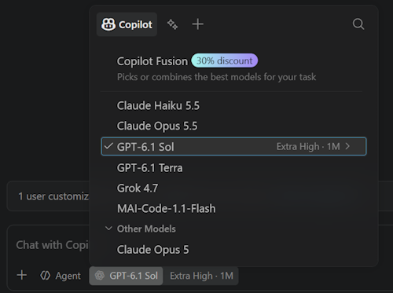

　　如果模型选择器显示 **模型** 而不是具体模型名称，请打开它，检查是否需要工作区信任或登录。详细了解[工作区信任和受限模式](../../../editor/3.2-WriteCode/3.2.8-Workspaces/3.2.8.3-WorkspaceTrust/#restricted-mode)。

　　你还可以通过[使用自己的语言模型 API 密钥](#bring-your-own-language-model-key)进一步扩展可用模型列表。

> **注意**：如果你使用的是 Copilot Business 或 Copilot Enterprise，管理员需要在 GitHub.com 的 [Copilot 策略设置](https://docs.github.com/en/enterprise-cloud@latest/copilot/managing-copilot/managing-github-copilot-in-your-organization/managing-policies-for-copilot-in-your-organization#enabling-copilot-features-in-your-organization)中选择启用 `Editor Preview Features`，为组织启用特定模型。

　　要比较多个模型或运行框架在同一编码任务上的结果，请在智能体窗口中使用[模型比较（预览）](../2.3.4-CompareModelResults/)。用同一个提示词运行多个模型，然后并排审查结果。

### 组织管理的模型默认值 {#organization-managed-model-defaults}

　　你的组织可以为编辑器和智能体窗口中的新对话设置起始模型。模型选择器会将组织的选择标记为 **组织默认**，设置编辑器会在 `chat.defaultModel` 旁显示指示器，并说明 **由组织管理**。

　　受管理的默认值优先于你保存的模型偏好，但仅用于新对话；你仍然可以为当前对话选择其他可用模型。现有对话保留其模型。你的已保存偏好会被保留，当组织默认值被移除后，它会再次应用于新对话。

　　管理员配置请参阅[设置托管模型默认值](../../../enterprise/7.2-ManageAISettings/#set-managed-model-defaults)。

## 配置思考强度和上下文大小 {#configure-thinking-effort-and-context-size}

　　某些模型支持可配置的思考强度、上下文大小和其他参数。这些参数控制模型为每个请求投入多少推理，以及模型一次可以考虑多少上下文。关于思考和推理的背景知识，请参阅[思考与推理](../../concepts/2.7.2-HowModelsWork/#thinking-and-reasoning)。

　　默认情况下，VS Code 会设置推荐的努力级别，并启用自适应推理，即模型根据每个请求的复杂度动态决定思考多少。对于大多数用例，默认配置即可良好工作。

> **提示**：更高的思考强度会产生更多思考令牌，从而增加 [AI 点数](../../concepts/2.7.2-HowModelsWork/#ai-credits-and-model-costs)消耗。只应为确实复杂的任务提高思考强度。详细了解[优化 AI 点数使用量](../../tutorials-and-guides/2.6.14-ReduceCreditUsage/)。

要配置模型参数：

1. 打开聊天输入框中的模型选择器，选择一个推理模型。

2. 选择模型名称旁出现的 **>** 箭头，打开模型配置子菜单。

    > **注意**：非推理模型（例如 GPT-4.1 和 GPT-4o）不会在模型配置子菜单中显示思考强度选项。

3. 选择一个努力级别。

    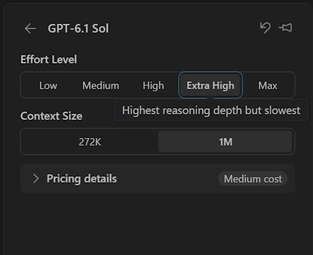

　　模型配置按会话记忆，因此返回较早的会话时会保留当时使用的努力级别和上下文大小。新对话会从你为该模型最后设置的级别和大小开始。

> **注意**：`github.copilot.chat.anthropic.thinking.effort` 和 `github.copilot.chat.responsesApiReasoningEffort` 设置已弃用。请直接从语言模型选择器配置思考强度。

## 使用自动模型选择 {#use-auto-model-selection}

　　使用自动模型选择时，Visual Studio Code 会评估任务复杂度和实时模型可用性，将每个请求路由到最优模型。关于自动模型选择工作方式的背景知识，请参阅[自动模型选择](../../concepts/2.7.2-HowModelsWork/#auto-model-selection)。

　　要使用自动模型选择，请在聊天中的模型选择器里选择 **自动**。

　　在 [Copilot 运行框架会话](../2.3.2-ChooseAnAgentHarness/#copilot)中，当启用动态自动层级且服务提供你的账户可以运行的 Fusion 层级时，**Copilot Fusion** 会取代 **自动**。如果选择器显示 **Copilot Fusion**，请改为按照 [Fusion 说明](#use-copilot-fusion)操作。

　　在可用时使用 **优化目标** 选择符合你优先级的层级。提供的层级取决于服务，可能包括：

* **效率**：偏向更低的 AI 点数消耗。
* **平衡**：在能力和点数消耗之间取得平衡。
* **智能**：偏向使用能力更强的模型处理复杂任务。

　　你的组织可以为新聊天设置起始层级。受管理的层级会在 **优化目标** 菜单中显示为 **默认**，但你仍然可以选择其他层级。当组织默认值更改或被移除时，你的显式选择会被保留。

　　将鼠标悬停在聊天响应上，可以查看生成该响应用的模型。

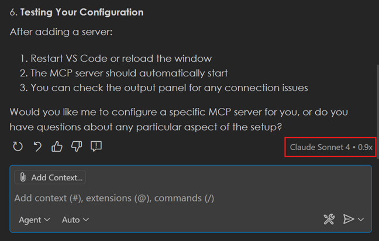

## 使用 Copilot Fusion {#use-copilot-fusion}

　　Copilot Fusion 会选择模型和工作流来完成任务，因此你不必为每个步骤选择模型。关于 Fusion 与自动选择的区别以及何时使用它的背景知识，请参阅 [Copilot Fusion 概念](../../concepts/2.7.2-HowModelsWork/#copilot-fusion)。

　　关于编排、努力级别、可用性和 AI 点数使用的详细信息，请参阅 GitHub 文档中的 [GitHub Copilot Fusion](https://docs.github.com/en/copilot/concepts/models/copilot-fusion)。

要使用 Copilot Fusion：

1. 确认设置编辑器中的 `chat.copilot.dynamicAutoTiers.enabled` 已启用。更改该设置会在活动请求完成后重新启动 Copilot 运行时。

2. 使用 [Copilot 运行框架](../2.3.2-ChooseAnAgentHarness/#copilot)启动新聊天。

3. 在模型选择器中选择 **Copilot Fusion**，然后选择可用层级：**Standard**、**High** 或 **Max**。

　　启用该设置并不会授予 Fusion 层级的访问权限。如果服务没有提供你的账户可以运行的 Fusion 层级，选择器会继续显示 **自动**。

## 使用设备上模型 {#use-on-device-models-experimental}

　　设备上模型让你在 Copilot 运行框架会话中，直接在设备上运行 GitHub Copilot 提供的编码模型，目前为 MAI Code 1.1 Flash。VS Code 使用 [llama.cpp](https://github.com/ggml-org/llama.cpp)在你的设备上提供模型服务。设备上模型将这项能力带到 VS Code 中的 GitHub Copilot，无需你自己寻找、下载和提供模型服务。

　　你可以将本地模型与云端模型一起使用。[自动模型选择](#use-auto-model-selection)可以将合适的请求路由到本地模型，并在需要时回退到云端模型。

<video src="https://code.visualstudio.com/assets/docs/agent-customization/language-models/on-device-model.mp4" title="视频展示从模型选择器的“此设备”选项卡下载 MAI Code 1.1 Flash、加载模型并在设备上回答聊天提示词的过程。" autoplay loop controls muted></video>

　　设备上模型与 [BYOK 本地模型](#bring-your-own-language-model-key)不同。GitHub Copilot 提供和管理设备上模型，且需要 GitHub 登录。BYOK 本地模型（例如 Ollama）通过你配置的提供商运行，无需登录。

### 设备上模型的要求 {#on-device-model-requirements}

* 使用具有 Copilot 访问权限的 GitHub 账户登录。如果你使用 Copilot Business 或 Enterprise，管理员必须在 [Copilot 策略设置](https://docs.github.com/en/enterprise-cloud@latest/copilot/managing-copilot/managing-github-copilot-in-your-organization/managing-policies-for-copilot-in-your-organization#enabling-copilot-features-in-your-organization)中启用 `Editor Preview Features`。

* 在聊天视图或智能体窗口中使用在你的本地计算机上运行的 [Copilot 运行框架会话](../2.3.2-ChooseAnAgentHarness/)。

* 使用具有至少 96 GB GPU 内存（VRAM）的 NVIDIA GPU。具有统一内存（GPU 与系统共享的内存）的设备也计入此要求。

* 为 MAI Code 1.1 Flash 留出约 55 GB 的可用磁盘空间。下载大小为 52.8 GB，安装需要 54.8 GB 可用空间。模型选择器中的详情页会显示你设备上的确切大小。

* 安装支持该模型的 llama.cpp 构建。VS Code 不会安装 llama.cpp。请从 [llama.cpp 发布页面](https://github.com/ggml-org/llama.cpp/releases)获取构建。MAI Code 1.1 Flash 需要 llama.cpp b11658 或更高版本。如果构建过旧，模型选择器会提示需要更新版本。

### 设置设备上模型 {#set-up-an-on-device-model}

1. 为你的平台和 GPU 安装 llama.cpp 构建。

2. 将 `chat.copilot.localModel.llamaServerPath` 设置为 `llama-server` 可执行文件的绝对路径。此设置仅作用于当前计算机。VS Code 只运行此路径下的 `llama-server` 可执行文件。

3. 启用 `chat.copilot.localModel.enabled`。更改此设置后，本地 Copilot 运行时会在活动响应完成后重新启动。

4. 在 Copilot 运行框架会话中打开模型选择器，选择 **此设备** 选项卡。尚未下载的模型会显示为灰色，并提供 **下载** 操作。

    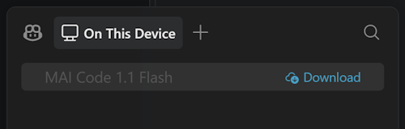

5. 选择模型名称打开详情，查看下载大小、来源（Azure ML 注册表）和许可证，然后选择 **下载**。

    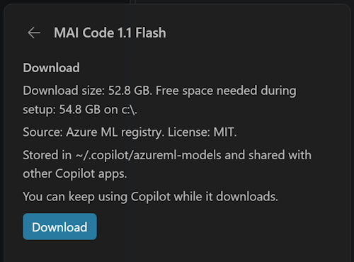

6. 在聊天输入框上方的通知中跟踪进度。模型下载期间可以继续使用 Copilot，并选择 **暂停** 暂停下载。

    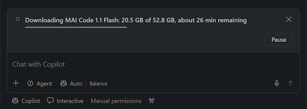

　　VS Code 将模型存储在 `~/.copilot/azureml-models`，并与其他 Copilot 应用（例如 Copilot CLI）共享。

### 在聊天中使用设备上模型 {#use-an-on-device-model-in-chat}

　　下载完成后，VS Code 会验证文件并加载模型。加载可能需要几分钟，聊天输入框上方的通知会显示进度，并提供 **取消** 操作。模型就绪后，在通知中选择 **切换到 MAI Code 1.1 Flash**，或从 **此设备** 选项卡中选择该模型。

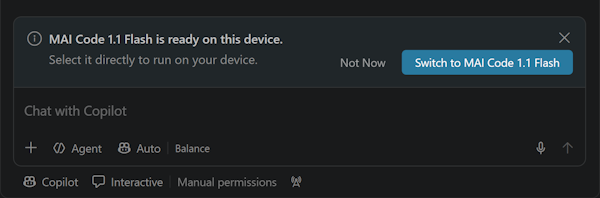

　　选择设备上模型时，模型选择器和每个响应的页脚都会显示模型名称，并带有 **设备上** 标记。设备上响应不使用 AI 点数，响应页脚会显示 **0 点数**。

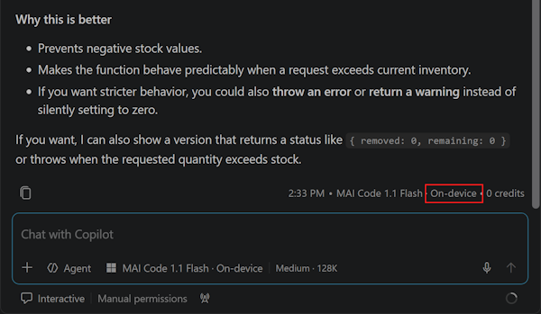

　　要更改模型运行方式，请在 **此设备** 选项卡中将鼠标悬停在模型上，选择 **详情**。在详情页可以：

* 选择 **努力级别**：**低**、**中** 或 **高**。
* 选择 **上下文** 大小。可用大小取决于设备的 GPU 内存，页面会显示所选大小的估计内存。更改上下文大小会在正在运行的响应结束后重新加载模型。
* 使用页面顶部的图标停止或移除模型。

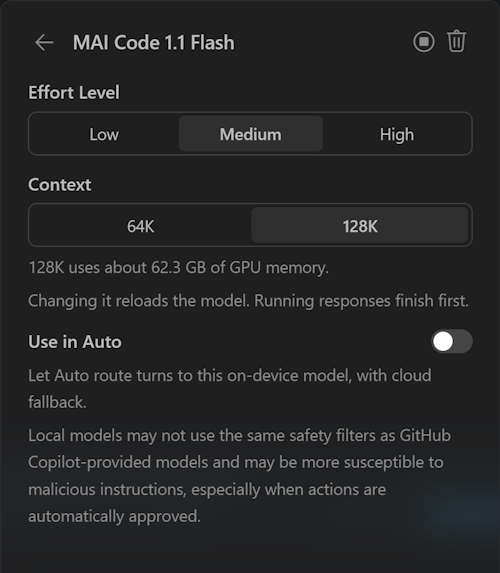

### 将设备上模型与自动模型选择一起使用 {#use-an-on-device-model-with-auto-model-selection}

　　[自动模型选择](#use-auto-model-selection)可以将请求路由到活动设备上模型，并支持回退到云端。如果设备上模型无法响应，模型选择会在首次输出前回退到云端模型。此更改立即生效。

　　要为自动模型选择启用本地模型，请在模型详情页启用 **在自动中使用**，或启用 `chat.copilot.localModel.useInAuto`。

　　自动模型选择会为每个请求选择合适的模型，因此许多请求仍会使用云端模型。使用本地模型的响应会标记为 **设备上**。如果某个模型在你的设备上运行太慢，无法用于自动选择，会显示 **对自动来说太慢**。你仍然可以直接选择该模型。

> **警告**：本地模型可能不会使用与 GitHub Copilot 提供的云端模型相同的安全过滤器，并且可能更容易受到恶意指令影响，尤其是在[自动批准操作](../../work-with-ai/permissions-and-security/2.2.12.1-ApprovalsAndPermissions/)时。

### 管理设备上模型 {#manage-on-device-models}

使用命令面板中的以下命令：

* **Chat: Set Up On-Device Model...**
* **Chat: Make On-Device Model Active...**
* **Chat: Start On-Device Model**
* **Chat: Stop On-Device Model**
* **Chat: Update On-Device Model**
* **Chat: Resume On-Device Model Download**
* **Chat: Cancel On-Device Model Download**
* **Chat: Retry On-Device Model Setup**
* **Chat: Remove On-Device Model...**

　　一次只能加载一个设备上模型。加载另一个模型会卸载当前活动模型。移除模型会请求确认。

### 排查设备上模型问题 {#troubleshoot-on-device-models}

　　如果模型无法设置或加载，**此设备** 选项卡会显示状态，聊天输入框上方的通知会提供 **获取 llama.cpp**、**打开设置** 和 **重试** 等操作。

| 状态 | 操作 |
|--------|------------|
| **需要 llama.cpp** | 安装 llama.cpp，并将 `chat.copilot.localModel.llamaServerPath` 设置为其 `llama-server` 可执行文件。 |
| **llama.cpp 太旧** 或 **需要更新的 llama.cpp** | 安装更新的 llama.cpp 版本，更新设置，然后选择 **重试**。 |
| **需要 GPU 驱动程序** | 安装或更新 NVIDIA GPU 驱动程序。 |
| **GPU 内存不足** | 选择更小的上下文大小，或使用具有更多 GPU 内存的设备。 |
| **GPU 内存忙** | 关闭其他使用 GPU 的应用，然后选择 **重试**。 |
| **正在另一个窗口中运行** | 模型已在另一个 VS Code 窗口中运行。请在那里使用它，或先停止它。 |
| **磁盘空间不足** | 释放磁盘空间，然后恢复下载。 |
| **下载已中断** | 检查网络连接，然后恢复下载。 |
| **被策略阻止** | 组织策略阻止了 llama.cpp 可执行文件。请联系管理员。 |

## 管理语言模型 {#manage-language-models}

　　可以使用语言模型编辑器查看所有可用模型，选择哪些模型显示在模型选择器中，并通过内置提供商或扩展提供的模型提供商添加更多模型。

　　要打开语言模型编辑器，请在聊天视图中打开模型选择器，选择 **管理语言模型**（齿轮图标），或从命令面板运行 **Chat: Manage Language Models** 命令。语言模型编辑器默认以[模态覆盖层](../../../editor/3.1-GettingStarted/3.1.2-UserInterface/#modal-editors)显示在编辑器区域上方。

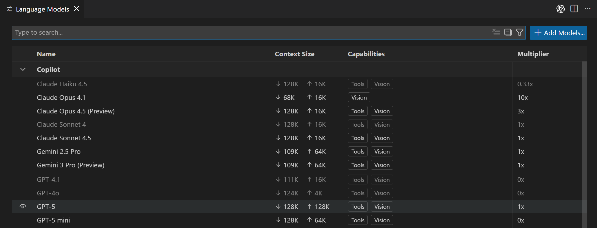

　　编辑器列出所有对你可用的模型，显示模型能力、上下文大小、计费详情和可见性状态等关键信息。默认按提供商分组，也可以按可见性分组。

　　可以使用以下选项搜索和筛选模型：

* 使用搜索框进行文本搜索。
* 提供商：`@provider:"OpenAI"`
* 能力：`@capability:tools`、`@capability:vision`、`@capability:agent`
* 可见性：`@visible:true/false`

### 自定义模型选择器 {#customize-the-model-picker}

　　可以通过更改语言模型编辑器中模型的可见性状态，自定义模型选择器中显示哪些模型。可以显示或隐藏任何提供商的模型。

　　将鼠标悬停在列表中的模型上，选择眼睛图标，即可在模型选择器中显示或隐藏该模型。

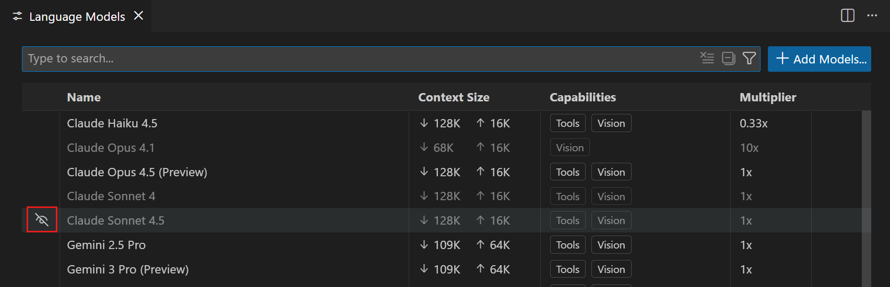

### 固定收藏的模型 {#pin-favorite-models}

　　固定模型可将其保持在模型选择器顶部的固定位置。固定的模型会显示在专门的 **已固定** 部分，不会在你使用其他模型时移动。

要固定或取消固定模型：

1. 在聊天输入框中打开模型选择器。

2. 将鼠标悬停在模型上，选择固定图标，将其添加到 **已固定** 部分。

3. 要取消固定，请在 **已固定** 部分将鼠标悬停在该模型上，选择取消固定图标。

## 自带语言模型密钥 {#bring-your-own-language-model-key}

　　自带密钥（Bring Your Own Key，BYOK）让你连接任何兼容的模型提供商，同时继续使用 VS Code 聊天体验和工具。可以使用 BYOK 访问其他提供商的模型、在本地运行模型，或使用尚未作为 VS Code 内置选项提供的模型。

　　在 [Local 运行框架会话](../2.3.2-ChooseAnAgentHarness/#local)中，BYOK 模型无需登录 GitHub 账户，也无需 Copilot 套餐即可使用。这样你就可以用自己的模型使用 AI 聊天功能，包括使用 Ollama 等本地模型的离线场景。

> **注意**：要在聊天视图或智能体窗口的 Copilot 运行框架会话中使用受支持的 BYOK 模型，请启用 `chat.agentHost.byokModels.enabled`。有关登录要求，请参阅[智能体窗口账户和提供商凭据](../../work-with-ai/2.2.9-ConfigureTheAgentsWindow/#manage-ai-providers-and-accounts)。

　　如果要改为将提供商凭据用于 Anthropic Claude 或 OpenAI Codex 运行框架，请遵循该[运行框架的设置要求](../2.3.2-ChooseAnAgentHarness/#requirements-and-setup)。在此处添加模型不会为每个运行框架配置身份验证。

　　你还可以使用这些模型[覆盖 VS Code 中实用任务使用的模型](#configure-models-for-other-features)（例如标题生成和意图检测）。

> **注意**：某些功能仍需要 GitHub 账户：语义搜索、内联建议（代码补全）以及依赖嵌入的功能。BYOK 仅适用于聊天体验和实用任务。

　　VS Code 提供不同的选项来添加更多语言模型：

* [内置提供商](#add-a-model-from-a-built-in-provider)：所需的提供商已经列出（Azure、Anthropic、Gemini、OpenAI 等）。
* [扩展](#add-a-model-provider-extension)：Marketplace 扩展提供模型，例如用于本地模型的 AI Toolkit。
* [自定义终结点](#add-a-custom-endpoint-model)：你有一个支持 Chat Completions、Responses 或 Messages API 的自托管、企业或其他终结点。

> **注意**：如果你是 Copilot Business 或 Enterprise 用户，管理员可以在 GitHub.com 的 [Copilot 策略设置](https://github.com/settings/copilot/features)中禁用 **在 Visual Studio Code 中自带语言模型密钥** 策略。更多详情请参阅 [GitHub Copilot 文档](https://docs.github.com/en/copilot/how-tos/administer-copilot/manage-for-enterprise/use-your-own-api-keys)。

### 从内置提供商添加模型 {#add-a-model-from-a-built-in-provider}

　　从一组在 VS Code 中可直接使用的常见提供商中选择。根据提供商不同，你需要 API 密钥以及终结点 URL 等其他配置细节。

> **重要**：内置 Ollama 提供商已弃用。对于本地 Ollama 模型，请改为从 [Visual Studio Marketplace 上的 Ollama 发布者](https://marketplace.visualstudio.com/publishers/Ollama)安装官方 Ollama 扩展。该扩展由 Ollama 团队维护，因此比内置提供商更快支持新的 Ollama 模型和能力。如果你的 BYOK 本地模型使用内置 Ollama 提供商，请安装该扩展并移除内置提供商配置，以便不中断地继续使用 Ollama 模型。

要配置来自内置提供商的语言模型：

1. 从语言模型选择器中选择 **管理语言模型**（齿轮图标），或通过命令面板中的 **Chat: Manage Language Models** 命令打开语言模型编辑器。

2. 选择 **添加模型**，然后从列表中选择模型提供商。

    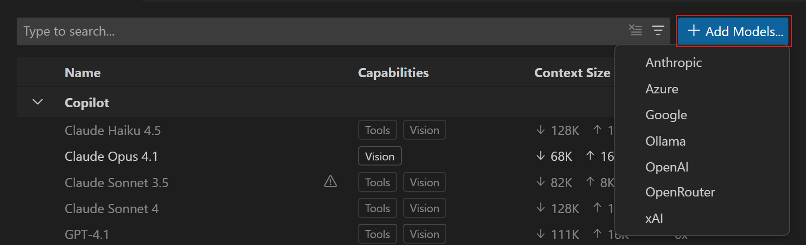

3. 输入模型的组名称。这是模型选择器和语言模型编辑器中显示的分组标签。之后可以在语言模型编辑器中更改组名称。

4. 输入提供商特定的详细信息，例如 API 密钥或终结点 URL。

5. 如果提供商需要额外配置，VS Code 会打开 `chatLanguageModels.json` 文件，你可以在其中配置提供商和模型详细信息。有关配置属性的详细信息，请参阅[模型配置参考](#model-configuration-reference)。

    以下示例展示使用 Entra ID 身份验证的 Azure OpenAI 配置：

    ```json
    [
      {
        "name": "Azure",
        "vendor": "azure",
        "models": [
          {
            "id": "<my-deployment-name>",
            "name": "GPT-5.5",
            "url": "https://<my-endpoint>.openai.azure.com",
            "toolCalling": true,
            "vision": true,
            "maxInputTokens": 200000,
            "maxOutputTokens": 64000
          }
        ]
      }
    ]
    ```

6. 配置模型后，可以在聊天的模型选择器中选择它。

    要让模型在使用聊天中的智能体时可用，它必须支持工具调用。如果模型不支持工具调用，它不会显示在模型选择器中。

### 添加模型提供商扩展 {#add-a-model-provider-extension}

　　可以从 Visual Studio Marketplace 安装为 VS Code 添加语言模型提供商的扩展。这些扩展可以提供对额外云端托管或本地运行模型的访问。例如，Visual Studio Code 的 Foundry Toolkit 扩展提供对 Foundry 的本地和云端托管模型的访问。

要添加模型提供商扩展：

1. 从语言模型选择器中选择 **管理语言模型**（齿轮图标），或通过命令面板中的 **Chat: Manage Language Models** 命令打开语言模型编辑器。

2. 选择 **安装模型提供商**。VS Code 会打开扩展视图，并筛选出语言模型提供商扩展。也可以打开扩展视图，搜索 `@tag:language-models`。

3. 选择 **安装** 安装扩展，例如[用于 Visual Studio Code 的 Foundry Toolkit](https://aka.ms/AIToolkit)。

4. 按照扩展的设置说明配置模型访问。

5. 扩展的模型会出现在聊天的模型选择器和语言模型编辑器中。如果模型没有出现，请重新加载 VS Code。

### 添加自定义终结点模型 {#add-a-custom-endpoint-model}

> **注意**：它取代了已弃用的 OpenAI Compatible 提供商，并支持额外的 API 类型。`github.copilot.chat.customOAIModels` 设置已弃用。

　　自定义终结点提供商允许你将任何兼容的 API 终结点连接到 VS Code 中的聊天。它支持三种 API 类型，可以按提供商或按模型选择：Chat Completions、Responses 和 Anthropic Messages API。因此它非常适合自托管模型、企业网关以及尚未作为内置提供商提供的提供商。

要使用自定义终结点提供商添加模型：

1. 从语言模型选择器中选择 **管理语言模型**（齿轮图标），或通过命令面板中的 **Chat: Manage Language Models** 命令打开语言模型编辑器。

2. 选择 **添加模型**，然后从列表中选择 **自定义终结点**。

3. 输入模型的组名称。这是模型选择器和语言模型编辑器中显示的分组标签。之后可以在语言模型编辑器中更改。

4. 输入终结点的显示名称和 API 密钥。

5. 选择 API 类型：**Chat Completions**、**Responses** 或 **Messages**。确保模型支持该 API 类型。

6. VS Code 会打开 `chatLanguageModels.json` 文件，你可以在其中配置模型详细信息。更新模型属性并保存文件。有关配置属性的详细信息，请参阅[自定义终结点配置参考](#custom-endpoint-configuration-reference)。

    以下示例展示 Anthropic 终结点的 Messages API 配置：

    ```json
    [
      {
        "name": "Anthropic",
        "vendor": "customendpoint",
        "apiKey": "${input:anthropicApiKey}",
        "apiType": "messages",
        "models": [
          {
            "id": "claude-sonnet-4-6",
            "name": "Claude Sonnet 4.6",
            "url": "https://api.anthropic.com/v1/messages",
            "toolCalling": true,
            "vision": true,
            "maxInputTokens": 200000,
            "maxOutputTokens": 64000
          }
        ]
      }
    ]
    ```

7. 配置模型后，在聊天的模型选择器中选择它。

    > **提示**：如果你添加的模型没有立即出现在模型选择器中，请重新启动 VS Code。

#### 自定义终结点配置参考 {#custom-endpoint-configuration-reference}

　　自定义终结点提供商支持所有[通用模型配置属性](#model-configuration-reference)，以及本节描述的额外提供商级和模型级属性。提供商级属性设置在提供商对象上，模型级属性设置在 `models` 数组的每个条目上。当同一属性在两个级别都设置时，模型级值优先。

提供商级属性（除[通用提供商属性](#model-configuration-reference)外）：

| 属性 | 说明 |
|----------|-------------|
| `vendor` | 使用自定义终结点提供商时必须为 `customendpoint`。 |
| `apiKey` | 用于对请求进行身份验证的 API 密钥。请使用输入变量安全存储密钥，例如 `"apiKey": "${input:myApiKey}"`，不要提交原始密钥。 |
| `apiType` | _（可选）_ 提供商中所有模型的默认 API 类型：`chat-completions`（默认）、`responses` 或 `messages`。可以使用模型级 `apiType` 覆盖。 |
| `url` | _（可选）_ 用于自动发现模型的基础 URL。设置后，VS Code 会查询终结点获取可用模型列表，而不是使用 `models` 数组。省略它则通过 `models` 数组显式配置模型。 |

除[通用模型属性](#model-configuration-reference)外，自定义终结点提供商还支持以下模型级属性：

| 属性 | 说明 |
|----------|-------------|
| `apiType` | _（可选）_ 覆盖此模型的 API 类型（`chat-completions`、`responses` 或 `messages`）。默认为提供商级 `apiType`，两者都未设置时根据 `url` 推断。 |
| `contextWindow` | _（可选）_ 模型的完整上下文窗口（输入 + 输出），以令牌为单位，例如 1M 令牌模型为 `1000000`。设置后可以省略 `maxInputTokens`，VS Code 会将其计算为 `contextWindow - maxOutputTokens`。 |
| `modelOptions` | _（可选）_ 随每次模型请求发送的请求参数对象，例如 `temperature` 和 `top_p`。例如 `"modelOptions": { "temperature": 0.2 }`。 |
| `requestHeaders` | _（可选）_ 随此模型请求发送的额外 HTTP 标头对象，例如用于通过网关或自定义域进行身份验证。请参阅[自定义身份验证标头](#custom-authentication-headers)。 |
| `statefulResponses` | _（可选）_ Responses API 服务器是否保留先前响应。默认为 `true`。对于无状态服务器，设置为 `false`，以便每次请求发送完整对话历史。仅适用于 Responses API。请参阅[有状态 Responses API 终结点](#stateful-responses-api-endpoints)。 |

##### 终结点 URL 解析 {#endpoint-url-resolution}

　　为模型提供的 `url` 会根据其 API 类型解析：

* 如果 URL 已包含显式 API 路径（`/chat/completions`、`/responses` 或 `/messages`），则按原样使用。
* 否则，VS Code 会追加模型 API 类型的路径。如果 URL 尚未以 `/v1` 等版本段结尾，VS Code 会先插入 `/v1`。例如，使用 Responses API 类型时，`https://my-host.example.com` 解析为 `https://my-host.example.com/v1/responses`。

　　为避免歧义，请提供包含 API 路径的完整终结点 URL，如示例所示。

##### 有状态 Responses API 终结点 {#stateful-responses-api-endpoints}

　　Responses API 模型默认使用 `statefulResponses: true`，仅使用 `previous_response_id` 发送新历史。对于无状态服务器，请将 `statefulResponses` 设置为 `false`，以省略该 ID 并发送完整历史（包括工具调用和结果），避免缺少工具调用的错误。

　　对于无状态服务器，请在其 `chatLanguageModels.json` 模型条目中添加以下属性：

```json
{
  "apiType": "responses",
  "statefulResponses": false
}
```

　　该选项描述服务器的能力，不会更改其数据保留策略。当 `zeroDataRetentionEnabled` 为 `true` 时，`statefulResponses` 会被忽略，请求会发送完整对话历史，而不包含 `previous_response_id`。

##### 自定义身份验证标头 {#custom-authentication-headers}

　　默认情况下，自定义终结点提供商会根据 API 类型和 URL 推断身份验证标头。对于 Messages API，它发送 `x-api-key`；对于 Azure OpenAI URL，它发送 `api-key`；否则发送 `Authorization: Bearer <apiKey>`。

　　可以使用 `requestHeaders` 覆盖身份验证标头。当你提供已知的身份验证标头（例如 `Authorization`、`api-key`、`x-api-key`、`x-goog-api-key` 或 `apikey`）时，VS Code 不会再发送默认推断的身份验证标头，因此终结点不会收到冲突的凭据。

　　要将 API 密钥保留在机密存储中，同时在自定义标头中使用它，请在标头值中使用 `${apiKey}` 令牌。VS Code 会在请求时将其替换为配置的 `apiKey`：

```json
[
  {
    "name": "Gateway",
    "vendor": "customendpoint",
    "apiKey": "${input:myApiKey}",
    "models": [
      {
        "id": "my-model",
        "name": "My Model",
        "url": "https://gateway.example.com/v1/chat/completions",
        "toolCalling": true,
        "vision": false,
        "maxInputTokens": 128000,
        "maxOutputTokens": 16000,
        "thinking": true,
        "supportsReasoningEffort": ["low", "medium", "high"],
        "reasoningEffortFormat": "chat-completions",
        "modelOptions": {
          "temperature": 0.2,
          "top_p": 0.9
        },
        "requestHeaders": {
          "Authorization": "Bearer ${apiKey}",
          "Ocp-Apim-Subscription-Key": "my-subscription-key"
        }
      }
    ]
  }
]
```

## 更新模型提供商详细信息 {#update-model-provider-details}

要更新之前配置的模型提供商的详细信息：

1. 在聊天视图中从语言模型选择器选择 **管理语言模型**（齿轮图标），或从命令面板运行 **Chat: Manage Language Models** 命令。

2. 在语言模型编辑器中，选择要更新的模型提供商旁的齿轮图标。

   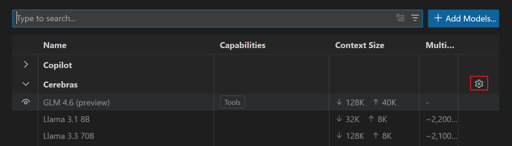

3. 更新提供商详细信息，例如 API 密钥或终结点 URL。

## 为其他功能配置模型 {#configure-models-for-other-features}

　　除了主聊天模型，还可以配置内联聊天、内联建议、语音模式和后台实用任务使用哪个模型。

### 更改内联聊天的模型 {#change-the-model-for-inline-chat}

　　可以为编辑器内联聊天配置默认语言模型。这样可以对内联聊天使用与聊天对话不同的模型。

　　要配置内联聊天的默认模型，请使用 `inlineChat.defaultModel` 设置。该设置列出模型选择器中的所有可用模型。

　　如果在内联聊天会话期间更改模型，选择会在该会话剩余时间内保持有效。重新加载 VS Code 后，模型会重置为 `inlineChat.defaultModel` 设置中指定的值。

### 更改内联建议的模型 {#change-the-model-for-inline-suggestions}

要更改用于生成编辑器中内联建议的语言模型：

1. 在 VS Code 标题栏的 **聊天** 菜单中选择 **配置内联建议...**。

2. 选择 **更改补全模型...**，然后从列表中选择一个模型。

> **注意**：可用模型列表可能随时间变化。如果没有其他可用模型，更改模型的选项将不可用。
>
> 如果你是 Copilot Business 或 Enterprise 用户，管理员需要在 GitHub.com 的 [Copilot 策略设置](https://docs.github.com/en/enterprise-cloud@latest/copilot/managing-copilot/managing-github-copilot-in-your-organization/managing-policies-for-copilot-in-your-organization#enabling-copilot-features-in-your-organization)中选择启用 `Editor Preview Features`，为组织启用特定模型。

### 更改语音模式的模型 {#change-the-model-for-voice-mode}

　　要使用 OpenAI Live 模型进行语音智能体对话，请[使用自己的 OpenAI 密钥配置语音模式](../../../editor/3.3-ConfigureTheEditor/3.3.9-Accessibility/3.3.9.2-Voice/#use-your-own-openai-key)。语音模型负责语音对话，与聊天中为编码任务选择的模型相互独立。

### 更改实用任务的模型 {#change-the-model-for-utility-tasks}

　　除主聊天模型外，VS Code 还会在后台使用轻量模型执行实用任务，例如生成标题、创建提交消息和拉取请求描述，以及检测意图。你为聊天或智能体会话选择的模型不会控制这些实用任务。默认情况下，这些任务使用 GitHub Copilot 提供的内置实用模型。你可以使用任何可用模型覆盖这些任务使用的模型，包括 [BYOK](#bring-your-own-language-model-key) 和扩展提供的模型。

　　实用模型有两个设置，具体取决于任务类型：

* `chat.utilityModel`：覆盖一般实用流程使用的模型，例如生成标题和摘要、设置搜索和 Git 审查。
* `chat.utilitySmallModel`：覆盖快速、轻量实用流程使用的模型，例如提交消息、拉取请求标题和描述、重命名建议、分支名称生成、提示词分类和意图检测。此设置建议使用快速且低成本的模型。

　　两个设置默认均为 **默认**，即使用 GitHub Copilot 的内置实用模型。

　　如果在不登录 GitHub 账户的情况下使用 BYOK 模型，内置实用模型不可用。VS Code 会在聊天视图中显示通知，提示你配置实用模型。将 `chat.utilityModel` 和 `chat.utilitySmallModel` 设置为 BYOK 模型，以启用标题生成、提交消息创建和拉取请求描述创建等实用功能。

#### 为 BYOK 模型配置默认实用模型 {#configure-the-default-utility-model-for-byok-models}

　　当你选择 [BYOK](#bring-your-own-language-model-key) 模型作为主智能体模型时，使用 `chat.byokUtilityModelDefault` 设置控制内置实用流程默认使用哪个模型。该设置接受以下值：

* **None**：不使用默认实用模型。
* **Main Agent Model**：为实用流程使用所选的 BYOK 主智能体模型。
* **GitHub Copilot**：使用默认的 GitHub Copilot 实用模型。

> **注意**：默认情况下，当 Copilot 令牌可用时，实用流程使用 GitHub Copilot 实用模型。如果无法获得 Copilot 令牌，请配置 `chat.utilityModel` 和 `chat.utilitySmallModel`，或选择 **Main Agent Model**，以启用实用功能。

　　当主智能体模型由 GitHub Copilot 提供时，此设置无效。在 `chat.utilityModel` 或 `chat.utilitySmallModel` 中配置的特定模型优先于此默认值。

## 模型配置参考 {#model-configuration-reference}

　　添加 BYOK 模型时，可以在 `chatLanguageModels.json` 文件中配置模型属性。配置分为两个级别：提供商级和模型级。

　　根据提供商不同，某些提供商和模型属性可能是必需的，其他则是可选的。例如，某些提供商只需要 API 密钥和终结点 URL，并会自动发现可用模型，而其他提供商则需要你指定每个模型的详细信息。

提供商级属性包括：

| 属性 | 说明 |
|----------|-------------|
| `vendor` | 模型提供商，例如 `azure`、`openai`、`customendpoint`。 |
| `name` | UI 中显示的提供商显示名称（组名称）。 |
| `models` | _（可选）_ 此提供商提供的模型配置数组。 |

`models` 数组中的每个模型支持以下属性：

| 属性 | 说明 |
|----------|-------------|
| `id` | 发送给 API 的模型标识符。例如，对于 Foundry，这是部署名称。 |
| `name` | 模型选择器中显示的显示名称。 |
| `url` | 模型的完整终结点 URL。 |
| `apiType` | _（可选）_ 按模型覆盖 API 类型（`chat-completions`、`responses` 或 `messages`）。默认为提供商级 `apiType`。 |
| `toolCalling` | 如果模型支持工具调用，请设置为 `true`。 |
| `vision` | 如果模型支持图像输入，请设置为 `true`。 |
| `maxInputTokens` | 模型接受的最大输入令牌数。与 `maxOutputTokens` 一起定义模型的上下文窗口。 |
| `maxOutputTokens` | 模型生成的最大输出令牌数。与 `maxInputTokens` 一起定义模型的上下文窗口。 |
| `editTools` | _（可选）_ 模型支持的编辑工具数组。如果未配置，编辑器会尝试多个编辑工具并选择最佳工具。可能的值为 `find-replace`、`multi-find-replace`、`apply-patch` 和 `code-rewrite`。 |
| `thinking` | _（可选）_ 如果模型支持思考能力，请设置为 `true`。默认为 `false`。 |
| `streaming` | _（可选）_ 如果模型支持流式响应，请设置为 `true`。默认为 `true`。 |
| `zeroDataRetentionEnabled` | _（可选）_ 如果此终结点启用了零数据保留（ZDR），请设置为 `true`。启用后，通过 Responses API 的请求不会发送 `previous_response_id`。默认为 `false`。 |
| `supportsReasoningEffort` | _（可选）_ 模型接受的推理努力级别数组（例如 `["low", "medium", "high"]`）。设置后，模型选择器中会显示 **思考强度** 选择器。常见级别为 `minimal`、`low`、`medium`、`high`。 |
| `reasoningEffortFormat` | _（可选）_ 用于将推理努力转发给模型的正文形状。`chat-completions` 发送顶层 `reasoning_effort` 字符串，`responses` 发送嵌套的 `reasoning.effort` 对象，`messages` 发送 `output_config.effort`。未设置时，格式根据 URL 推断。 |
| `requestHeaders` | _（可选）_ 随对此模型的请求发送的额外 HTTP 标头对象。某些保留标头（禁止、转发和内部标头）不允许使用，如果存在会被忽略。 |

> **注意**：`maxInputTokens` 和 `maxOutputTokens` 的总和不得超过模型的上下文窗口。VS Code 使用这两个值的总和作为模型的总上下文窗口，例如在聊天视图中显示上下文使用量。通常，将 `maxInputTokens` 设置为模型的上下文窗口大小减去 `maxOutputTokens`。请查看提供商模型文档中的上下文窗口大小。

## 常见问题 {#frequently-asked-questions}

### 如何为 Copilot Business 或 Copilot Enterprise 启用自带模型密钥？ {#how-do-i-enable-bring-your-own-model-key-for-copilot-business-or-copilot-enterprise}

　　如果你是 Copilot Business 或 Enterprise 用户，组织管理员必须在 GitHub.com 的 [Copilot 策略设置](https://github.com/settings/copilot/features)中启用 **在 Visual Studio Code 中自带语言模型密钥** 策略。策略启用后，你可以像个人套餐用户一样使用自己的 API 密钥添加模型。更多详情请参阅 [GitHub Copilot 文档](https://docs.github.com/en/copilot/how-tos/administer-copilot/manage-for-enterprise/use-your-own-api-keys)。

### 可以在 VS Code 中将本地托管的模型与 Copilot 一起使用吗？ {#can-i-use-locally-hosted-models-with-copilot-in-vs-code}

　　在聊天中使用本地托管的模型有两种选择：

* **BYOK 本地模型**：使用[自带模型密钥](#bring-your-own-language-model-key)（BYOK）连接支持本地模型的模型提供商。可以使用支持本地模型的内置提供商，或安装 [Visual Studio Marketplace](https://marketplace.visualstudio.com/search?term=tag%3Alanguage-models&target=VSCode&category=All%20categories&sortBy=Relevance)中的扩展，例如[带有 Foundry Local 的 Visual Studio Code AI Toolkit](https://aka.ms/AIToolkit)。BYOK 本地模型无需 GitHub 账户、Copilot 套餐或 Internet 连接即可工作。
* **设备上模型（实验性）**：使用在受支持的 NVIDIA 硬件上运行的 [Copilot 托管模型](#use-on-device-models-experimental)。设备上模型需要 GitHub 登录。

　　要使用 BYOK 本地模型获得完整的实用功能集（例如标题生成和提交消息），请将 `chat.utilityModel` 和 `chat.utilitySmallModel` 设置为指向本地模型。

　　目前无法为内联建议连接本地模型。VS Code 提供扩展 API [`InlineCompletionItemProvider`](https://code.visualstudio.com/api/references/vscode-api#InlineCompletionItemProvider)，使扩展可以提供自定义补全提供程序。你可以从[内联补全示例](https://github.com/microsoft/vscode-extension-samples/blob/main/inline-completions)开始。

> **注意**：某些功能需要 GitHub 账户和 Internet 连接：语义搜索、内联建议（代码补全）以及依赖嵌入的功能。这些功能无法通过 BYOK 模型使用。

### 可以在没有 Internet 连接的情况下使用本地模型吗？ {#can-i-use-a-local-model-without-an-internet-connection}

　　可以，你可以完全离线使用 BYOK 本地模型。使用 **Chat: Manage Language Models** 命令添加 Ollama 等本地模型提供商，在聊天中选择该模型并开始使用。要同时启用标题生成和提交消息等实用功能，请将 `chat.utilityModel` 和 `chat.utilitySmallModel` 设置为本地模型。依赖 GitHub Copilot 服务的功能（例如语义搜索、内联建议和嵌入）无法离线使用。

### 可以在没有 Copilot 套餐的情况下使用本地模型吗？ {#can-i-use-a-local-model-without-a-copilot-plan}

　　可以，你可以在没有 Copilot 套餐且不登录 GitHub 账户的情况下使用 BYOK 模型，包括本地模型。使用 **Chat: Manage Language Models** 命令添加模型，并在聊天中选择它。依赖 GitHub Copilot 服务的功能（例如语义搜索、内联建议和嵌入）需要 Copilot 套餐。

## 相关资源 {#related-resources}

* [语言模型概念](../../concepts/2.7.2-HowModelsWork/)
* [GitHub Copilot 中可用的语言模型](https://docs.github.com/en/copilot/using-github-copilot/ai-models/changing-the-ai-model-for-copilot-chat?tool=vscode)
* [为任务选择合适的 AI 模型](https://docs.github.com/en/copilot/using-github-copilot/ai-models/choosing-the-right-ai-model-for-your-task)
* [VS Code 中 AI 的安全注意事项](../../work-with-ai/permissions-and-security/2.2.12.3-AISecurity/)
