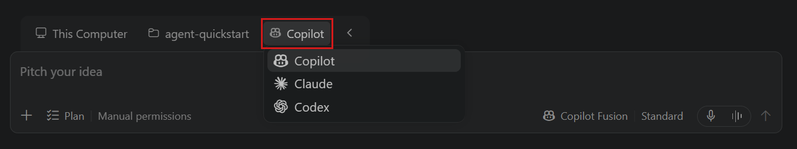

+++
title = "2.3.2 选择智能体运行框架"
date = 2026-11-06T07:53:25+08:00
weight = 2
type = "docs"
description = ""
isCJKLanguage = true
draft = false
+++


> 原文链接: [https://code.visualstudio.com/docs/agents/run/agent-harnesses](https://code.visualstudio.com/docs/agents/run/agent-harnesses)

# 2.3.2 选择智能体运行框架

　　VS Code 支持多种智能体运行框架，每种都有自己的工具、自定义项和工作流。智能体运行框架协调语言模型、上下文和智能体完成任务所用的工具。

　　本指南比较可用选项，说明如何识别会话使用的运行框架，如何选择运行框架或云执行目标，并列出设置要求。

　　关于运行框架如何工作以及它们与模型、主机的区别，请参阅[智能体运行框架概念](../../concepts/2.7.6-AgentHarnesses/)。

　　如果已在使用 Local 运行框架，请按照[从 Local 迁移到 Copilot](../2.3.3-MoveFromLocalToCopilot/)继续工作、检查兼容性并验证组织控制。

## 比较智能体运行框架 {#compare-agent-harnesses}

　　日常编码和智能体任务请从 Copilot 运行框架开始。需要不同工具、自定义项或执行工作流时，再选择其他运行框架或云目标。

| 运行框架 | 运行内容 | 对你的工作意味着什么 |
|----------------|-----------|-------------------------------|
| **Copilot** | 使用 GitHub Copilot SDK 运行任务；该 SDK 在 GitHub Copilot 产品中提供共享智能体体验。智能体在 Agent Host 中工作。 | 会话独立于编辑器窗口运行，关闭编辑器后仍可在后台继续，前提是 Agent Host 保持运行。也可以在受支持的界面之间继续会话。请参阅 [Copilot 要求](#copilot)。 |
| **Local** | 在 VS Code 内置智能体运行框架中运行任务。智能体在 VS Code 的扩展宿主中工作。 | 智能体通过聊天迭代，在当前工作区中交互式实现更改。会话与编辑器窗口绑定：关闭窗口会停止智能体正在执行的工作。请参阅 [Local 要求](#local)。 |
| **Claude** | Anthropic Claude Agent SDK 集成到 VS Code 中。 | 会话在当前工作区或隔离工作树中使用 Claude 项目配置和提供商工作流。请参阅 [Claude 要求](#claude)。 |
| **Codex** | OpenAI Codex 通过 OpenAI Codex 扩展或实验性 Agent Host 集成运行。 | 会话支持交互式或后台编码。可用界面取决于集成方式。请参阅 [Codex 要求](#codex)。 |
| **Cloud** | Copilot 运行框架在受管理的云环境中运行。Cloud 是执行目标，不是单独的运行框架。 | 使用交互式[云会话](../../work-across-apps-and-machines/2.5.3-CloudSessions/)，无需保持自己的计算机在线即可重新连接继续工作。云工作使用单独的工作区，而不是本地编辑器状态。请参阅 [Cloud 目标要求](#cloud-target)。 |

　　对于由桌面版 VS Code 在你的计算机上管理的 Agent Host 会话，请保持应用程序运行。关闭编辑器窗口与退出应用程序不同。窗口提供的工具也要求该窗口保持连接。

　　更改模型或智能体角色不会更改运行框架。例如，在 Copilot 运行框架会话中选择 Claude 模型仍使用 Copilot 运行框架。在其他受支持界面中打开同一会话也会保留其运行框架。

　　一个会话可以通过[混合运行框架聊天](../../work-with-ai/sessions/2.2.11.1-ManageSessions/#use-different-harnesses-in-a-session)对使用不同运行框架的聊天进行分组。这会使用所选运行框架启动单独对话，而不是交接现有对话。

　　**Local** 是运行框架名称，不是在本机运行的代名词。Copilot、Claude 和 Codex 运行框架也可以在你的计算机上运行。

　　可用模型取决于运行框架以及你[访问模型](../2.3.1-ChooseAndConfigureModels/#choose-how-to-access-models)的方式，例如通过 GitHub Copilot 订阅、其他受支持账户或自己的 API 密钥。运行框架特定的自定义项（包括[钩子](../../customize-and-extend/2.4.9-Hooks/#choose-the-hook-implementation-for-your-session)）遵循所选运行框架。

> **注意**：当 [GitHub Copilot 企业托管设置生效](../../../enterprise/7.2-ManageAISettings/#claude-and-codex-availability)时，包括托管的权限或沙盒设置，Claude 和 Codex 运行框架会被禁用。请联系部署设置的 IT 团队讨论访问权限。如果不知道负责人，请让 IT 服务台找到负责的管理员。

## 选择运行框架 {#select-a-harness}

　　提交会话的第一条提示词之前，请选择运行框架：

1. [打开聊天视图](../../work-with-ai/2.2.2-ChatView/)或[打开智能体窗口](../../work-with-ai/2.2.3-AgentsWindow/)。
2. 在聊天视图中选择 **新建聊天**（`+`），或在智能体窗口中选择 **新建**。
3. 在智能体窗口中，选择会话的文件夹或 GitHub 仓库。
4. 打开 **会话目标** 控件，选择可用的运行框架或 Cloud 目标。

    

　　该控件只列出当前窗口满足其[要求](#requirements-and-setup)的目标。

### 选择内置智能体 {#choose-a-built-in-agent}

　　选择运行框架后，从智能体选择器中选择可用的内置智能体。可用内置智能体取决于运行框架：

| 运行框架 | 内置智能体 |
|---------|----------------|
| **Copilot** | <ul><li>**Ask** 在不更改代码的情况下回答问题并研究代码库。它只使用只读工具，不能编辑文件或运行会改变状态的命令。</li><li>**Agent** 实现更改并验证结果。</li><li>**[Plan](../../work-with-ai/plan-and-run-tasks/2.2.10.1-PlanWork/)** 研究任务并创建供你审查的实现计划。使用 `/plan` 调用。</li></ul> |
| **Local** | <ul><li>**Ask** 在不更改代码的情况下回答问题。</li><li>**Agent** 实现更改并验证结果。</li><li>**Plan** 研究任务并创建供你审查的实现计划。</li></ul> |

　　切换智能体不会更改运行框架。也可以从同一选择器中选择[自定义智能体](../../customize-and-extend/2.4.5-CustomAgents/)。在 Copilot 运行框架中，[Autopilot](../../work-with-ai/permissions-and-security/2.2.12.1-ApprovalsAndPermissions/#how-autopilot-works) 是一种具有自己工作流的模式，不是额外的内置智能体。

　　运行框架选择与会话更改代码的位置相互独立。在智能体窗口中，还可以[在文件夹和工作树之间选择](../../work-with-ai/2.2.3-AgentsWindow/#choose-where-an-agent-makes-changes)，或[在 Dev Container 中运行会话](../../work-with-ai/2.2.3-AgentsWindow/#run-a-session-in-a-dev-container)。

### 识别当前运行框架 {#identify-your-current-harness}

要识别聊天会话的当前运行框架，请使用以下任一方法：

* 在编辑器窗口中，活动运行框架显示为聊天标题的前缀。
* 在智能体窗口中，聊天输入框将活动运行框架显示为水印。
* 在智能体窗口中，将鼠标悬停在会话列表中的会话条目上，查看显示运行框架的工具提示。

　　对于使用与父会话不同运行框架的嵌套聊天，请将鼠标悬停在其聊天选项卡或会话列表条目上，查看聊天运行框架。

## 要求和设置 {#requirements-and-setup}

　　检查所选运行框架或 Cloud 目标所需的账户、扩展和设置。如果某个选项未出现在 **会话目标** 控件中，请先查看下面的要求。

　　运行框架和模型访问是分开的选择。通过 GitHub Copilot 使用提供商模型，与使用该提供商自己的凭据不同。你选择的访问选项决定适用哪个账户的使用限制和计费。

如果从现有账户或密钥开始：

* **GitHub Copilot 访问**：从 [Copilot 运行框架](#copilot)开始。Anthropic Claude 和 OpenAI Codex 集成本身也提供由 Copilot 路由的模型，但须满足其要求。
* **Anthropic Claude 凭据**：遵循 [Claude 身份验证选项](#claude)。
* **ChatGPT 账户**：按照所选集成遵循 [Codex 设置](#codex)。
* **其他模型 API 密钥或本地模型**：为 Local 会话或受支持的实验性 Copilot 运行框架工作流[配置模型提供商](../2.3.1-ChooseAndConfigureModels/#bring-your-own-language-model-key)。

　　通过提供商自己的凭据访问时，适用该提供商的使用限制、计费和数据处理条款。即使拥有单独凭据，组织策略也可能限制可用途径。

### Copilot {#copilot}

　　要通过 GitHub Copilot 使用模型，请遵循 [Copilot 设置指南](../../getting-started/2.1.2-SetUpCopilot/)。Copilot 运行框架会话使用与 VS Code 中聊天相同的 GitHub 身份验证上下文，包括配置后的 GitHub Enterprise 账户。

　　要通过自己的凭据使用受支持的模型，请遵循[实验性 Agent Host BYOK 设置](../2.3.1-ChooseAndConfigureModels/#bring-your-own-language-model-key)。这与为 Anthropic Claude 或 OpenAI Codex 运行框架配置提供商原生身份验证相互独立。

　　对于 GHE.com 上的托管用户账户，请完成[在 GHE.com 上使用 GitHub Copilot 账户](https://docs.github.com/en/copilot/managing-copilot/configure-personal-settings/using-github-copilot-with-an-account-on-ghecom)中的设置。

　　在复用 Local 运行框架会话的配置之前，请检查[工具可用性](../../work-with-ai/plan-and-run-tasks/2.2.10.2-UseTools/#manage-tool-availability-for-the-copilot-harness)和 [MCP 配置兼容性](../../reference-and-help/reference/2.8.1.8-MCPConfiguration/#configuration-file)。Copilot 运行框架会话无法访问所有内置或扩展提供的工具。共享 SDK 运行时也不意味着不同产品中的工具、模型、权限或自定义项完全相同，也不意味着所有会话和个人设置都会同步。

　　企业 SDK 策略钩子要求请参阅[企业钩子配置](../../../enterprise/7.2-ManageAISettings/#enable-or-disable-hooks)。

　　要让本地 Copilot 会话与 macOS 或 Windows 桌面应用交互，请参阅[计算机使用（实验性）](../../work-with-ai/plan-and-run-tasks/2.2.10.2-UseTools/#control-desktop-applications-experimental)。

### Claude {#claude}

　　除非[企业托管设置禁用该运行框架](../../../enterprise/7.2-ManageAISettings/#claude-and-codex-availability)，否则默认启用 Claude 支持。组织策略允许时，使用 `chat.agentHost.claudeAgent.enabled`（实验性）打开或关闭支持。

要使用 Claude，请配置以下身份验证和计费选项之一：

* **GitHub Copilot 订阅**：登录 GitHub 使用 Copilot 路由的模型。用量通过 Copilot 订阅计费。
* **自带密钥（BYOK）**：使用 Claude API 密钥或其他受支持的 Claude BYOK 选项。用量由配置的提供商计费。

　　两个选项都可用时，模型选择器按 **Anthropic** 和 **Copilot** 对模型分组。所选模型决定下一轮使用的提供商和计费方式。可以在现有 Claude 运行框架会话中切换 BYOK 模型和 Copilot 路由模型。

要在不登录 GitHub 的情况下使用 Claude（实验性），请配置 Claude API 密钥或其他受支持的 Claude BYOK 选项。对于 Anthropic API 密钥，请在环境中或 `~/.claude/settings.json` 的 `env` 对象中设置 `ANTHROPIC_API_KEY`。详细了解 [Claude Code 身份验证](https://code.claude.com/docs/en/authentication)。

　　配置 BYOK 凭据后，在退出 GitHub 登录的状态下打开智能体窗口。登录之前，模型选择器只显示 Anthropic BYOK 配置中的模型。登录 GitHub 后，Copilot 路由的模型也会可用。

　　审批行为和注意事项请参阅 [Claude 权限模式](../../work-with-ai/permissions-and-security/2.2.12.1-ApprovalsAndPermissions/#claude-permission-modes)。

### Codex {#codex}

　　Codex 默认不列出。请选择以下集成之一，不需要同时使用两者。

#### 基于扩展的集成 {#extension-based-integration}

　　要在聊天视图中使用 Codex，请安装并启用 [OpenAI Codex 扩展](https://marketplace.visualstudio.com/items?itemName=openai.chatgpt)。按照扩展文档配置身份验证和权限。

#### Agent Host 集成（实验性） {#agent-host-integration-experimental}

> **注意**：当[企业托管设置生效](../../../enterprise/7.2-ManageAISettings/#claude-and-codex-availability)时，即使使用 ChatGPT 账户或将集成的用户设置设为 `true`，Codex Agent Host 集成也会被禁用。请联系部署设置的 IT 团队讨论访问权限。

　　启用 `chat.agentHost.codexAgent.enabled`，无需 OpenAI Codex 扩展即可在智能体窗口中使用 Codex。

　　如果还想在聊天视图中使用此集成，请启用 `chat.editor.codex.preferAgentHost`，并在提示时重启 VS Code。每个窗口只显示一个 Codex 实现。在 **会话目标** 控件中，此设置会替换 OpenAI 扩展提供的 **Codex** 选项。

为 Agent Host 集成选择以下访问选项之一：

* **GitHub Copilot 订阅**：登录 GitHub 使用 Copilot 支持的模型。此选项需要 Copilot Pro+。
* **ChatGPT 账户**：打开账户菜单，选择 **登录 ChatGPT**。免费 ChatGPT 账户即可。

　　两个账户都登录时，模型选择器按 **Copilot** 和 **ChatGPT** 对模型分组。你的选择决定哪个账户提供模型访问，VS Code 会将该提供商与会话一起保存。

要在不登录 GitHub 的情况下使用 OpenAI Codex（实验性），请配置 Agent Host 集成并按上述方式登录 ChatGPT。随后，智能体窗口会在退出 GitHub 登录时显示 ChatGPT 支持的模型。Copilot 支持的模型会提示登录 GitHub，基于浏览器的智能体窗口仍需要 GitHub 登录。

　　审批行为和注意事项请参阅 [Codex 审批预设](../../work-with-ai/permissions-and-security/2.2.12.1-ApprovalsAndPermissions/#codex-approval-presets)。

### Local {#local}

　　Local 运行框架会话使用 VS Code 中配置的模型。[设置 GitHub Copilot](../../getting-started/2.1.2-SetUpCopilot/)以使用 Copilot 提供的模型，或[配置自己的模型凭据](../2.3.1-ChooseAndConfigureModels/#bring-your-own-language-model-key)以使用受支持的模型。

　　在聊天视图中选择 **Local**，并在智能体工作时保持编辑器窗口打开。Local 运行框架会话使用与 Copilot 运行框架会话不同的[自定义设置](../../customize-and-extend/2.4.4-Instructions/)。

　　Local 运行框架会话不会加载 SDK 策略钩子。在复用其他运行框架的钩子之前，请检查[钩子兼容性](../../customize-and-extend/2.4.9-Hooks/#migrate-hooks-between-harnesses)。

### Cloud 目标 {#cloud-target}

　　使用云会话在受管理计算资源上与智能体进行交互式工作，之后返回同一会话，而无需保持自己的计算机在线。Cloud 是执行目标，独立于语言模型选择。

#### 云会话 {#cloud-sessions}

　　开启 `chat.agentHost.cloudSandbox.enabled` 后，新的 **Cloud** 会话使用运行 Copilot 运行时的受管理环境。在智能体窗口中，这会为新的 **Cloud** 会话取代 GitHub Actions 上的 Copilot 云智能体工作流。可以发送后续消息并重新连接会话，而无需保持自己的计算机在线。连接需要 `chat.remoteAgentHostsEnabled` 和账户的服务访问权限。

　　云环境有自己的工作区和工具。选择其他模型不会更改运行框架。启用云会话不会将本地对话或本地文件移动到云中。

　　入门请遵循[运行云会话](../../work-across-apps-and-machines/2.5.3-CloudSessions/)了解创建、继续和生命周期指导。**Cloud** 创建体验取决于设置和账户可用性。

## 使用其他运行框架继续 {#continue-with-a-different-harness}

　　交接会使用不同的运行框架或执行环境继续正在进行的任务，并携带对话历史和上下文。由于新配置提供不同能力，工具、权限和模型可能变化。

### 从 Local 运行框架会话交接 {#hand-off-from-a-local-harness-session}

　　在 Local 运行框架会话中，工作开始后可以选择其他受支持的运行框架。使用 Copilot 或 Claude 运行框架的会话，以及使用[实验性 Codex 集成](#codex)的会话可以接收这些交接，但不能交接给其他运行框架或云会话。

要交接 Local 运行框架会话：

1. 打开会话。
2. 在聊天输入框中打开 **会话目标** 下拉列表。
3. 选择 Copilot、Claude 或 Codex 继续工作。

　　VS Code 会将对话历史和上下文带到目标会话。要实施计划或在另一个受支持会话中继续计划，请参阅[使用智能体规划](../../work-with-ai/plan-and-run-tasks/2.2.10.1-PlanWork/)。

> **注意**：当[运行时策略要求 Copilot 运行框架](../../../enterprise/7.2-ManageAISettings/#runtime-policies-and-harness-selection)时，打开未归档的 Local 运行框架对话可能会自动移动它。宿主支持对话导入时，会保留历史记录和未发送输入，不提交提示词，并将原始会话归档为只读。如果无法导入，**在 Copilot 中继续** 会将记录作为上下文附加到新对话，并保留原始会话可用。这与用户发起的交接不同。请参阅[转换和历史记录指南](../2.3.3-MoveFromLocalToCopilot/#continue-an-existing-local-conversation)。

　　更改运行框架与开始另一个对话或在另一个界面中打开同一会话不同。详细了解[会话、分叉和交接](../../concepts/2.7.5-SessionsAndChats/)。

## 在 Copilot 运行框架中使用画布 {#use-canvases-with-the-copilot-harness}

　　画布是受支持的 Copilot 会话（包括智能体窗口中的远程 Agent Host 会话）中由你和智能体共享的交互式视觉表面。关于先决条件以及查找、打开和管理画布的步骤，请参阅[在智能体中使用画布](../../work-with-ai/2.2.6-Canvases/)。

## 常见问题 {#frequently-asked-questions}

### Local 和 Copilot 有什么区别？ {#what-is-the-difference-between-local-and-copilot}

　　两种运行框架都可以在你的计算机上运行。**Local** 使用 VS Code 内置的专有智能体运行框架，在 VS Code 扩展宿主中工作。**Copilot** 使用 GitHub Copilot SDK，这是 GitHub Copilot 产品中一致共享的智能体体验。

　　两种运行框架都支持工具、模型选择和智能体自定义项，但可用能力和配置不同。

Copilot 运行框架提供以下优势：

* **跨 Copilot 产品的共享运行时**：在 VS Code、GitHub Copilot CLI 和 GitHub Copilot 应用之间，核心能力和行为更一致。
* **界面和计算机之间的连续性**：可以在聊天视图、智能体窗口和其他 GitHub Copilot 界面中继续同一活动会话。也可以[从另一台计算机远程连接](../../work-across-apps-and-machines/2.5.2-RemoteAgentSessions/)，同时会话继续在其主机上运行。Local 会话仅在编辑器的聊天视图中可用。
* **独立于编辑器窗口的工作**：关闭编辑器窗口后，只要 Agent Host 继续运行，正在进行的工作就可以继续。关闭 Local 运行框架会话的编辑器窗口会停止其正在进行的工作。

### 应选择哪个运行框架？ {#which-harness-should-i-choose}

　　日常编码和智能体任务请从 **Copilot** 开始，尤其是希望在聊天视图和智能体窗口之间继续工作，或在关闭编辑器窗口后保持工作运行时。

　　如果工作流依赖 Copilot 运行框架不支持的工具或自定义项，请[告诉我们](https://github.com/microsoft/vscode/issues)。在迁移现有工作流之前，请检查[工具可用性](../../work-with-ai/plan-and-run-tasks/2.2.10.2-UseTools/#manage-tool-availability-for-the-copilot-harness)、[MCP 配置兼容性](../../reference-and-help/reference/2.8.1.8-MCPConfiguration/#configuration-file)和[钩子兼容性](../../customize-and-extend/2.4.9-Hooks/#migrate-hooks-between-harnesses)。

### 迁移期间可以继续使用 Local 运行框架吗？ {#can-i-keep-the-local-harness-available-while-migrating}

　　可以，前提是组织控制允许。在调整依赖 Local 的集成期间，Local 运行框架仍是旧版编辑器运行框架选项。在编辑器的聊天视图中启动新会话，并从 **会话目标** 中选择 **Local**。智能体窗口不支持 Local 运行框架。

　　对于非托管编辑器，以下实验性设置会使 Local 可见并关闭自动优先使用 Copilot：

```json
{
    "chat.editor.localAgent.enabled": true,
    "chat.defaultToCopilotHarness": false,
    "chat.editor.preferCopilotHarness": false
}
```

　　组织策略可以覆盖用户设置。从 1.142 版开始，管理员可以在[企业托管设置](../../../enterprise/7.2-ManageAISettings/#keep-local-harness-as-default)中将 `vscode.temporaryDefaultToLocalHarness` 设置为 `true`。此临时控制会保持 Local 运行框架可用，并抑制自动 Copilot 路由，包括由托管沙盒和权限设置触发的路由。它会保留显式、记忆和当前运行框架选择。从 1.143 版开始，`vscode.temporaryAllowLocalHarness: false` 会禁止 Local、Claude 和 Codex，并覆盖该临时默认值。

> **警告**：Local 不强制执行仅运行时沙盒和权限规则。管理员在使用临时 Local 默认值之前必须审查安全影响。Copilot 运行框架会话会继续强制执行这些规则。

　　关于自定义项相关的阻碍和后续步骤，请参阅[迁移常见问题](../../customize-and-extend/2.4.11-MigrateExistingCustomizations/#frequently-asked-questions)。

### 本地运行是否意味着语言模型在我的计算机上运行？ {#does-running-locally-mean-the-language-model-runs-on-my-machine}

　　不是。运行框架协调会话及其工具，但语言模型可以在其他地方运行。在你的计算机上编辑文件和运行命令的会话仍可能向托管服务发送模型请求。**Local** 运行框架名称不意味着模型在本地运行，也不意味着会话可离线工作。了解[运行框架与模型和执行环境的区别](../../concepts/2.7.6-AgentHarnesses/#how-a-harness-differs-from-other-agent-concepts)。

### 选择其他模型会更改运行框架吗？ {#does-selecting-a-different-model-change-the-harness}

　　不会。选择模型只会更改当前运行框架中使用的模型。例如，在 Copilot 会话中选择 Claude 模型不会切换到 Claude 运行框架。更改智能体角色（例如 Ask 或 Agent）也不会更改运行框架。要检查正在使用的运行框架，请参阅[识别当前运行框架](#identify-your-current-harness)。

### 可以使用 Copilot 继续现有 Local 会话吗？ {#can-i-continue-an-existing-local-session-with-copilot}

　　可以。在 Local 会话的聊天输入框中打开 **会话目标** 下拉列表，选择 **Copilot**。交班会将会话历史和上下文带到目标会话，但可用工具、权限和模型可能变化。请参阅[从 Local 运行框架会话交接](#hand-off-from-a-local-harness-session)。

## 相关资源 {#related-resources}

* [管理智能体会话](../../work-with-ai/sessions/2.2.11.1-ManageSessions/)，包括[在终端中继续](../../work-with-ai/sessions/2.2.11.1-ManageSessions/#use-copilot-cli-from-the-terminal)。
* [通过 GitHub Environments、SSH 或开发隧道远程访问智能体](../../work-across-apps-and-machines/2.5.2-RemoteAgentSessions/#choose-how-to-connect)
* [审批和权限](../../work-with-ai/permissions-and-security/2.2.12.1-ApprovalsAndPermissions/)
