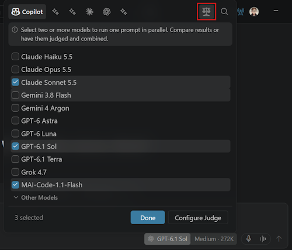
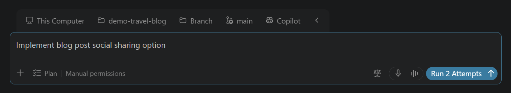
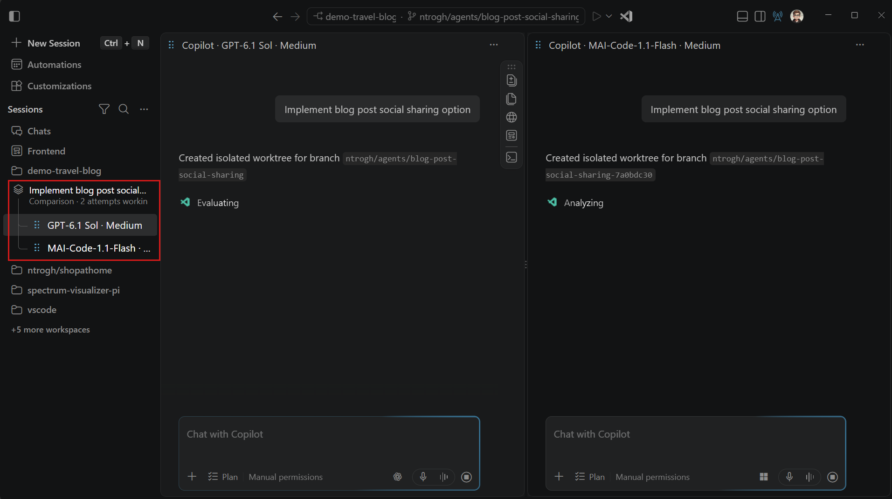
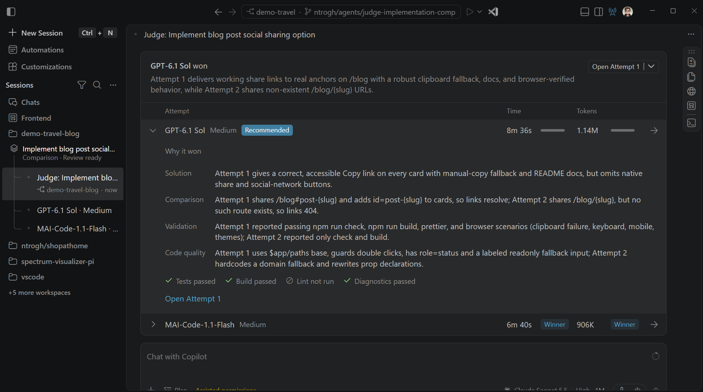

+++
title = "2.3.4 比较模型结果"
date = 2026-11-06T07:53:25+08:00
weight = 4
type = "docs"
description = ""
isCJKLanguage = true
draft = false
+++


> 原文链接: [https://code.visualstudio.com/docs/agents/run/compare-models](https://code.visualstudio.com/docs/agents/run/compare-models)

# 2.3.4 比较模型结果

　　在智能体窗口中使用多个模型或智能体运行框架运行同一提示词，然后并排比较它们的响应或实现。使用无文件夹聊天比较想法和计划，或使用 Git 仓库在隔离工作树中比较代码更改。对于仓库比较，可以选择最强的一次尝试，或从多次尝试的最佳部分综合出新实现。

　　模型比较处于预览阶段，仅在智能体窗口中可用。编辑器聊天视图不支持。

## 前提条件 {#prerequisites}

开始之前，请确保：

* 满足[智能体窗口前提条件](../../work-with-ai/2.2.3-AgentsWindow/#prerequisites)。
* 有权访问符合条件的 Agent Host 运行框架。

　　对于无文件夹比较，请使用支持[快速聊天](../../work-with-ai/2.2.3-AgentsWindow/#start-a-quick-chat)的运行框架。无文件夹比较运行独立聊天，不使用工作树、评判器或综合器。

　　可用于比较的模型和运行框架取决于设置、凭据和企业策略。了解如何[配置和选择智能体运行框架](../2.3.2-ChooseAnAgentHarness/)。

## 配置比较 {#configure-a-comparison}

　　模型比较默认开启。如果符合条件的会话没有显示 **比较模型**，请检查 **设置** 中的 `sessions.chat.compareAgents.enabled` 是否启用。

1. 在智能体窗口中选择 **新建**，然后为任务选择 Git 仓库。要比较无仓库的响应，请改为[启动快速聊天](../../work-with-ai/2.2.3-AgentsWindow/#start-a-quick-chat)。

2. 打开模型选择器，选择 **比较模型**（刻度图标）。

    

3. 添加 2 到 10 个模型。

    从智能体运行框架可用的模型中选择。在可用时，可以混合 Copilot、Anthropic Claude 和 OpenAI Codex 尝试。**自动** 和其他路由选项不适用于比较。

    对于支持思考强度的模型，可以多次添加同一模型，并为每次尝试选择不同的强度。

4. 对于仓库比较，可选择 **配置评判器**，然后选择评判模型自动评估尝试。

5. 如果之后要创建组合实现，请选择 **配置综合** 并选择综合模型。

    在运行比较之前配置评判器和综合器。没有评判器时，请手动比较尝试。综合需要同时有评判器和综合器。这些步骤不适用于无文件夹比较。

6. 选择 **完成**。如果要在没有评判器或综合器的情况下比较尝试，请在选择尝试后直接选择 **完成**。

## 在各次尝试中运行同一任务 {#run-the-same-task-across-attempts}

　　输入一个限定提示词，让每个尝试都有相同的目标和成功标准。对于仓库比较，请使用类似以下的编码任务：

```text
为个人资料表单添加验证，要求显示名称必填且不超过 50 个字符。
显示内联错误，保留现有表单样式，并为有效、空和过长名称添加聚焦测试。
不要更改其他表单。
```

　　对于无文件夹比较，请提出问题或请求计划，例如概述两种 API 设计之间的权衡。



　　选择 **运行 N 次尝试**，其中 `N` 是配置的尝试次数。所有尝试会作为独立会话同时启动。结果默认以平铺网格显示，可以监控每次尝试并打开其会话。



　　对于仓库比较，每次尝试都在基于仓库已提交状态的独立 Git 工作树中工作。它不包含原始工作树中未提交的更改。Git 忽略的文件和依赖项也可能缺失。关于工作树要求、忽略文件和 **全部允许** 权限行为，请参阅[选择智能体更改位置](../../work-with-ai/2.2.3-AgentsWindow/#choose-where-an-agent-makes-changes)。

> **警告**：仓库比较使用 **全部允许** 的工作树会话，会跳过工具审批提示。工作树隔离的是编辑，不是智能体对你计算机或网络的访问。运行比较之前，请审查[审批和权限](../../work-with-ai/permissions-and-security/2.2.12.1-ApprovalsAndPermissions/)以及[智能体沙盒](../../work-with-ai/permissions-and-security/2.2.12.2-AgentSandboxing/)。

## 比较结果 {#compare-the-results}

　　尝试完成后，请手动比较；对于仓库比较，也可以使用评判器评分卡：

* 审查每次尝试的响应；对于仓库比较，还要审查已更改文件。
* 检查每个结果是否满足提示词约束。对于代码更改，还要检查实现是否遵循仓库约定。
* 对于代码更改，在有希望的尝试中运行相关测试和检查。

　　如果配置了评判器，尝试完成后会自动开始评估。评分卡包含推荐结果、每次尝试的时间和令牌用量，以及带有验证证据的可展开理由。选择 **打开尝试 N** 检查尝试的完整会话和更改。

　　令牌值可能是下限而不是完整总量。评分卡不衡量 AI 点数或货币成本。



> **重要**：评判器的评估不能证明实现正确。整合结果之前，请审查代码、验证证据并运行项目测试。

## 综合新实现 {#synthesize-a-new-implementation}

　　对于仓库比较，如果同时配置了评判器和综合器，请在审查裁决后选择 **综合**。可以添加可选指令，让综合聚焦特定优势、约束或更正。

　　综合器会在另一个隔离工作树中创建新的分组会话。它使用评判裁决和尝试中的优势作为新实现的上下文。它不会修改推荐尝试或原始工作树。

　　综合不会自动合并尝试或综合结果的更改。请将新实现作为单独结果审查和验证。

## 使用结果继续 {#continue-with-a-result}

　　打开要继续的尝试或综合会话。对于无文件夹比较，在所选聊天中继续对话。对于代码更改，请审查所有已更改和未跟踪文件，运行相关测试并做必要修订。

　　仓库结果准备好后，请遵循[智能体更改审查和工作树整合工作流](../../work-with-ai/2.2.8-ReviewAndRevertChanges/)。比较不会自动合并、推送或为所选结果创建拉取请求。

　　每次尝试、评判器评估和综合都是单独的模型工作。选择尝试次数以及是否启用评估或综合时，请考虑额外的模型用量。

## 相关资源 {#related-resources}

* [管理智能体会话](../../work-with-ai/sessions/2.2.11.1-ManageSessions/)
* [使用 Git 分支和工作树](../../../source-control/4.5-BranchesWorktrees/)
