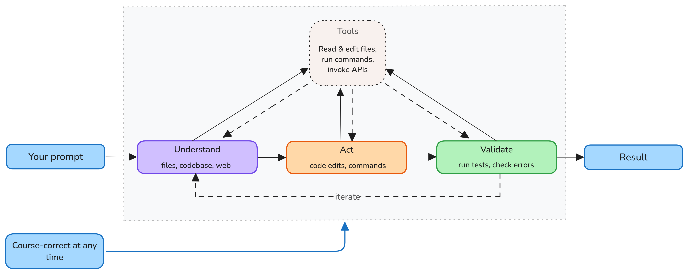

+++
title = "2.7.1 智能体"
date = 2026-11-06T07:53:25+08:00
weight = 1
type = "docs"
description = ""
isCJKLanguage = true
draft = false
+++

> 原文链接: [https://code.visualstudio.com/docs/agents/concepts/agents](https://code.visualstudio.com/docs/agents/concepts/agents)

# 2.7.1 智能体

　　智能体是一种 AI 系统，使用语言模型和[工具](../2.7.4-Tools/)代表你完成目标。语言模型根据提示词中的信息生成响应。智能体更进一步：收集上下文、在开发环境中执行操作、评估结果，并按需重复这些步骤。

　　你选择目标、控制哪些操作需要批准并审查结果更改。本文解释智能体循环如何工作，并介绍支持智能体工作的会话、规划、子智能体、记忆和自定义项。

　　关于 VS Code 中 AI 工作流的概述以及在哪里使用智能体，请参阅[使用 AI 构建](../)。

> **提示**：完成简短快速入门，使用智能体创建并验证应用，请从[智能体快速入门](../../getting-started/2.1.3-AgentsQuickstart/)开始。

## 概念如何协同 {#how-the-concepts-fit-together}

每次发送请求时，核心概念会协同工作：

1. **请求**：你描述目标并提供需求或约束。
2. **上下文和推理**：VS Code 组装相关[上下文](../2.7.3-Context/)，例如文件和对话历史。[语言模型](../2.7.2-HowModelsWork/)对这些信息进行推理并确定下一步操作。
3. **工具操作**：智能体使用[工具](../2.7.4-Tools/)收集更多信息或在你的环境中执行操作，例如读取文件、编辑代码或运行命令。
4. **验证**：工具调用结果作为上下文返回模型。智能体评估进度并决定是否执行另一操作。
5. **审查**：任务完成后，你审查响应、代码更改和验证结果。

　　重复的推理、操作和验证步骤构成**智能体循环**。[会话](../2.7.5-SessionsAndChats/)将对话和任务状态保持在一起。[智能体运行框架](../2.7.6-AgentHarnesses/)协调循环，执行环境决定工具在哪里运行以及代码更改在哪里进行。

## 智能体循环 {#agent-loop}

　　智能体循环使智能体能够逐步完成任务，而不是生成单个响应。每一步，智能体评估进度并选择下一操作。该操作的输出影响下一个决策。

例如，要求智能体为表单添加验证时，循环通常包括：

1. **理解**：智能体找到表单、读取相关代码和测试，并识别项目现有验证模式。
2. **操作**：智能体更新表单并添加或修改测试。
3. **验证**：智能体运行相关测试并检查错误。如果验证失败，它诊断结果、再次更改并重新验证。

　　简单问题可能只需少量文件读取。大型实现任务可能在智能体编辑代码、运行测试和修复问题时多次重复循环。

## 保持控制 {#stay-in-control}

　　智能体可以执行操作，但你仍负责指导任务并决定保留哪些更改。会话期间，你可以：

* 选择可用工具以及哪些工具调用需要批准。
* 在操作运行前审查审批请求。
* 发送另一条消息添加上下文或重定向工作。
* 在智能体采用错误方法时停止它。
* 在保留更改前审查已更改文件和验证结果。

　　详细了解[信任和安全控制](../2.7.9-TrustAndSafety/)。

## 会话 {#sessions}

　　会话是与智能体一起工作的单位。它汇集任务的工作区、代码更改和执行状态。根据运行框架，会话可以包含多个聊天，每个聊天有自己的对话历史。

　　会话可以并行运行。聊天视图和智能体窗口都支持智能体，但运行框架决定能否在两个界面中继续同一会话。例如，Local 运行框架会话仅在编辑器中可用。会话可以使用相同文件夹或单独工作树，因此单独对话不一定隔离代码更改。了解[会话兼容性、执行环境和交接](../2.7.5-SessionsAndChats/)。

## 智能体运行框架和执行环境 {#agent-harnesses-and-execution-environments}

　　智能体运行框架是协调智能体循环的运行时。它管理会话、将语言模型连接到工具并提供提供商特定能力。VS Code 支持 Copilot、Claude 和 Codex 等运行框架。

> **注意**：当 [GitHub Copilot 企业托管设置生效](../../../enterprise/7.2-ManageAISettings/#claude-and-codex-availability)时，Claude 和 Codex 运行框架会被禁用。请联系部署设置的 IT 团队讨论访问权限。

　　执行环境是运行框架运行工作区工具并更改代码的位置。根据可用运行框架，这可以是你的计算机、连接的主机、任一主机上的 Dev Container 或云基础设施。Dev Container 提供项目配置的工具和依赖项，而不更改运行框架。详细了解[智能体运行框架和执行环境](../2.7.6-AgentHarnesses/#relate-execution-environments-and-code-isolation)。

## 扩展智能体工作的能力 {#capabilities-that-extend-agent-work}

　　智能体可以为复杂任务和重复工作流使用额外能力。这些能力并非每个请求都必需。

### 规划 {#planning}

　　每个智能体在智能体循环中决定下一步操作。对于复杂任务，请使用内置 Plan 智能体研究代码库、明确需求并在代码更改前提出实现计划。

　　Plan 智能体在准备计划时使用只读工具。审查并批准方法后，可以将计划交接给实现智能体。详细了解[使用智能体规划](../../work-with-ai/plan-and-run-tasks/2.2.10.1-PlanWork/)。

### 子智能体 {#subagents}

　　对于复杂任务，主智能体可以将聚焦工作委派给子智能体。子智能体执行特定任务（例如研究主题或分析代码库的一部分），并向主智能体报告结果。

　　当独立研究会在主智能体[上下文窗口](../2.7.2-HowModelsWork/#context-window)中添加大量中间信息时，子智能体很有用。

子智能体的主要特征：

* **上下文隔离**：每个子智能体在自己的上下文中工作。运行框架决定它接收哪些指令和对话历史。在 Local 运行框架中，子智能体接收委派任务和适用指令，而不是主对话历史。
* **并行执行**：当运行框架支持并发子智能体时，独立子任务可以并行运行，例如单独的正确性和性能审查。
* **聚焦结果**：主智能体使用子智能体结果，而不将其所有中间工作添加到主上下文。

　　子智能体会发出自己的模型请求，因此较小主上下文不一定意味着更低的总令牌用量或[成本](../2.7.2-HowModelsWork/#ai-credits-and-model-costs)。

　　使用子智能体不需要创建自定义智能体。[自定义智能体](../../customize-and-extend/2.4.5-CustomAgents/)定义子智能体可使用的可复用指令、工具和模型偏好。

　　例如，[Plan 智能体](#planning)可以使用子智能体在创建计划前研究任务的独立部分。详细了解[使用子智能体](../../work-with-ai/plan-and-run-tasks/2.2.10.4-Subagents/)。

### 记忆 {#memory}

　　记忆将偏好和代码库知识与会话自动累积的对话上下文分开保留。记忆系统取决于智能体运行框架：

* **Copilot 记忆**：本地使用 Copilot 运行框架的会话可以回忆云支持的仓库事实和用户偏好。仓库事实与有权访问该仓库和记忆的人共享。用户偏好在你自己跨仓库的受支持交互中适用。
* **基于文件的记忆**：Local 运行框架使用单独记忆工具保存用户、仓库和会话笔记。这些文件默认存储在本地。会话记忆可以保存临时任务上下文，例如实现计划。

　　详细了解 [VS Code 智能体中的记忆](../../work-with-ai/sessions/2.2.11.1-ManageSessions/)。

### 自定义 {#customization}

可以为项目或工作流自定义智能体循环：

* [**自定义智能体**](../../customize-and-extend/2.4.5-CustomAgents/)定义特定工作流的指令、可用工具、语言模型和可选交接。
* [**智能体技能**](../../customize-and-extend/2.4.3-AgentSkills/)为智能体提供专门任务的指令和资源。
* [**钩子**](../../customize-and-extend/2.4.9-Hooks/)在智能体工作流特定位置运行命令，例如工具运行前后。

　　详细了解[自定义概念](../2.7.7-AgentCustomization/)。

## 相关资源 {#related-resources}

* [工具](../2.7.4-Tools/)
* [智能体运行框架和执行环境](../2.7.6-AgentHarnesses/)
* [信任和安全](../2.7.9-TrustAndSafety/)
