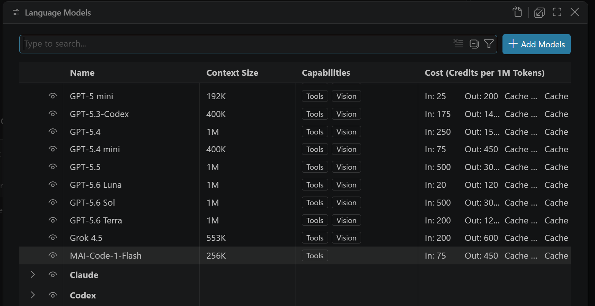

+++
title = "2.7.2 模型如何工作"
date = 2026-11-06T07:53:25+08:00
weight = 2
type = "docs"
description = ""
isCJKLanguage = true
draft = false
+++

> 原文链接: [https://code.visualstudio.com/docs/agents/concepts/language-models](https://code.visualstudio.com/docs/agents/concepts/language-models)

# 2.7.2 模型如何工作

　　VS Code 使用大型语言模型（LLM）为 AI 功能提供支持。你可以灵活选择模型以及访问方式：

* **来自 GitHub Copilot 套餐的模型**：从套餐包含的多个提供商（例如 Anthropic、Google 和 OpenAI）中选择模型。
* **其他账户**：使用[所选运行框架支持的账户](../../choose-models-and-agents/2.3.2-ChooseAnAgentHarness/#cloud-target)，例如 Codex 的 ChatGPT 账户。模型可用性、使用限制和计费取决于该账户的套餐和运行框架。
* **自带密钥（BYOK）**：使用自己的 API 密钥添加其他提供商的模型，或托管自己的模型，包括离线运行的本地模型。使用 BYOK，无需 GitHub Copilot 套餐即可在 VS Code 中使用智能体。
* **设备上模型**：下载 [Copilot 提供的编码模型](../../choose-models-and-agents/2.3.1-ChooseAndConfigureModels/#use-on-device-models-experimental)，在受支持的 NVIDIA GPU 上于 Copilot 运行框架会话中运行。

> **注意**：当 [GitHub Copilot 企业托管设置生效](../../../enterprise/7.2-ManageAISettings/#claude-and-codex-availability)时，即使使用单独的提供商凭据，Claude 和 Codex 运行框架也会被禁用。请联系部署设置的 IT 团队讨论访问权限。此运行框架限制本身不会禁用 Copilot 运行框架中的 Claude 或 OpenAI 模型。

　　本文解释语言模型如何工作、其特点以及何时选择模型、使用自动或 Copilot Fusion。

## 语言模型如何工作 {#how-language-models-work}

　　语言模型处理文本输入（“提示词”）并生成文本输出。在 VS Code 中，提示词从多个来源组装：你的消息、对话历史、文件内容、工具输出和自定义指令。模型生成的响应可以包含解释、代码编辑或调用[工具](../2.7.4-Tools/)的请求。

　　语言模型不直接执行代码或访问文件。它们生成文本，由[智能体循环](../2.7.1-Agents/#agent-loop)解释为操作。当模型请求工具调用时，VS Code 执行工具并将结果反馈给模型进行下一轮迭代。

语言模型的一些关键特点：

* **非确定性**：相同提示词每次可能产生不同结果。这是设计使然，反映模型如何从概率分布中采样。
* **依赖上下文**：响应质量取决于提示词中提供的[上下文](../2.7.3-Context/)质量和相关性。
* **知识边界**：模型训练数据截止到某个日期，对于超出训练数据的主题可能产生过时或错误信息。VS Code 通过工具和工作区索引缓解此问题。

## 上下文窗口 {#context-window}

　　上下文窗口是模型在单个请求中可以处理的信息总量。它包括系统提示词、自定义指令、对话历史、文件内容、工具输出和当前消息。不同模型有不同上下文窗口大小。

　　上下文窗口填满时，VS Code 会自动总结对话较早部分以腾出空间。这意味着长对话早期的重要细节可能被压缩或丢失。也可以在聊天输入框中输入 `/compact` 手动触发压缩。可以在命令后添加自定义指令引导摘要，例如 `/compact focus on the API design decisions`。

　　详细了解 [VS Code 如何组装上下文](../2.7.3-Context/)以及[上下文压缩](../../work-with-ai/sessions/2.2.11.1-ManageSessions/#compact-conversation-context)。

## 思考和推理 {#thinking-and-reasoning}

　　某些语言模型可以在生成响应前执行扩展推理，也称为“思考”。推理模型不立即生成答案，而是先在内部处理问题、考虑多种方法、评估权衡并构建逐步思维链。这种内部推理在专用思考令牌中进行，与最终输出分开。

　　推理模型对多步骤调试、架构规划、代码重构以及数学或科学分析等复杂任务特别有效。对于生成样板代码或回答基本问题等简单任务，额外推理会增加延迟而没有显著收益。

### 思考强度 {#thinking-effort}

　　思考强度控制模型对每个请求应用多少推理。更高强度产生更彻底的内部推理，改善复杂问题的质量。较低强度通过限制或跳过思考步骤降低延迟和令牌用量。

　　可用强度级别及其默认值因模型和提供商而异。某些模型还支持*自适应思考*，模型根据每个请求复杂度动态决定是否以及思考多少，而不是始终使用固定思考预算。

　　VS Code 根据评估和在线性能数据设置默认强度，并在支持时启用自适应推理。对于大多数用例，默认值无需更改即可良好工作。

### 思考令牌 {#thinking-tokens}

　　思考令牌会计入模型上下文窗口，即使它们不在响应中显示。实际思考输出通常以摘要形式返回，或为降低延迟完全省略。请记住，更高思考强度可能产生更多思考令牌，增加延迟。

　　了解如何在 VS Code 中[配置思考强度](../../choose-models-and-agents/2.3.1-ChooseAndConfigureModels/#configure-thinking-effort-and-context-size)。

## 选择合适的模型 {#choose-the-right-model}

　　每个模型有不同优势。某些针对速度优化，适合快速编辑和简单问题。其他模型有更大上下文窗口或更好推理能力，适合复杂任务。一般指导原则：

* **快速模型** 最适合快速代码编辑、样板生成和直接问题。
* **推理模型** 擅长复杂重构、架构决策、多步骤调试以及需要分析权衡的任务。
* **大上下文模型** 适合大型代码库或需要保留更多信息的长期对话。

　　可以根据特定任务需求随时切换模型。详细比较请参阅 GitHub Copilot 文档中的[为任务选择合适的 AI 模型](https://docs.github.com/en/copilot/using-github-copilot/ai-models/choosing-the-right-ai-model-for-your-task)。

### 自动模型选择 {#auto-model-selection}

　　GitHub Copilot 中的自动模型选择结合两个系统，为每个请求选择一个模型。一个系统跟踪实时模型健康状况和可用性，另一个评估任务复杂度。两者共同将每个任务匹配到最高效的模型，为需要的问题保留高成本推理模型，并将简单任务路由到更快模型。

　　在 Copilot 运行框架会话中，同一路由入口可能显示为 **Copilot Fusion** 而不是 **自动**，取决于设置和账户可用层级。Fusion 在单模型路由之外增加[多模型编排](#copilot-fusion)。

　　自动从多个模型中选择，并遵守组织的[模型访问设置](https://docs.github.com/en/copilot/how-tos/use-ai-models/configure-access-to-ai-models)。自动不会选择管理员策略排除的模型或数据驻留策略限制的模型。

　　为[设备上模型](../../choose-models-and-agents/2.3.1-ChooseAndConfigureModels/#use-on-device-models-experimental)开启 **在自动中使用** 后，自动可以将部分请求路由到你设备上的该模型，并支持云回退。

　　更多细节请参阅 GitHub 文档中的 [Copilot 自动模型选择](https://docs.github.com/en/copilot/concepts/auto-model-selection)。

### Copilot Fusion {#copilot-fusion}

　　Copilot Fusion 是模型编排系统，不是单个语言模型。它为任务选择模型和工作流，因此无需自己协调每一步。与每个请求选择一个模型的自动不同，Fusion 可以使用一个模型或协调多个模型。例如，一个模型起草解决方案，另一个模型批评，原模型再修订。你收到单个最终响应。

　　对于大型、范围明确的编码任务，如果额外审查值得增加时间和 [AI 点数](#ai-credits-and-model-costs)，请考虑 Fusion。可用性取决于账户和组织策略。

　　了解如何[使用 Copilot Fusion](../../choose-models-and-agents/2.3.1-ChooseAndConfigureModels/#use-copilot-fusion)。编排细节请参阅 GitHub 文档中的 [GitHub Copilot Fusion](https://docs.github.com/en/copilot/concepts/models/copilot-fusion)。

### AI 点数和模型成本 {#ai-credits-and-model-costs}

　　每个 Copilot 套餐包含每月 [AI 点数](https://docs.github.com/en/copilot/concepts/billing/usage-based-billing-for-individuals)额度。不同模型根据模型和处理令牌数量以不同速率消耗 AI 点数。能力更强的模型每令牌成本更高，而轻量模型可以延长使用量。使用自动模型选择时，VS Code 将每个请求路由到平衡质量和成本的高效模型。

　　Copilot Fusion 可以为任务使用多次模型处理，例如起草、批评和修订。每次处理都会消耗 AI 点数，因此编排工作流可能比单模型请求耗时更长、消耗更多点数。

　　其他因素也影响点数消耗，例如[思考强度](../../choose-models-and-agents/2.3.1-ChooseAndConfigureModels/#configure-thinking-effort-and-context-size)（更高强度产生更多思考令牌）、上下文窗口大小和工具使用。提示词缓存通过复用先前请求的令牌降低请求有效成本。可以使用[缓存浏览器](../../reference-and-help/troubleshooting/2.8.2.3-DiagnosePromptCaching/)检查缓存命中率。减少点数消耗的实用技巧请参阅[优化 AI 点数使用量](../../tutorials-and-guides/2.6.14-ReduceCreditUsage/)。

　　了解如何在 VS Code 中[选择和配置语言模型](../../choose-models-and-agents/2.3.1-ChooseAndConfigureModels/)。

## 自带语言模型密钥 {#bring-your-own-language-model-key}

　　如果内置模型不满足需求，可以自带语言模型 API 密钥（BYOK），使用其他提供商的模型或在本地运行模型。BYOK 让你连接任何兼容模型提供商，同时继续使用 VS Code 聊天和智能体编码功能。VS Code 内置支持提供商列表，也可以从 Visual Studio Marketplace 添加更多提供商。

　　BYOK 可用于智能体体验和实用任务，例如生成提交消息。

### 为什么自带密钥 {#why-bring-your-own-key}

* **模型选择**：访问不同提供商的数百个模型，超出内置模型。
* **实验**：尝试内置模型尚不可用的新模型或功能。
* **本地计算**：使用自己的计算资源运行 GitHub Copilot 已支持的模型，或运行尚不可用的模型。
* **更多控制**：绕过内置模型的标准速率限制和限制。
* **离线和隔离环境**：无需 GitHub 账户、Copilot 套餐或 Internet 连接，使用 Ollama 等本地模型进行 AI 聊天。

### 注意事项 {#considerations}

* BYOK 仅适用于聊天体验和实用任务。内联建议（代码补全）和依赖嵌入的功能（例如语义搜索）仍需要 GitHub Copilot 套餐。
* 能力取决于模型，可能与内置模型不同，例如工具调用、视觉或思考支持。
* 使用 BYOK 时，不保证对模型输出应用负责任 AI 过滤。

　　了解如何在 VS Code 中[添加自己的语言模型密钥](../../choose-models-and-agents/2.3.1-ChooseAndConfigureModels/#bring-your-own-language-model-key)。

## 相关资源 {#related-resources}

* [上下文](../2.7.3-Context/)
* [VS Code 中的 AI 语言模型](../../choose-models-and-agents/2.3.1-ChooseAndConfigureModels/)
