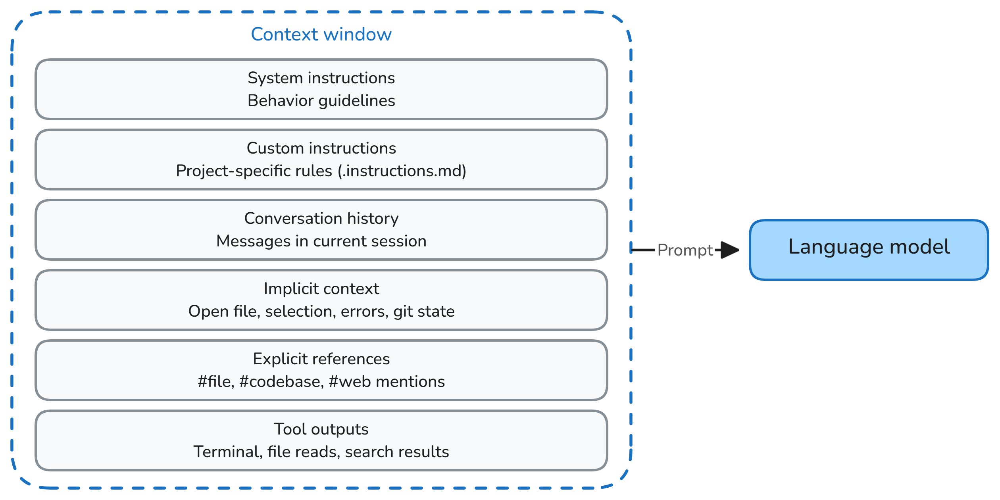

+++
title = "2.7.3 上下文"
date = 2026-11-06T07:53:25+08:00
weight = 3
type = "docs"
description = ""
isCJKLanguage = true
draft = false
+++


> 原文链接: [https://code.visualstudio.com/docs/agents/concepts/context](https://code.visualstudio.com/docs/agents/concepts/context)

# 2.7.3 上下文

　　上下文是 AI 智能体及其语言模型在处理请求时可用 information。它可以包括对话历史、工作区文件、工具输出、自定义指令以及你添加到提示词中的引用。

　　语言模型对这些信息进行推理，决定下一步说什么或做什么。智能体可以使用[工具](../2.7.4-Tools/)收集更多上下文、执行操作并评估结果。本文解释 VS Code 如何组装和发现上下文，以及如何在上下文窗口限制内工作。

## 为什么上下文重要 {#why-context-matters}

　　包含相关文件、清晰指令和聚焦历史的提示词比没有上下文的模糊提示词产生更好结果。语言模型只能对当前上下文中包含的信息进行推理。

　　开始前不必识别每个相关文件。在[智能体循环](../2.7.1-Agents/#agent-loop)中，智能体可以搜索工作区、读取文件、运行命令并将结果添加到下一步上下文。当你已经知道智能体应考虑哪些信息时，显式引用很有用。

　　对话历史作用域是单个聊天，不会自动与其他聊天或会话共享。可以通过委派任务或[交接](../2.7.5-SessionsAndChats/#hand-off-a-session)显式传递上下文。持久来源（例如[自定义指令](../../customize-and-extend/2.4.4-Instructions/)或[智能体记忆](../2.7.1-Agents/#memory)）也可以跨对话提供信息。

## VS Code 如何组装上下文 {#how-vs-code-assembles-context}

　　每次智能体向语言模型发送请求时，VS Code 从多个来源组装提示词：



* **系统指令**：定义智能体行为的内置指南。
* **自定义项**：你设置的 AI 自定义项，包括自定义智能体、技能和自定义指令。
* **用户消息**：当前请求或你发送给智能体的后续消息。
* **对话历史**：当前聊天中迄今交换的消息。
* **隐式上下文**：编辑器信息，例如活动文件或选区，前提是界面、运行框架和上下文设置包含它。
* **显式引用**：使用 `#` 提及引用的文件、编辑器上下文、Web 内容和其他来源。
* **工具输出**：智能体会话期间文件读取、终端命令、代码库搜索结果和其他工具调用的结果。

　　上下文会随智能体工作而变化。例如，代码搜索输出可能引导智能体读取文件，该文件又会影响下一次模型请求。未包含在请求中的信息对模型不可用，但智能体可以使用工具发现并添加更多信息。

　　智能体还可以通过 [Copilot 连接器](../../customize-and-extend/2.4.6-CopilotConnectors/)或其他 MCP 工具从外部服务检索上下文。连接服务不会自动将其数据加载到上下文。智能体检索结果时，结果会成为工具输出。

## 工作区索引 {#workspace-indexing}

　　VS Code 使用语义索引按含义而非仅精确关键词查找代码。索引帮助智能体快速定位相关片段，尤其是在大型代码库中。它不会将整个工作区添加到每个模型请求。

　　VS Code 自动构建和维护索引。如果语义索引尚不可用，智能体仍可以通过文本搜索、文件搜索和语言智能查找上下文。

　　详细了解[工作区索引](../../reference-and-help/reference/2.8.1.11-AgentHostArchitecture/)。

## 隐式上下文 {#implicit-context}

　　VS Code 可以使用编辑器活动为请求提供上下文或建议附件。此行为取决于界面、运行框架和上下文设置：

* 在聊天视图中，活动文件、笔记本或选中文本可以提供编辑器上下文。
* 使用 Local 运行框架和默认上下文设置时，**Ask** 包含活动编辑器上下文。**Agent** 将活动文件建议为附件，同时包含选中文本。
* Agent Host 会话（例如 Copilot）也可以自动接收活动编辑器上下文。Local 运行框架行为不适用于每个智能体。
* 在智能体窗口中，隐式编辑器上下文默认关闭。请添加请求需要的文件或项目上下文。

　　建议附件不同于显式附加文件。当来源很重要时，请[将其添加到请求](../../work-with-ai/2.2.7-AddPromptContext/#add-files-as-context)，不要假设打开的编辑器提供完整文件。智能体也可以通过工具收集更多上下文。

## 显式上下文 {#explicit-context}

　　当希望确保智能体考虑特定文件、文件夹、符号、图像、网页或其他来源时，请添加显式上下文。在聊天输入框中输入 `#` 选择上下文项，或选择 **添加上下文**（`+` 图标）。

　　显式上下文引导智能体找到相关信息，但仍会计入上下文窗口。只添加帮助智能体完成当前任务的来源。详细了解[向聊天添加上下文](../../work-with-ai/2.2.7-AddPromptContext/)。

> **提示**：预先提供聚焦上下文可能减少智能体所需的搜索和文件读取，从而降低 AI 点数使用量。避免添加无关或大型来源，因为它们也会消耗上下文窗口令牌。详细了解[优化 AI 点数使用量](../../tutorials-and-guides/2.6.14-ReduceCreditUsage/)。

## 上下文窗口和压缩 {#context-window-and-compaction}

　　上下文窗口是语言模型在单个请求中可以处理的最大信息量。用户消息、对话历史、指令、引用文件和工具输出都占用此窗口空间。

　　对话接近限制时，VS Code 会自动将较早部分压缩为摘要。压缩为新信息腾出空间，但早期消息细节可能被总结或省略。也可以在聊天输入框中输入 `/compact` 手动压缩对话。

　　要在保持相同工作区和代码更改的情况下使用全新对话历史，请在支持时[在会话中创建另一个聊天](../../work-with-ai/sessions/2.2.11.1-ManageSessions/#run-multiple-chats-in-a-session)。为无关任务或不同项目开始新会话。两种操作都不会移除已保存文件、适用自定义指令或持久记忆。如果指令应跨对话应用，请将其存储在[自定义指令](../../customize-and-extend/2.4.4-Instructions/)中。详细了解[管理对话上下文](../../work-with-ai/sessions/2.2.11.1-ManageSessions/#compact-conversation-context)。

## 使用子智能体隔离上下文 {#context-isolation-with-subagents}

　　智能体可以将聚焦任务委派给在自有上下文中工作并返回结果的[子智能体](../2.7.1-Agents/#subagents)。这会将中间工作与主对话分开。相比之下，压缩会总结该对话中已有的内容。

　　上下文隔离不是代码隔离。它本身不会创建单独工作树或沙盒。智能体对文件和工具的访问取决于[执行环境](../2.7.6-AgentHarnesses/#relate-execution-environments-and-code-isolation)和[权限控制](../2.7.9-TrustAndSafety/)。

　　了解如何[将工作委派给子智能体](../../work-with-ai/plan-and-run-tasks/2.2.10.4-Subagents/)。

## 有效使用上下文 {#working-effectively-with-context}

* **描述目标和约束。** 解释想要的结果以及智能体应遵循的要求。
* **让智能体发现上下文。** 智能体可以在工作时搜索工作区并读取相关文件。无需附加整个代码库。
* **引用重要来源。** 显式添加智能体必须考虑的文件、符号、错误或文档。
* **保持每个对话聚焦。** 对不需要当前历史的相关工作使用新聊天，对无关任务使用单独会话。

### 上下文如何改善响应 {#how-context-improves-a-response}

　　考虑要求智能体解释项目中身份验证如何工作。

没有相关工作区上下文：

```text
身份验证如何工作？
```

　　模型无法知道你指哪个项目，会给出关于身份验证模式的通用答案。

将 `src/auth.ts` 作为上下文附加到请求后：

```text
解释身份验证流程，并确定令牌在哪里验证。
```

　　引用的文件为智能体提供起点。智能体随后可以搜索相关代码，并用具体函数和配置值解释实现。

## 相关资源 {#related-resources}

* [语言模型](../2.7.2-HowModelsWork/)
* [提示词示例](../../tutorials-and-guides/2.6.15-PromptExamples/)
* [上下文工程指南](../../tutorials-and-guides/2.6.11-ContextEngineering/)
