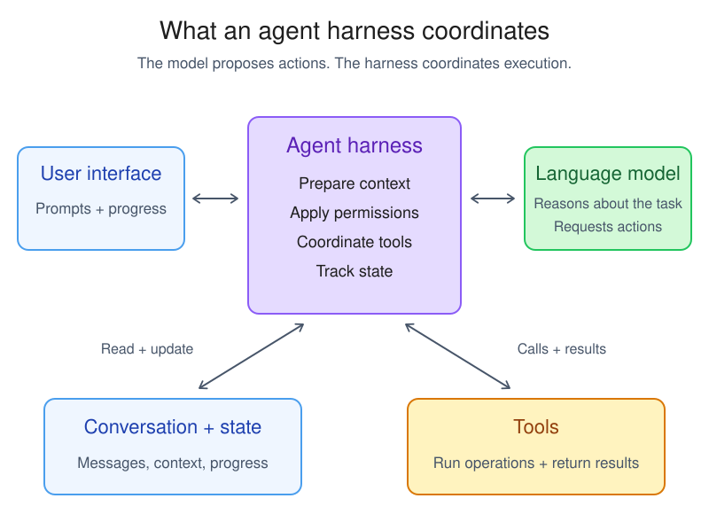
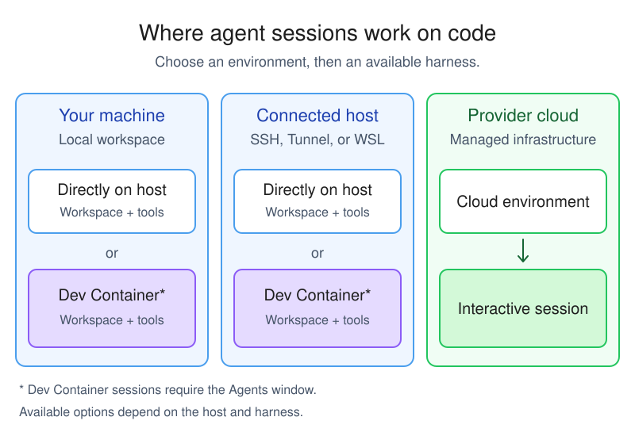

+++
title = "2.7.6 智能体运行框架"
date = 2026-11-06T07:53:25+08:00
weight = 6
type = "docs"
description = ""
isCJKLanguage = true
draft = false
+++

> 原文链接: [https://code.visualstudio.com/docs/agents/concepts/agent-harnesses](https://code.visualstudio.com/docs/agents/concepts/agent-harnesses)

# 2.7.6 智能体运行框架

　　智能体运行框架是运行智能体会话的软件层。它通过将语言模型连接到上下文和工具、协调[智能体循环](../2.7.1-Agents/#agent-loop)并在工作推进时维护会话状态，将语言模型变成智能体。

　　VS Code 支持多种智能体运行框架，包括 Copilot、Anthropic Claude 和 OpenAI Codex。Copilot 运行框架使用共享运行时提供核心能力，并在 VS Code、GitHub Copilot CLI 和 GitHub Copilot 应用之间提供更一致的行为。

　　模型提供推理并决定说什么或请求哪个工具。运行框架通过准备模型请求、协调工具调用和审批、将结果返回模型以及跟踪对话和更改，使这些决策作为有状态工作流运行。

　　本文解释运行框架做什么以及它如何区别于模型访问、语言模型、智能体角色和执行环境。还解释 **会话目标** UI 控件如何呈现运行框架和 Cloud 目标。要比较运行框架并查看设置要求，请参阅[选择智能体运行框架](../../choose-models-and-agents/2.3.2-ChooseAnAgentHarness/)。

　　该图展示职责，不是流程或部署边界。模型请求操作，运行框架应用相关权限规则并协调工具执行。模型和工具可以与运行框架在不同位置运行。

## 跟踪运行框架中的一轮 {#follow-a-turn-through-an-agent-harness}

　　提交提示词时，运行框架协调该轮的每一步：

1. 运行框架接收请求和当前会话状态，为语言模型准备指令、上下文和可用工具定义。
2. 语言模型对这些信息进行推理，返回响应或工具调用请求。
3. 对于工具请求，运行框架应用配置的权限和审批规则，将调用路由到工具运行环境并捕获结果。
4. 运行框架将工具结果返回模型。模型决定调用另一工具、请求输入还是完成任务。
5. 运行框架将消息、工具调用、结果和代码更改关联到会话，并在 VS Code 中显示当前状态。

　　模型选择操作，运行框架协调执行这些操作的系统。

## 运行框架与其他概念的区别 {#how-a-harness-differs-from-other-agent-concepts}

　　多个选择决定智能体如何工作。它们协同工作，但不可互换：

| 概念 | 决定什么 | 与运行框架的关系 |
|---------|--------------------|-----------------------------|
| **模型访问** | 哪个账户、订阅或凭据提供模型访问以及如何计费。 | 每个运行框架支持特定模型和访问选项。更改访问来源不会切换运行框架。 |
| **语言模型** | 智能体如何推理并生成响应。 | 运行框架可以提供多个模型，同一模型可能通过多个运行框架可用。模型可以与运行框架在不同位置运行。 |
| **智能体角色** | 哪些指令、工具和行为适用于任务。例如 Agent、Plan、Ask 和自定义智能体。 | 角色塑造运行框架内的任务行为。更改角色不会替换运行框架。 |
| **执行环境** | 工作区工具在哪里运行以及代码更改在哪里进行，例如你的计算机、连接的主机、Dev Container 或云基础设施。 | 运行框架协调所选环境中的工作。环境不是运行框架。 |
| **会话目标 UI 控件** | VS Code 为会话使用哪个运行框架或 Cloud 目标。 | 此控件列出运行框架和 Cloud 目标。在智能体窗口中，使用工作区选择器单独选择机器或 Dev Container。 |

### 模型访问 {#model-access}

　　可以通过 GitHub Copilot、所选运行框架支持的其他账户或配置了 API 密钥的模型提供商访问模型。访问可能需要订阅或基于用量的计费。提供访问的服务不一定是模型开发者。例如，Copilot 可以提供 Anthropic 开发的 Claude 系列模型的访问。

　　模型访问和运行框架选择是分开的。Copilot 订阅可以为多个受支持运行框架提供模型访问，但登录不会使每个运行框架可用。每个运行框架决定其支持的模型和访问选项。在 Copilot 运行框架中选择 Claude 模型不会切换到 Claude 运行框架。账户和组织策略也影响可用性。了解如何[配置模型访问和选择模型](../../choose-models-and-agents/2.3.1-ChooseAndConfigureModels/)。

### 运行框架和主机 {#harness-and-host}

　　运行框架决定智能体行为。Copilot 运行框架使用 GitHub Copilot SDK 并在 Agent Host 中运行，Local 运行框架在编辑器的扩展宿主中运行。聊天视图和智能体窗口是显示和控制受支持会话的界面，不是运行框架本身。

　　要识别会话运行框架并比较选项，请参阅[选择运行框架](../../choose-models-and-agents/2.3.2-ChooseAnAgentHarness/#select-a-harness)和[比较智能体运行框架](../../choose-models-and-agents/2.3.2-ChooseAnAgentHarness/#compare-agent-harnesses)。进程边界、会话生命周期和客户端相关工具请参阅可选的 [Agent Host 架构参考](../../reference-and-help/reference/2.8.1.11-AgentHostArchitecture/)。

## 运行框架选择改变什么 {#understand-what-the-harness-choice-changes}

　　所选运行框架定义智能体实现。根据运行框架和配置，此选择影响：

* **工具和能力**：智能体支持哪些内置、扩展提供、[MCP](../../customize-and-extend/2.4.7-AddMCPServers/) 或提供商特定工具集成，以及运行框架如何路由工具调用。
* **模型选项**：运行框架提供哪些语言模型以及如何配置请求。
* **智能体工作流**：哪些提供商特定命令、自定义项和会话功能可用。
* **权限**：运行框架支持哪些审批模式和工具权限设置。

　　运行框架选择本身不决定语言模型在哪里运行，也不决定代码更改进入文件夹还是工作树。这些选择取决于运行框架支持的模型、执行环境和隔离选项。

## 将会话目标映射到运行框架 {#map-session-targets-to-harnesses}

　　VS Code 在各运行框架之间提供通用聊天和会话管理界面。可用控件和工作流取决于所选运行框架。**会话目标** UI 控件包括运行框架和 Cloud 执行目标：

| **会话目标** 选项 | 运行框架 | 执行环境 |
|-----------------------|---------|-----------------------|
| **Copilot** | 使用共享运行时的 Copilot 运行框架。 | 你的计算机、连接的主机或 Dev Container。 |
| **Claude 或 Codex** | 对应提供商运行框架及其提供商特定能力。 | 你的计算机，或集成支持的连接主机或 Dev Container。请检查[运行框架设置和能力](../../choose-models-and-agents/2.3.2-ChooseAnAgentHarness/#requirements-and-setup)。 |
| **Cloud** | 受管理云环境中的 Copilot 运行框架。 | 用于[交互式云会话](../../work-across-apps-and-machines/2.5.3-CloudSessions/)的受管理基础设施，无需保持自己的计算机在线即可重新连接。 |

> **注意**：**对于 Local 运行框架会话：** Local 运行框架通过编辑器扩展宿主在当前工作区中工作。**Local** 是会话目标名称，不是在本机运行智能体的唯一方式。请参阅 [Local 设置和能力](../../choose-models-and-agents/2.3.2-ChooseAnAgentHarness/#local)。

> **注意**：当 [GitHub Copilot 企业托管设置生效](../../../enterprise/7.2-ManageAISettings/#claude-and-codex-availability)时，Claude 和 Codex 运行框架集成会被禁用。请联系部署设置的 IT 团队讨论访问权限。在 Copilot 运行框架中选择 Claude 或 OpenAI 模型是单独选择，不会切换运行框架。

　　Cloud 是执行目标，不是单独运行框架。启用云会话后，新的 Cloud 会话在受管理环境中使用 Copilot 运行框架。云会话目前仅支持此运行框架，即使选择其他提供商的模型。

## 关联执行环境和代码隔离 {#relate-execution-environments-and-code-isolation}

　　执行环境决定运行框架在哪里运行工作区工具并更改代码。Dev Container 可以在你的计算机或连接的主机上运行：

* **你的计算机**：运行框架使用本地文件夹或 Git 工作树，并可以访问本地上下文，例如测试结果和终端输出。
* **连接的主机**：运行框架在 SSH、Tunnel 或 WSL 主机上的源代码旁运行。详细了解[远程智能体会话](../../work-across-apps-and-machines/2.5.2-RemoteAgentSessions/)。
* **Dev Container**：智能体在项目容器内运行工作区工具，并使用其配置的工具和依赖项。容器可以在你的计算机或受支持的 SSH、Tunnel 或 WSL 主机上。
* **云基础设施**：运行框架在受管理环境中工作，而不是你的本地 VS Code 工作区。[云会话](../../work-across-apps-and-machines/2.5.3-CloudSessions/)支持交互式工作和重新连接。

　　该图展示会话在何处处理代码，不是你从哪里连接或语言模型在哪里运行。连接步骤请参阅[远程会话和浏览器访问](../../work-across-apps-and-machines/2.5.2-RemoteAgentSessions/)。运行框架可用性取决于所选环境。

　　Dev Container 会话需要智能体窗口和支持 Dev Container 执行的主机。浏览器版本不提供。在工作区选择器中选择容器会更改执行环境，而不是运行框架。了解如何[在 Dev Container 中运行会话](../../work-with-ai/2.2.3-AgentsWindow/#run-a-session-in-a-dev-container)。

　　对于提供文件夹和工作树选项的会话，代码隔离控制哪个工作目录接收更改。文件夹隔离将编辑直接应用到当前工作区，包括其未提交更改。工作树隔离为会话提供基于已提交 Git 状态的单独 [Git 工作树](../../../source-control/4.5-BranchesWorktrees/#understanding-worktrees)。Dev Container 会话直接在容器工作区中工作，不支持 **新工作树**。

　　工作树是 Git 代码隔离边界，不是安全边界。它不限制命令、网络访问或工作树之外的文件访问。请使用[智能体沙盒](../../work-with-ai/permissions-and-security/2.2.12.2-AgentSandboxing/)进行操作系统级文件系统和网络限制。

## 相关资源 {#related-resources}

* [选择智能体运行框架](../../choose-models-and-agents/2.3.2-ChooseAnAgentHarness/)
* [使用智能体完成第一个任务](../../getting-started/2.1.3-AgentsQuickstart/)
* [会话和交接](../2.7.5-SessionsAndChats/)
