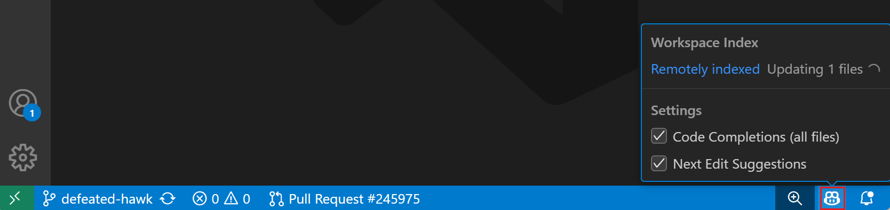
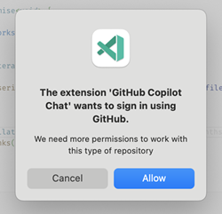

+++
title = "2.7.8 工作区上下文"
date = 2026-11-06T07:53:25+08:00
weight = 8
type = "docs"
description = ""
isCJKLanguage = true
draft = false
+++

> 原文链接: [https://code.visualstudio.com/docs/agents/reference/workspace-context](https://code.visualstudio.com/docs/agents/reference/workspace-context)

# 2.7.8 工作区上下文

　　Copilot 智能体使用搜索和文件读取工具查找相关工作区代码。对于“身份验证在哪里处理？”或“为列表终结点添加测试”等提示词，它们可以从相关文件收集上下文，而不是只依赖当前编辑器。发现什么取决于可用工具、索引、排除项和你提供的信息。请对照源代码审查答案和编辑。

　　本文解释 Copilot 用于发现工作区上下文的工具和索引，以及结果不完整时应考虑的限制。索引帮助查找相关片段，但不会将整个工作区放入每个模型请求。

## 搜索和读取工具 {#search-and-read-tools}

　　发送提示词时，Copilot 分析所需信息，并自动选择合适的搜索工具组合来回答问题或开始生成代码编辑。Copilot 会运行多个工具、审查结果并自动执行后续搜索，直到较好地理解问题。

例如，要求“为支付服务添加错误处理”时，智能体可能：

1. 使用**语义搜索**查找项目中与支付相关的代码。
2. 使用 **grep** 查找代码库中现有错误处理模式。
3. 使用**用法**跟踪支付函数的调用方式。
4. 使用**文件搜索**定位相关配置和测试文件。
5. 读取相关文件并进行协调更改。

　　这种迭代方法让智能体跟踪代码库中的关系，但不能保证找到每个相关文件。当知道需要重要文件时，请显式引用。

智能体可以访问以下内置搜索工具。也可以在提示词中输入 `#` 后跟工具名，显式引用这些工具。

| 工具 | 说明 |
|------|-------------|
| **语义搜索**（`#codebase`） | 查找与问题含义匹配的代码，而不仅是精确关键词。需要[工作区索引](#semantic-index-sources)。 |
| **文本搜索** | 搜索文件内容中的文本匹配，例如特定关键词。 |
| **Grep** | 跨文件搜索精确文本或正则表达式模式。无需索引。 |
| **文件搜索** | 按名称或 glob 模式查找文件。 |
| **用法** | 结合查找所有引用、查找实现和转到定义，跟踪符号跨文件使用情况。 |
| **列出目录** | 列出目录内容以探索项目结构。 |
| **读取文件** | 读取特定文件内容以详细检查代码。 |

　　这些工具适用于任何工作区大小。对于小项目，整个工作区可以直接读入智能体上下文。对于较大项目，智能体根据项目大小和可用资源选择最高效的搜索策略。

### 搜索工作区之外的 GitHub 仓库 {#search-github-repositories-beyond-your-workspace}

　　除了搜索当前工作区，智能体还可以搜索其他 GitHub 仓库中的代码。当智能体需要了解本地未打开的代码库时很有用，例如查找上游库中的 API 或比较仓库之间的实现。

| 工具 | 说明 |
|------|-------------|
| **GitHub 仓库语义搜索**（`#githubRepo`） | 对 GitHub 仓库进行语义搜索，查找相关源代码片段。使用 `owner/repo` 指定仓库。 |
| **GitHub 文本搜索**（`#githubTextSearch`） | 对 GitHub 仓库或组织进行文本搜索，查找包含特定关键词或代码模式的文件。 |

　　对于更高级的 GitHub 工作流（例如搜索和管理议题或拉取请求），请使用 [GitHub MCP 服务器](https://github.com/github/github-mcp-server)。

### 智能体可以访问什么 {#what-the-agent-has-access-to}

　　根据运行框架、工具和上下文设置，智能体可以从以下来源收集信息：

* [可索引工作区文件](#what-content-is-included-in-the-semantic-index)，受索引和排除规则限制。
* 包含嵌套文件夹和文件名的目录结构。
* 代码符号和定义（类、函数、变量）。
* [编辑器上下文](../2.7.3-Context/#implicit-context)，例如包含在请求中的选中文本。
* 对话历史和以前的工具结果。

> **重要**：如果打开忽略文件或在其中选择文本，会绕过 `.gitignore`。

### 使用排除设置改善智能体搜索 {#improve-agent-search-with-exclusion-settings}

　　智能体使用文本搜索或 grep 搜索工作区时，返回的每个匹配项都会成为对话上下文的一部分，即使智能体从未打开该文件。生成文件、构建产物、日志和大型数据集可能产生大量无关匹配，用噪音填满上下文窗口。

配置排除设置，使智能体搜索聚焦于你关心的源代码：

* **`.gitignore`**：将文件从文本搜索、grep 和[语义索引](#what-content-is-included-in-the-semantic-index)中排除。
* **`files.exclude`**：从资源管理器隐藏文件，并将其从文本搜索、grep 和语义索引中排除。
* **`search.exclude`**：将文件从文本搜索和 grep 中排除，同时在资源管理器中保持可见。

　　严格排除可以提高搜索相关性、加快大型工作区搜索并减少搜索结果消耗的令牌。这也有助于[管理 AI 点数使用量](../../tutorials-and-guides/2.6.14-ReduceCreditUsage/#exclude-files-from-chat-context)。

　　将排除模式添加到[工作区设置](../../../editor/3.3-ConfigureTheEditor/3.3.4-Settings/)。模式使用 [glob 语法](https://code.visualstudio.com/docs/editor/glob-patterns)。

> **提示**：文本搜索没有结果时，智能体会收到模式可能被排除的提示，例如调查 `node_modules` 中的依赖时。

## 语义搜索 {#semantic-search}

　　语义搜索工具（`#codebase`）按含义而非精确关键词查找代码。

　　语义搜索需要索引，以便即使在非常大的代码库中也能快速运行。当工作区支持索引时，Copilot 会自动维护受支持的索引。可用性取决于仓库宿主、账户策略和工作区设置。

可以在 VS Code 状态栏的 Copilot 状态仪表板中查看索引状态。

### 语义索引来源 {#semantic-index-sources}

　　索引来源决定可用性以及首次可用速度：

* **GitHub 仓库**：GitHub 为工作区中的 GitHub 仓库建立索引。使用 GitHub 账户登录。每个仓库只需构建一次索引，因此通常立即可用。GitHub 按需构建和更新索引。对于中小型项目很快，但如果仓库包含数十万个文件可能需要时间。远程索引适用于 GitHub.com 或 GitHub Enterprise Cloud 上的仓库，不支持 GitHub Enterprise Server。
* **Azure DevOps 仓库**：自动构建和维护索引。在 VS Code 中使用 Microsoft 账户登录，Copilot 即可开始使用索引。检查 Copilot 状态栏项了解当前索引状态。
* **其他工作区**：对于没有受支持 GitHub 或 Azure DevOps 仓库索引的本地文件夹和仓库，Copilot 可以使用**外部引入**。这会将可索引工作区文件上传到 GitHub 以便搜索。必须由账户策略允许并为工作区启用。可用性和策略要求请参阅[非 GitHub 仓库的语义索引](https://docs.github.com/en/copilot/concepts/prompting-and-context/repository-indexing#semantic-indexing-for-non-github-repositories)。

　　外部引入还有助于搜索现有仓库索引未覆盖的文件和本地更改。如果看到“外部引入已禁用”，请遵循[故障排除指导](#why-do-i-see-external-ingest-is-disabled)。

　　当索引可用且已启用时，请从命令面板运行 **Build Codebase Semantic Index**，按需为当前工作区构建或重建索引。

### 语义索引包含哪些内容 {#what-content-is-included-in-the-semantic-index}

　　VS Code 索引当前项目中的相关文本文件。这不限于特定文件类型或编程语言。VS Code 会自动跳过一些通常不相关的常见文件类型，例如 `.tmp` 或 `.out` 文件。

　　工作区索引还会排除被 `files.exclude` 设置或 `.gitignore` 文件从 VS Code 中排除的文件。

　　二进制文件（例如图像或 PDF）不会被索引。

## 获得更好结果的提示 {#tips-for-better-results}

　　提示词措辞会影响智能体使用的工具和结果质量。

* **具体**：避免“这是做什么的”等模糊表述，其中“这”可能指上一个答案、当前文件或整个项目。
* **使用代码术语**：使用代码中出现的函数名、类名和概念，以便智能体找到精确匹配。
* **手动添加上下文**：选择代码、引用文件或 [# 提及上下文项](../../work-with-ai/2.2.7-AddPromptContext/)，例如调试上下文、终端输出等。
* **限定请求范围**：响应可以引用多个位置，例如“查找没有 catch 块的异常”。但不要期望完整代码库分析，例如“此函数被调用多少次？”。
* **非代码问题使用外部工具**：对于“谁贡献了这个文件？”等信息，请配置相关[工具或 MCP 服务器](../../work-with-ai/plan-and-run-tasks/2.2.10.2-UseTools/)。

## 私有仓库 {#private-repositories}

　　要对私有仓库使用语义搜索，Copilot 可能需要额外权限。如果尚未授予，VS Code 会在启动时请求。授予后，会话会安全存储以供将来使用。

　　详细了解 [GitHub Copilot 信任中心](https://resources.github.com/copilot-trust-center/)中的安全、隐私和透明度。

## 常见问题 {#frequently-asked-questions}

### 提示词中需要使用 `#codebase` 吗？ {#do-i-need-to-use-codebase-in-my-prompts}

　　不需要。智能体会在合理时自动使用语义搜索，无需在提示词中添加 `#codebase`。

　　`#codebase` 工具始终是语义搜索，并提供一致结果。如果希望为特定提示词强制语义搜索，仍可以将 `#codebase` 添加为[上下文项](../../work-with-ai/2.2.7-AddPromptContext/)。

### 工作区没有语义索引会怎样？ {#what-happens-if-my-workspace-is-not-semantically-indexed}

　　如果索引仍在构建或因策略或工作区设置不可用，智能体仍可以使用文本搜索、grep、文件搜索和语言智能搜索代码。这些工具不需要语义索引。也可以显式引用重要文件，帮助智能体找到相关代码。

### 为什么看到“外部引入已禁用”？ {#why-do-i-see-external-ingest-is-disabled}

　　此消息表示外部引入被账户策略阻止或为工作区禁用。从 VS Code 状态栏打开 Copilot 状态仪表板，检查 **代码库语义索引** 中的完整消息。

| 消息 | 操作 |
|---------|------------|
| “外部引入已被组织策略禁用” | 请组织或企业所有者将 **非 GitHub 仓库的语义索引** 策略设置为 **已启用**。对于 Copilot Business 和 Enterprise，将策略保持为 **未配置** 会继续禁用该功能。 |
| “此工作区已禁用外部引入” | 如果状态仪表板提供 **启用外部引入？**，请选择它。或者打开[工作区设置](../../../editor/3.3-ConfigureTheEditor/3.3.4-Settings/)，启用 `github.copilot.chat.workspace.codeSearchExternalIngest.enabled`。 |

　　管理员步骤请参阅 GitHub 文档中的[管理组织策略](https://docs.github.com/copilot/how-tos/administer-copilot/manage-for-organization/manage-policies)和[管理企业策略](https://docs.github.com/copilot/how-tos/administer-copilot/manage-for-enterprise/manage-enterprise-policies)。工作区设置和重建索引不能覆盖这些策略。

　　外部引入在 github.com 上可用，但在 GHE.com 或 GitHub Enterprise Server 上不可用。请参阅[非 GitHub 仓库的语义索引](https://docs.github.com/en/copilot/concepts/prompting-and-context/repository-indexing#semantic-indexing-for-non-github-repositories)。

　　外部引入禁用时，现有仓库索引可能仍然可用，但语义搜索结果对于本地更改和该索引之外的文件可能不完整或过时。如果没有可用索引，请使用[不需要索引的搜索工具](#search-and-read-tools)或显式引用文件。
