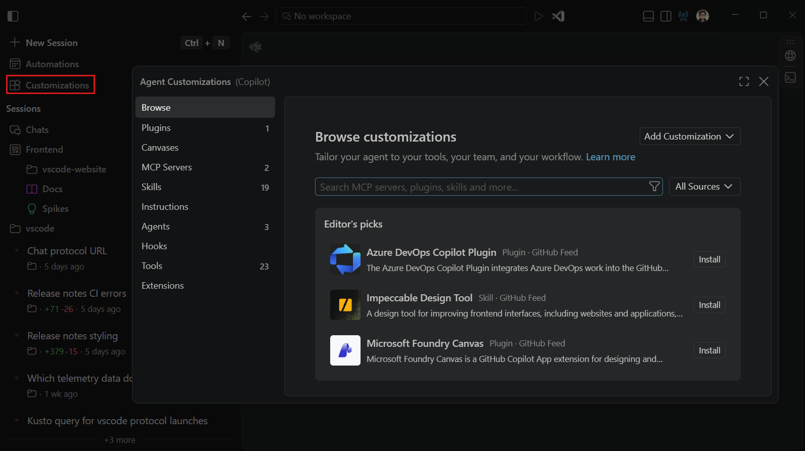
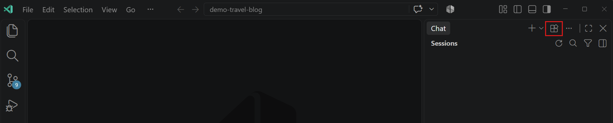

+++
title = "2.4.1 自定义概述"
date = 2026-11-06T07:53:25+08:00
weight = 1
type = "docs"
description = ""
isCJKLanguage = true
draft = false
+++


> 原文链接: [https://code.visualstudio.com/docs/agent-customization/overview](https://code.visualstudio.com/docs/agent-customization/overview)

# 2.4.1 自定义概述

　　智能体自定义项使智能体适应你的编码标准、工作流和开发系统。在创建自己的自定义项之前，请先在自定义 Marketplace 中查找现有技能、插件或集成。本指南帮助你在 VS Code 中查找、安装和验证自定义项，或创建项目特定指导。要了解不同自定义类型如何区分和协同工作，请参阅[智能体自定义概念](../../concepts/2.7.7-AgentCustomization/)。

> **核心概念**：了解不同自定义类型以及何时使用每种类型，请参阅[自定义概念](../../concepts/2.7.7-AgentCustomization/)。

> **教程**：按照动手演练为项目自定义 AI，请参阅[为项目自定义 AI](../../tutorials-and-guides/2.6.10-AdaptAgentsToYourProject/)。

## 选择自定义方式 {#choose-how-to-customize}

　　从一个反复出现的任务或观察到的问题开始，例如智能体使用了错误的测试命令。选择一个代表性任务并定义预期结果。如果智能体已满足需求，请不要添加自定义项。将一次性需求放入当前请求。

| 如果你希望 | 从以下开始 |
|----------------|------------|
| 采用现有工作流或打包设置 | [浏览自定义 Marketplace](#discover-and-install-existing-customizations-preview)查找技能、插件和集成 |
| 停止重复项目命令和约定 | [创建或完善项目指令](../2.4.4-Instructions/#get-started-with-project-instructions) |
| 复用团队特定的多步骤过程 | [创建或调整智能体技能](../2.4.3-AgentSkills/#create-a-skill) |
| 为反复出现的角色提供聚焦指导和工具 | [创建自定义智能体](../2.4.5-CustomAgents/) |
| 连接外部服务 | [使用 Copilot 连接器](../2.4.6-CopilotConnectors/)或[添加 MCP 服务器](../2.4.7-AddMCPServers/#connect-a-server) |
| 在智能体工作流的特定事件运行操作 | [配置钩子](../2.4.9-Hooks/) |

　　在从头创建之前，请复用或调整现有自定义项。可以组合方法，例如安装插件并添加项目指令。关于保存的提示词和所有选项的比较，请参阅[自定义类型和激活](../../concepts/2.7.7-AgentCustomization/#customization-options-at-a-glance)。

　　完整项目演练请遵循[为代码库配置 AI](../../tutorials-and-guides/2.6.10-AdaptAgentsToYourProject/)。

## 检查运行框架兼容性 {#check-harness-compatibility}

　　智能体运行框架协调会话的模型、工具和自定义项。它决定支持哪些自定义格式和位置。选择不同语言模型不会更改这些要求。

安装、复制或创建自定义项之前：

1. 在新聊天的 **会话目标** 控件中[选择目标运行框架](../../choose-models-and-agents/2.3.2-ChooseAnAgentHarness/#select-a-harness)。
2. 按下面说明为该运行框架打开智能体自定义编辑器。
3. 遵循对应自定义类型的指南，了解运行框架特定的文件位置、字段和激活规则。

> **注意**：[提示词文件](../2.4.10-PromptFiles/)和工具集需要聊天视图中的 **Local** 运行框架会话。智能体窗口不支持 Local 会话。对于其他兼容技能的运行框架中的可复用工作流，请使用技能而不是提示词文件。

### 选择自定义作用域 {#choose-a-customization-scope}

　　将自定义项存储在与其使用和共享方式匹配的最窄作用域：

* **用户**：跨工作区使用自定义项，不提交到项目。
* **工作区**：通过源代码管理与贡献者共享项目指导和工作流。
* **组织**：跨仓库集中管理受支持的自定义类型。通过 GitHub 配置，而不是智能体自定义编辑器。

　　并非每种自定义类型都支持每个作用域。用户文件必须存储在智能体运行所在机器上运行框架支持的位置，并且不会在机器之间自动共享。支持的位置请遵循各自定义指南。

## 智能体自定义编辑器 {#agent-customizations-editor}

　　智能体自定义编辑器提供集中位置，用于发现、创建和管理所选运行框架的自定义项。它将自定义类型组织到不同部分，根据类型和来源提供配置表单、内联文件编辑器或只读详情。

按照以下步骤打开智能体自定义编辑器：

**智能体窗口**

　　在左侧边栏中选择 **自定义项** 打开智能体自定义编辑器，然后在编辑器中选择自定义类型。



　　实验性 **扩展** 部分还允许你[选择哪些已安装扩展在智能体窗口中运行](../../work-with-ai/2.2.9-ConfigureTheAgentsWindow/#manage-extensions-experimental)。

**聊天视图**

　　在聊天视图中选择标题栏中的 **打开自定义项**，或从命令面板（`Ctrl + Shift + P`）运行 **Chat: Open Customizations**。



### 使用深层链接打开自定义页面 {#open-customization-pages-with-deep-links}

　　也可以使用 `chat-customizations/open` URL 直接导航到智能体自定义编辑器的特定部分：

```text
vscode://chat-customizations/open?page=<page>&search=<query>
```

参数：

* **`page`**（必需）：要打开的自定义部分。支持的值包括：
  * `discover`：打开自定义 Marketplace（**浏览** 页面）。需要 `chat.customizations.marketplace.enabled`。
  * `agents`：打开自定义智能体部分。
  * `skills`：打开智能体技能部分。
  * `instructions`：打开自定义指令部分。
  * `hooks`：打开钩子部分。
  * `mcp-servers`：打开 MCP 服务器部分（也接受 `mcp-server`）。
  * `plugins`：打开智能体插件部分。
  * `tools`：打开工具部分。
  * `migrations`：打开迁移审查视图。
* **`search`**（可选）：要在部分搜索字段中预填充的搜索查询。对查询值进行 URL 编码。

　　这些链接在所选运行框架上下文中导航；它们不会安装自定义项，也不会绕过同意、工作区信任或企业策略。

**示例：**

* 打开插件部分：

  ```text
  vscode://chat-customizations/open?page=plugins
  ```

* 打开筛选到“python”的技能：

  ```text
  vscode://chat-customizations/open?page=skills&search=python
  ```

* 打开发现 Marketplace：

  ```text
  vscode://chat-customizations/open?page=discover
  ```

> **注意**：对于 VS Code Insiders，请使用 `vscode-insiders://` 方案而不是 `vscode://`。要在网页或 Markdown 徽章上共享链接，请使用 HTTPS 重定向包装：`https://vscode.dev/redirect?url=<url-encoded-vscode-URL>`。URL 处理程序详情请参阅 [URL 处理](../../../editor/3.3-ConfigureTheEditor/3.3.10-CommandLineInterface/#url-handling)。

## 发现和安装现有自定义项（预览） {#discover-and-install-existing-customizations-preview}

　　使用自定义 Marketplace 查找可复用工作流或集成，而不是从头构建。统一 **浏览** 页面汇集可用来源，包括插件 Marketplace、GitHub 源和 Copilot 连接器。可用来源和安装操作取决于所选运行框架和组织策略。

　　可以安装单个技能，或安装捆绑相关自定义项（例如技能、自定义智能体、钩子和 MCP 服务器）的插件。对于服务集成，请查找 MCP 服务器或无需服务器设置即可连接受支持的服务。

要查找并安装自定义项：

1. 打开智能体自定义编辑器，选择 **浏览**。
2. 使用来源菜单浏览所有来源，或选择特定可用来源，例如 **GitHub 源** 或单个插件 Marketplace。
3. 按名称搜索或使用类型筛选器，例如 `@type:skill` 或 `@type:mcp`。
4. 选择项目，审查其发布者、来源、安装详情和任何设置要求。
5. 选择 **安装**，在提示时选择目标。对于 Copilot 连接器，请选择 **连接** 并完成授权。

　　某些项目可供发现，但不支持自动安装。如果提供发布者设置说明，请遵循这些说明。

　　如果团队通过其他 Marketplace 共享插件，请从来源菜单选择 **配置 Marketplace**，[添加或管理插件 Marketplace](../2.4.2-Plugins/#configure-plugin-marketplaces)。添加 Marketplace 只会使其插件可浏览，不会安装它们。

　　安装后，完成发布者设置并用代表性任务[验证自定义项](#verify-a-customization)。类型特定指导请参阅[安装技能](../2.4.3-AgentSkills/#install-a-skill-from-the-customization-marketplace-preview)、[安装插件](../2.4.2-Plugins/#install-a-plugin-from-a-marketplace)或[查找 MCP 服务器](../2.4.7-AddMCPServers/#find-another-server)。

### Marketplace 可用性 {#marketplace-availability}

　　当 Marketplace 来源可用时，会显示 **浏览** 页面。Marketplace 发现默认通过 `chat.customizations.marketplace.enabled` 启用。

　　如果 **浏览** 不可用，请检查该设置是否启用，以及组织是否允许 **编辑器预览功能**。禁用该策略会强制关闭统一 **浏览** 体验和 Copilot 连接器。请参阅[组织和企业设置](../../../enterprise/7.2-ManageAISettings/#use-github-organization-and-enterprise-settings)。

　　对于提供 Marketplace 搜索的运行框架，实验性 GitHub 源默认启用。Local 会话不提供此来源，组织策略可能限制访问。使用 `chat.customizations.marketplace.sources.publicFeed.enabled` 设置显示或隐藏此来源。要在没有统一 **浏览** 页面的情况下发现插件，请遵循[插件安装指南](../2.4.2-Plugins/#install-a-plugin-from-a-marketplace)。

## 创建自定义项 {#create-a-customization}

　　对于基于文件的自定义项，使用编辑器在所选作用域创建文件：

1. 打开智能体自定义编辑器，选择自定义类型。
2. 选择 **工作区** 旁的 `+` 按钮与项目共享自定义项，或选择 **用户** 旁跨工作区使用。
3. 输入名称，并在提示时选择存储位置。
4. 在内联编辑器中编辑自定义项，编辑器提供语法突出显示和验证。
5. 审查并保存自定义项。

　　也可以从命令面板（`Ctrl + Shift + P`）运行 **Chat: New \<customization-type\>** 命令。该命令会在该自定义类型的受支持位置创建相应文件。

要手动添加 MCP 服务器，请选择 **MCP 服务器**，在 **用户** 或 **工作区** 组中选择 **添加服务器**（**+**），并遵循引导流程。详细步骤请参阅[添加 MCP 服务器](../2.4.7-AddMCPServers/#connect-a-server)。要更新现有连接，请参阅[编辑 MCP 服务器配置](../2.4.8-ManageMCPServers/#edit-an-mcp-server-configuration)。

　　创建或保存文件不能证明智能体会使用它。依赖或与团队共享之前，请验证自定义项。

## 验证自定义项 {#verify-a-customization}

　　使用目标运行框架和工作区，在新聊天中重复代表性任务。不要在测试提示词中重复自定义项的规则。分别检查以下三个阶段：

1. **发现**：打开智能体自定义编辑器，确认自定义项已列出且没有验证错误。
2. **包含或调用**：检查请求是否使用自定义项。对于指令和技能，检查响应的 **引用** 部分（如果可用），或查看[智能体调试日志](../../reference-and-help/troubleshooting/2.8.2.2-DebugChatInteractions/#instructions-or-a-prompt-file-are-not-applied)。对于工具和钩子，检查相应工具活动或执行日志。
3. **有效性**：对照定义的结果审查更改、命令和结果。包含并不保证智能体遵循指导。

　　例如，如果项目指令指定了正确的测试命令，请要求智能体做一个小代码更改，不要重复该命令。确认它运行预期测试并报告结果。

　　如果某个阶段失败，请在添加更多指导之前[排查该阶段](#troubleshoot-customization-issues)。自定义项达到目标后，在共享前审查它。完整的前后工作流请参阅[为代码库配置 AI](../../tutorials-and-guides/2.6.10-AdaptAgentsToYourProject/)。

## 管理现有自定义项 {#manage-existing-customizations}

使用智能体自定义编辑器查找和更新所选运行框架的自定义项：

1. 打开智能体自定义编辑器，选择自定义类型。
2. 使用搜索框查找自定义项。
3. 选择自定义项打开其详情。
4. 如果自定义项可编辑，更新其表单或文件并保存更改。对于只读自定义项，使用可用操作打开源文件。

　　可用操作取决于自定义类型及其来源。使用内联操作或上下文菜单执行支持的操作，例如在操作系统中显示可编辑文件或删除它。从 **插件** 部分管理插件提供的自定义项。

> **重要**：如果智能体自定义编辑器显示 **迁移**，Copilot 无法使用一个或多个当前位置或格式的自定义项。选择 **迁移** 审查所需工作，并按照[在 VS Code 中迁移 Copilot 自定义项](../2.4.11-MigrateExistingCustomizations/)执行详细步骤。

## 排查自定义问题 {#troubleshoot-customization-issues}

根据验证结果选择下一步操作：

| 症状 | 检查内容 |
|---------|---------------|
| 自定义项未列出 | 确认运行框架、文件名和受支持位置。确保会话使用包含更改的文件夹。 |
| 自定义项有验证错误 | 更正报告的文件或配置错误。 |
| 已发现但未包含或调用 | 对照当前文件或任务检查激活条件。支持时显式调用按需自定义项。 |
| 已包含但未改善结果 | 解决冲突指导，使模糊规则更具体，并在新聊天中重复任务。 |

　　对于钩子，还要验证脚本的事件输入和输出。用户文件夹、设置、仓库、自定义智能体和插件中的钩子可能需要[手动迁移到共享 Copilot 运行时](../2.4.11-MigrateExistingCustomizations/#migrate-hooks)，即使文件已被发现。

　　如果问题仍然存在，请遵循[自定义诊断和智能体故障排除](../../reference-and-help/troubleshooting/2.8.2.1-Troubleshooting/#check-customization-diagnostics)。

## 高级场景 {#advanced-scenarios}

### 修复 Marketplace 安装 {#repair-marketplace-installations}

　　如果从 Marketplace 安装的技能显示 **文件缺失**，请选择 **修复** 仅恢复缺失文件。修复会保留你编辑或添加的文件。**已安装** 表示记录的目标可用。

　　Marketplace 安装的自定义项和同名本地自定义项保持独立。删除 Marketplace 安装不会移除无关的本地自定义项。

### 管理画布扩展 {#manage-canvas-extensions}

　　**画布** 部分列出活动本地 Copilot 会话可用的画布扩展，并按来源分组。前提条件、打开画布和管理扩展启用，请参阅[在智能体中使用画布](../../work-with-ai/2.2.6-Canvases/)。

### 在 monorepo 中使用自定义项 {#use-customizations-in-a-monorepo}

　　在 monorepo 中，可能打开仓库的子文件夹而不是仓库根目录。对于 Local 运行框架发现，启用 `chat.useCustomizationsInParentRepositories` 也可从父仓库发现自定义项。其他运行框架使用自己的发现规则。请参阅[嵌套项目指令](../../reference-and-help/reference/2.8.1.6-CustomInstructionsReference/#nested-project-instructions)。

　　启用此设置后，VS Code 从每个工作区文件夹沿文件夹层次向上查找，直到找到 `.git` 文件夹。如果找到，它会收集工作区文件夹与仓库根目录（含）之间所有文件夹的自定义项。这适用于所有自定义类型：始终启用的指令（`copilot-instructions.md`、`AGENTS.md`、`CLAUDE.md`）、基于文件的指令、提示词文件、自定义智能体、智能体技能和钩子。

例如，考虑以下 monorepo 结构：

```text
my-monorepo/              # repo root (has .git folder)
├── .github/
│   ├── copilot-instructions.md
│   ├── instructions/
│   │   └── style.instructions.md
│   ├── prompts/
│   │   └── review.prompt.md
│   └── agents/
│       └── reviewer.agent.md
├── packages/
│   └── frontend/          # opened as workspace folder
│       └── src/
```

　　如果只在 VS Code 中打开 `packages/frontend/` 并启用该设置，VS Code 会发现仓库根目录的自定义文件，例如 `copilot-instructions.md`、`style.instructions.md`、`review.prompt.md` 和 `reviewer.agent.md`。

父仓库发现条件：

* 工作区文件夹不包含 `.git` 文件夹（它本身不是仓库根目录）。
* 父文件夹包含 `.git` 文件夹。
* 父仓库文件夹受[信任](../../../editor/3.2-WriteCode/3.2.8-Workspaces/3.2.8.3-WorkspaceTrust/)。打开工作区时，VS Code 会提示信任父文件夹。

> **注意**：`chat.useCustomizationsInParentRepositories` 设置默认禁用。

### 评估和改进自定义文件（预览） {#evaluate-and-improve-customization-files-preview}

　　对于较大的自定义集合，单独发布的 [Chat Customizations Evaluations 扩展](https://marketplace.visualstudio.com/items?itemName=ms-vscode.vscode-chat-customizations-evaluations)会分析技能、自定义智能体、指令和提示词文件中的模糊、矛盾和过于复杂的规则。

　　安装扩展后，打开自定义文件，从命令面板（`Ctrl + Shift + P`）运行 **Chat Customizations Evaluations: Analyze**。在 **问题** 面板（`Ctrl + Shift + M`）中审查诊断，然后选择 **实施建议**。

　　关于分析指导和使用 [Waza](https://github.com/microsoft/waza)进行技能评估，请运行 **Chat Customizations Evaluations: Open Analysis and Fix User Guide**。文件分析补充但不能替代在代表性任务上测试自定义项。

## 相关资源 {#related-resources}

* [自定义概念](../../concepts/2.7.7-AgentCustomization/)
* [为代码库配置 AI](../../tutorials-and-guides/2.6.10-AdaptAgentsToYourProject/)
