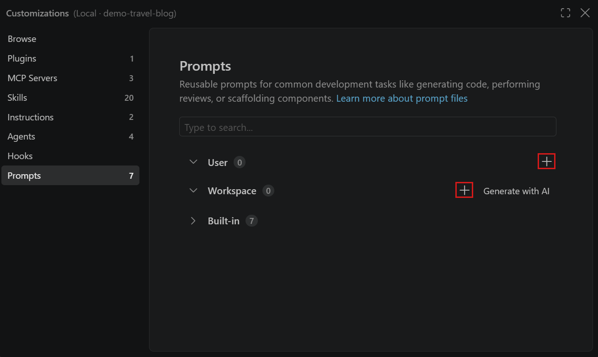
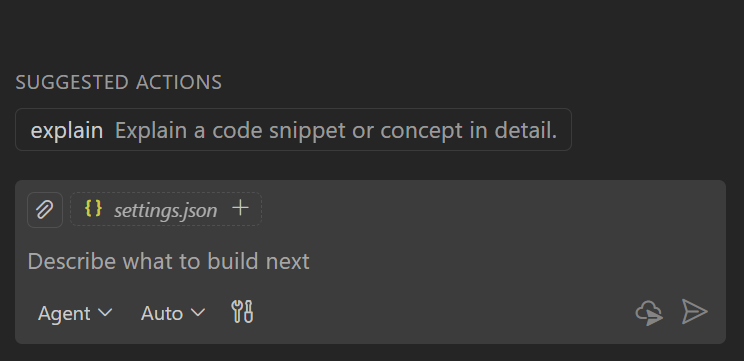

+++
title = "2.4.10 提示词文件"
date = 2026-11-06T07:53:25+08:00
weight = 10
type = "docs"
description = ""
isCJKLanguage = true
draft = false
+++


> 原文链接: [https://code.visualstudio.com/docs/agent-customization/prompt-files](https://code.visualstudio.com/docs/agent-customization/prompt-files)

# 2.4.10 提示词文件

　　提示词文件将常见任务的提示词编码为独立 Markdown 文件，并在聊天中作为斜杠命令调用。每个提示词文件包含任务特定上下文以及如何执行该任务的指南。

　　与自动应用的[自定义指令](../2.4.4-Instructions/)不同，提示词文件由你在聊天中手动调用。要将提示词文件与自定义智能体、智能体技能和其他选项比较，请参阅[决策矩阵](../../concepts/2.7.7-AgentCustomization/#customization-options-at-a-glance)。

使用提示词文件的场景：

* 简化常见任务的提示词，例如搭建新组件、运行和修复测试或准备拉取请求。
* 覆盖自定义智能体的默认行为，例如创建最小实现计划或为 API 调用生成模拟。

　　在选中 **Local** 的情况下，使用[智能体自定义编辑器](../2.4.1-Overview/#agent-customizations-editor)发现、创建和管理提示词文件。从命令面板运行 **Chat: Open Customizations**。

> **重要**：提示词文件只在聊天视图的 **Local** 运行框架会话中运行。要在其他运行框架中使用可复用工作流，请创建[智能体技能](../2.4.3-AgentSkills/)或[将现有提示词文件转换为技能](../2.4.11-MigrateExistingCustomizations/#convert-prompt-files-to-skills)。

　　编写提示词文件之前，请考虑[在自定义 Marketplace 中复用技能](../2.4.3-AgentSkills/#install-a-skill-from-the-customization-marketplace-preview)完成相同任务。这会安装技能，而不是 Local 提示词文件。请遵循技能的运行框架要求和调用说明。

## 创建提示词文件 {#create-a-prompt-file}

　　创建提示词文件之前，请在聊天视图中选择 **Local** 运行框架。选择将文件存储在工作区还是用户配置文件。工作区提示词文件可用于该工作区中的 Local 会话。用户提示词文件可用于同一配置文件中跨工作区的 Local 会话。

使用智能体自定义编辑器在所选作用域中创建文件：

1. 在聊天视图中选择标题栏的 **打开自定义项**，打开智能体自定义编辑器，然后选择 **提示词**。
2. 根据存储位置，选择 **工作区** 或 **用户** 组旁的 **新建提示词**（加号图标）。

    

3. 选择位置，输入提示词文件名。这是在聊天中输入 `/` 时显示的默认名称。
4. 用以下自包含提示词替换生成的内容：

    ```markdown
    ---
    name: review-api-security
    agent: agent
    description: Review a REST API implementation for common security risks
    argument-hint: [API folder or file]
    ---
    Review the REST API implementation identified by the user. If no path is provided, ask which folder or file to review.

    Check authentication, authorization, input validation, sensitive-data handling, and rate limiting. Do not claim that a control exists unless the available code demonstrates it.

    Return a Markdown TODO list grouped by high, medium, and low priority. For each item, cite the relevant file and explain the risk. If you find no issue in a category, say what you checked.
    ```

5. 保存文件。之后可以在智能体自定义编辑器中打开并修改。

　　也可以从命令面板（`Ctrl + Shift + P`）运行 **Chat: New Prompt File** 或 **Chat: New Untitled Prompt File**，或在 Local 聊天中输入 `/prompts` 打开 **配置提示词文件**。

### 使用 AI 生成提示词文件 {#generate-a-prompt-file-with-ai}

　　具有文件编辑工具的智能体可以帮助编写提示词文件，即使你使用其他运行框架编写。告诉智能体该文件将在 Local 会话中运行，并描述任务、预期输出和存储位置。使用前审查生成的文件。

　　在 Copilot 会话中编写 `.prompt.md` 文件不会使该文件可由 Copilot 运行框架运行。要在该运行框架中复用工作流，请[创建技能](../2.4.3-AgentSkills/#create-a-skill)或[转换现有提示词文件](../2.4.11-MigrateExistingCustomizations/#convert-prompt-files-to-skills)。

　　在选中 **Local** 的情况下，也可以在聊天中输入 `/create-prompt` 后跟描述。智能体会提出澄清问题、生成带适当 frontmatter 和指令的 `.prompt.md` 文件，并让你选择工作区或用户存储。其他运行框架不支持 `/create-prompt` 命令。

　　也可以要求智能体将正在进行的对话捕获为 Local 会话的提示词文件。请指定目标运行框架，以免创建无法使用的自定义格式。

　　在聊天视图中选中 **Local** 后，还可以在智能体自定义编辑器的 **提示词** 部分选择 **工作区** 组旁的 **使用 AI 生成** 来生成提示词文件。

## 在聊天中使用提示词文件 {#use-a-prompt-file-in-chat}

　　运行提示词之前，请在聊天视图中选择 **Local**。以下选项在 Local 会话中运行提示词文件：

* 在聊天视图中，在聊天输入框输入 `/` 后跟提示词名称。智能体技能也会与提示词文件一起作为斜杠命令出现。可以在聊天输入框中添加额外信息，例如 `/review-api-security src/api` 指定要审查的 API 文件夹。
* 从命令面板（`Ctrl + Shift + P`）运行 **Chat: Run Prompt**，从快速选择中选择提示词文件。
* 在编辑器中打开提示词文件，按编辑器标题区域的播放按钮。可以选择在当前聊天会话中运行提示词，或打开新聊天会话。此选项适合快速测试和迭代提示词文件。

> **提示**：使用 `chat.promptFilesRecommendations` 设置在新聊天会话开始时将提示词显示为推荐操作。
>
> 

## 验证和完善提示词文件 {#verify-and-refine-a-prompt-file}

分别测试发现和有效性：

1. 在创建提示词的工作区中启动新的 **Local** 聊天。
2. 输入 `/`，确认出现 `/review-api-security`。如果没有，请遵循[排查提示词文件](#troubleshoot-prompt-files)。
3. 运行 `/review-api-security`，后跟一个小型 API 文件或文件夹的路径。
4. 确认结果引用文件、按优先级分组发现，并区分已观察到的控制和缺失或不确定的控制。
5. 打开提示词文件，调整产生不清晰或不支持结果的指令，并使用编辑器播放按钮在新聊天中重新运行同一请求。

　　发现只确认 Local 运行框架找到了文件。请审查结果和工具活动，确定提示词对任务是否有效。

## 排查提示词文件 {#troubleshoot-prompt-files}

如果提示词缺失或产生意外结果：

1. 确认会话目标是 **Local**，并且文件具有 `.prompt.md` 扩展名。
2. 确认工作区提示词位于打开工作区的 `.github/prompts` 中，或用户提示词位于当前 VS Code 配置文件中。
3. 检查 YAML frontmatter 语法错误，并确认配置的智能体、模型和工具可用。
4. 在新聊天中运行提示词，避免之前任务的上下文。
5. 从聊天视图的省略号（**...**）菜单打开智能体调试日志面板，检查发现和相关错误。详细了解[排查 VS Code 中的 AI](../../reference-and-help/troubleshooting/2.8.2.1-Troubleshooting/)。

## 提示词文件参考 {#prompt-file-reference}

### 位置 {#locations}

　　可以为特定工作区定义提示词文件，或在用户级别定义，使其在所有工作区中可用。下表列出 Local 运行框架使用的默认提示词文件位置。

| 作用域 | 默认文件位置 |
|-------|-----------------------|
| 工作区 | `.github/prompts` 文件夹 |
| 用户配置文件 | 用户数据（特定于 VS Code 配置文件） |

　　要创建用户级提示词文件，请使用智能体自定义编辑器或 **Chat: New Prompt File** 命令。

> **提示**：在 monorepo 中，启用 `chat.useCustomizationsInParentRepositories` 以从父仓库根目录发现提示词文件。详细了解[父仓库发现](../2.4.1-Overview/#use-customizations-in-a-monorepo)。

### 文件格式 {#file-format}

　　提示词文件是带 `.prompt.md` 扩展名的 Markdown 文件。可选的 YAML frontmatter 头配置提示词行为：

| 字段 | 必需 | 说明 |
| --- | --- | --- |
| `description` | 否 | 提示词的简短说明。 |
| `name` | 否 | 提示词名称，在聊天中输入 `/` 后使用。未指定时使用文件名。 |
| `argument-hint` | 否 | 显示在聊天输入框中的提示文本，指导用户如何与提示词交互。 |
| `agent` | 否 | 运行提示词使用的智能体：`ask`、`agent`、`plan` 或[自定义智能体](../2.4.5-CustomAgents/)名称。默认使用当前智能体。如果指定工具，默认智能体为 `agent`。 |
| `model` | 否 | 运行提示词时使用的语言模型。未指定时使用模型选择器中当前选中的模型。 |
| `tools` | 否 | 此 Local 运行框架提示词可用的工具名称列表。可以包含内置工具、MCP 工具或扩展提供的工具。要包含 MCP 服务器的所有工具，请使用 `<server name>/*` 格式。现有工具集引用已弃用，请参阅[替换工具集](../2.4.11-MigrateExistingCustomizations/#replace-tool-sets)。<br/>详细了解[智能体工具](../../work-with-ai/plan-and-run-tasks/2.2.10.2-UseTools/)。 |

> **注意**：如果运行提示词时给定工具不可用，它会被忽略。

　　正文包含 Markdown 格式的提示词文本。提供你希望 AI 遵循的具体指令、指南或其他相关信息。

#### 引用文件 {#reference-files}

　　可以使用 Markdown 链接或 `#file:` 语法在提示词正文中引用文件。

* 对于工作区文件，使用相对于提示词文件的路径。例如，`[coding standards](../instructions/coding.instructions.md)` 引用同级 `instructions` 文件夹中的文件。
* 对于环境用户主目录中的文件，使用 `~` 或以 `~/` 开头。单独的 `~` 引用用户主目录，`~/prompts/style-guide.md` 等路径从该文件夹解析。

　　使用 Unix 风格 `/` 路径分隔符，以保持提示词文件跨操作系统可移植。

以下示例使用两种引用格式引用用户主目录中的文件：

```markdown
Review [my personal instructions](~/copilot/instructions.md).
Use #file:~/templates/component.md as the component template.
```

　　要在正文中引用智能体工具，请使用 `#tool:<tool-name>` 语法。例如，要引用 `browser` 工具，请使用 `#tool:browser`。

> **提示**：如果希望用户提供额外信息，可以使用 `vscode/askQuestion` 工具。也可以使用 `${input:variableName}`、`${input:variableName:placeholder}` 等语法。大多数语言模型理解此语法，并会提示输入。

### 工具列表优先级 {#tool-list-priority}

　　可以使用 `tools` 元数据字段为自定义智能体和提示词文件指定可用工具列表。提示词文件还可以使用 `agent` 元数据字段引用自定义智能体。

聊天中可用工具列表按以下优先级确定：

1. 提示词文件中指定的工具（如果有）。
2. 提示词文件中引用的自定义智能体的工具（如果有）。
3. 所选智能体的默认工具（如果有）。

## 跨设备同步用户提示词文件 {#sync-user-prompt-files-across-devices}

　　VS Code 可以使用[设置同步](../../../editor/3.3-ConfigureTheEditor/3.3.5-SettingsSync/)在多台设备之间同步用户提示词文件。

要同步用户提示词文件，请启用设置同步，并从命令面板（`Ctrl + Shift + P`）运行 **Settings Sync: Configure**。从要同步的设置列表中选择 **提示词和指令**。

## 编写有效提示词的技巧 {#tips-for-writing-effective-prompts}

* 清楚描述提示词应完成什么以及预期输出格式。
* 提供预期输入和输出示例，引导 AI 响应。
* 使用 Markdown 链接引用自定义指令，而不是在每个提示词中重复指南。
* 利用 `${selection}` 等内置变量和输入变量，使提示词更灵活。
* 修改提示词后，使用编辑器播放按钮重新运行相同任务。

## 相关资源 {#related-resources}

* [创建自定义指令](../2.4.4-Instructions/)
* [配置智能体工具](../../work-with-ai/plan-and-run-tasks/2.2.10.2-UseTools/)
* [社区贡献的指令、提示词和自定义智能体](https://github.com/github/awesome-copilot)
