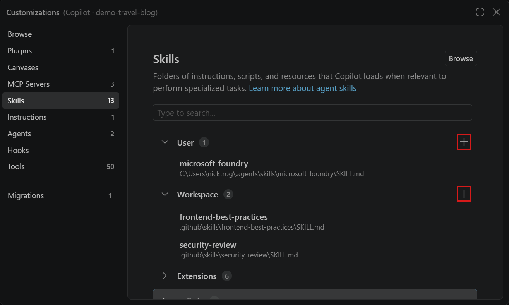

+++
title = "2.4.3 智能体技能"
date = 2026-11-06T07:53:25+08:00
weight = 3
type = "docs"
description = ""
isCJKLanguage = true
draft = false
+++


> 原文链接: [https://code.visualstudio.com/docs/agent-customization/agent-skills](https://code.visualstudio.com/docs/agent-customization/agent-skills)

# 2.4.3 智能体技能

　　智能体技能是包含指令、脚本和资源的文件夹，AI 智能体可以在相关时加载它们来执行专门任务。智能体技能是[开放标准](https://agentskills.io)，可跨多个 AI 智能体使用，包括 VS Code 中的 GitHub Copilot、GitHub Copilot CLI、GitHub Copilot 应用以及[实验性 OpenAI Codex 集成](../../choose-models-and-agents/2.3.2-ChooseAnAgentHarness/#codex)。

　　与主要定义编码指南的[自定义指令](../2.4.4-Instructions/)不同，技能支持包含脚本、示例和其他资源的专门能力与工作流。创建的技能可在兼容技能的智能体之间移植，但支持的位置和可选功能因智能体而异。除非另有说明，本页配置选项和控件适用于 GitHub Copilot。

　　技能与其他自定义选项的比较请参阅[自定义概念](../../concepts/2.7.7-AgentCustomization/)。

智能体技能的主要优势：

* **专门化 Copilot**：针对领域任务定制能力，无需重复上下文。
* **减少重复**：创建一次，在所有对话中自动使用。
* **组合能力**：组合多个技能构建复杂工作流。
* **高效加载**：只在需要时将相关内容加载到上下文。

> **提示**：使用[智能体自定义编辑器](../2.4.1-Overview/#agent-customizations-editor)在一个地方发现、创建和管理所有智能体自定义项。从命令面板运行 **Chat: Open Customizations**。

## 智能体技能与自定义指令 {#agent-skills-vs-custom-instructions}

　　两者都帮助自定义 Copilot 行为，但用途不同：

| 功能 | 智能体技能 | 自定义指令 |
| ------- | ------------ | ------------------- |
| **用途** | 教授专门能力和工作流 | 定义编码标准和指南 |
| **可移植性** | 可在[兼容技能的编码智能体](#agent-skills-standard)之间复用，受各智能体支持位置和功能限制 | 可在支持所选[指令格式](../../reference-and-help/reference/2.8.1.6-CustomInstructionsReference/#supported-formats-and-locations)的体验中复用 |
| **内容** | 指令、脚本、示例和资源 | 仅指令 |
| **作用域** | 任务特定，按需加载 | 始终应用（或通过 glob 模式） |
| **标准** | 开放标准（[agentskills.io](https://agentskills.io)） | 多种格式，例如 `AGENTS.md` 和 `.github/copilot-instructions.md` |

　　例如，可以在 VS Code 和 [GitHub Copilot CLI](https://docs.github.com/en/copilot/how-tos/copilot-cli/customize-copilot/add-custom-instructions)之间共享仓库的 `.github/copilot-instructions.md`。请检查每个体验支持的文件位置和激活规则。

使用智能体技能的场景：

* 创建可跨不同 AI 工具工作的可复用能力。
* 在指令旁包含脚本、示例或其他资源。
* 与更广泛的 AI 社区共享能力。
* 定义测试、调试或部署等专门工作流。

使用自定义指令的场景：

* 定义项目特定的编码标准。
* 设置语言或框架约定。
* 指定代码审查或提交消息指南。
* 使用 glob 模式按文件类型应用规则。

## 使用现有技能 {#use-an-existing-skill}

　　如果现有技能提供了所需工作流，请从它开始。[浏览自定义 Marketplace](../2.4.1-Overview/#discover-and-install-existing-customizations-preview)安装单个技能，或查找[智能体插件](../2.4.2-Plugins/)中捆绑的技能。也可以复制并调整技能以适应项目。选择来源和位置之前，请检查[运行框架兼容性](../2.4.1-Overview/#check-harness-compatibility)。

　　技能包含其完整目录，而不仅是 `SKILL.md` 文件：脚本、模板、示例和其他资源都可以成为工作流的一部分。

### 从自定义 Marketplace 安装技能（预览） {#install-a-skill-from-the-customization-marketplace-preview}

　　使用自定义 Marketplace 从配置的来源查找和安装技能。Marketplace 发现默认启用。实验性 GitHub 源需要提供 Marketplace 搜索的运行框架。Local 会话不提供此来源，组织策略可能限制访问。

1. 打开智能体自定义编辑器，选择 **浏览**。
2. 从来源菜单选择 **GitHub 源**，然后按名称搜索技能，或在搜索中添加 `@type:skill`。
3. 选择技能，审查其发布者、来源和包含的文件。
4. 选择 **安装**，在提示时选择受支持的用户或工作区目标。
5. 在具有目标运行框架的会话中[验证已安装技能](#verify-a-skill)。

　　要复用插件中捆绑的技能，请从来源菜单选择插件 Marketplace，并[安装插件](../2.4.2-Plugins/#install-a-plugin-from-a-marketplace)。如果团队 Marketplace 未列出，请[通过 Configure Marketplaces 添加](../2.4.2-Plugins/#configure-plugin-marketplaces)。

　　VS Code 不会覆盖所选目标中的现有技能。如果另一个受支持位置包含同名技能，两个技能都会显示在 **技能** 页面。来源或发布者图像标识 Marketplace 安装，**复制相对路径** 显示其确切位置。

　　VS Code 会跟踪从 Marketplace 安装的每个技能的目录。从 **技能** 页面删除该技能不会移除其他位置的同名本地技能。

　　如果 Marketplace 安装的技能文件缺失，**浏览** 会显示 **文件缺失**。选择 **修复** 只恢复缺失的打包文件。你更改或添加的文件保持不变。

　　来源可用性和设置请参阅[发现和安装现有自定义项](../2.4.1-Overview/#discover-and-install-existing-customizations-preview)。

### 复制并调整现有技能 {#copy-and-adapt-an-existing-skill}

1. 将技能添加到工作区之前，审查其指令、脚本和其他资源。
2. 将整个技能目录复制到运行框架支持的[项目或个人位置](#skill-locations)。
3. 根据需要调整 `SKILL.md`。检查命令、文件路径、依赖项和对项目的假设。
4. 更新调整后指令使用的支持脚本、模板或示例。
5. 共享之前[验证调整后的技能](#verify-a-skill)。

> **提示**：只复用信任的技能。技能可能包含运行工具或与外部系统交互的脚本。使用前请审查[安全注意事项](../../work-with-ai/permissions-and-security/2.2.12.3-AISecurity/#approvals-and-review)。

## 创建技能 {#create-a-skill}

　　使用智能体自定义编辑器在所选运行框架支持的位置创建技能目录和 `SKILL.md` 文件。选择 **工作区** 与项目共享技能，或选择 **用户** 跨工作区使用。

1. 选择目标运行框架，从命令面板（`Ctrl + Shift + P`，macOS：`Cmd + Shift + P`）运行 **Chat: Open Customizations**，选择 **技能**。在智能体窗口中，也可以选择侧边栏中的 **自定义项**。
2. 选择 **工作区** 旁的 **新建技能**（加号图标）将技能存储在项目中，或选择 **用户** 旁跨工作区使用。

    

3. 在提示时选择位置，输入技能名称，例如 `test-changes`。编辑器会提供所选运行框架的位置。详情请参阅[技能位置](#skill-locations)。
4. 在生成的 `SKILL.md` 中描述技能的作用、使用时机和要遵循的指令。例如：

    ```markdown
    ---
    name: test-changes
    description: Run relevant project tests and report the results. Use when validating a code change.
    ---

    # Test changes

    1. Identify the tests that cover the changed code.
    1. Run them using the test commands documented in this repository.
    1. Report what passed, what failed, and any checks you couldn't run.
    ```

    保持 `name` 与技能目录名一致。其他字段请参阅[文件格式参考](#skillmd-file-format)。

5. 如果技能需要脚本、模板或示例，请将它们添加到技能目录，并在 `SKILL.md` 中引用。使用相对于 `SKILL.md` 的 Markdown 链接或 `#file:` 引用，例如 `[test template](./test-template.js)` 或 `#file:./test-template.js`。
6. 保存文件并[验证技能](#verify-a-skill)。

　　如果希望直接创建文件，请在[受支持的技能位置](#skill-locations)创建技能目录，并将指令保存为 `SKILL.md`。保持目录名与 frontmatter `name` 一致，然后用相同方式验证。

### 使用 AI 生成技能 {#generate-a-skill-with-ai}

　　不必自己编写文件，可以在使用目标运行框架的聊天中要求智能体创建技能。描述任务、技能适用时机和存储位置。例如：

```text
创建一个名为 test-changes 的项目技能，放在此运行框架支持的位置。
它应使用仓库中记录的命令识别并运行代码更改的相关测试，
然后报告通过、失败或未运行的内容。包含技能适用时机的描述。
```

　　也可以要求智能体将当前对话中的过程转化为技能，例如“根据我们刚才调试的方式创建一个技能”。审查生成的指令、文件位置和支持资源，然后[验证技能](#verify-a-skill)。

### Local 运行框架快捷方式 {#local-harness-shortcuts}

　　在聊天视图中选择 **Local** 后，还可以：

* 输入 `/skills` 打开 **配置技能** 菜单。
* 输入 `/create-skill` 后跟描述来生成技能。
* 在智能体自定义编辑器的 **技能** 部分选择 **使用 AI 生成**。

　　对于其他运行框架，请使用 **打开自定义项** 或直接在聊天中描述技能。

## 将技能用作斜杠命令 {#use-skills-as-slash-commands}

　　技能可以作为聊天中的斜杠命令出现，并在请求与其描述匹配时自动加载。在聊天输入框中输入 `/` 查看可用技能和提示词，选择技能进行调用。可以在命令后添加上下文，例如 `/test-changes for the authentication update`。

　　使用 `user-invocable` 和 `disable-model-invocation` frontmatter 属性控制每个技能的访问方式：

| 配置 | 斜杠命令 | Copilot 自动加载 | 用例 |
|---|---|---|---|
| 默认（两个属性都省略） | 是 | 是 | 通用技能 |
| `user-invocable: false` | 否 | 是 | 模型在相关时加载的后台知识技能 |
| `disable-model-invocation: true` | 是 | 否 | 只希望按需运行的技能 |
| 两个都设置 | 否 | 否 | 禁用的技能 |

## 验证技能 {#verify-a-skill}

　　安装、复制、创建或编辑技能后，使用以下检查。

　　使用目标运行框架和工作区启动新聊天。如果技能出现在 `/` 菜单中，请[自行运行技能](#use-skills-as-slash-commands)，给它一个预期能处理的小任务。审查工具活动和结果，确认它使用预期指令和资源。

　　如果希望智能体自动选择技能，请用匹配其描述的请求单独测试。发现和安装只使技能可用，不能保证智能体在每个相关请求中都选择它。

## 技能位置 {#skill-locations}

　　要与贡献者共享项目技能，请将其存储在仓库中。要跨工作区使用个人技能，请将其存储在主目录中。每个技能都有自己的目录，其中包含 `SKILL.md`。

下表列出每个运行框架支持的一个项目位置和个人位置，而不是它识别的所有目录。智能体自定义编辑器会为所选运行框架提供创建位置。

| 运行框架 | 技能目录 |
|---------|-------------------|
| Copilot | 项目：`.github/skills/`<br>个人：`~/.copilot/skills/` |
| Anthropic Claude | 项目：`.claude/skills/`<br>个人：`~/.claude/skills/` |
| OpenAI Codex | 项目：`.agents/skills/`<br>个人：`~/.agents/skills/` |
| Local | 项目：`.github/skills/`<br>个人：`~/.copilot/skills/` |

### Codex {#codex}

　　要与 OpenAI Codex 复用仓库技能，请[配置实验性 Codex 集成](../../choose-models-and-agents/2.3.2-ChooseAnAgentHarness/#codex)。除了原生 `.agents/skills/` 发现，此集成会在第一条提示词之前发现 `.github/skills/` 中的工作区技能，无需额外技能位置配置。

　　如果 `.github/skills/` 中的技能在多个工作区根目录中名称重复，主根目录优先。

　　当 [GitHub Copilot 企业托管设置生效](../../../enterprise/7.2-ManageAISettings/#claude-and-codex-availability)时，Codex 运行框架会被禁用。请联系部署设置的 IT 团队讨论访问权限。

### Local {#local}

　　Local 会话还会从 `.claude/skills/` 和 `.agents/skills/` 读取项目技能，从 `~/.claude/skills/` 和 `~/.agents/skills/` 读取个人技能。

　　已弃用的 `chat.agentSkillsLocations` 设置会为 Local 会话添加其他技能位置，并为兼容性保留。当其他运行框架在 VS Code 中运行时，编辑器会转发这些位置的技能。独立的运行框架客户端不会继承此设置。要从原生位置使用这些技能，请[将它们移动到受支持位置](../2.4.11-MigrateExistingCustomizations/#move-customizations-from-configured-locations)。

### Monorepo {#monorepos}

　　如果打开 monorepo 的子文件夹，在将技能存储到打开的工作区文件夹之上之前，请检查[父仓库发现要求](../2.4.1-Overview/#use-customizations-in-a-monorepo)。

## `SKILL.md` 文件格式 {#skillmd-file-format}

　　`SKILL.md` 是带 YAML frontmatter 的 Markdown 文件，定义技能的元数据和行为。

### 头部（必需） {#header-required}

头部是 YAML frontmatter，包含以下字段：

| 字段 | 必需 | 说明 |
|-------|----------|-------------|
| `name` | 是 | 技能的唯一标识符。只允许小写字母、数字和连字符（例如 `webapp-testing`）。不要使用斜杠、冒号、点或命名空间前缀。必须与父目录名一致。最多 64 个字符。无效字符会导致技能静默加载失败。 |
| `description` | 是 | 描述技能做什么**以及何时使用**。具体说明能力和用例，帮助 Copilot 决定何时加载技能。最多 1024 个字符。 |
| `argument-hint` | 否 | 技能作为斜杠命令调用时显示在聊天输入框中的提示文本。帮助用户了解应提供哪些额外信息（例如 `[test file] [options]`）。 |
| `user-invocable` | 否 | 控制技能是否作为斜杠命令出现在聊天菜单中。默认 `true`。设置为 `false` 可从 `/` 菜单隐藏技能，但仍允许智能体自动加载。 |
| `disable-model-invocation` | 否 | 控制智能体是否可以根据相关性自动加载技能。默认 `false`。设置为 `true` 要求仅通过 `/` 斜杠命令手动调用。 |
| `context` | 否 | 控制技能加载方式。默认内联（技能指令添加到父智能体上下文）。设置为 `fork` 在专用子智能体上下文中运行技能。请参阅[在分叉上下文中运行技能](#run-a-skill-in-a-forked-context)。 |

> **重要**：当技能通过[插件](../2.4.2-Plugins/)分发时，插件名会自动用作命令前缀（例如 `/my-plugin:test-runner`）。不要手动向技能 `name` 字段添加命名空间前缀。使用 `myorg/skillname` 或 `myorg:skillname` 等前缀会导致技能静默加载失败。

### 正文 {#body}

　　技能正文包含 Copilot 使用该技能时应遵循的指令、指南和示例。编写清晰、具体的说明，描述：

* 技能帮助完成什么
* 何时使用技能
* 要遵循的分步过程
* 预期输入和输出示例
* 对包含的脚本或资源的引用

　　可以使用 Markdown 链接或 `#file:` 语法引用文件。对于技能目录内的文件，请使用相对于 `SKILL.md` 的路径，例如 `[test script](./test-template.js)`。要引用环境用户主目录，请使用 `~`，或以 `~/` 开头，例如 `#file:~/skill-resources/test-template.js`。使用 Unix 风格 `/` 路径分隔符，以保持技能跨操作系统可移植。

### 在分叉上下文中运行技能 {#run-a-skill-in-a-forked-context}

　　默认情况下，VS Code 加载技能时，技能指令会添加到父智能体的上下文窗口。对于大型技能，或中间推理与对话其余部分无关的技能，可以改为在**分叉上下文**中运行技能。在分叉上下文中，技能在专用子智能体中执行，只将最终结果返回给父智能体。这样可以保持主对话上下文干净。

要在分叉上下文中运行技能，请将 `SKILL.md` frontmatter 的 `context` 字段设置为 `fork`：

```markdown
---
name: review-pr
description: Review a pull request for code quality, style, and correctness. Use when asked to review a PR.
context: fork
---

# PR review

Follow these steps to review the pull request...
```

　　对于以下技能，请使用 `context: fork`：

* 读取大量文件或运行冗长调查，且细节不需要留在主对话中。
* 生成父智能体可以直接处理的聚焦结果（例如摘要、报告或少量编辑）。
* 除最终输出外，不应影响父智能体行为。

> **注意**：要在分叉上下文中运行技能，请启用 `github.copilot.chat.skillTool.enabled` 设置。

## 示例技能 {#example-skills}

以下示例展示可以创建的不同类型技能。

**示例：Web 应用测试技能**

```markdown
---
name: webapp-testing
description: Guide for testing web applications using Playwright. Use this when asked to create or run browser-based tests.
---

# Web Application Testing with Playwright

This skill helps you create and run browser-based tests for web applications using Playwright.

## When to use this skill

Use this skill when you need to:
- Create new Playwright tests for web applications
- Debug failing browser tests
- Set up test infrastructure for a new project

## Creating tests

1. Review the [test template](./test-template.js) for the standard test structure
2. Identify the user flow to test
3. Create a new test file in the `tests/` directory
4. Use Playwright's locators to find elements (prefer role-based selectors)
5. Add assertions to verify expected behavior

## Running tests

To run tests locally:
```bash
npx playwright test
```

To debug tests:
```bash
npx playwright test --debug
```

## Best practices

- Use data-testid attributes for dynamic content
- Keep tests independent and atomic
- Use Page Object Model for complex pages
- Take screenshots on failure

To check the skill, run `/webapp-testing for the login page`. Confirm that the result identifies the relevant test file, uses the project test command, and reports whether the test passed.
```

**示例：GitHub Actions 调试技能**

```markdown
---
name: github-actions-debugging
description: Guide for debugging failing GitHub Actions workflows. Use this when asked to debug failing GitHub Actions workflows.
---

# GitHub Actions Debugging

This skill helps you debug failing GitHub Actions workflows in pull requests.

## Process

1. Use the `list_workflow_runs` tool to look up recent workflow runs for the pull request and their status
2. Use the `summarize_job_log_failures` tool to get an AI summary of the logs for failed jobs
3. If you need more information, use the `get_job_logs` or `get_workflow_run_logs` tool to get the full failure logs
4. Try to reproduce the failure locally in your environment
5. Fix the failing build and verify the fix before committing changes

## Common issues

- **Missing environment variables**: Check that all required secrets are configured
- **Version mismatches**: Verify action versions and dependencies are compatible
- **Permission issues**: Ensure the workflow has the necessary permissions
- **Timeout issues**: Consider splitting long-running jobs or increasing timeout values
```

## Copilot 如何使用技能 {#how-copilot-uses-skills}

　　技能会逐步加载内容，以保持上下文高效。以下是 Copilot 使用 `webapp-testing` 技能的示例：

1. **发现**：Copilot 从 YAML frontmatter 读取技能的 `name` 和 `description`。当你请求“帮我测试登录页”时，Copilot 根据描述将其匹配到 `webapp-testing` 技能。
2. **加载指令**：Copilot 将 `SKILL.md` 正文加载到上下文，使其可以访问详细测试过程和指南。也可以通过在聊天中输入 `/webapp-testing` 直接触发此步骤。
3. **访问资源**：当 Copilot 按指令工作时，只在引用时访问技能目录中的其他文件，例如 `test-template.js` 或示例场景。如果指令未引用某个文件，它不会被加载。

　　这种三级加载系统意味着可以安装许多技能而不消耗上下文。Copilot 只加载每个任务相关的内容。

　　选择使用[分叉上下文](#run-a-skill-in-a-forked-context)的技能遵循相同发现步骤，但其指令和读取的文件会加载到单独子智能体。只有技能的最终结果会返回给父智能体。

## 从扩展贡献技能 {#contribute-skills-from-extensions}

　　扩展可以使用 `package.json` 中的 `chatSkills` 贡献点提供技能。路径必须指向包含 `SKILL.md` 文件的目录，并遵循[智能体技能规范](https://agentskills.io/specification)。

### 必需的文件夹结构 {#required-folder-structure}

技能目录必须遵循以下结构：

```text
extension-root/
└── skills/
    └── my-skill/           # Directory name must match the `name` field in SKILL.md
        └── SKILL.md         # Required
```

### 在 package.json 中注册技能 {#register-the-skill-in-packagejson}

　　在扩展的 `package.json` 中添加 `chatSkills` 贡献点。`path` 属性必须指向对应的 `SKILL.md` 文件：

```json
{
  "contributes": {
    "chatSkills": [
      {
        "path": "./skills/my-skill/SKILL.md"
      }
    ]
  }
}
```

> **重要**：`SKILL.md` frontmatter 中的 `name` 字段必须与父目录名一致。例如，目录为 `skills/my-skill/` 时，`name` 字段必须为 `my-skill`。名称不匹配时技能不会加载。

　　`SKILL.md` 文件采用与[项目和个人技能](#create-a-skill)相同的格式。例如：

```markdown
---
name: my-skill
description: Description of what the skill does and when to use it.
---

# My Skill

Detailed instructions for the skill...
```

## 智能体技能标准 {#agent-skills-standard}

　　智能体技能是开放标准，支持跨不同 AI 智能体移植。在 VS Code 中创建的技能可用于多个智能体，包括：

* **VS Code 中的 GitHub Copilot**：在聊天和智能体模式中可用。
* **GitHub Copilot CLI**：在终端中工作时可访问。
* **GitHub Copilot 应用**：在专用桌面体验中可用。
* **OpenAI Codex 集成（实验性）**：在[设置集成](../../choose-models-and-agents/2.3.2-ChooseAnAgentHarness/#codex)后发现 `.github/skills/` 中的工作区技能。

　　请在 [agentskills.io](https://agentskills.io) 了解智能体技能标准。

## 相关资源 {#related-resources}

* [自定义 AI 响应概述](../2.4.1-Overview/)
* [创建自定义指令](../2.4.4-Instructions/)
* [创建可复用提示词文件](../2.4.10-PromptFiles/)
* [创建自定义智能体](../2.4.5-CustomAgents/)
* [智能体技能规范](https://agentskills.io)
* [参考技能仓库](https://github.com/anthropics/skills)
* [发现和管理智能体插件](../2.4.2-Plugins/)
