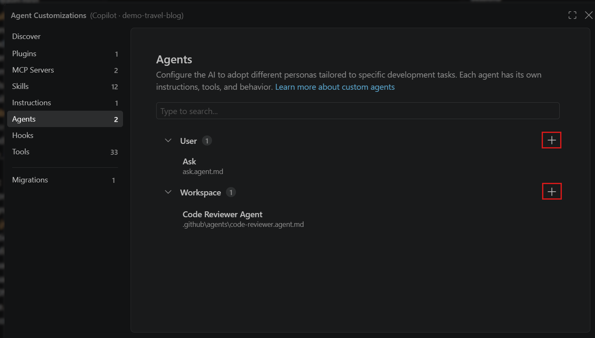

+++
title = "2.4.5 自定义智能体"
date = 2026-11-06T07:53:25+08:00
weight = 5
type = "docs"
description = ""
isCJKLanguage = true
draft = false
+++


> 原文链接: [https://code.visualstudio.com/docs/agent-customization/custom-agents](https://code.visualstudio.com/docs/agent-customization/custom-agents)

# 2.4.5 自定义智能体

　　自定义智能体将指令、工具和可选的语言模型组合成可复用配置，用于特定角色，例如规划或代码审查。切换到自定义智能体，而不是在每个对话中重复相同指令并选择工具。

　　先从一个反复出现、默认智能体需要更具体指导的任务开始。本文介绍创建代码审查智能体、检查结果并在与团队共享前完善它。文件位置、语法和运行框架特定选项请参阅[自定义智能体文件参考](../../reference-and-help/reference/2.8.1.5-CustomAgentFileReference/)。

## 何时使用自定义智能体 {#when-to-use-a-custom-agent}

　　当反复出现的角色需要自己的指令、工具或输出格式时，请创建自定义智能体。例如：

* 使用读取和搜索工具，按照团队标准审查代码。
* 调查功能如何工作，并返回带文件引用的发现。
* 生成符合团队要求结构的实现计划。

　　不需要为每个任务都创建自定义智能体。如果[内置规划工作流](../../work-with-ai/plan-and-run-tasks/2.2.10.1-PlanWork/)已满足需求，请使用它。将项目范围约定放入[自定义指令](../2.4.4-Instructions/)，将一次性需求放入提示词。对于带支持脚本或资源的可复用工作流，请考虑[智能体技能](../2.4.3-AgentSkills/)。

　　如果不确定哪种选项适合，请参阅[自定义项比较](../../concepts/2.7.7-AgentCustomization/#customization-options-at-a-glance)。

## 复用插件中的智能体 {#reuse-an-agent-from-a-plugin}

　　创建自定义智能体之前，请[浏览自定义 Marketplace](../2.4.1-Overview/#discover-and-install-existing-customizations-preview)，查找包含所需角色的插件。

1. 选择一个插件，审查其包含的智能体、指令、工具和设置要求。确认它支持目标运行框架。
2. [安装插件](../2.4.2-Plugins/#install-a-plugin-from-a-marketplace)并完成设置。
3. 如果支持用户调用，请[在聊天中选择该智能体](#use-a-custom-agent)，或按照发布者意图将其用作[子智能体](../../work-with-ai/plan-and-run-tasks/2.2.10.4-Subagents/)。
4. 尝试一个代表性任务，在依赖智能体之前审查其响应和工具调用。

　　通过[插件部分](../2.4.2-Plugins/#view-installed-plugins)管理安装。当现有插件无法提供所需角色或配置时，再创建自己的智能体。

## 创建自定义智能体 {#create-a-custom-agent}

> **提示**：创建智能体之前，请检查插件是否已为任务提供智能体。[浏览并安装 Marketplace 中的插件](../2.4.2-Plugins/#install-a-plugin-from-a-marketplace)。安装之前审查插件包含的智能体和运行框架兼容性。

以下步骤使用 **Copilot** 运行框架，创建一个可通过源代码管理共享的工作区智能体。其他运行框架有不同的文件格式和工具规则。在其他运行框架中复用文件之前，请参阅[运行框架兼容性](../../reference-and-help/reference/2.8.1.5-CustomAgentFileReference/#harness-compatibility)。

1. 打开项目文件夹，在聊天中选择 **Copilot** 运行框架。
2. 从命令面板（`Ctrl + Shift + P`）运行 **Chat: Open Customizations**，打开[智能体自定义编辑器](../2.4.1-Overview/#agent-customizations-editor)，然后选择 **智能体** 选项卡。
3. 在 **工作区** 旁选择 **新建智能体**（加号图标）。

    

4. 选择工作区位置，输入 `reviewer` 作为文件名。
5. 用以下示例替换生成的文件内容。根据团队反复遇到的问题调整审查标准。

    ```markdown
    ---
    name: Reviewer
    description: Review code for incorrect behavior and missing tests without editing files
    tools: ['read', 'search']
    ---
    Review the code supplied in the request. Read related code and tests
    when needed to check the behavior.

    Focus on:
    * Incorrect behavior and unhandled errors.
    * Missing tests for important behavior and error cases.

    Report only actionable findings. For each finding, include the file
    and line, the problem, its impact, and a suggested fix or test.
    If you find no issues, say so and note anything you couldn't verify.

    Do not edit files or run terminal commands.
    ```

6. 保存文件，然后在添加更多配置之前[验证智能体](#verify-your-custom-agent)。

　　YAML 头为智能体命名，并选择读取和搜索工具。Markdown 正文定义审查标准和预期输出。此示例不需要模型偏好、交接或子智能体配置。

　　如果希望直接创建文件，请保存为 `.github/agents/reviewer.agent.md`，必要时创建文件夹。也可以运行 **Chat: New Custom Agent**，或要求智能体生成起始文件。使用前审查生成的指令和工具选择。

## 验证自定义智能体 {#verify-your-custom-agent}

检查智能体是否可用，以及是否产生所需结果：

1. 在智能体自定义编辑器中打开 **智能体**，确认 **Reviewer** 已列出且没有文件错误。
2. 使用相同运行框架和仓库文件夹启动新聊天。从 **智能体** 下拉列表选择 **Reviewer**。
3. 使用 **添加上下文** 附加一个小型源文件及其测试。选择你理解的代码，以便检查发现。发送请求，不要重复智能体的指令：

    ```text
    Review these files.
    ```

4. 检查响应是否聚焦行为和缺失测试、引用相关文件位置并解释每个发现的影响。对照代码验证发现，而不仅是请求的输出格式。
5. 审查工具活动和工作区更改。对于此审查者，应看到读取和搜索活动，而不是文件编辑或终端命令。它不应声称运行了测试。

　　如果结果没有用，请澄清一条指令，并在新聊天中重复相同任务。比较结果时保持运行框架、模型、输入文件和可用工具一致。如果智能体缺失或使用意外能力，请参阅[排查自定义智能体](#troubleshoot-custom-agents)。

## 编写有效的智能体指令 {#write-effective-agent-instructions}

　　给智能体具体的决策和有用的结果，而不只是命名一个角色。

* **保持角色聚焦。** 定义任务、所需输入以及何时停止。例如，将“成为专家审查者”改为“审查提供的代码中的错误处理和缺失测试。报告发现，不要编辑文件”。
* **指定输出。** 要求提供带文件和行引用的可操作发现，而不是一般反馈。对于规划智能体，要求实现步骤、受影响文件、要更新的测试以及编码前需要确认的决策。
* **将共享规则保留在项目指令中。** 不要在每个智能体中重复仓库编码约定。智能体正文用于角色特定指导。
* **让工具匹配任务。** 只读取代码的审查者不需要编辑、终端或委派工具。使用[编辑器补全](../../reference-and-help/reference/2.8.1.5-CustomAgentFileReference/#edit-a-custom-agent-file)选择运行框架支持的工具。
* **根据观察结果完善。** 当规则针对反复出现的失败时再添加规则，然后重复代表性任务检查效果。

　　指令引导模型，不能保证遵守。仅写“不要编辑”不是权限边界。请配置角色需要的工具，并检查实际使用情况。工具限制因运行框架而异，因此跨运行框架共享智能体之前，请审查[运行框架兼容性](../../reference-and-help/reference/2.8.1.5-CustomAgentFileReference/#harness-compatibility)。

　　更多可调整和验证的示例请参阅社区贡献的 [Awesome Copilot 智能体](https://github.com/github/awesome-copilot/blob/main/docs/README.agents.md)。

## 使用自定义智能体 {#use-a-custom-agent}

　　从 **会话目标** 控件选择目标运行框架，然后从 **智能体** 下拉列表选择自定义智能体。输入适合其角色的请求，并审查响应和工具调用。自定义智能体会保持选中，直到切换智能体。准备执行其他任务（例如实现审查发现）时，请切回通用智能体。

　　在 Copilot 运行框架中，智能体指令会添加到自定义指令中，并在冲突时优先。请保持指导一致，不要依赖冲突规则。详情请参阅[智能体文件参考](../../reference-and-help/reference/2.8.1.5-CustomAgentFileReference/#body)。

　　另一个智能体也可以将自定义智能体作为[子智能体](../../work-with-ai/plan-and-run-tasks/2.2.10.4-Subagents/)调用。委派是可选的。自己使用审查者时不需要委派。

## 管理和共享自定义智能体 {#manage-and-share-custom-agents}

　　使用智能体自定义编辑器查找和编辑智能体。可以通过 **Chat: Open Customizations**、智能体窗口中的 **自定义项**，或智能体下拉列表中的 **配置自定义智能体** 打开。将鼠标悬停在智能体上检查其来源位置。

* **与仓库共享。** 验证行为后，审查并提交工作区智能体文件。使用兼容运行框架的队友可以从智能体下拉列表中选择它。
* **跨项目复用。** 在编辑器中选择 **用户** 旁的 **新建智能体**。将文件存储在[运行框架支持的用户位置](../../reference-and-help/reference/2.8.1.5-CustomAgentFileReference/#custom-agent-file-locations)。
* **跨组织共享。** 对于受支持体验，使用[组织级自定义智能体](../../reference-and-help/reference/2.8.1.5-CustomAgentFileReference/#organization-level-agents)。
* **分发捆绑包。** 将智能体与相关技能、指令或工具打包到[智能体插件](../2.4.2-Plugins/#what-plugins-provide)。支持的组件取决于所选运行框架和插件格式。

　　要移除自己维护的智能体，请删除其文件，或在编辑器中悬停并选择垃圾桶图标。删除共享工作区文件后，队友收到仓库更改时也会移除该智能体。不能在此编辑器中删除扩展提供的智能体。请改为禁用或卸载贡献扩展，这也会影响其其他功能。

### 自定义智能体下拉列表 {#customize-the-agents-dropdown-list}

　　如果希望自定义智能体可作为[子智能体](../../work-with-ai/plan-and-run-tasks/2.2.10.4-Subagents/)使用，但不在 **智能体** 下拉列表中显示，请在其 YAML frontmatter 中设置 `user-invocable: false`：

```yaml
user-invocable: false
```

　　此属性控制 **Local** 和 **Copilot** 中的选择器可见性。要再次显示，请设置为 `true` 或移除该属性。子智能体调用由 `disable-model-invocation` 单独控制。

　　编辑此属性会更改智能体定义，而不是个人可见性偏好。如果在仓库中共享文件，更改会应用于所有使用该定义的人。它不会删除智能体文件。

## 交接 {#handoffs}

> **注意**：自定义智能体 `handoffs` 仅在 **Local** 运行框架中受支持。Local 交接仍可为其他受支持会话目标提供 **继续于** 选项。

　　交接将智能体连接成带建议下一步的工作流。聊天响应完成后，交接按钮可让你带着对话上下文和预填提示词切换到另一个智能体。

使用交接在开始下一阶段之前审查任务的一个阶段。例如：

* **规划到实现**：审查计划，然后交接给实现智能体开始编码。
* **实现到审查**：完成实现，然后切换到代码审查智能体。
* **失败测试到通过测试**：审查生成的测试，然后交接给实现所需更改的智能体。

可选的规划到实现工作流：

1. 在聊天视图中选择 **Local** 作为运行框架。
2. 打开智能体自定义编辑器，选择 **智能体**，在 **工作区** 旁选择 **新建智能体**（加号图标）。
3. 选择工作区位置，输入 `planner` 作为文件名，并用以下示例替换生成内容。

```markdown
---
name: Planner
description: Generate an implementation plan without changing code
tools: ['read', 'search']
handoffs:
  - label: Implement Plan
    agent: agent
    prompt: Implement the plan outlined above.
    send: false
---
Research the requested feature or refactoring task.
Do not edit files. Return a Markdown plan with these sections:
* Overview
* Requirements
* Implementation steps
* Tests to add or update
```

　　保存文件，然后尝试交接。如果希望直接创建文件，请将示例保存为 `.github/agents/planner.agent.md`。

1. 在 Local 运行框架会话中选择 **Planner**，要求它规划一个更改。
2. 审查完成的计划，选择 **Implement Plan**。
3. 审查预填的实现提示词，准备好进行代码更改时发送。

　　将 `send: true` 设置为自动提交交接提示词。所有属性（包括为下一步选择模型）请参阅[交接字段参考](../../reference-and-help/reference/2.8.1.5-CustomAgentFileReference/#handoff-fields)。

　　交接会切换对话中的活动智能体。要在不切换主智能体的情况下委派工作，请使用[子智能体](../../work-with-ai/plan-and-run-tasks/2.2.10.4-Subagents/)。

## 排查自定义智能体 {#troubleshoot-custom-agents}

　　更改智能体指令之前，请确定问题是发现、配置还是结果：

| 观察到的现象 | 检查内容 |
|------------------|--------|
| 智能体自定义编辑器中未列出文件 | 确认所选运行框架、[文件名和位置](../../reference-and-help/reference/2.8.1.5-CustomAgentFileReference/#custom-agent-file-locations)以及仓库文件夹。新工作树可能不包含未提交的智能体文件。 |
| 文件已列出，但下拉列表中没有智能体 | 检查 frontmatter 错误以及 `user-invocable` 是否为 `false`。请参阅[选择器可见性](#customize-the-agents-dropdown-list)。 |
| 智能体有意外工具，或无法使用所需工具 | 检查所选运行框架支持的工具名称，并审查实际工具活动。编辑器补全不能证明运行时可用性。对于 Local，还要检查[提示词文件是否覆盖工具列表](../../reference-and-help/reference/2.8.1.5-CustomAgentFileReference/#tool-list-priority)。 |
| 已选择智能体，但结果不遵循其角色 | 检查模糊或冲突的指令。澄清一条规则，并[在新聊天中重复任务](#verify-your-custom-agent)。除非任务需要，否则不要添加更多工具。 |

　　对于未解决的问题，请[检查聊天交互](../../reference-and-help/troubleshooting/2.8.2.1-Troubleshooting/#inspect-chat-interactions)比较请求、指令和工具活动。仅发现文件不能证明智能体遵循预期指导。

## 相关资源 {#related-resources}

* [自定义智能体文件参考](../../reference-and-help/reference/2.8.1.5-CustomAgentFileReference/)
* [为代码库配置 AI](../../tutorials-and-guides/2.6.10-AdaptAgentsToYourProject/)
* [使用子智能体协调研究和实现](../../work-with-ai/plan-and-run-tasks/2.2.10.4-Subagents/)
