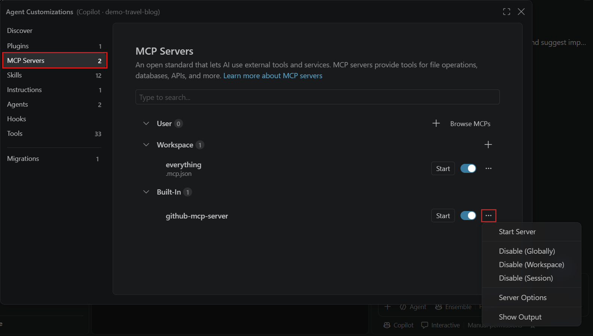
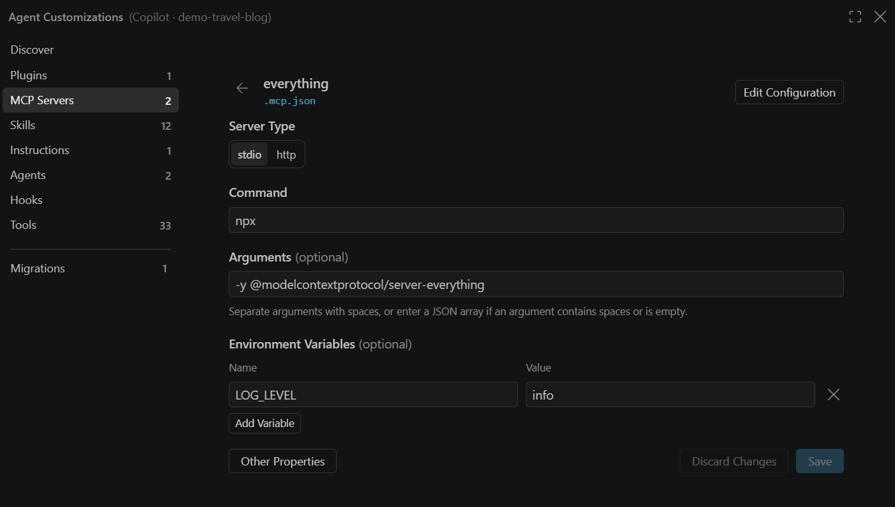

+++
title = "2.4.8 管理 MCP 服务器"
date = 2026-11-06T07:53:25+08:00
weight = 8
type = "docs"
description = ""
isCJKLanguage = true
draft = false
+++


> 原文链接: [https://code.visualstudio.com/docs/agents/run/manage-mcp-servers](https://code.visualstudio.com/docs/agents/run/manage-mcp-servers)

# 2.4.8 管理 MCP 服务器

　　更改、停止、共享或排查 VS Code 中的现有 MCP 服务器。首次设置请参阅[添加 MCP 服务器](../2.4.7-AddMCPServers/)。格式和属性请参阅 [MCP 配置参考](../../reference-and-help/reference/2.8.1.8-MCPConfiguration/)。

　　使用[智能体自定义编辑器](../2.4.1-Overview/#agent-customizations-editor)编辑连接、启动或停止服务器、更改启用状态并查看输出。该编辑器的作用域是所选智能体运行框架。下面的配置表单步骤使用 Copilot 运行框架。服务器支持和配置差异请参阅[智能体运行框架](../../choose-models-and-agents/2.3.2-ChooseAnAgentHarness/)。

## 打开服务器控件 {#open-the-server-controls}

1. 在聊天视图中选择要管理其服务器的智能体运行框架。
2. 选择标题栏中的 **打开自定义项**，或从命令面板（`Ctrl + Shift + P`，macOS：`Cmd + Shift + P`）运行 **Chat: Open Customizations**。
3. 选择 **MCP 服务器**。选择服务器编辑其配置，使用切换控件更改启用状态，或打开其省略号（**...**）菜单执行服务器操作。



## 编辑 MCP 服务器配置 {#edit-an-mcp-server-configuration}

要编辑现有服务器，请[打开服务器控件](#open-the-server-controls)：

1. 在智能体自定义编辑器的 **MCP 服务器** 中，从列表选择服务器。
2. 更改服务器类型或字段：stdio 的命令、参数和环境变量，或 HTTP 的 URL 和标头。
3. 选择 **保存**。如果目标文件不支持某个值，**保存** 不可用，表单会说明需要更改的内容。

　　选择 **放弃更改** 恢复已保存的值。保存会保留未更改的文件内容以及表单未显示的属性，例如 `tools`。选择 **其他属性** 在源 JSON 文件中打开该条目。

　　以空格分隔的字符串或 JSON 字符串数组输入参数。焦点在表单中时，按 `Alt + F1`（macOS 上为 `Option + F1`）打开辅助功能帮助。



　　可移植配置支持表单编辑。VS Code 格式显示为只读 JSON，因此请改为编辑源文件。支持字段和转发限制请参阅[配置文件比较](../../reference-and-help/reference/2.8.1.8-MCPConfiguration/#configuration-file)。VS Code 特定能力可能仍需要旧版目标。

## 控制或移除服务器 {#control-or-remove-a-server}

　　在[智能体自定义编辑器](#open-the-server-controls)的 **MCP 服务器** 中，打开服务器的省略号（**...**）菜单并选择可用操作。也可以从命令面板运行 **MCP: List Servers**，选择服务器并选择操作。

| 操作 | 使用时机 |
|--------|----------------|
| **启动服务器** | 启动已配置的服务器。 |
| **停止服务器** | 结束当前运行。后续请求可以再次启动服务器。 |
| **重启服务器** | 更改配置或解决问题后重启。如果没有此操作，请先停止再启动。 |
| **启用** 或 **禁用** | 在不删除配置的情况下控制可用性。 |
| **卸载** | 移除不再需要的服务器。 |

　　启动可能需要信任或身份验证。如果服务器启动失败，请先[查看其输出](#view-server-output)再重试。

　　**禁用与停止不同。** 禁用的服务器不会启动，其工具、资源、提示词和 MCP 应用不可用。使用服务器旁的切换控件，或从菜单选择启用操作来指定作用域。根据服务器和运行框架，可以使用全局、工作区或会话作用域。启用状态与共享配置分离，因此禁用服务器不会更改队友的配置。

　　**移除取决于配置来源。** 如果手动配置的服务器没有 **卸载**，请只从源配置中移除其条目，而不是整个文件。如果自动发现会恢复它，请检查其[发现来源](../../reference-and-help/reference/2.8.1.8-MCPConfiguration/#automatic-mcp-server-discovery)。也可以从扩展视图的 **MCP SERVERS - INSTALLED** 部分卸载已安装的服务器。

　　对于 GitHub 托管的 MCP 服务器，请[断开 Copilot 连接器](../2.4.6-CopilotConnectors/#disconnect-a-service)，而不是卸载服务器或编辑本地配置文件。

## 自动启动 MCP 服务器 {#automatically-start-mcp-servers}

　　提交聊天消息时，VS Code 可以启动服务器以发现其工具。`chat.mcp.autostart` 设置控制此编辑器自动启动过程：

* `never`：不在此过程中启动服务器。
* `onlyNew`：启动从未运行过的服务器。
* `newAndOutdated`（默认）：启动从未运行过或配置已更改的服务器。

　　已禁用的服务器和处于错误状态的服务器会被排除。

> **重要**：将 `chat.mcp.autostart` 设置为 `never` 不会阻止 Copilot 运行框架独立启动其自行配置的 MCP 服务器。要阻止服务器启动，请[禁用它](#control-or-remove-a-server)。

## 共享和复用配置 {#share-and-reuse-configuration}

　　对于兼容的 Copilot 配置，请提交工作区根目录 `.mcp.json`，与团队共享服务器定义。在文件之间复制条目之前，请审查[支持的配置格式](../../reference-and-help/reference/2.8.1.8-MCPConfiguration/#configuration-file)。

　　不要提交机密。请遵循所用配置格式的[身份验证和机密指南](../../reference-and-help/reference/2.8.1.8-MCPConfiguration/#authentication-and-secrets)。每个环境都需要自己的运行时、凭据和外部服务访问权限。共享配置不会安装服务器运行时或传输这些凭据。

　　要复用其他应用程序的配置，请参阅[自动发现 MCP 服务器](../../reference-and-help/reference/2.8.1.8-MCPConfiguration/#automatic-mcp-server-discovery)。

### 远程工作区和 Dev Container {#remote-workspaces-and-dev-containers}

　　本地用户配置文件的 stdio 服务器在本地运行。对于[远程执行](../../../remote/8.1-VSCodeForTheWeb/)，请在远程工作区中配置服务器，或使用 **MCP: Open Remote User Configuration**。在命令执行的位置安装其运行时和依赖项。

　　HTTP 服务器的 URL 标识服务。远程存储其配置不会移动服务。

要将服务器包含在 Dev Container 中，请将 `customizations.vscode.mcp` 添加到 `devcontainer.json`。以下示例使用带有 Node.js 的镜像来运行 `npx` 命令：

```json
{
    "image": "mcr.microsoft.com/devcontainers/typescript-node:latest",
    "customizations": {
        "vscode": {
            "mcp": {
                "servers": {
                    "playwright": {
                        "type": "stdio",
                        "command": "npx",
                        "args": ["-y", "@playwright/mcp@latest"]
                    }
                }
            }
        }
    }
}
```

　　创建容器时，VS Code 会将此配置写入远程 `mcp.json`。这是 VS Code 格式，不是可移植 `.mcp.json`。其[转发限制](../../reference-and-help/reference/2.8.1.8-MCPConfiguration/#configuration-file)仍然适用，包括对需要交互输入的配置的限制。

### 跨设备同步 MCP 配置 {#synchronize-mcp-configuration-across-devices}

要同步 VS Code 用户配置文件的 MCP 配置：

1. 开启[设置同步](../../../editor/3.3-ConfigureTheEditor/3.3.5-SettingsSync/)。
2. 从命令面板运行 **Settings Sync: Configure**。
3. 选择 **MCP 服务器**。

　　这会同步用户配置文件的 `mcp.json`，不同步工作区 `.mcp.json` 文件或 Copilot 用户的 `mcp-config.json`。同步不会安装运行时或配置外部服务访问权限。请在每台设备上检查这些前提条件。

## 审查信任和隔离 {#review-trust-and-isolation}

　　信任决定服务器是否可以启动。身份验证控制对其服务的访问。工具可用性控制智能体可以使用什么，而[审批](../../work-with-ai/permissions-and-security/2.2.12.1-ApprovalsAndPermissions/)控制单个操作。解决其中一项不会自动解决其他项。

### MCP 服务器信任 {#mcp-server-trust}

　　工作区 `.vscode/mcp.json` 和 `.mcp.json` 配置继承[工作区信任](../../../editor/3.2-WriteCode/3.2.8-Workspaces/3.2.8.3-WorkspaceTrust/)。受限模式会阻止这些服务器启动。在受信任的工作区中，它们可以在没有单独 MCP 信任提示的情况下启动，包括配置更改后。

　　信任仓库之前请审查 MCP 配置，因为 stdio 服务器可以在其执行环境中运行代码。

　　非工作区来源可以使用单独的信任决定，并可能在首次启动或配置更改后提示。请审查提示中链接的配置。如果不信任，请在不使用该服务器的情况下继续。

　　运行 **MCP: Reset Trust** 重置单独的 MCP 信任决定。这不会重置工作区信任。

### 沙盒 MCP 服务器 {#sandbox-mcp-servers}

　　在 macOS 和 Linux 上，每服务器沙盒可以限制 stdio MCP 服务器的文件系统和网络访问。在受支持的 VS Code 格式配置中设置 `sandboxEnabled`，并定义所需的访问规则。schema 和示例请遵循[沙盒配置参考](../../reference-and-help/reference/2.8.1.8-MCPConfiguration/#sandbox-configuration)。

　　此机制在 Windows 上不可用。它不同于 [Copilot 运行框架沙盒](../../work-with-ai/permissions-and-security/2.2.12.2-AgentSandboxing/)，后者使用 `chat.agent.sandbox.mcpServers` 为其服务器提供沙盒。两者的作用域和审批行为不同。

## 排查 MCP 服务器 {#troubleshoot-mcp-servers}

　　从症状开始，然后检查服务器输出。服务器正在运行并不能保证其工具对当前会话可用，也不能保证智能体会选择调用它们。

| 症状 | 检查内容 |
|---------|---------------|
| 服务器缺失或更改未出现 | 确认所选运行框架、工作区和配置来源。检查[配置格式和 schema](../../reference-and-help/reference/2.8.1.8-MCPConfiguration/#configuration-file)，包括转发限制。 |
| stdio 服务器启动失败 | 检查执行环境中的命令、参数、运行时安装和 `PATH`。本地可用的命令在远程可能缺失。 |
| 启动被信任阻止 | 审查服务器配置和[工作区信任](#mcp-server-trust)。不要为未审查的仓库绕过受限模式。 |
| Docker stdio 服务器退出或无法连接 | 检查其参数。不要使用分离模式（`-d`），因为客户端需要 stdio 连接。 |
| HTTP 服务器无法连接或验证 | 检查终结点和网络访问。遵循发布者的登录说明，并在不暴露凭据的情况下检查身份验证错误。 |
| 企业限制阻止服务器 | 请管理员检查[托管 MCP 允许列表和注册表优先级](../../../enterprise/7.2-ManageAISettings/#managed-allowlists-and-registry-precedence)。对于编辑器管理的服务器，仅注册表成员资格不能覆盖托管允许列表。拒绝规则和显式 MCP 禁用仍然适用。本地配置不能覆盖组织限制。 |
| 服务器运行，但工具不可用 | 检查服务器已启用、支持所选运行框架并公开预期工具。审查[可用工具选择](../../work-with-ai/plan-and-run-tasks/2.2.10.2-UseTools/#manage-available-tools)。 |
| 工具可用，但智能体不调用 | 按照[未调用 MCP 工具](../../reference-and-help/troubleshooting/2.8.2.2-DebugChatInteractions/#an-mcp-tool-is-not-being-invoked)检查工具选择和请求。 |

　　修正原因后，请重启服务器并重试需要其工具的请求。检查返回的工具输出，确认其中包含预期结果，而不只是启动成功。

### 查看服务器输出 {#view-server-output}

　　在智能体自定义编辑器中，打开 **MCP 服务器**，选择服务器的省略号（**...**）菜单，选择 **显示输出**。输出视图会打开并选中该服务器的输出通道。

　　也可以运行 **MCP: List Servers**，选择服务器并选择 **显示输出**。

　　如果问题仍然存在，请向服务器发布者报告错误、相关配置、执行环境和复现步骤。共享之前，请从配置和日志中隐去令牌、授权标头和其他敏感值。

## 相关资源 {#related-resources}

* [MCP 配置参考](../../reference-and-help/reference/2.8.1.8-MCPConfiguration/)
* [智能体安全](../../work-with-ai/permissions-and-security/2.2.12.3-AISecurity/)
