+++
title = "2.1.4 智能体教程"
date = 2026-11-06T07:53:25+08:00
weight = 4
type = "docs"
description = ""
isCJKLanguage = true
draft = false
+++


> 原文链接: [https://code.visualstudio.com/docs/agents/agents-tutorial](https://code.visualstudio.com/docs/agents/agents-tutorial)

# 2.1.4 智能体教程

　　在本教程中，你将使用 Visual Studio Code 中的 AI 智能体构建一个个人作品集页面。你用自然语言描述需求，智能体会创建和编辑文件，然后你审查并测试结果。该应用使用 HTML、CSS 和 JavaScript，因此不需要安装任何运行时或构建工具。

　　你从**智能体窗口**开始创建应用，然后在**聊天视图**中继续同一会话，在代码旁完善应用。在此过程中，你将学习打开项目文件夹、在集成浏览器中预览应用，以及使用 Git 审查和提交更改。

> **提示**：如果希望先熟悉 VS Code 用户界面、编辑功能和常用效率工具，请从 [VS Code 编辑教程](../../../editor/3.1-GettingStarted/3.1.1-EditorTutorial/)开始。

## 前提条件 {#prerequisites}

* [下载并安装 Visual Studio Code](https://code.visualstudio.com/download)。

* [在 VS Code 中启用 AI 功能](../../../get-started/#enable-ai-features)。

    如果你使用 GitHub Copilot，请详细了解 [AI 点数和模型费用](../../concepts/2.7.2-HowModelsWork/#ai-credits-and-model-costs)以及[达到限制时会发生什么](../../reference-and-help/troubleshooting/2.8.2.4-FAQ/#i-reached-my-inline-suggestions-or-ai-credits-limit)。

* [安装 Git](https://git-scm.com/)。

## 1. 创建项目文件夹 {#1-create-a-project-folder}

　　智能体在文件夹上下文中工作，在 VS Code 中也称为*工作区*。首先为项目创建一个空文件夹，并启用 Git 版本控制来跟踪更改。

1. 在计算机上创建一个名为 `myportfolio` 的新文件夹。

    ```bash
    mkdir myportfolio
    ```

2. 将该文件夹置于 Git 版本控制之下，以跟踪更改。打开终端并运行以下命令：

    ```bash
    cd myportfolio
    git init
    ```

## 2. 使用智能体窗口构建功能 {#2-build-features-with-the-agents-window}

　　智能体窗口是 VS Code 中的专用窗口，针对跨所有项目与智能体协作进行了优化，无需为每个项目打开单独的 VS Code 窗口。

　　在本部分中，你在智能体窗口中打开文件夹，并让智能体构建作品集页面。

### 打开智能体窗口 {#open-the-agents-window}

1. 在 VS Code 中，选择 VS Code 标题栏中的 **在智能体中打开** 按钮。

    也可以从 VS Code 欢迎页打开智能体窗口，或从命令面板（`Ctrl + Shift + P`）运行 **Chat: Open Agents Window** 命令。

    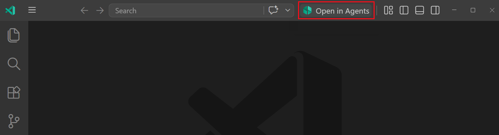

2. 如果提示登录，请使用有权访问 GitHub Copilot 的 GitHub 账户。本教程使用 **Copilot** 智能体运行框架。如果要为受支持的工作流使用自己的提供商凭据，请查看[智能体运行框架身份验证选项](../../choose-models-and-agents/2.3.2-ChooseAnAgentHarness/#requirements-and-setup)。

### 启动智能体会话 {#start-an-agent-session}

1. 选择左侧边栏顶部的 **新建**，开始新的智能体会话。

    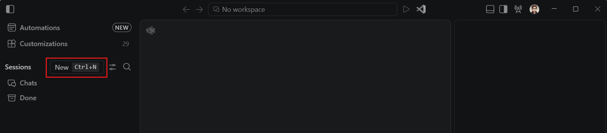

    侧边栏显示活动智能体会话列表，按工作区分组。可以使用会话列表在会话及其工作区上下文之间切换。

    > **提示**：如果想问一个通用问题，也可以启动不绑定特定工作区的聊天会话。

2. 由于智能体窗口可以跨不同项目操作，请从下拉列表中选择之前创建的 `myportfolio` 文件夹。该文件夹成为会话的主要执行工作区。

    如果 VS Code 询问是否信任该文件夹，请选择 **信任**。

    > **重要**：从互联网下载代码时，请在信任之前审查代码，确保运行安全。详细了解[工作区信任](../../../editor/3.2-WriteCode/3.2.8-Workspaces/3.2.8.3-WorkspaceTrust/)。

3. 为会话配置以下设置。其他选项保留默认值。

    | 控件 | 值 | 简短说明 |
    |---------|-------|-------------------|
    | **会话目标** | **Copilot** | 使用 GitHub Copilot 智能体运行框架在本机运行会话。 |
    | **智能体** | **智能体** | 使用工具进行规划、编辑文件、运行命令并验证结果。 |
    | **语言模型** | **自动** | 根据任务复杂度和可用性自动选择模型。 |
    | **权限** | **手动审批** | 运行工具或访问资源时请求你批准。智能体可以在项目文件夹中编辑文件。 |

    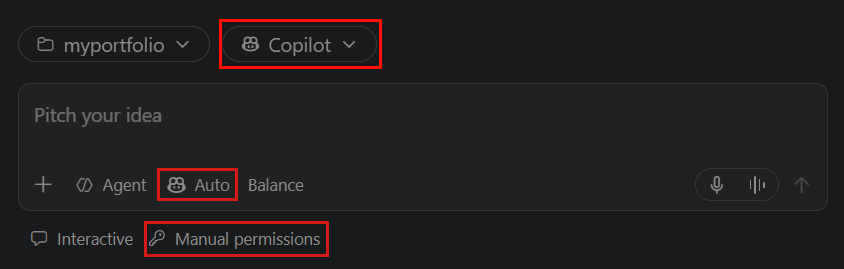

4. 在聊天输入框中输入以下提示词，然后按 `Enter`：

    ```text
    使用 HTML、CSS 和 JavaScript 创建个人作品集页面，分别放在不同文件中。
    包含带有我的姓名和简短介绍的头像区域、带卡片的项目部分和联系部分。
    使用现代样式，并添加一些示例内容。
    ```

5. 智能体会分析请求、规划工作，然后开始创建和编辑文件。如果遇到错误，它会自我纠正或请求澄清和批准。

    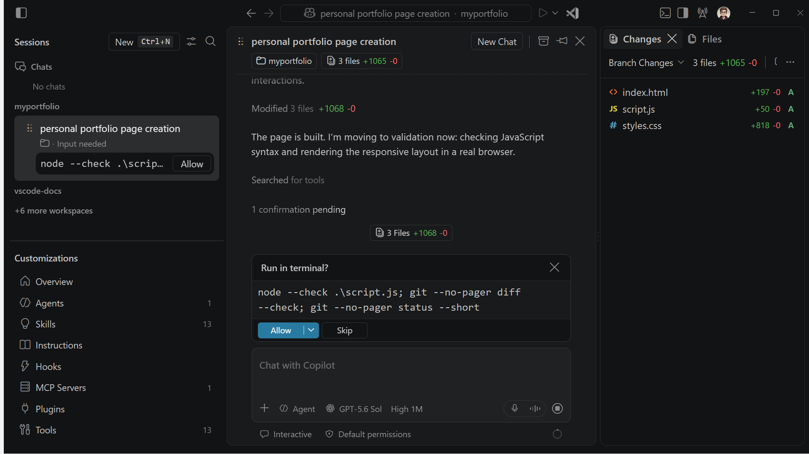

    **Copilot** 智能体运行框架会直接将编辑应用并保存到项目文件夹。提交更改之前，请审查生成的差异。

    > **提示**：如果智能体方向错误，请[引导或停止请求](../../work-with-ai/2.2.5-UseChat/#send-messages-while-a-request-is-running)。停止不会撤销已完成的操作。要撤销某次请求对工作区文件的更改，请[恢复检查点](../../work-with-ai/2.2.8-ReviewAndRevertChanges/#restore-a-checkpoint)。

### 预览并迭代设计 {#preview-and-iterate-on-the-design}

　　智能体窗口非常适合将任务交给智能体，然后验证结果而不是具体代码更改的工作流。使用集成浏览器，你无需离开 VS Code 即可预览智能体的工作。

要在集成浏览器中预览生成的作品集：

1. 选择左侧边栏中的 **文件** 选项卡，右键单击 `index.html` 文件，选择 **在集成浏览器中打开**。

    **文件** 选项卡显示工作区中的所有文件，类似于编辑器中的 **资源管理器** 视图。

    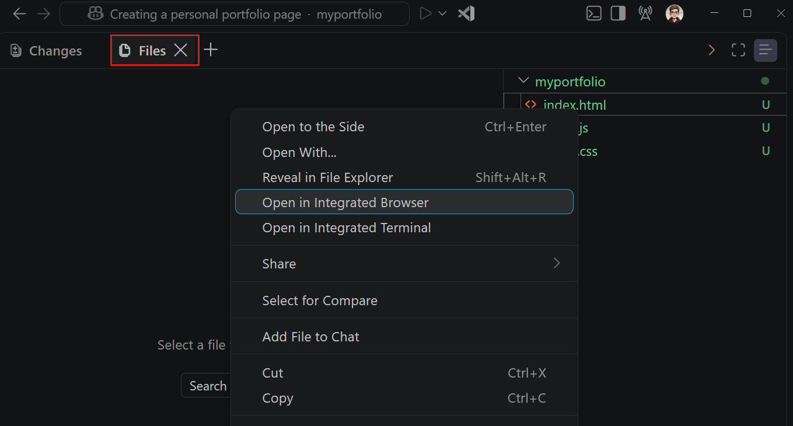

2. 集成浏览器会在智能体窗口的新选项卡中打开，你可以像在普通浏览器中一样与页面交互。

    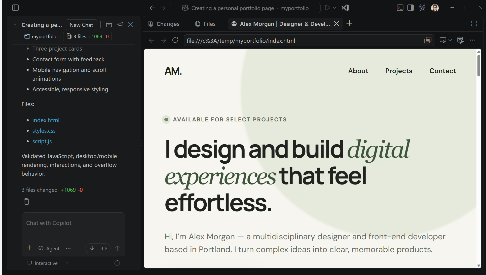

3. 对页面做一次设计更改。在集成浏览器中，选择 **添加元素到聊天** 按钮进入选择模式。

    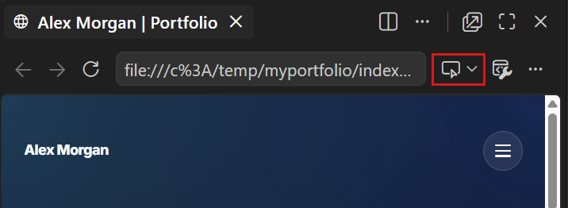

4. 将鼠标悬停在页面上，选择要更改的元素，例如选择主标题。

    智能体会将所选元素添加到提示词上下文中，包括其 HTML、CSS 和截图。

5. 在聊天输入框中输入描述更改的提示词，然后按 `Enter`。例如：

    ```text
    为文本使用渐变色，并使用手写体。
    ```

6. 智能体会将更改应用到所选元素。刷新集成浏览器中的页面以查看更新。

### 审查并提交更改 {#review-and-commit-the-changes}

　　提交智能体的工作之前，请审查智能体应用的代码更改。**更改** 面板显示智能体在会话期间创建或修改的每个文件的差异。要审查并提交文件更改：

1. 选择 **更改** 面板，查看智能体添加或修改的文件的差异。每个条目还会显示更改统计信息以及添加/删除/更新指示器。

    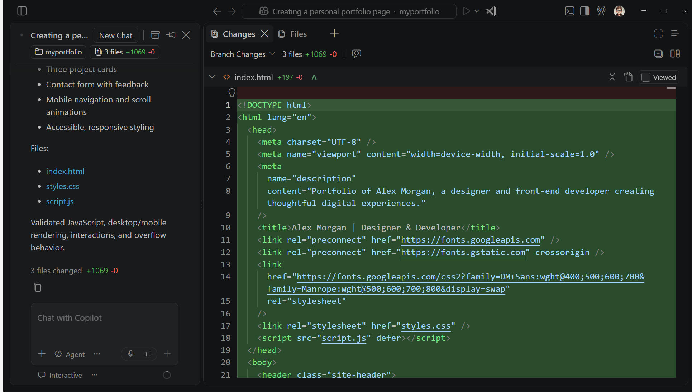

    如需通过键盘和屏幕阅读器访问差异，请使用[可访问差异查看器](../../../editor/3.3-ConfigureTheEditor/3.3.9-Accessibility/3.3.9.1-Accessibility/#diff-editor-accessibility)。

2. 打开 `index.html` 文件的差异，选择一段文本以打开内联反馈流程。输入反馈，然后选择 **提交**。

    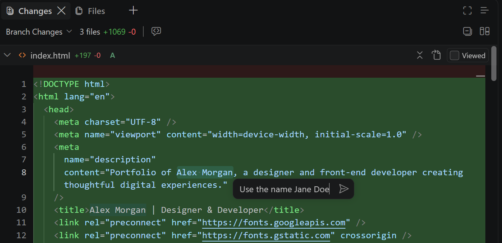

    请注意，反馈会添加到聊天对话中，智能体会处理反馈并将更改应用到文件。你可以继续对差异视图中的其他更改提供反馈。

3. 在更改下拉列表中选择 **未提交的更改**，查看尚未提交到 Git 仓库的更改。

    使用更改下拉列表在分支更改、未提交的更改、会话中的所有更改以及上一次智能体轮次中的更改之间切换。

    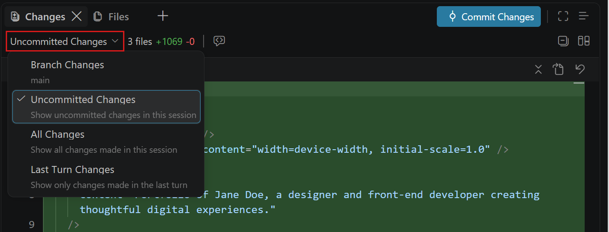

4. 现在在 **更改** 面板中选择 **提交更改**，将智能体的更改保存到 Git 仓库。

    VS Code 会根据智能体的提示词及其所做的更改自动生成提交消息。

    提交更改后，分支更改和未提交的更改都会清空，因为没有待处理更改。会话列表中的会话条目也会清除更改统计信息。

## 3. 在编辑器中继续使用智能体 {#3-continue-working-with-agents-in-the-editor}

　　对于某些更改，你可能更喜欢代码优先的方式，即专注于编写代码，让 Copilot 在过程中提供协助。例如，你可能想添加主题切换器并微调样式。对于这种方式，请在聊天视图中继续同一 Copilot 运行框架会话。

### 为工作区打开编辑器 {#open-the-editor-for-your-workspace}

1. 在智能体窗口中，选择标题栏中的 **在编辑器中打开** 按钮，在编辑器中打开活动工作区。

    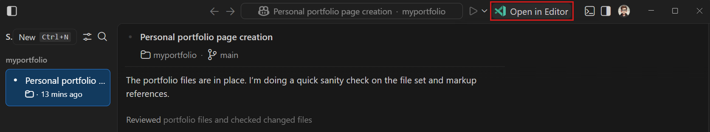

    这会打开包含你的工作区的新 VS Code 窗口。聊天视图仍在右侧边栏中打开，因此你可以在编辑器中工作时与智能体交互。

2. 注意左侧边栏显示 **资源管理器** 视图，其中列出工作区中的文件。选择一个文件，在主区域的编辑器选项卡中打开它。

    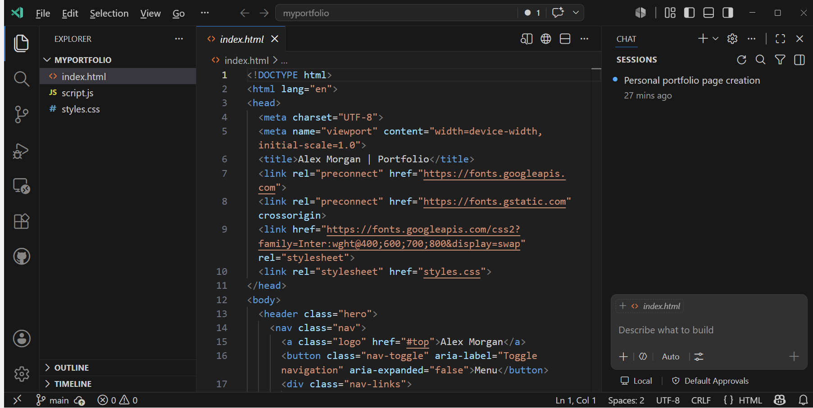

    右侧边栏中的聊天视图显示你之前在智能体窗口中创建的正在进行的智能体会话。

### 从聊天视图继续会话 {#continue-the-session-from-the-chat-view}

　　聊天视图位于辅助侧边栏中，与编辑器选项卡并排。在智能体窗口和编辑器之间移动时，同一个 Copilot 运行框架会话保持活动状态。

1. 在聊天输入框中输入以下提示词，然后按 `Enter`：

    ```text
    添加一个可访问的主题切换按钮，在浅色和深色主题之间切换。
    在页面重新加载后保留所选主题，更新按钮标签以描述它应用的主题，
    并保持布局在窄屏上的响应式。
    ```

    Copilot 会直接将更改应用并保存到项目文件。

2. 打开 **源代码管理** 视图，审查 Copilot 更改的文件。选择一个文件查看其差异。也可以在聊天视图中选择一个已更改的文件，打开其差异。

3. 选择 `index.html` 文件，选择标题栏中的 **在集成浏览器中打开**（地球）按钮。

4. 在集成浏览器中验证更改：

    * 选择主题切换器，确认页面颜色和按钮标签发生变化。
    * 将浏览器调整为较窄宽度，确认内容仍然可读，项目卡片能适应可用空间。
    * 使用 `Tab` 聚焦主题切换器，然后使用 `Enter` 或 `Space` 切换主题。

5. 如果某项检查失败，请在聊天视图中向 Copilot 描述你观察到的现象。例如：

    ```text
    我刷新页面后，所选主题被重置。请保留主题选择，并验证页面加载时会恢复该主题。
    ```

6. 在 **源代码管理** 视图中审查最终更改，并将其提交到 Git 仓库。

　　恭喜！你已通过智能体优先和代码优先两种方式，使用 Copilot 构建了作品集页面。你在智能体窗口和聊天视图之间继续了同一会话，并使用集成浏览器预览和验证结果。

## 后续步骤 {#next-steps}

　　将同样的提示词、审查和验证工作流应用到现有项目中的一个有界任务：

* [将工作流应用到你的项目](../2.1.6-BestPractices/#apply-the-workflow-to-your-project)
* [在不更改文件的情况下探索不熟悉的代码库](../../tutorials-and-guides/2.6.2-ExploreACodebase/)
* [查看推荐的安全基线](../../work-with-ai/permissions-and-security/2.2.12.3-AISecurity/#recommended-security-baseline)
* [从终端继续云智能体会话](../2.1.5-CloudContinuityTutorial/)（实验性）
* [为下一个任务查找指南](../2.1.1-FindAGuide/#work-on-a-project)
