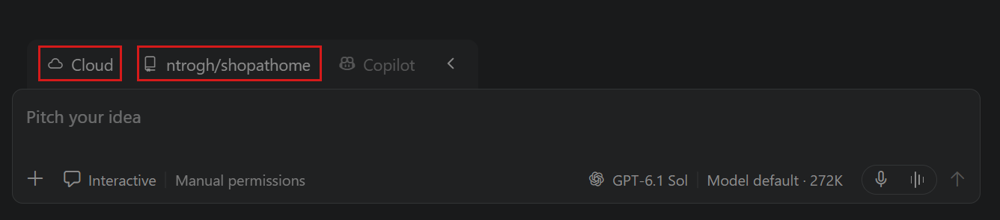
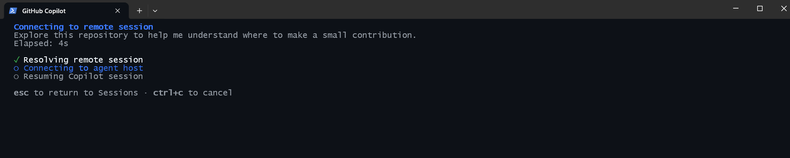
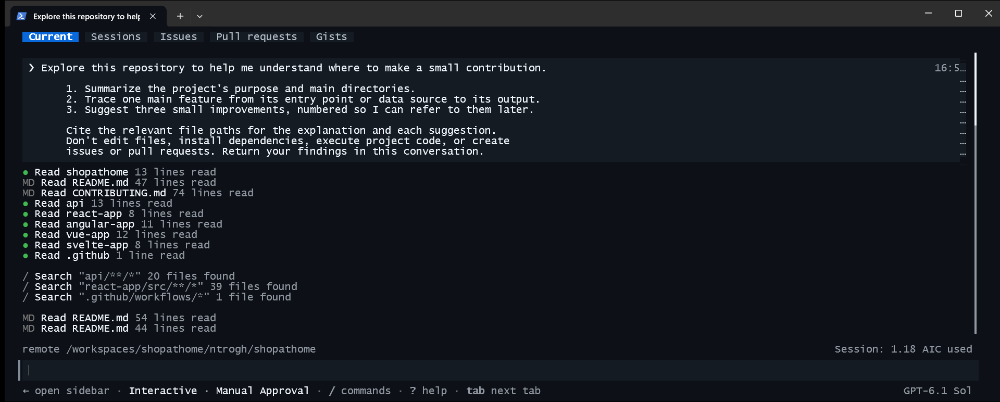

+++
title = "2.1.5 云连续性教程"
date = 2026-11-06T07:53:25+08:00
weight = 5
type = "docs"
description = ""
isCJKLanguage = true
draft = false
+++


> 原文链接: [https://code.visualstudio.com/docs/agents/cloud-continuity-tutorial](https://code.visualstudio.com/docs/agents/cloud-continuity-tutorial)

# 2.1.5 云连续性教程

　　在 Visual Studio Code 中启动智能体任务，关闭应用程序，然后从普通终端中的 GitHub Copilot CLI 继续同一对话。智能体在受管理的云环境中运行，因此你的开发计算机无需保持在线，任务也能继续运行。

　　在本教程中，你让智能体探索自己的一个私有仓库并建议改进。然后从终端连接，将其中一条建议转化为实现计划，而无需重复仓库上下文。你不需要克隆仓库、安装其依赖项或更改任何代码。

　　如果之前没有使用过智能体，请从[智能体快速入门](../2.1.3-AgentsQuickstart/)开始。

## 前提条件 {#prerequisites}

* [安装 VS Code](https://code.visualstudio.com/download)并[设置 GitHub Copilot](../2.1.2-SetUpCopilot/)。
* 使用有权访问云会话的 GitHub 账户。可用性取决于账户和组织。
* 在 GitHub.com 上拥有一个现有仓库。
* 确保 VS Code 中的 `chat.agentHost.cloudSandbox.enabled` 设置已开启。
* [安装最新版 GitHub Copilot CLI](https://docs.github.com/en/copilot/how-tos/copilot-cli/set-up-copilot-cli/install-copilot-cli)。如果尚未安装 Node.js，请选择原生安装选项。账户和组织必须允许 CLI 访问和云连接。

> **注意**：请求会消耗 GitHub Copilot 套餐的额度。开始前请查看 [AI 点数和模型费用](../../concepts/2.7.2-HowModelsWork/#ai-credits-and-model-costs)。

## 1. 选择仓库 {#1-choose-a-repository}

　　从自己的项目中选用可用于云会话的仓库。选择一个小项目，或专注于一个功能，以便控制探索范围。

　　该任务只读取仓库文件，并在对话中返回发现。在本演练中，你无需安装依赖或运行项目。

　　云会话使用 GitHub.com 上可用的代码。未提交的更改、本地依赖项以及仅存在于你计算机上的文件不会复制到云环境。

## 2. 在云会话中启动任务 {#2-start-the-task-in-a-cloud-session}

　　云会话为智能体提供隔离环境来探索仓库，而不会影响本地设置。它运行在 GitHub 的基础设施上。

1. 在 VS Code 中选择标题栏中的 **在智能体中打开**，打开智能体窗口。

2. 选择 **新建** 启动会话。

3. 从环境下拉列表中选择 **云端**，然后从工作区下拉列表中选择 **在仓库中工作**，并选择你的私有仓库。

    

4. 其他选项保留默认值。

5. 输入以下提示词：

    ```text
    探索此仓库，帮助我了解可以在哪里做一个小贡献。

    1. 总结项目的用途和主要目录。
    2. 跟踪一个主要功能，从其入口点或数据源到输出。
    3. 提出三项小改进，并编号以便我之后引用。

    为解释和每项建议引用相关文件路径。
    不要编辑文件、安装依赖、执行项目代码，也不要创建
    议题或拉取请求。在此对话中返回发现。
    ```

    要聚焦探索，可以添加你感兴趣的功能名称，并要求智能体跟踪其工作方式。

6. 等待云环境连接，智能体开始工作。接受任何审批请求之前先审查。

7. 记下会话标题，以便在 CLI 中识别它，然后关闭 VS Code 应用程序。

　　此任务在云端启动。从另一个应用连接不会移动本地会话或上传本地工作区。由于云会话运行在远程云基础设施上，它独立于本地应用状态。关闭应用不会停止云执行。

## 3. 在 Copilot CLI 中继续 {#3-continue-in-the-copilot-cli}

　　可以从不同的 Copilot 客户端连接并交互 Copilot 智能体会话。在本节中，你使用 Copilot CLI 继续在 VS Code 中启动的云会话。也可以使用其他受支持的 Copilot 客户端，例如 GitHub Copilot 应用。

　　可以使用同一台计算机，或另一台安装了 Copilot CLI 的计算机。

1. 如果尚未登录 CLI，请运行：

    ```shell
    copilot login
    ```

    使用启动云会话时所用的同一 GitHub 账户登录。

2. 输入 `/sessions` 查看会话列表。使用右方向键选择 **远程** 选项卡。

3. 选择你在 VS Code 中启动的云会话。根据标题和仓库匹配上一节的任务。

    

4. 等待连接，然后确认对话包含仓库探索提示词，以及智能体的进度或发现。

    

5. 观察终端现在显示正在进行的对话和智能体进度。你可以像在原客户端中一样继续与智能体交互。

    终端是同一会话的另一个客户端。仓库访问和智能体工具仍在云环境中运行，而不是在终端当前目录中运行。你不需要本地克隆。

　　如果已经知道会话 ID 或任务 ID，可以直接使用 `copilot --connect=<session-or-task-id>` 连接。详情请参阅 [CLI 命令行选项](https://docs.github.com/en/copilot/reference/copilot-cli-reference/cli-command-reference#command-line-options)。

　　如果找不到或无法连接会话：

* 检查两个应用是否使用同一账户，以及账户是否有云会话访问权限。
* 运行 `copilot --help` 检查是否支持 `--connect`。如果缺失，请按照安装说明更新 CLI。
* 在 VS Code 中重新打开原会话，检查其连接状态。保存的转录记录并不保证云环境仍可用于实时工作。

## 4. 不重复上下文地继续 {#4-continue-without-repeating-the-context}

　　智能体完成探索后，请在已连接的 CLI 会话中输入以下后续请求：

```text
将你提出的第二项改进转化为简短的实现计划。
确定受影响的文件、验收标准和验证步骤。
不要实现更改、安装依赖、执行项目代码，
也不要创建议题或拉取请求。
```

　　智能体会使用先前的对话识别该建议。你无需粘贴仓库摘要或启动另一个任务。

审查结果：

* 确认计划针对原始响应中的第二项建议。
* 在 GitHub.com 上打开引用的文件，确认它们支持该解释。
* 检查验收标准描述的是可观察结果，并且拟议的验证步骤明确标记为待运行步骤，而不是已经通过的测试。

　　你已在 VS Code 中探索了一个仓库，并从终端继续了同一个云托管任务。也可以重新打开智能体窗口中的原会话，在那里继续。

## 后续步骤 {#next-steps}

* 阅读[管理云会话](../../work-across-apps-and-machines/2.5.3-CloudSessions/)，了解重新连接、审查工作和完成会话。
* 为仓库摘要等重复性工作[创建自动化](../../work-with-ai/plan-and-run-tasks/2.2.10.5-Automations/)。自动化会从保存的提示词启动新运行，而不是让此交互会话持续运行。
