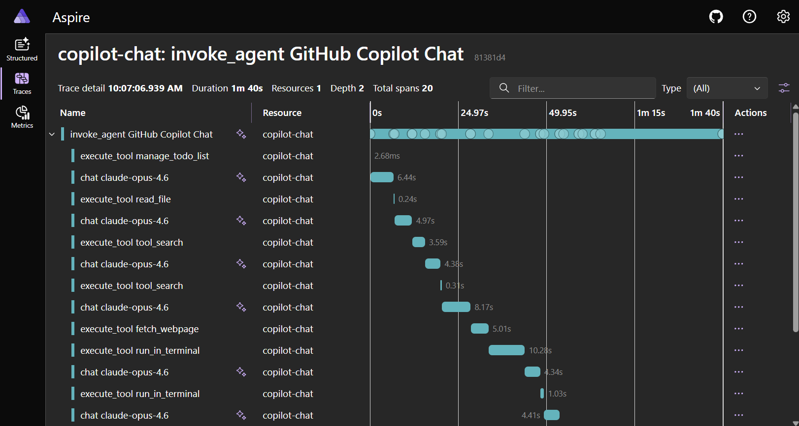

+++
title = "2.8.1.10 OpenTelemetry 监控"
date = 2026-11-06T07:53:25+08:00
weight = 10
type = "docs"
description = ""
isCJKLanguage = true
draft = false
+++


> 原文链接: [https://code.visualstudio.com/docs/agents/guides/monitoring-agents](https://code.visualstudio.com/docs/agents/guides/monitoring-agents)

# 2.8.1.10 OpenTelemetry 监控

　　本文介绍如何为 VS Code 中的 Copilot Chat 智能体交互启用和配置 OpenTelemetry 监控。

　　Copilot Chat 可以通过 [OpenTelemetry](https://opentelemetry.io/)（OTel）导出跟踪、指标和事件，让你了解智能体交互、LLM 调用、工具执行和令牌使用情况。所有信号名称和属性遵循 [OTel GenAI 语义约定](https://github.com/open-telemetry/semantic-conventions/blob/main/docs/gen-ai/)，因此数据可用于任何兼容 OTel 的后端。

> **提示**：无需设置 OTel 后端即可交互查看缓存指标，请使用[缓存浏览器](../../troubleshooting/2.8.2.3-DiagnosePromptCaching/)直接在 VS Code 中检查提示词缓存命中率。

## 收集内容 {#what-gets-collected}

　　Copilot Chat 发出三类 OTel 信号：跟踪、指标和事件。

### 属性命名空间 {#attribute-namespaces}

　　Copilot Chat 在三个命名空间下发出 OTel 属性：

| 命名空间 | 来源 | 使用时机 |
|---|---|---|
| `gen_ai.*` | [OTel GenAI 语义约定](https://github.com/open-telemetry/semantic-conventions/blob/main/docs/gen-ai/) | 标准键存在时 |
| `github.copilot.*` | 规范 Copilot 命名空间，与 [Copilot CLI OpenTelemetry 约定](https://docs.github.com/copilot/reference/copilot-cli-reference/cli-command-reference#opentelemetry-monitoring)共享 | 新仪表板、警报和查询的首选 |
| `copilot_chat.*` | 原始 VS Code 扩展命名空间 | 旧版。多个键现在与 `github.copilot.*` 等价键双重发出 |

　　旧版 `copilot_chat.*` 键会无限期继续发出，因此现有收集器、仪表板和下游消费者无需更改。没有停用日期。本节表格将双重发出行标记为 **旧版** 并指向首选键。

### 跟踪 {#traces}

　　每次智能体交互产生捕获完整执行流的层次 span 树：

```text
invoke_agent copilot                           [~15s]
  ├── chat gpt-4o                              [~3s]  (LLM requests tool calls)
  ├── execute_tool readFile                    [~50ms]
  ├── execute_tool runCommand                  [~2s]
  ├── chat gpt-4o                              [~4s]  (LLM generates final response)
  └── (span ends)
```

　　智能体调用子智能体时（例如通过 `runSubagent` 工具），跟踪上下文会自动传播。子智能体的 `invoke_agent` span 作为父智能体 `execute_tool` span 的子项出现，形成跨异步边界的连接跟踪树。

#### `invoke_agent` span

　　包装整个智能体编排，包括所有 LLM 调用和工具执行。

| 属性 | 说明 |
|---|---|
| `gen_ai.operation.name` | 始终为 `invoke_agent` |
| `gen_ai.provider.name` | 提供商（例如 `github`） |
| `gen_ai.agent.name` | 智能体名称（例如 `copilot`、`copilotcli`、`claude`） |
| `gen_ai.conversation.id` | 对话会话 ID |
| `gen_ai.request.model` | 请求的模型 |
| `gen_ai.response.model` | 解析后的模型 |
| `gen_ai.usage.input_tokens` | 会话总输入令牌 |
| `gen_ai.usage.output_tokens` | 会话总输出令牌 |
| `gen_ai.usage.cache_read.input_tokens` | 可用时的缓存读取输入令牌 |
| `gen_ai.usage.cache_creation.input_tokens` | 可用时的缓存创建输入令牌 |
| `github.copilot.agent.type` | `builtin`、`custom` 或 `plugin` |
| `github.copilot.git.repository` | Git 仓库中的远程 URL |
| `github.copilot.git.branch` | Git 仓库中的活动 branch |
| `github.copilot.git.commit_sha` | Git 仓库中的当前提交 |
| `github.copilot.github.org` | 仅 GitHub 远程的 GitHub 组织所有者 |
| `copilot_chat.repo.remote_url` | 旧版。首选 `github.copilot.git.repository` |
| `copilot_chat.repo.head_branch_name` | 旧版。首选 `github.copilot.git.branch` |
| `copilot_chat.repo.head_commit_hash` | 旧版。首选 `github.copilot.git.commit_sha` |
| `copilot_chat.turn_count` | 会话中的 LLM 往返次数 |
| `error.type` | 失败时的错误类 |
| `gen_ai.input.messages` | 完整提示词消息（仅内容捕获） |
| `gen_ai.output.messages` | 完整响应消息（仅内容捕获） |
| `gen_ai.tool.definitions` | 工具 schema（仅内容捕获） |

#### `chat` span

　　每次 LLM API 调用一个 span。

| 属性 | 说明 |
|---|---|
| `gen_ai.operation.name` | 始终为 `chat` |
| `gen_ai.provider.name` | 提供商名称 |
| `gen_ai.request.model` | 请求的模型 |
| `gen_ai.response.model` | 解析后的模型 |
| `gen_ai.response.finish_reasons` | 停止原因（例如 `["stop"]`） |
| `gen_ai.request.max_tokens` | 最大输出令牌 |
| `gen_ai.request.temperature` | 设置时的 temperature |
| `gen_ai.request.top_p` | 设置时的 top-p |
| `gen_ai.usage.input_tokens` | 此调用输入令牌 |
| `gen_ai.usage.output_tokens` | 此调用输出令牌 |
| `gen_ai.usage.cache_read.input_tokens` | 可用时的缓存读取输入令牌 |
| `gen_ai.usage.cache_creation.input_tokens` | 可用时的缓存创建输入令牌 |
| `gen_ai.usage.reasoning.output_tokens` | 可用时的推理令牌 |
| `gen_ai.usage.reasoning_tokens` | 旧版。首选 `gen_ai.usage.reasoning.output_tokens` |
| `copilot_chat.time_to_first_token` | 首个 SSE 令牌时间（毫秒） |
| `server.address` | API 主机名 |
| `error.type` | 失败时的错误类 |

#### `execute_tool` span

　　每次工具调用一个 span。

| 属性 | 说明 |
|---|---|
| `gen_ai.operation.name` | 始终为 `execute_tool` |
| `gen_ai.tool.name` | 工具名称（例如 `readFile`） |
| `gen_ai.tool.type` | `function` 或 `extension`（MCP 工具） |
| `gen_ai.tool.call.id` | 工具调用标识符 |
| `github.copilot.tool.parameters.edit_type` | 编辑工具：`create`、`update`、`str_replace` 或 `insert` |
| `github.copilot.tool.parameters.skill_name` | 技能调用 |
| `github.copilot.tool.parameters.mcp_server_name_hash` | MCP 工具：服务器名称的 SHA-256 |
| `github.copilot.tool.parameters.mcp_tool_name` | MCP 工具：调用的工具名称 |
| `github.copilot.tool.parameters.command` | Shell 工具（仅内容捕获，截断） |
| `github.copilot.tool.parameters.file_path` | 文件工具（仅内容捕获） |
| `github.copilot.tool.parameters.mcp_server_name` | MCP 工具（仅内容捕获） |
| `error.type` | 失败时的错误类 |
| `gen_ai.tool.call.arguments` | 工具输入参数（仅内容捕获） |
| `gen_ai.tool.call.result` | 工具输出（仅内容捕获） |

#### `execute_hook` span

　　每次钩子执行一个 span（例如 `PreToolUse`、`Stop`）。

| 属性 | 说明 |
|---|---|
| `gen_ai.operation.name` | 始终为 `execute_hook` |
| `github.copilot.hook.decision` | `pass`、`block` 或 `non_blocking_error` |
| `github.copilot.hook.duration` | 钩子执行时长（秒） |
| `github.copilot.hook.tool_names` | 钩子作用域工具，JSON 数组 |
| `copilot_chat.hook_type` | 钩子事件（例如 `PreToolUse`） |
| `copilot_chat.hook_result_kind` | `success`、`error` 或 `non_blocking_error` |
| `copilot_chat.hook_input` | 钩子输入负载（截断） |
| `copilot_chat.hook_output` | 成功时的钩子 stdout（截断） |
| `error.type` | 失败时的错误类 |

### 指标 {#metrics}

GenAI 语义约定指标：

| 指标 | 类型 | 说明 |
|---|---|---|
| `gen_ai.client.operation.duration` | Histogram | LLM API 调用时长（秒） |
| `gen_ai.client.token.usage` | Histogram | 令牌计数（输入和输出） |

扩展特定指标：

| 指标 | 类型 | 说明 |
|---|---|---|
| `copilot_chat.tool.call.count` | Counter | 按名称和成功状态统计工具调用 |
| `copilot_chat.tool.call.duration` | Histogram | 工具执行延迟（毫秒） |
| `copilot_chat.agent.invocation.duration` | Histogram | 智能体端到端时长（秒） |
| `copilot_chat.agent.turn.count` | Histogram | 每次智能体调用的 LLM 往返次数 |
| `copilot_chat.session.count` | Counter | 启动的聊天会话 |
| `copilot_chat.time_to_first_token` | Histogram | 首个 SSE 令牌时间（秒） |

　　智能体活动和结果指标跟踪受支持界面中的智能体代码更改，包括内联聊天和智能体会话：

| 指标 | 类型 | 说明 |
|---|---|---|
| `copilot_chat.edit.acceptance.count` | Counter | 编辑接受和拒绝决定（内联聊天、聊天编辑、hunk 级） |
| `copilot_chat.chat_edit.outcome.count` | Counter | 文件级聊天编辑会话结果（接受、拒绝、保存） |
| `copilot_chat.lines_of_code.count` | Counter | 已接受智能体编辑添加或移除的代码行 |
| `copilot_chat.edit.survival.four_gram` | Histogram | 4-gram 文本相似度存活分数（0-1） |
| `copilot_chat.edit.survival.no_revert` | Histogram | 无回退存活分数（0-1） |
| `copilot_chat.user.action.count` | Counter | 用户参与操作：复制、插入、应用、追问 |
| `copilot_chat.user.feedback.count` | Counter | 聊天响应的赞和踩 |
| `copilot_chat.agent.edit_response.count` | Counter | 按成功或错误统计智能体编辑响应 |
| `copilot_chat.agent.summarization.count` | Counter | 上下文摘要结果（应用、失败） |
| `copilot_chat.pull_request.count` | Counter | 通过 Copilot 智能体创建的拉取请求 |
| `copilot_chat.cloud.session.count` | Counter | 按合作伙伴智能体统计的云和远程智能体会话 |
| `copilot_chat.cloud.pr_ready.count` | Counter | 远程智能体任务 PR 就绪通知 |

　　指标包含用于筛选的属性，例如 `gen_ai.request.model`、`gen_ai.provider.name`、`gen_ai.tool.name`、`copilot_chat.edit.source` 和 `error.type`。

### 事件 {#events}

| 事件 | 说明 |
|---|---|
| `gen_ai.client.inference.operation.details` | 完整 LLM 调用元数据，含模型、令牌和完成原因 |
| `copilot_chat.session.start` | 新聊天会话开始时发出 |
| `copilot_chat.tool.call` | 每次工具调用及时间和错误详情 |
| `copilot_chat.agent.turn` | 每轮 LLM 往返及令牌数 |
| `copilot_chat.edit.feedback` | 用户接受或拒绝文件级智能体编辑 |
| `copilot_chat.edit.hunk.action` | 用户接受或拒绝单个 hunk |
| `copilot_chat.inline.done` | 内联聊天编辑被接受或拒绝 |
| `copilot_chat.edit.survival` | AI 生成代码接受后留存程度的定期测量 |
| `copilot_chat.user.feedback` | 用户对聊天响应的赞或踩 |
| `copilot_chat.cloud.session.invoke` | 启动云或远程智能体会话 |

### 资源属性 {#resource-attributes}

所有信号携带以下资源属性：

| 属性 | 值 |
|---|---|
| `service.name` | `copilot-chat`（可通过 `OTEL_SERVICE_NAME` 配置） |
| `service.version` | 扩展版本 |
| `session.id` | 每个 VS Code 窗口唯一 |

使用 `OTEL_RESOURCE_ATTRIBUTES` 添加自定义资源属性，以便按团队、部门或其他组织边界筛选：

```bash
export OTEL_RESOURCE_ATTRIBUTES="team.id=platform,department=engineering"
```

### 身份捕获 {#identity-capture}

　　对于 Local 运行框架会话，身份捕获可将智能体活动归因到个人开发者和机器。启用后，遥测包括：

* 智能体调用 span（包括子智能体和内联聊天 span）上的 `user.name`。
* 资源属性 `process.user.name` 和 `host.name`。

　　使用 `github.copilot.chat.otel.captureIdentity` 或 `COPILOT_OTEL_CAPTURE_IDENTITY=true` 启用身份捕获。此控制独立于[内容捕获](#content-capture)。

> **警告**：身份属性可以识别开发者和其机器。仅在组织有适当目的、访问控制和保留策略时启用。

> **注意**：身份捕获目前仅适用于 Local 运行框架会话。Agent Host 进程的遥测不包含这些身份属性。

### 内容捕获 {#content-capture}

　　默认不捕获提示词内容、响应或工具参数，只包含模型名称、令牌数和时长等元数据。

　　要捕获完整内容，请启用 `github.copilot.chat.otel.captureContent` 或设置 `COPILOT_OTEL_CAPTURE_CONTENT=true`。这会用完整提示词消息、响应消息、系统提示词、工具 schema、工具参数和工具结果填充 span 属性。

> **警告**：内容捕获可能包含代码、文件内容和用户提示词等敏感信息。仅在受信任环境中启用。

## 启用 OTel 监控 {#enable-otel-monitoring}

以下任一条件为真时 OTel 激活：

* `github.copilot.chat.otel.enabled` 为 `true`
* `github.copilot.chat.otel.dbSpanExporter.enabled` 为 `true`
* `COPILOT_OTEL_ENABLED=true`
* 设置了 `OTEL_EXPORTER_OTLP_ENDPOINT`

### VS Code 设置 {#vs-code-settings}

打开 **设置**（`Ctrl + ,`，macOS：`Cmd + ,`），搜索 `copilot otel`：

| 设置 | 类型 | 默认值 | 说明 |
|---|---|---|---|
| `github.copilot.chat.otel.enabled` | boolean | `false` | 启用 OTel 发出 |
| `github.copilot.chat.otel.exporterType` | string | `"otlp-http"` | `otlp-http`、`otlp-grpc`、`console` 或 `file` |
| `github.copilot.chat.otel.otlpEndpoint` | string | `"http://localhost:4318"` | OTLP 收集器终结点 |
| `github.copilot.chat.otel.captureContent` | boolean | `false` | 捕获完整提示词和响应内容 |
| `github.copilot.chat.otel.captureIdentity` | boolean | `false` | 为 Local 运行框架会话捕获认证账户名、操作系统用户名和机器主机名 |
| `github.copilot.chat.otel.maxAttributeSizeChars` | integer | `0` | 每个内容属性（提示词、工具参数、工具结果）的最大字符数。`0` 禁用截断。设置为正值以匹配后端的每属性大小限制。 |
| `github.copilot.chat.otel.outfile` | string | `""` | JSON-lines 输出文件路径 |
| `github.copilot.chat.otel.dbSpanExporter.enabled` | boolean | `false` | 将 OTel span 持久化到本地 SQLite 数据库，供 **Chat: Export Agent Traces DB** 命令使用。隐式启用 OTel。 |

### 环境变量 {#environment-variables}

环境变量始终优先于 VS Code 设置。组织通过 [Copilot 托管设置](#manage-otel-configuration-for-your-organization)强制 OTel 配置时，托管值覆盖用户设置。在 Copilot Chat 扩展中，OTel 环境变量仍可覆盖托管值。

| 变量 | 默认值 | 说明 |
|---|---|---|
| `COPILOT_OTEL_ENABLED` | `false` | 启用 OTel。设置 `OTEL_EXPORTER_OTLP_ENDPOINT` 时也启用。 |
| `COPILOT_OTEL_ENDPOINT` | | OTLP 终结点 URL（优先于 `OTEL_EXPORTER_OTLP_ENDPOINT`） |
| `OTEL_EXPORTER_OTLP_ENDPOINT` | | 标准 OTel OTLP 终结点 URL |
| `OTEL_EXPORTER_OTLP_PROTOCOL` | `http/protobuf` | OTLP 协议。只有 `grpc` 会改变行为。 |
| `COPILOT_OTEL_PROTOCOL` | | 覆盖 OTLP 协议（`grpc` 或 `http`），优先于 `OTEL_EXPORTER_OTLP_PROTOCOL`。 |
| `OTEL_SERVICE_NAME` | `copilot-chat` | 资源属性中的服务名称 |
| `OTEL_RESOURCE_ATTRIBUTES` | | 额外资源属性（`key1=val1,key2=val2`） |
| `COPILOT_OTEL_CAPTURE_CONTENT` | `false` | 捕获完整提示词和响应内容 |
| `COPILOT_OTEL_CAPTURE_IDENTITY` | `false` | 为 Local 运行框架会话捕获开发者和机器身份 |
| `COPILOT_OTEL_MAX_ATTRIBUTE_SIZE_CHARS` | `0` | 覆盖内容属性最大字符数。`0` 禁用截断。优先于 `maxAttributeSizeChars` 设置。 |
| `COPILOT_OTEL_LOG_LEVEL` | `info` | 最低日志级别：`trace`、`debug`、`info`、`warn` 或 `error`。 |
| `COPILOT_OTEL_FILE_EXPORTER_PATH` | | 将所有信号以 JSON lines 写入此文件。 |
| `COPILOT_OTEL_HTTP_INSTRUMENTATION` | `false` | 启用 HTTP 级 OTel 检测。 |
| `OTEL_EXPORTER_OTLP_HEADERS` | | 收集器的静态 HTTP 标头。托管 Agent Host 会话请参阅[动态标头](#configure-dynamic-headers)。 |

### 命令 {#commands}

　　`github.copilot.chat.otel.dbSpanExporter.enabled` 为 `true` 时，Copilot Chat 将 OTel span 持久化到本地 SQLite 数据库。这适合离线检查或共享跟踪数据，而无需运行 OTLP 后端。

| 命令 | 说明 |
|---|---|
| **Chat: Export Agent Traces DB**（`github.copilot.chat.otel.exportAgentTracesDB`） | 将本地 SQLite span 数据库导出为 `.db` 文件。仅在 `dbSpanExporter.enabled` 为 `true` 时可用。 |

## 为组织管理 OTel 配置 {#manage-otel-configuration-for-your-organization}

　　企业可以通过 Copilot 企业托管设置集中强制 OTel 导出配置，无需每个开发者设置 `OTEL_*` 环境变量。托管遥测配置适用于 Copilot Chat 扩展和 Agent Host 进程。除收集器导出外，Copilot Agent Host 会话支持托管文件目标。

　　交付方法、配置字段、客户端支持和优先级请参阅[企业管理设置参考中的 `telemetry`](https://docs.github.com/en/copilot/reference/enterprise-administrators/enterprise-managed-settings#telemetry)。VS Code 特定行为请参阅[在 VS Code 中应用托管遥测](../../../../enterprise/7.2-ManageAISettings/)。

　　对于 Local 运行框架会话，启用导出的托管 OTel 配置在 Copilot Chat 启动后到达时，VS Code 会每个编辑器会话自动尝试一次重启扩展宿主。重启可能中断其他扩展。自动重启无法完成或后续策略更改时，请在提示时选择 **重新加载窗口**。

> **注意**：配置托管遥测值时，它会覆盖用户设置。托管身份捕获还会覆盖 `COPILOT_OTEL_CAPTURE_IDENTITY`，托管资源属性覆盖 `OTEL_RESOURCE_ATTRIBUTES`。请从托管设备移除其他冲突 OTel 环境变量，确保企业配置在 Copilot Chat 扩展中生效。

### 将托管遥测导出到文件 {#export-managed-telemetry-to-a-file}

　　从 VS Code 1.143 开始，管理员可以设置 `telemetry.filePath`，将 Copilot Agent Host 遥测保存为 JSON Lines（JSONL），无需运行 OTLP 收集器或要求开发者通过个人 OTel 设置选择加入。此托管目标不同于 Copilot Chat 扩展的[文件导出器](#other-exporter-examples)。

对于本地 Agent Host，请将以下遥测块添加到设备级 `managed-settings.json` 文件，而不是编辑器设置 JSON：

| 平台 | 托管设置文件 |
|---|---|
| macOS | `/Library/Application Support/GitHubCopilot/managed-settings.json` |
| Linux | `/etc/github-copilot/managed-settings.json` |
| Windows | `%ProgramFiles%\GitHubCopilot\managed-settings.json` |

```json
{
    "telemetry": {
        "filePath": "~/copilot-telemetry/copilot-otel.jsonl",
        "captureContent": false,
        "capture": {
            "identity": false
        }
    }
}
```

　　选择 Agent Host 可写入的绝对或主目录相对输出路径。路径指导出遥测的机器。`~/` 前缀展开为该机器的用户主目录。`filePath` 中的 `$HOME` 或 `%USERPROFILE%` 等环境变量引用不会展开，会被拒绝。

　　设置 `filePath` 会在没有 `enabled: true` 的情况下启用 Agent Host OTel 导出。显式托管 `telemetry.enabled: false` 优先并关闭导出。

　　VS Code 解析托管遥测更改后会自动重启本地 Agent Host。启动新的 Copilot Agent Host 会话并发送提示词，然后检查目标文件中是否有 `invoke_agent` 和 `vscode.agent_host.session` 等 span。

　　导出器创建缺少的父目录，每行附加一个 span。无法解析路径或写入文件时，Agent Host 记录错误但不阻塞聊天，也不会回退到收集器。请对导出文件应用组织的访问和保留控制。

> **重要**：托管 `filePath` 优先于收集器配置。配置期间，Agent Host 遥测进入文件而不是收集器，[动态标头](#configure-dynamic-headers)不适用。请将文件配置包含在[最高优先级托管遥测块](../../../../enterprise/7.2-ManageAISettings/)中。

### 配置动态标头 {#configure-dynamic-headers}

　　从 VS Code 1.143 开始，管理员可以为 Copilot Agent Host 会话配置 `telemetry.headersProvider`，生成和刷新 OTLP 导出的 HTTP 标头。Agent Host 运行辅助可执行文件获取标头值，开发者无需手动更新。使用这些标头提供收集器特定元数据、路由遥测或与收集器身份验证。

　　通过 Copilot 企业托管设置配置提供程序，而不是编辑器设置 JSON。例如，在 `managed-settings.json` 中部署以下遥测块：

```json
{
    "telemetry": {
        "enabled": true,
        "endpoint": "https://<collector-host>:4318",
        "protocol": "http/protobuf",
        "captureContent": false,
        "capture": {
            "identity": false
        },
        "headers": {
            "x-organization": "<organization-id>"
        },
        "headersProvider": {
            "path": "<absolute-path-to-header-helper>",
            "args": [],
            "refreshIntervalMs": 1740000
        }
    }
}
```

　　将终结点、组织 ID 和辅助程序路径替换为部署值。在 Agent Host 运行的机器上安装辅助程序及依赖项。远程会话中，可执行文件和路径必须存在于远程主机。

　　辅助程序从执行主机主目录运行，`args` 中的参数不经过 shell 求值。它必须在 30 秒内完成，并向标准输出写入字符串值的 JSON 对象：

```json
{
    "x-team": "platform",
    "x-environment": "production"
}
```

　　收集器要求身份验证时，辅助程序还可以返回 `Authorization` 标头。

　　提供程序默认每 29 分钟刷新标头。设置 `refreshIntervalMs` 匹配标头值所需刷新频率。返回 `{}` 清除动态标头。刷新失败时，依赖动态标头的导出会被阻止，直到提供程序成功刷新。

　　提供程序返回的标头优先于同名托管静态 `telemetry.headers` 值。不冲突的静态标头保留在请求中。托管标头也优先于用户提供的标头。

　　提供程序要求同一遥测块中有 `endpoint`，并支持 `http/protobuf` 或 `http/json` 的 HTTP OTLP 导出，不支持 gRPC。托管导出不要求开发者通过个人 OTel 设置选择加入。

　　更高优先级托管来源会替换整个 `telemetry` 块。请将全部必需字段放在获胜来源中，不要跨交付方法拆分终结点和提供程序。更多信息请参阅[托管设置交付优先级](../../../../enterprise/7.2-ManageAISettings/)和[标头提供程序参考](https://docs.github.com/en/copilot/reference/copilot-cli-reference/cli-command-reference#dynamic-authentication-headers)。

## 按运行框架划分的跟踪结构 {#trace-structure-by-harness}

　　OTel 启用时，本节描述的 Copilot 和 Claude 集成会自动检测。用于 Local 运行框架会话跟踪的相同设置也会为这些集成启用跟踪。

### Copilot 运行框架 {#copilot}

　　Copilot 运行框架会话的共享运行时与聊天扩展在同一 VS Code 进程中运行，产生包含子智能体、权限、钩子和工具调用的丰富跟踪层次。扩展包装 span（`invoke_agent copilotcli`，服务 `copilot-chat`）作为运行时原生 span（服务 `github-copilot`）的父项。两者在收集器中出现在同一跟踪中。

　　Copilot 运行框架会话还会在 VS Code 的 **智能体调试日志** 面板中显示完整运行时跟踪层次，与跟踪查看器相同。即使 OTel 导出禁用，调试面板也可工作，因为运行时内部跟踪对面板始终激活。

　　OTel 导出禁用时，调试面板自动捕获完整提示词和响应内容。OTel 导出启用时，`github.copilot.chat.otel.captureContent` 设置控制调试面板和 OTLP 导出的内容捕获。

### Copilot CLI（终端会话） {#copilot-cli-terminal-session}

　　在终端运行 Copilot CLI 会话（**新建 Copilot CLI 会话**）时，它在单独进程中运行。OTel 启用时，扩展将 `COPILOT_OTEL_ENABLED` 和 `OTEL_EXPORTER_OTLP_ENDPOINT` 转发到终端进程。终端跟踪作为 `github-copilot` 服务下的独立根跟踪出现，不链接到扩展跟踪。

　　CLI 运行时仅支持 `otlp-http`。配置 `otlp-grpc` 时，终端 CLI 仍使用 HTTP。在同一端口提供两种协议的后端（例如 Aspire Dashboard）可透明工作。

### Claude 智能体 {#claude-agent}

> **注意**：当 [GitHub Copilot 企业托管设置生效](../../../../enterprise/7.2-ManageAISettings/)（包括托管遥测设置）时，Claude 运行框架会被禁用。请联系部署设置的 IT 团队讨论访问权限。

　　OTel 启用时，Claude 智能体会话在 `copilot-chat` 服务下产生遵循 GenAI 语义约定的扩展级 span。扩展通过拦截 Claude SDK 消息并通过本地 HTTP 服务器代理 LLM 调用来创建 span。

　　`invoke_agent claude` 根 span 包装每个用户请求，嵌套 `chat`、`execute_tool` 和 `execute_hook` span。工具为 `Agent`（Claude 子智能体调用）时，嵌套子 `chat` 和 `execute_tool` span，提供完整子智能体可见性。

### 按智能体类型筛选 {#filter-by-agent-type}

在跟踪查看器中按 `service.name` 筛选，查看特定智能体运行时的跟踪：

| `service.name` | 来源 |
|---|---|
| `copilot-chat` | 前台智能体、CLI 包装和 Claude 智能体 span（扩展发出） |
| `github-copilot` | 共享 Copilot 运行时 span 和 CLI 终端会话 |
| `claude-code` | Claude Code 子进程 SDK 遥测（转发 `CLAUDE_CODE_ENABLE_TELEMETRY` 时） |

　　在 `copilot-chat` 服务中，按 `gen_ai.agent.name` 区分智能体类型：

| `gen_ai.agent.name` | 智能体类型 |
|---|---|
| `Copilot Chat` | 前台智能体（智能体模式） |
| `copilotcli` | Copilot 包装 span |
| `claude` | Claude 智能体 |

## 与可观测性后端配合使用 {#use-with-observability-backends}

　　Copilot Chat 的 OTel 输出适用于任何支持 OTLP 协议的后端。将 `github.copilot.chat.otel.otlpEndpoint` 设置或 `OTEL_EXPORTER_OTLP_ENDPOINT` 环境变量指向后端 OTLP 摄取 URL，并配置导出器类型匹配后端协议（`otlp-http` 或 `otlp-grpc`）。

### Aspire Dashboard {#aspire-dashboard}

　　[Aspire Dashboard](https://aspire.dev/dashboard/standalone/)是本地开发最简单选项。它是带内置 OTLP 终结点和跟踪查看器的单应用，无需云账户。

可以使用 [Aspire CLI](https://aspire.dev/get-started/install-cli/)启动仪表板：

```bash
aspire dashboard run
```

或从 Docker 容器镜像运行同一独立仪表板：

```bash
docker run --rm -d -p 18888:18888 -p 4318:18890 --name aspire-dashboard \
  mcr.microsoft.com/dotnet/aspire-dashboard:latest
```

VS Code 配置：

```json
{
  "github.copilot.chat.otel.enabled": true,
  "github.copilot.chat.otel.captureContent": true
}
```

　　打开 `http://localhost:18888`，进入 **跟踪** 查看智能体交互 span。



### Jaeger {#jaeger}

　　[Jaeger](https://www.jaegertracing.io/)是直接接受 OTLP 的开源分布式跟踪平台。

```bash
docker run -d --name jaeger -p 16686:16686 -p 4318:4318 jaegertracing/jaeger:latest
```

VS Code 配置：

```json
{
  "github.copilot.chat.otel.enabled": true,
  "github.copilot.chat.otel.otlpEndpoint": "http://localhost:4318"
}
```

　　打开 `http://localhost:16686`，选择服务 `copilot-chat`，选择 **Find Traces**。

### Azure Application Insights {#azure-application-insights}

　　使用 [OTel Collector](https://opentelemetry.io/docs/collector/)和 [Azure Monitor 导出器](https://github.com/open-telemetry/opentelemetry-collector-contrib/tree/main/exporter/azuremonitorexporter)将 Copilot Chat 遥测转发到 Application Insights。将 VS Code `github.copilot.chat.otel.otlpEndpoint` 设置指向收集器 OTLP 终结点，并配置收集器导出到 Application Insights 连接字符串。

　　端到端设置和现成仪表板请参阅[使用 Grafana 监控 AI 编码智能体](https://learn.microsoft.com/azure/managed-grafana/grafana-opentelemetry-app-insights#github-copilot)。该指南介绍运行 OTel Collector、将 VS Code 指向它并导入预构建 [Azure Managed Grafana](https://learn.microsoft.com/azure/managed-grafana/)仪表板。仪表板可视化 Copilot 操作、输入和输出令牌、聊天会话、工具调用以及来自 Application Insights 的每模型响应时间和 TTFT。

### Langfuse {#langfuse}

　　[Langfuse](https://langfuse.com/)是开源 LLM 可观测性平台，原生支持 OTLP 摄取和 OTel GenAI 语义约定。

VS Code 配置：

```json
{
  "github.copilot.chat.otel.enabled": true,
  "github.copilot.chat.otel.otlpEndpoint": "http://localhost:3000/api/public/otel",
  "github.copilot.chat.otel.captureContent": true
}
```

　　使用 `OTEL_EXPORTER_OTLP_HEADERS` 环境变量设置认证标头。详情请参阅 [Langfuse OTel 文档](https://langfuse.com/docs/opentelemetry/introduction)。

### 其他后端 {#other-backends}

　　任何 OTLP 兼容后端都可用，包括 [Grafana Tempo](https://grafana.com/oss/tempo/)、[Honeycomb](https://www.honeycomb.io/)和 [Datadog](https://www.datadoghq.com/)。OTLP 摄取设置请参阅各后端文档。

## 其他导出器示例 {#other-exporter-examples}

　　默认导出器是 `otlp-http`。可以切换为 `otlp-grpc`、`console` 或 `file` 以匹配后端或调试工作流。

OTLP/gRPC：

```json
{
  "github.copilot.chat.otel.enabled": true,
  "github.copilot.chat.otel.exporterType": "otlp-grpc",
  "github.copilot.chat.otel.otlpEndpoint": "http://localhost:4317"
}
```

控制台输出（快速调试）：

```json
{
  "github.copilot.chat.otel.enabled": true,
  "github.copilot.chat.otel.exporterType": "console"
}
```

Copilot Chat 扩展的文件输出（离线或 CI）：

```json
{
  "github.copilot.chat.otel.enabled": true,
  "github.copilot.chat.otel.exporterType": "file",
  "github.copilot.chat.otel.outfile": "/tmp/copilot-otel.jsonl"
}
```

　　组织托管的 Copilot Agent Host 会话输出请参阅[将托管遥测导出到文件](#export-managed-telemetry-to-a-file)。

　　静态 HTTP 标头请设置 `OTEL_EXPORTER_OTLP_HEADERS`。管理员还可以配置托管静态标头，并为 Copilot Agent Host 会话配置[动态标头](#configure-dynamic-headers)。

## 安全和隐私 {#security-and-privacy}

　　OTel 监控默认关闭。你或组织必须先配置监控，数据才会导出。托管部署中，组织控制收集内容和去向。

| 方面 | 详情 |
|---|---|
| **默认关闭** | 除非你或组织启用监控，否则不导出 OTel 数据。 |
| **默认不含内容** | 提示词、响应和工具参数需要 `captureContent` 选择加入。 |
| **默认属性无 PII** | 会话 ID、模型名称和令牌数不可识别个人。 |
| **配置的目标** | 数据进入你或组织配置的收集器终结点或文件。 |

## 相关内容 {#related-content}

* [AI 设置参考](../2.8.1.3-SettingsReference/)
* [在企业环境中管理 AI 设置](../../../../enterprise/7.2-ManageAISettings/)
* [排查 VS Code 中的 AI](../../troubleshooting/2.8.2.1-Troubleshooting/)
* [使用缓存浏览器诊断提示词缓存](../../troubleshooting/2.8.2.3-DiagnosePromptCaching/)
* [OTel GenAI 语义约定](https://github.com/open-telemetry/semantic-conventions/blob/main/docs/gen-ai/)
* [深入 LLM 调用：使用 OpenTelemetry 实现 GenAI 可观测性](https://opentelemetry.io/blog/2026/genai-observability/)
* [Aspire Dashboard 独立文档](https://aspire.dev/dashboard/standalone/)
* [视频：使用 OpenTelemetry 和 Aspire 跟踪智能体会话](https://www.youtube.com/watch?v=JsZ3q8OKsMM)
