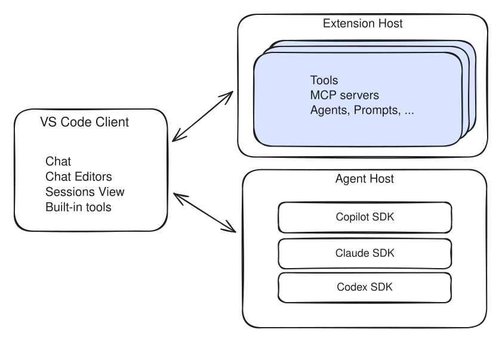
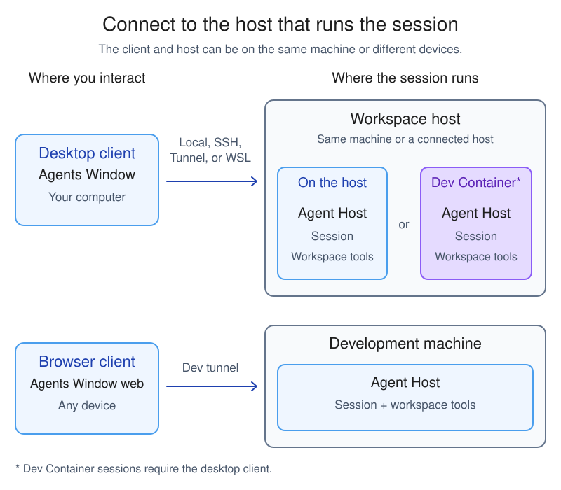

+++
title = "2.8.1.11 Agent Host 架构"
date = 2026-11-06T07:53:25+08:00
weight = 11
type = "docs"
description = ""
isCJKLanguage = true
draft = false
+++

> 原文链接: [https://code.visualstudio.com/docs/agents/concepts/agent-host](https://code.visualstudio.com/docs/agents/concepts/agent-host)

# 2.8.1.11 Agent Host 架构

　　Agent Host 是运行智能体运行框架并管理其会话的专用进程。将会话执行与单个窗口分离，使你可以跨界面使用同一会话，并在代码和开发工具附近运行智能体。

　　本文解释使用 Agent Host 的集成的进程边界、执行环境、会话生命周期和客户端依赖。使用智能体不需要了解此架构背景。要识别会话使用的运行框架或比较 Local 与 Copilot，请参阅[选择智能体运行框架](../../../choose-models-and-agents/2.3.2-ChooseAnAgentHarness/)。会话管理任务请参阅[管理会话](../../../work-with-ai/sessions/2.2.11.1-ManageSessions/)。

## 此架构提供的能力 {#what-this-architecture-enables}

　　将智能体与显示它的窗口分离提供以下能力：

* **共享会话**：多个客户端可以观察和控制同一会话，保持同步。
* **远程执行**：主机可以在另一台机器上的工作区旁运行，客户端从其他地方连接。
* **独立执行**：主机及其执行环境运行时，智能体会话可以在没有连接编辑器的情况下继续。客户端提供的工具仍需要该客户端。
* **多个智能体实现**：不同智能体运行时插入同一主机接口，向客户端呈现通用会话概念。
* **专用进程**：智能体在自己的进程中运行，不会被繁忙扩展阻塞。

> **注意**：当 [GitHub Copilot 企业托管设置生效](../../../../enterprise/7.2-ManageAISettings/#claude-and-codex-availability)时，Claude 和 Codex 运行框架会被禁用。请联系部署设置的 IT 团队讨论访问权限。

## 进程架构 {#process-architecture}

组件有不同职责：

* **客户端**：显示会话并发送请求的聊天视图、智能体窗口或浏览器界面。
* **智能体运行框架**：协调模型、工具和智能体工作流的实现。
* **Agent Host**：运行受支持运行框架并拥有其会话的进程，独立于显示它们的客户端。

　　扩展宿主仍负责扩展。扩展可以提供工具、MCP 服务器和自定义智能体，而无需运行智能体运行框架本身。扩展工具仅在运行该扩展的编辑器窗口聊天中可用。

　　Agent Host 可以作为本地实用进程或远程机器上的独立服务器运行。VS Code 使用消息端口进行本地 IPC，使用 WebSocket 上的 AHP JSON-RPC 进行远程连接。

　　智能体适配器在 Agent Host 进程内运行。适配器在其智能体运行时和通用 [Agent Host Protocol（AHP）](#agent-host-protocol)会话模型之间转换。

## 会话运行位置 {#where-sessions-run}

　　Agent Host 在工作区旁运行：你的机器、Dev Container 或远程机器。工作区文件编辑和命令使用包含主机的环境。这不决定语言模型在哪里运行。

　　智能体窗口可以连接同一机器或已连接 SSH、Tunnel 或 WSL 主机上的 Agent Host。SSH 和开发隧道提供 VS Code 特定的远程主机访问。开发隧道还支持[基于浏览器的智能体窗口](../../../work-across-apps-and-machines/2.5.2-RemoteAgentSessions/)，其中浏览器是客户端，不是运行会话的主机。

　　[GitHub Environments（预览）](../../../work-across-apps-and-machines/2.5.2-RemoteAgentSessions/)扩展受支持 Copilot 客户端之间的连续性。使用 GitHub 账户注册现有机器，即可从 VS Code、GitHub Copilot 应用、Copilot CLI、GitHub.com 或 GitHub Mobile 访问其智能体会话。支持的会话和操作因客户端而异。注册不会移动工作区或配置计算，主机必须保持运行。

下图展示本地、容器和开发隧道部署。

　　客户端显示和控制会话，Agent Host 拥有它们。桌面和浏览器客户端可以连接同一隧道主机。

　　对于 Dev Container 会话，Agent Host 在项目容器内运行。容器可以在你的机器或受支持的 SSH、Tunnel 或 WSL 主机上运行，智能体窗口保留在你的机器上。工作区文件编辑和命令使用容器内工具和依赖项，而不是直接安装在源主机上的工具。

　　Dev Container 执行是环境选择，不是不同运行框架。本地、连接主机、容器和云执行的关系请参阅[会话执行选项图](../../../concepts/2.7.6-AgentHarnesses/)。设置步骤请参阅[在 Dev Container 中运行智能体会话](../../../work-with-ai/2.2.3-AgentsWindow/)。

　　与 VS Code 远程开发类似，用户界面保留在客户端，而工作区操作在源代码和开发工具附近运行。

　　**Cloud** 目标使用提供商管理的基础设施，是单独选择。[云会话](../../../work-across-apps-and-machines/2.5.3-CloudSessions/)在受管理环境中运行 Copilot 运行时，可以从客户端重新连接。与使用 GitHub Environments 注册自己的机器不同，这会配置云计算。

## 会话生命周期和客户端依赖 {#session-lifetime-and-client-dependencies}

　　Agent Host 包含管理会话和操作工作区所需的基础能力，无需连接客户端。客户端可以断开并重新连接同一会话。

　　项目窗口关闭后，只要 Agent Host 继续运行，活动轮次可以继续。对于由桌面 VS Code 在你机器上管理的会话，请保持应用程序运行。关闭项目文件夹与退出应用程序不同。

　　对于自己远程机器上的会话，请保持机器和为该会话服务的进程运行。重新连接会话不意味着主机进程停止或机器关闭期间活动工作仍在继续。

　　云会话执行不依赖保持本地应用打开。服务管理环境可用性和生命周期。存储的对话不保证云环境仍然可用。请参阅[继续现有云会话](../../../work-across-apps-and-machines/2.5.3-CloudSessions/)。

　　连接的客户端可以提供工具，例如浏览器工具或已安装扩展的工具。Agent Host 将这些定义添加到会话，并将每个工具调用路由回贡献它的客户端。这些工具要求客户端保持连接。了解如何[管理工具可用性](../../../work-with-ai/plan-and-run-tasks/2.2.10.2-UseTools/)。

## Agent Host Protocol {#agent-host-protocol}

　　[Agent Host Protocol](https://microsoft.github.io/agent-host-protocol/)是主机与其客户端之间开放的智能体无关协议。它使用 JSON-RPC 通信，并使用不可变状态和纯 reducer 同步会话数据。

　　主机是事实来源。每个客户端订阅会话、聊天、终端和变更集等资源的 URI 寻址通道。客户端收到初始状态快照，随后收到有序操作。连接断开时，客户端重新连接并接收错过的操作或新快照。

　　协议定义和实现细节请参阅 [Agent Host Protocol 源仓库](https://github.com/microsoft/agent-host-protocol)。

## 运行独立主机 {#run-a-standalone-host}

　　要运行自己的独立 Agent Host，请使用 `code agent host`。默认情况下，命令在 localhost 启动服务器并使用连接令牌保护。使用 `--tunnel` 选项通过开发隧道公开。

## Local 和现有扩展宿主会话 {#local-and-existing-extension-host-sessions}

　　并非每个智能体会话都使用 Agent Host。以下情况使用扩展宿主：

* 创建会话时选择 **Local** 运行框架。
* 继续 Agent Host 支持会话之前使用早期扩展宿主架构创建的会话。

　　扩展宿主会话与当前编辑器窗口及其扩展紧密集成。这种集成有代价：窗口拥有会话，因此关闭窗口会停止进行中的工作，且不能从另一个界面继续会话。

　　Agent Host 会话由专用进程拥有，而不是单个编辑器窗口。关闭窗口后它们可以继续，并可在主机运行时从受支持界面重新打开。在单独进程中运行智能体还可以防止繁忙扩展宿主阻塞它们。但编辑器窗口贡献的工具（例如已安装扩展工具）仅在该窗口连接时可用。

　　进程边界还影响审查编辑、配置智能体和继续会话的方式。任务特定差异请参阅：

| 任务 | 指导 |
|------|----------|
| 审查已保存编辑 | [Local 运行框架特定行为](../../../work-with-ai/2.2.8-ReviewAndRevertChanges/)。 |
| 配置指令和自定义智能体 | [选择自定义作用域和位置](../../../customize-and-extend/2.4.1-Overview/)或[迁移现有自定义项](../../../customize-and-extend/2.4.11-MigrateExistingCustomizations/)。 |
| 配置钩子 | [为会话选择钩子实现](../../../customize-and-extend/2.4.9-Hooks/)。共享主机不会给运行框架共享钩子 schema。 |
| 设置权限和 Autopilot 行为 | [管理审批和权限](../../../work-with-ai/permissions-and-security/2.2.12.1-ApprovalsAndPermissions/)。 |
| 跨界面继续会话 | [跨界面会话](../../../concepts/2.7.5-SessionsAndChats/)。 |
| 配置工具和 MCP 服务器 | [管理可用工具](../../../work-with-ai/plan-and-run-tasks/2.2.10.2-UseTools/)和 [MCP 配置格式](../2.8.1.8-MCPConfiguration/)。 |

## 相关资源 {#related-resources}

* [远程智能体会话](../../../work-across-apps-and-machines/2.5.2-RemoteAgentSessions/)
* [智能体运行框架概念](../../../concepts/2.7.6-AgentHarnesses/)
* [VS Code 远程开发架构](../../../../remote/)
