+++
title = "2.8.1.4 VS Code 宠物"
date = 2026-11-06T07:53:25+08:00
weight = 4
type = "docs"
description = ""
isCJKLanguage = true
draft = false
+++

> 原文链接: [https://code.visualstudio.com/docs/agents/reference/chat-pet](https://code.visualstudio.com/docs/agents/reference/chat-pet)

# 2.8.1.4 VS Code 宠物

　　VS Code 宠物 Blobby 位于聊天输入框上方，在你与智能体协作时做出反应。本参考列出 Blobby 对聊天活动、移动、直接交互和上下文菜单操作的反应。

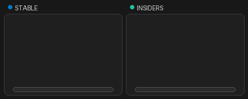

　　要了解如何显示、隐藏和控制宠物，请参阅[个性化聊天](../../../work-with-ai/2.2.5-UseChat/#personalize-chat)。

## 聊天活动反应 {#chat-activity-reactions}

| 活动 | 宠物反应 | 预览 |
|----------|--------------|---------|
| 在聊天输入框周围移动指针 | 瞳孔跟随指针。 | 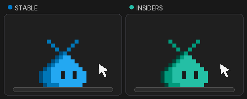 |
| 输入提示词 | 在微型终端上工作。 | 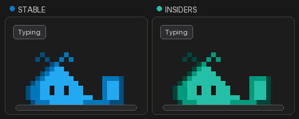 |
| 等待请求运行 | 用动画对话气泡思考。 | 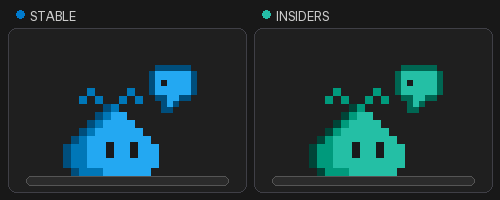 |
| 回应确认或问题 | 智能体需要输入时鼓掌。 | 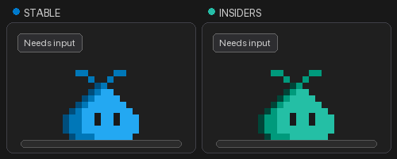 |
| 让聊天空闲 20 秒 | 睡着，睡眠气泡从鼻子长出并飘走。与宠物交互或在输入框输入可唤醒。 | 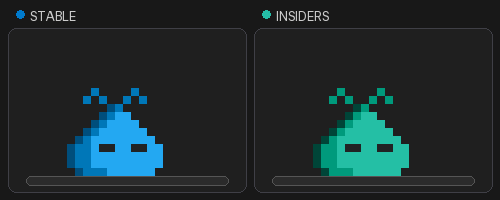 |
| 完成响应 | 表演按钮庆祝动作。 | 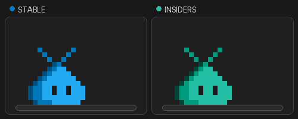 |

## 移动反应 {#movement-reactions}

| 交互 | 宠物反应 | 预览 |
|-------------|--------------|---------|
| 拖放 | 宠物跟随指针，直到释放。 | 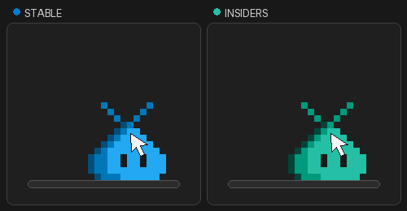 |
| 轻弹 | 宠物沿手势方向继续，然后被重力拉下。 | |
| 按左方向键或右方向键 | 宠物沿输入框跳跃，直到边缘。 | 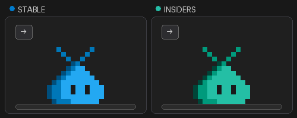 |
| 按 `Shift + 左/右` | 宠物被扔向墙壁。 | |
| 在宠物左右快速移动指针，或交替按方向键 | 宠物眩晕。 | 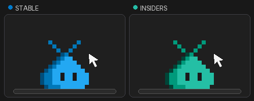 |
| 将宠物丢过输入框 | 宠物掉入聊天底部的消失效果，在顶部重新出现并落在输入框上。 | 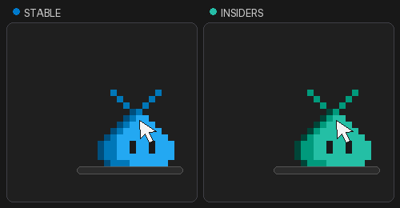 |

## 激活反应 {#activation-reactions}

　　宠物休息时选择它，或将焦点移到它并按 `Enter` 或 `Space`，随机触发以下反应。宠物不会立即重复上一个反应。

| 反应 | 行为 | 预览 |
|----------|----------|---------|
| 按钮 | 按红色按钮。 |  |
| 爱心 | 用爱心回应。 | 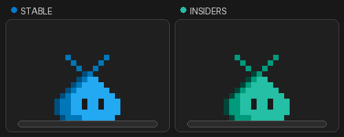 |
| 酷 | 戴上墨镜。 |  |
| VS Code | 侧躺叫唤。 | 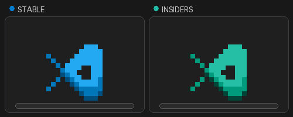 |
| 唱歌 | 唱出音符。 | 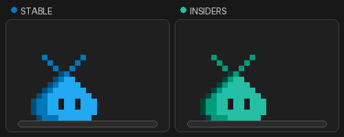 |
| 无语 | 变得无语。 |  |
| 担忧 | 看起来担忧。 |  |

## 成就和上下文菜单操作 {#achievements-and-context-menu-actions}

　　解锁成就时，宠物身上会出现金色星星，持续 10 秒。星星可见时选择宠物，打开 **成就**。

打开宠物上下文菜单访问以下操作：

| 操作 | 行为 | 预览 |
|--------|----------|---------|
| **成就** | 查看已锁定和已解锁成就及其配件奖励。 | |
| **去跑步** 或 **回来** | 宠物躲到视线外，偶尔探头进入聊天，被召唤时返回。 | 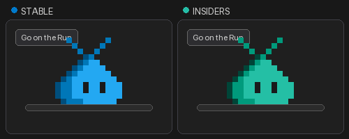 |
| **变大**、**变小** 或 **重置大小** | 以 20% 步长调整宠物大小，或恢复默认大小。可以缩小到 40% 或继续增大。 | 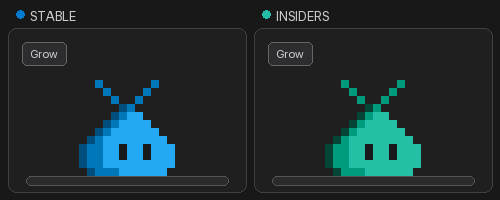 |
| **更改颜色** | 选择 Stable 或 Insiders，或在聊天中输入 `/blobby` 解锁预设和自定义颜色。自定义颜色请使用颜色选择器或输入十六进制值，然后选择 **应用颜色**。 |  |

## 相关资源 {#related-resources}

* [在 VS Code 中使用聊天](../../../work-with-ai/2.2.5-UseChat/)
* [使用智能体窗口](../../../work-with-ai/2.2.3-AgentsWindow/)
