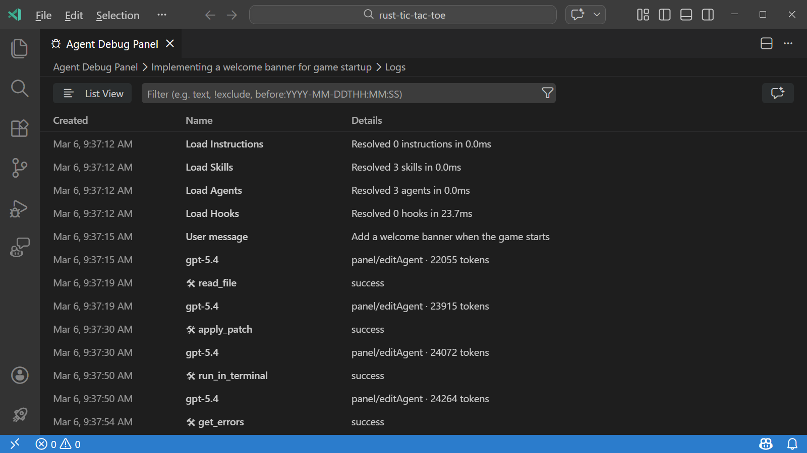
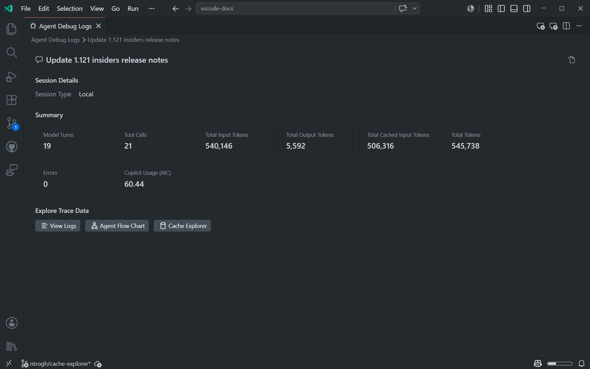
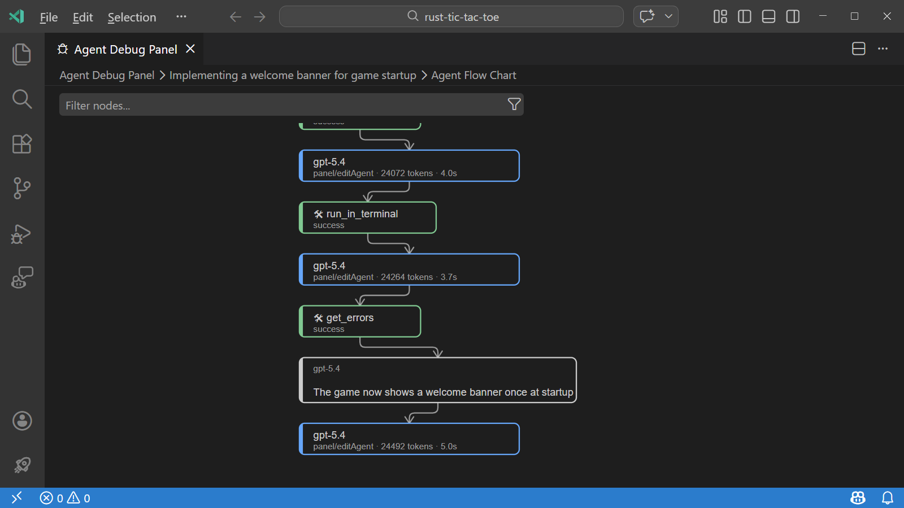
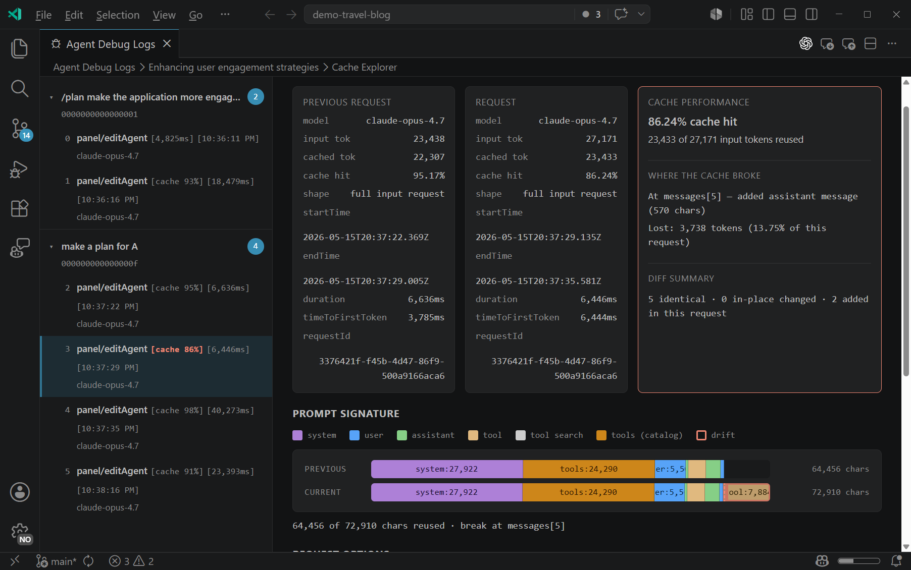
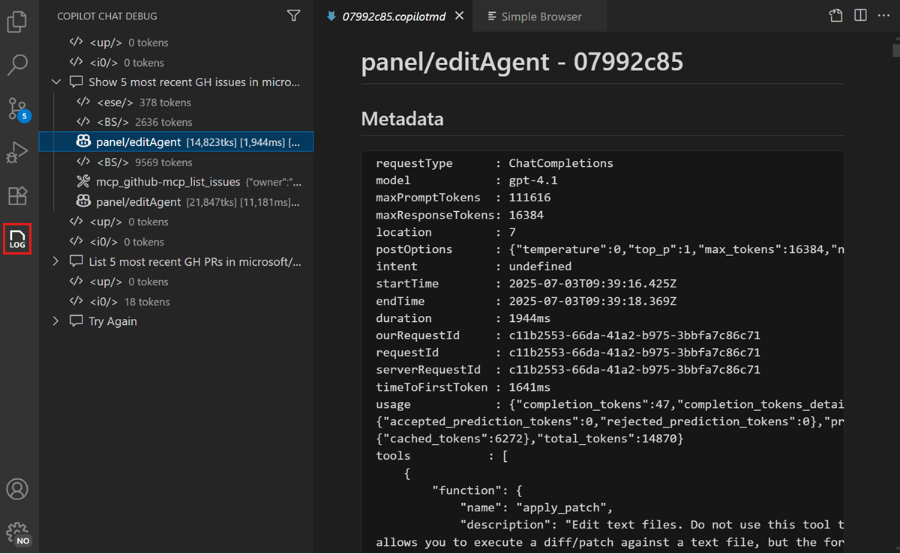

+++
title = "2.8.2.2 调试聊天交互"
date = 2026-11-06T07:53:25+08:00
weight = 2
type = "docs"
description = ""
isCJKLanguage = true
draft = false
+++


> 原文链接: [https://code.visualstudio.com/docs/agents/agent-troubleshooting/chat-debug-view](https://code.visualstudio.com/docs/agents/agent-troubleshooting/chat-debug-view)

# 2.8.2.2 调试聊天交互

　　智能体行为异常时，在更改提示词或配置之前检查受影响聊天会话的证据。本文帮助选择诊断视图、跟踪发生的情况并验证更改是否解决问题。

## 选择诊断工具 {#choose-a-diagnostic-tool}

　　VS Code 提供互补工具回答不同问题：

| 问题 | 工具 |
|----------|------|
| 发生了什么，顺序如何？ | 使用智能体调试日志面板中的[日志视图](#logs-view)。 |
| 会话耗时多久、用了多少令牌、是否有错误？ | 使用[摘要视图](#summary-view)。 |
| 智能体和子智能体如何交互？ | 使用[智能体流程图视图](#agent-flow-chart-view)。 |
| 发送给模型的提示词、上下文和工具是什么？ | 使用 [Chat Debug 视图](#chat-debug-view)。 |
| 请求之间的更改是否降低了报告的缓存复用？ | 使用[缓存浏览器](../2.8.2.3-DiagnosePromptCaching/)。 |
| AI 能否为我总结捕获的事件？ | [将调试事件附加到聊天或使用 `/troubleshoot`](#analyze-debug-events-with-chat)。 |

　　账户、连接或功能可用性问题，请从[排查 VS Code 中的 AI](../2.8.2.1-Troubleshooting/)开始。

## 开始之前 {#before-you-start}

> **注意**：智能体调试日志面板处于预览阶段。

在复现问题前准备日志：

* 在要检查的活动之前启用实验性 `chat.agentHost.agentDebugLog.enabled` 设置。它会捕获由 [Agent Host](../../../concepts/)管理的会话事件，无论使用聊天视图还是智能体窗口。
* 复现问题并记录受影响会话。捕获不是追溯性的。

> **注意**：**对于 Local 运行框架会话：** 改为启用实验性 `github.copilot.chat.agentDebugLog.fileLogging.enabled` 设置。使用 `/troubleshoot` 前重新加载编辑器窗口。

> **警告**：调试视图和导出的日志可能包含提示词、源代码、文件路径、工具输入输出和其他敏感数据。共享前审查内容，绝不要包含凭据或机密。

## 调查常见场景 {#investigate-common-scenarios}

### AI 忽略工作区文件 {#the-ai-ignores-workspace-files}

如果响应很通用或未使用预期代码：

1. 打开 Chat Debug 视图，检查受影响请求的 **上下文** 部分。
2. 如果文件缺失，确认打开了正确工作区并且[工作区索引](../../reference/2.8.1.11-AgentHostArchitecture/)可用。
3. 将相关文件或代码添加为显式[聊天上下文](../../../work-with-ai/2.2.7-AddPromptContext/)，然后重复请求。
4. 重新打开 Chat Debug 视图，确认预期上下文存在。

### 未调用 MCP 工具 {#an-mcp-tool-is-not-being-invoked}

如果模型未调用预期工具：

1. 从命令面板运行 **MCP: List Servers**，确认服务器正在运行。
2. 打开 Chat Debug 视图，检查工具是否出现在可用工具定义中。
3. 如果工具缺失，请[排查 MCP 服务器](../../../customize-and-extend/2.4.8-ManageMCPServers/#troubleshoot-mcp-servers)。
4. 如果工具可用，请检查智能体调试日志中的工具调用和错误。
5. 在提示词中说明工具名称及其应执行的操作，然后重复请求。

### AI 响应不完整 {#the-ai-response-is-incomplete}

如果响应提前停止或遗漏部分任务：

1. 检查智能体调试日志中的模型请求错误和令牌用量。
2. 检查 Chat Debug 视图的 **响应** 和 **工具响应** 部分，确定是模型响应还是工具结果不完整。
3. 如果对话包含无关或过时上下文，请使用 `/compact` 或开始新会话并重复请求。
4. 如果日志显示错误，请在[报告问题](../2.8.2.1-Troubleshooting/#report-an-unresolved-issue)时包含该错误。

### 指令或提示词文件未应用 {#instructions-or-a-prompt-file-are-not-applied}

　　自定义指令和提示词文件以不同方式进入请求。复现问题前[准备日志](#before-you-start)，然后区分发现、包含和遵守：

1. 对受影响运行框架和仓库[检查自定义项发现](../2.8.2.1-Troubleshooting/#check-customization-diagnostics)。确认文件已列出且没有错误。
2. 检查[指令激活](../../reference/2.8.1.6-CustomInstructionsReference/#discovery-and-activation)。对于基于模式的指导，验证 `applyTo` 或 Claude `paths`。对于 Local 基于任务的发现，检查 `description`。如果手动附加文件，确认它附加到正在检查的请求。
3. 对于提示词文件，确认会话使用 Local 运行框架，并且你手动调用了文件。提示词文件仅在 Local 运行框架会话中支持。对于希望与兼容技能的智能体复用的工作流，请创建[智能体技能](../../../customize-and-extend/2.4.3-AgentSkills/)。详情请参阅[使用提示词文件](../../../customize-and-extend/2.4.10-PromptFiles/)。
4. 检查智能体调试日志中的 **发现** 事件，查看自定义项是已加载、跳过还是拒绝。
5. 在请求详情可用处，检查 Chat Debug 视图中的指令内容或文件读取结果。对于 Local 会话，检查 **系统提示词** 中的自定义指令，以及 **用户提示词** 中调用的提示词文件。响应的 **引用** 部分（如果可用）是另一个包含检查。
6. 如果内容到达模型但结果未遵循，请检查冲突或不清楚的指导。更正相关问题，在新聊天中重复任务，并比较实际更改和工具活动。

## 智能体调试日志面板 {#agent-debug-logs-panel}

　　智能体调试日志面板显示聊天会话的时间顺序记录和聚合指标，还提供智能体编排流程图和缓存浏览器访问。

通过以下任一方式打开：

* 选择聊天视图中的省略号（**...**）菜单，然后选择 **显示智能体调试日志**。
* 从命令面板运行 **Developer: Open Agent Debug Logs**。

　　面板包括当前和历史会话。持久化日志存储在本地。

### 日志视图 {#logs-view}

　　日志视图列出会话事件及时间戳、类型和摘要。展开事件可检查模型请求的系统提示词或工具调用的输入输出等详情。



　　在平铺列表和按子智能体分组的树之间切换。使用筛选器聚焦模型请求、工具调用、发现或错误等事件。

### 摘要视图 {#summary-view}

　　摘要视图报告工具调用、令牌用量、错误和总时长等聚合信息。使用这些指标确定会话中需要深入调查的部分。



打开摘要视图：

1. 打开受影响会话的智能体调试日志面板。
2. 选择面板顶部面包屑中的会话描述。

　　在摘要视图中选择 **查看日志**、**智能体流程图** 或 **缓存浏览器** 打开相应视图。

### 智能体流程图视图 {#agent-flow-chart-view}

　　智能体流程图视图可视化智能体和子智能体之间的交互顺序。用于确定哪个智能体委派了操作以及工作流在哪里停止。



打开流程图：

1. 打开受影响会话的摘要视图。
2. 选择 **智能体流程图**。
3. 平移或缩放图表，选择节点检查该事件。

### 缓存浏览器视图 {#cache-explorer-view}

　　缓存浏览器比较连续模型请求并标记首次分歧。仅在摘要视图报告缓存复用率低且持续时间或输入令牌用量意外时使用。



　　解释和验证步骤请参阅[使用缓存浏览器诊断提示词缓存](../2.8.2.3-DiagnosePromptCaching/)。

### 使用聊天分析调试事件 {#analyze-debug-events-with-chat}

　　当希望 AI 回答有关令牌用量、已加载自定义项、工具调用、错误或时长的聚焦问题时，将会话事件快照附加到聊天。

1. 打开受影响会话的日志视图。
2. 选择智能体调试日志面板右上角的闪光图标。
3. 就附加事件提出聚焦问题。

　　也可以输入 `/troubleshoot` 后跟问题。例如：

```text
/troubleshoot 加载了哪些自定义项，是否有失败？
```

　　对于智能体窗口中的会话，输入 `/troubleshoot #session`，选择会话，然后添加问题。

### 导出和导入会话 {#export-and-import-sessions}

　　需要保留证据或用其他受支持工具分析时，将会话导出为 OTLP 格式的 OpenTelemetry JSON 文件。

导出会话：

1. 打开智能体调试日志面板，选择会话。
2. 选择右上角工具栏中的 **导出** 图标。
3. 选择 JSON 文件位置。
4. 共享前审查导出内容。

检查之前导出的会话：

1. 选择右上角工具栏中的 **导入** 图标。
2. 选择导出的智能体调试日志 JSON 文件。
3. 使用摘要和日志视图检查导入会话。

## Chat Debug 视图 {#chat-debug-view}

　　Chat Debug 视图显示每次模型交互的请求和响应详情。用它验证哪些指令、上下文、消息和工具定义到达模型。

### 打开 Chat Debug 视图 {#open-the-chat-debug-view}

通过以下任一方式打开：

* 选择聊天视图中的溢出菜单，然后选择 **显示 Chat Debug 视图**。
* 从命令面板运行 **Developer: Show Chat Debug View**。



### 阅读调试输出 {#read-the-debug-output}

每次交互包含可展开部分：

| 部分 | 显示内容 | 检查内容 |
|---------|---------------|---------------|
| **系统提示词** | 定义模型行为、能力和约束的指令。 | 验证预期自定义指令和智能体定义出现。 |
| **用户提示词** | 发送给模型的提示词。 | 确认提示词文本和解析后的引用存在。 |
| **上下文** | 文件、符号和其他附加上下文。 | 检查任务所需上下文是否存在且相关。 |
| **响应** | 模型返回的响应。 | 确定模型返回完整内容还是错误。 |
| **工具响应** | 请求期间调用工具的输入和输出。 | 验证每个工具收到预期输入并返回可用结果。 |

## 验证诊断 {#verify-the-diagnosis}

确定可能原因后：

1. 更改一个相关条件，例如文件模式、服务器配置、上下文附件或工具选择。
2. 重复可比请求。
3. 检查相同事件或请求部分。
4. 确认诊断证据和用户可见结果都按预期变化。

　　如果证据未变化，请恢复之前配置并调查下一个可能原因。

## 相关资源 {#related-resources}

* [排查 VS Code 中的 AI](../2.8.2.1-Troubleshooting/)
* [向聊天添加上下文](../../../work-with-ai/2.2.7-AddPromptContext/)
* [使用 AI 的安全注意事项](../../../work-with-ai/permissions-and-security/2.2.12.3-AISecurity/)
