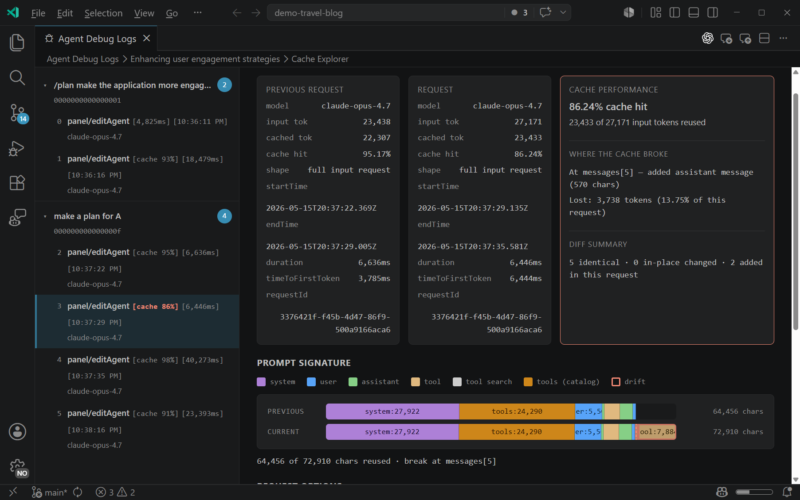

+++
title = "2.8.2.3 诊断提示词缓存"
date = 2026-11-06T07:53:25+08:00
weight = 3
type = "docs"
description = ""
isCJKLanguage = true
draft = false
+++

> 原文链接: [https://code.visualstudio.com/docs/agents/agent-troubleshooting/cache-explorer](https://code.visualstudio.com/docs/agents/agent-troubleshooting/cache-explorer)

# 2.8.2.3 诊断提示词缓存

　　某些语言模型提供商可以复用先前请求中未更改的前缀，而不是再次处理这些输入令牌。缓存浏览器比较聊天会话中的连续模型请求，帮助你调查该前缀的变化是否导致更高延迟或令牌用量。

　　在智能体调试日志摘要视图报告缓存复用率低且持续时间或输入令牌用量意外时，使用缓存浏览器。对于一般智能体失败、缺失上下文或工具错误，请从[调试聊天交互](../2.8.2.2-DebugChatInteractions/)开始。

## 理解提示词缓存 {#understand-prompt-caching}

　　提示词缓存取决于提供商和模型。支持时，提供商可能复用请求开头与缓存内容匹配的部分。请求早期发生变化会减少可复用前缀的比例。

　　缓存浏览器显示连续请求之间的差异并标记首次分歧。该差异有助于解释报告的缓存指标，但不能证明模型提供商如何处理或计费该请求。

> **重要**：不要仅为提高缓存复用率而移除必要指令、工具或上下文。响应质量和任务正确性优先于缓存指标。

## 开始之前 {#before-you-start}

使比较有用：

* 使用至少有两个模型请求的会话。
* 打开智能体调试日志摘要视图，确认某个请求的缓存复用率低，且持续时间或输入令牌用量意外。
* 比较同一会话的请求。验证更改时保持模型和任务可比。

　　如果摘要视图不报告缓存信息，所选模型或提供商可能不公开该信息。请改用日志视图调查请求时长、错误和工具调用。

## 打开缓存浏览器 {#open-the-cache-explorer}

1. 选择聊天视图中的省略号（**...**）菜单，选择 **显示智能体调试日志**，打开智能体调试日志面板。
2. 选择面包屑中的会话描述，打开摘要视图。
3. 选择 **缓存浏览器**。

## 阅读比较 {#read-the-comparison}

　　侧面板按用户请求分组列出模型轮次。每轮可以显示缓存命中百分比、时长、模型名称和时间戳。选择轮次可将其请求与前一个请求比较。

主区域包含：

* **缓存性能**：报告的缓存百分比和复用的输入令牌数。
* **提示词签名**：请求组件摘要，例如系统指令、工具定义和消息。首次分歧标记连续请求不再匹配的位置。
* **组件**：请求组件的可展开文本差异。

　　如果某轮没有前一个模型请求，缓存浏览器没有可比较的连续请求。

## 调查缓存未命中 {#investigate-a-cache-miss}

1. 选择报告缓存复用率低且持续时间或输入令牌用量意外的轮次。
2. 找到提示词签名中的首次分歧。
3. 展开该组件并确定变化内容。
4. 判断该变化是否必要且在你的控制范围内。
5. 进行一项有依据的调整。
6. 使用调整后的配置启动新会话，重复相同两次请求序列。
7. 比较第二个请求的缓存指标、时长、输入令牌用量和响应质量。只有整体结果改善时才保留调整。

例如，假设首次分歧在工具定义中，因为你在轮次之间启用了 MCP 服务器。如果任务需要该服务器，请保留它并接受较低的复用率。如果不需要，请在开始新会话前选择工具，并重复相同两次请求序列。差异中的变化是请求结构的证据，不能证明缓存导致了所有观察到的延迟。

## 保持请求上下文稳定 {#keep-request-context-stable}

以下实践可以减少轮次之间不必要的变化：

* **开始前选择会话选项**：尽可能在第一个请求前选择模型、推理强度、上下文大小和所需工具。
* **保持共享指令稳定**：比较轮次时避免编辑指令文件或自定义智能体定义。指导请参阅[上下文工程指南](../../../tutorials-and-guides/2.6.11-ContextEngineering/)。
* **只附加相关上下文**：反复添加或替换附件会更改请求。优先使用任务需要的聚焦上下文。
* **隔离独立研究**：当将探索保持在主对话之外能提高清晰度时，使用[子智能体](../../../work-with-ai/plan-and-run-tasks/2.2.10.4-Subagents/)执行单独研究任务。
* **有意重置长对话**：当累积历史不再有帮助时，开始新会话或使用 `/compact`。

　　某些请求组件由 VS Code、扩展或模型提供商组装，无法直接控制。如果首次分歧不在你的配置中，请将比较作为诊断证据，而不是试图围绕它重写提示词。

## 相关资源 {#related-resources}

* [调试聊天交互](../2.8.2.2-DebugChatInteractions/)
* [优化 AI 使用量](../../../tutorials-and-guides/2.6.14-ReduceCreditUsage/)
* [上下文工程指南](../../../tutorials-and-guides/2.6.11-ContextEngineering/)
