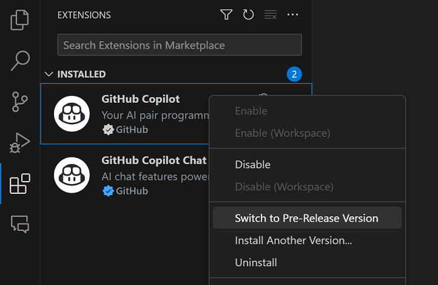
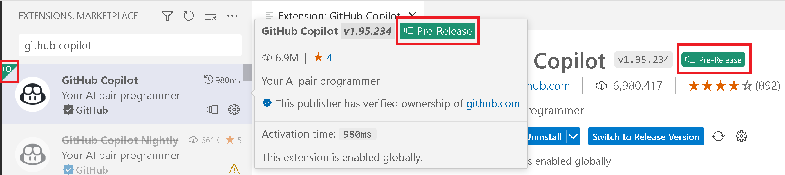
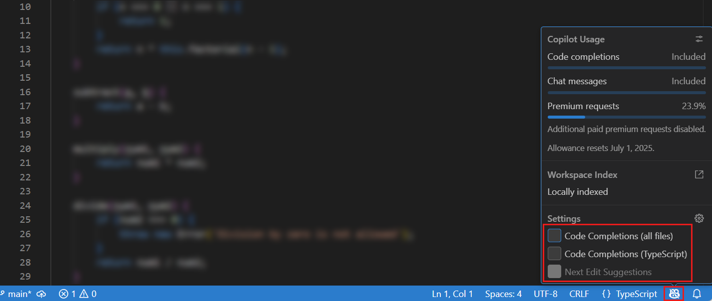

+++
title = "2.8.2.4 常见问题"
date = 2026-11-06T07:53:25+08:00
weight = 4
type = "docs"
description = ""
isCJKLanguage = true
draft = false
+++

> 原文链接: [https://code.visualstudio.com/docs/agents/agent-troubleshooting/faq](https://code.visualstudio.com/docs/agents/agent-troubleshooting/faq)

# 2.8.2.4 常见问题

　　查找有关 VS Code 中 GitHub Copilot 访问、用量、聊天、智能体、内联建议和故障排除的答案。

## GitHub Copilot 订阅 {#github-copilot-subscription}

### 可以在不登录的情况下使用 VS Code 吗？ {#can-i-use-vs-code-without-signing-in}

　　可以。使用 VS Code 核心编辑器功能不需要账户。

要使用 AI 功能，请选择以下访问方式之一：

* 使用具有 GitHub Copilot 套餐的 GitHub 账户登录。这会提供套餐包含的模型、功能和用量额度。
* 为受支持聊天功能配置[自带密钥模型](../../../choose-models-and-agents/2.3.1-ChooseAndConfigureModels/#bring-your-own-language-model-key)，无需 GitHub 登录。

　　某些功能（包括内联建议、语义搜索和嵌入）需要 GitHub Copilot 服务，无法通过 BYOK 模型使用。

　　如果不想使用 AI，可以继续在不登录的情况下使用 VS Code。要隐藏内置 AI 功能，请参阅[从 VS Code 移除 AI 功能](../../../getting-started/2.1.2-SetUpCopilot/)。

### 如何获取 Copilot 订阅？ {#how-can-i-get-a-copilot-subscription}

获取 GitHub Copilot 访问权限的方式不同：

| 用户类型 | 说明 |
|--------------------------------|-------------|
| 个人 | <ul><li>设置 Copilot Free，免费探索基本功能，并获得每月内联建议和 AI 点数额度。</li><li>注册付费 GitHub Copilot 套餐以获得更大灵活性和高级功能。</li><li>所有选项请参阅[为自己设置 GitHub Copilot](https://docs.github.com/en/copilot/setting-up-github-copilot/setting-up-github-copilot-for-yourself)。</li></ul> |
| 组织/企业成员 | <ul><li>如果所在组织或企业有 GitHub Copilot 订阅，请访问 <https://github.com/settings/copilot>，在“Get Copilot from an organization”下请求访问。</li><li>组织启用 Copilot 请参阅[为组织设置 GitHub Copilot](https://docs.github.com/en/copilot/setting-up-github-copilot/setting-up-github-copilot-for-your-organization)。</li></ul> |

### 使用 GitHub 账户登录有什么优势？ {#whats-the-advantage-of-signing-in-with-a-github-account}

使用有权访问 GitHub Copilot 的 GitHub 账户登录有以下好处：

* [更高的每月 AI 点数额度](https://docs.github.com/en/copilot/get-started/plans)
* [聊天中的高级语言模型](https://docs.github.com/en/copilot/reference/ai-models/supported-models)，超出自动模型选择
* [自带模型密钥](../../../choose-models-and-agents/2.3.1-ChooseAndConfigureModels/#bring-your-own-language-model-key)（BYOK）访问更多模型
* [远程仓库索引和语义代码搜索](../../reference/2.8.1.11-AgentHostArchitecture/)
* [Copilot 代码审查](https://docs.github.com/en/copilot/concepts/agents/code-review)
* [Copilot 内容排除](https://docs.github.com/en/copilot/how-tos/configure-content-exclusion/exclude-content-from-copilot)
* [在云会话中运行任务](../../../work-across-apps-and-machines/2.5.3-CloudSessions/)，进行受管理远程执行

　　根据 Copilot 套餐，访问级别和限制可能不同。更多信息请参阅 [GitHub Copilot 套餐](https://docs.github.com/en/copilot/get-started/plans)。

### 如何监控 Copilot 用量？ {#how-can-i-monitor-my-copilot-usage}

　　可以通过 VS Code 状态栏中的 Copilot 状态仪表板查看当前用量。仪表板显示：

* **内联建议**：当月已使用的内联建议配额百分比。付费套餐的内联建议配额不限。
* **AI 点数**：当月已使用的每月 AI 点数额度百分比。

　　访问 GitHub Copilot 文档了解[监控用量和权益](https://docs.github.com/en/copilot/managing-copilot/monitoring-usage-and-entitlements/monitoring-your-copilot-usage-and-entitlements)。减少点数消耗的技巧请参阅[优化 AI 点数使用量](../../../tutorials-and-guides/2.6.14-ReduceCreditUsage/)。

### 达到内联建议或 AI 点数限制 {#i-reached-my-inline-suggestions-or-ai-credits-limit}

　　内联建议额度和 AI 点数额度每月重置。如果只达到 AI 点数限制，仍可以使用内联建议；同样，达到内联建议限制时仍可以使用聊天。

　　对于 Copilot Free 用户，要获得更多内联建议和 AI 点数，可以直接从 VS Code 注册[付费套餐](https://docs.github.com/en/copilot/concepts/billing/usage-based-billing-for-individuals)。或者等到下个月继续免费使用 Copilot。

　　如果使用付费套餐并耗尽 AI 点数，可以设置额外用量预算继续工作，或等到下个月额度重置。详细了解 [GitHub Copilot 文档中超出包含的 AI 点数时会发生什么](https://docs.github.com/en/copilot/concepts/billing/usage-based-billing-for-individuals#what-happens-if-i-exceed-my-included-ai-credits)。

　　减少点数消耗的技巧请参阅[优化 AI 点数使用量](../../../tutorials-and-guides/2.6.14-ReduceCreditUsage/)。

### 在 VS Code 中未检测到 Copilot 订阅 {#my-copilot-subscription-is-not-detected-in-vs-code}

　　要在聊天中使用 Copilot 套餐，必须使用有权访问该套餐的 GitHub 账户登录 VS Code。

* 如果 Copilot 订阅关联另一个 GitHub 账户，请退出当前 GitHub 账户并登录另一个。使用活动栏 **账户** 菜单退出当前 GitHub 账户。更多信息请参阅[为 Copilot 使用其他 GitHub 账户](../../../getting-started/2.1.2-SetUpCopilot/)。
* 在 [GitHub Copilot 设置](https://github.com/settings/copilot)中确认订阅仍然有效。
* 如果在 GHE.com 上使用托管用户账户的 Copilot 套餐，需要在登录前更新一些设置。请参阅[在 GHE.com 上使用 GitHub Copilot 账户](https://docs.github.com/en/copilot/managing-copilot/configure-personal-settings/using-github-copilot-with-an-account-on-ghecom)。

### 如何为 Copilot 切换账户？ {#how-can-i-switch-accounts-for-copilot}

　　如果 Copilot 订阅关联另一个 GitHub 账户，请在 VS Code 中退出当前 GitHub 账户并登录另一个。

　　更多信息请参阅[为 Copilot 使用其他 GitHub 账户](../../../getting-started/2.1.2-SetUpCopilot/)。

## 常规 Copilot 问题 {#general-copilot-questions}

### 如何从 VS Code 中移除 Copilot？ {#how-can-i-remove-copilot-from-vs-code}

　　可以使用 `chat.disableAIFeatures` 设置禁用 VS Code 内置 AI 功能，与其他功能配置方式类似。这会禁用并隐藏聊天或内联建议等功能，并禁用 Copilot 扩展。可以在工作区或用户级别配置。

　　也可以使用标题栏聊天菜单中的 **了解如何隐藏 AI 功能** 操作访问该设置。

> **注意**：如果之前禁用了内置 AI 功能，更新到新版本 VS Code 时会尊重你的选择。

### Copilot 的网络和防火墙配置 {#network-and-firewall-configuration-for-copilot}

* 配置防火墙或代理，允许 GitHub Copilot 所需的域、端口和协议。请参阅[排查 GitHub Copilot 防火墙设置](https://docs.github.com/en/copilot/troubleshooting-github-copilot/troubleshooting-firewall-settings-for-github-copilot)。
* 如果使用企业 VPN 或 HTTP 代理，请检查 Copilot 能否在无连接或证书错误的情况下访问 GitHub。请参阅[排查 GitHub Copilot 网络错误](https://docs.github.com/en/copilot/troubleshooting-github-copilot/troubleshooting-network-errors-for-github-copilot)。

　　要识别失败连接，请[收集网络诊断](../2.8.2.1-Troubleshooting/)。

### 我的请求受到速率限制 {#my-request-is-rate-limited}

　　此错误表示服务正在临时限制请求。即使每月 AI 点数额度未耗尽，也可能发生速率限制。请等待几分钟后重试。

　　更多信息请参阅 [GitHub Copilot 速率限制](https://docs.github.com/en/copilot/troubleshooting-github-copilot/rate-limits-for-github-copilot)。

### Copilot 扩展有预发布版本吗？ {#are-there-pre-release-builds-of-the-copilot-extensions}

　　有。可以切换到 Copilot 扩展的预发布（每夜）版本，尝试最新功能和修复。在扩展视图中右键单击或选择齿轮图标打开上下文菜单，然后选择 **切换到预发布版本**：

　　扩展详情中的“预发布”徽章表示正在运行预发布版本：

## 内联建议 {#inline-suggestions}

### 如何启用或禁用内联建议？ {#how-do-i-enable-or-disable-inline-suggestions}

　　可以通过 VS Code 状态栏 Copilot 状态仪表板中的复选框启用或禁用内联建议。可以全局启用/禁用，或针对活动编辑器的文件类型启用/禁用。

　　也可以使用 `github.copilot.enable` 和 `github.copilot.nextEditSuggestions.enabled` 设置分别启用或禁用内联建议和下一次编辑建议。可以在工作区或用户级别配置。

### 编辑器中的内联建议不工作 {#inline-suggestions-are-not-working-in-the-editor}

* 确认 GitHub Copilot 没有在全局或该语言中被关闭。
* 确认 [GitHub Copilot 订阅有效并被检测](#my-copilot-subscription-is-not-detected-in-vs-code)。
* 确认[网络设置](#network-and-firewall-configuration-for-copilot)允许连接 GitHub Copilot。
* 确认没有达到 Copilot Free 套餐的每月内联建议限制。

　　如果这些检查通过，请[查看 GitHub Copilot 日志](../2.8.2.1-Troubleshooting/)。

## 聊天和智能体 {#chat-and-agents}

### 聊天功能无法工作 {#chat-features-arent-working-for-me}

检查以下要求：

* 运行 **Code: Check for Updates** 更新 VS Code。
* 如果使用 Copilot 套餐，确认 VS Code 已使用具有有效套餐的 GitHub 账户登录。
* 如果使用 BYOK 模型，验证模型提供商配置。某些聊天功能仍需要 GitHub Copilot 服务。
* 检查 Copilot 状态仪表板是否耗尽 AI 点数额度。如果请求报告临时速率限制，请等待几分钟后重试。
* 检查[网络和防火墙配置](#network-and-firewall-configuration-for-copilot)。

　　如果这些检查通过，请遵循[基于症状的故障排除步骤](../2.8.2.1-Troubleshooting/)。

### 智能体在聊天中不可用 {#agents-are-not-available-in-chat}

　　确认 `chat.agent.enabled` 设置已开启。组织可以通过策略管理该设置。如果设置不可用或受管理，请联系管理员。

### 智能体可以在 VS Code 中做什么？ {#what-can-agents-do-in-vs-code}

　　智能体可以自主处理完整编码任务。它们规划多步骤实现、跨多个文件执行协调更改、运行终端命令、调用工具并在遇到错误时自我纠正。功能实现、架构级重构、框架迁移、调试和测试生成可以使用智能体。详细了解[使用智能体](../../../getting-started/2.1.4-AgentsTutorial/)。

### Copilot 支持大型代码库和 monorepo 吗？ {#does-copilot-work-with-large-codebases-and-monorepos}

　　支持。VS Code 使用语义搜索、语言智能（LSP）和 GitHub 代码搜索自动索引工作区，从而对仓库提供深入理解。大型仓库可以使用[远程索引](../../reference/2.8.1.11-AgentHostArchitecture/)，利用 GitHub 索引在相关仓库中获得快速全面结果。在 monorepo 中使用[多根工作区](../../../../editor/3.2-WriteCode/3.2.8-Workspaces/3.2.8.2-MultiRootWorkspaces/)限定上下文，并使用[自定义指令](../../../customize-and-extend/2.4.4-Instructions/)描述项目架构。请参阅[大型代码库最佳实践](../../../getting-started/2.1.6-BestPractices/)。

### 组织可以控制 AI 功能和智能体访问吗？ {#can-my-organization-control-ai-features-and-agent-access}

　　可以。组织管理员可以通过[企业 AI 设置](../../../../enterprise/7.2-ManageAISettings/)和[策略](../../../../enterprise/7.1-Policies/)管理 Copilot，包括启用或禁用智能体、控制模型访问、配置内容排除并强制信任边界。合规详情请参阅 [GitHub Copilot 信任中心](https://resources.github.com/copilot-trust-center/)。

### 智能体有使用限制吗？ {#are-agents-usage-limited}

　　智能体消耗 Copilot 套餐中的 AI 点数。付费套餐包含每月 AI 点数额度，可以根据需要设置额外用量预算。可以并行运行多个智能体会话。免费套餐用户有每月 AI 点数额度。详细了解[基于用量的计费](https://docs.github.com/en/copilot/concepts/billing/usage-based-billing-for-individuals)和 [GitHub Copilot 套餐](https://docs.github.com/en/copilot/get-started/plans)。

### 语言模型选择器中并非所有模型都可用 {#not-all-models-are-available-in-the-language-model-picker}

　　可以选择语言模型选择器中可用的模型。了解如何[自定义语言模型选择器](../../../choose-models-and-agents/2.3.1-ChooseAndConfigureModels/)。

　　组织可以限制对某些模型的访问。如果认为某个模型应可用，请联系组织管理员。

### 如何防止聊天视图自动打开？ {#how-do-i-prevent-the-chat-view-from-opening-automatically}

　　默认情况下，聊天视图在辅助侧边栏中打开。关闭工作区的聊天视图后，VS Code 会记住该设置，下次打开该工作区时不会自动打开。

可以直接从聊天视图更改默认可见性：

1. 打开聊天视图（`Ctrl + Alt + I`）。
2. 选择右上角的 `...` 图标。
3. 选择 **默认显示视图** 启用或禁用自动打开。

　　也可以使用 `workbench.secondarySideBar.defaultVisibility` 设置控制辅助侧边栏默认可见性。设置为 `hidden` 可防止聊天视图自动打开。

## 跨 Copilot 体验工作 {#working-across-copilot-experiences}

### 可以在 VS Code 中继续 Copilot CLI 或 Copilot 应用会话吗？ {#can-i-continue-a-copilot-cli-or-copilot-app-session-in-vs-code}

　　可以。**外部** 筛选器默认 **最近 7 天**，在聊天视图或智能体窗口中显示[机器上其他应用的受支持会话](../../../work-with-ai/sessions/2.2.11.1-ManageSessions/)。打开会话并发送消息继续。在 VS Code 中发送消息后，会话不再是外部会话，**外部** 筛选器不再控制其可见性。

### 为什么看不到已经启动的 Copilot 会话？ {#why-cant-i-see-a-copilot-session-i-already-started}

　　检查工作区、主机、状态筛选器和[**外部** 筛选器](../../../work-with-ai/sessions/2.2.11.1-ManageSessions/)。**无** 隐藏外部会话；**最近 7 天** 是默认值。**最近** 最多显示两个最近更新的外部会话，并在启动时隐藏比第二近本地更新会话更早的会话。Copilot 只发现过去七天内更新的受支持本地会话，因此 **最近 30 天** 不会延长发现期。

### 可以在终端中继续 VS Code Copilot 会话吗？ {#can-i-continue-a-vs-code-copilot-session-in-the-terminal}

　　可以。打开 Copilot 会话上下文菜单，选择 **在终端中恢复**，使用 Copilot CLI 继续。了解[在集成终端中使用 Copilot CLI](../../../work-with-ai/sessions/2.2.11.1-ManageSessions/)。

### 在聊天视图和智能体窗口之间切换会启动新会话吗？ {#does-switching-between-the-chat-view-and-agents-window-start-a-new-session}

　　不会。会话支持两个界面时，在任一界面打开会保持同一对话、运行框架、工作区和工作树。[切换界面](../../../concepts/2.7.5-SessionsAndChats/)不会创建、分叉或交接会话。

### 拾取会话与同步历史相同吗？ {#is-picking-up-a-session-the-same-as-syncing-its-history}

　　不同。[本地会话发现](../../../work-with-ai/sessions/2.2.11.1-ManageSessions/)允许继续机器上其他应用的受支持会话，而[历史同步](../../../work-across-apps-and-machines/2.5.4-SessionHistory/)通过 GitHub 账户提供记录的会话数据。同步受设置和组织策略约束，本身不提供对运行中智能体的控制。要从另一台设备实时访问，请使用 [GitHub Environments（预览）、SSH 或开发隧道](../../../work-across-apps-and-machines/2.5.2-RemoteAgentSessions/)。会话主机必须保持运行且可访问。

## 故障排除和反馈 {#troubleshooting-and-feedback}

### 如何提供 Copilot 反馈？ {#how-can-i-provide-feedback-on-copilot}

　　使用内联建议或下一次编辑建议关联的反馈操作。聊天和智能体问题请使用 VS Code 问题报告器。

　　报告步骤、证据清单和共享诊断数据的注意事项请参阅[报告未解决的问题](../2.8.2.1-Troubleshooting/)。请遵循 [Copilot 问题报告指南](https://github.com/microsoft/vscode/wiki/Copilot-Issues)使报告可操作。

## 其他资源 {#additional-resources}

* [GitHub Copilot 信任中心](https://resources.github.com/copilot-trust-center/)
* [VS Code 中使用 AI 的安全注意事项](../../../work-with-ai/permissions-and-security/2.2.12.3-AISecurity/)
* [GitHub 文档中的 GitHub Copilot 常见问题](https://github.com/features/copilot#faq)
