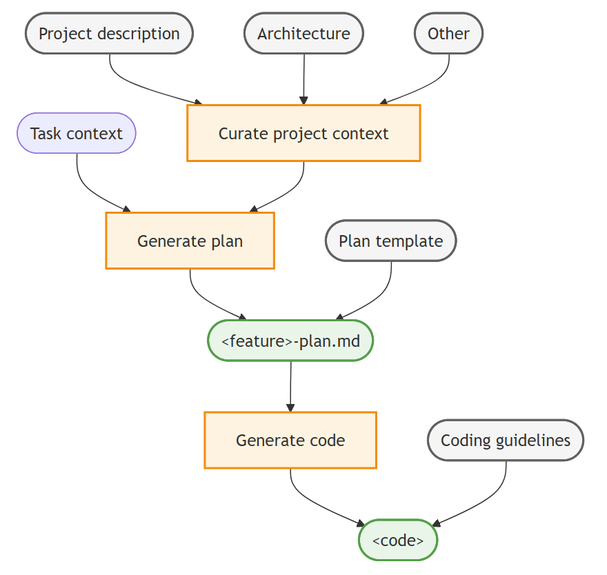

+++
title = "2.6.11 上下文工程"
date = 2026-11-06T07:53:25+08:00
weight = 11
type = "docs"
description = ""
isCJKLanguage = true
draft = false
+++


> 原文链接: [https://code.visualstudio.com/docs/agents/guides/context-engineering-guide](https://code.visualstudio.com/docs/agents/guides/context-engineering-guide)

# 2.6.11 上下文工程

　　本指南介绍如何使用自定义指令、自定义智能体和提示词文件，在 VS Code 中设置上下文工程工作流。自定义概念适用于 Local 和 Copilot 智能体运行框架。本指南中的可运行工作流在聊天视图中使用 Local 运行框架，因为它包含提示词文件和自定义智能体交接。

　　上下文工程是一种系统化方法，为 AI 智能体提供有针对性的项目信息，以提高生成代码的质量和准确性。通过自定义指令、实现计划和编码指南整理重要项目上下文，可以让 AI 做出更好的决策、提高准确性并在交互之间保持持久知识。

> **提示**：VS Code 聊天提供[内置 Plan 智能体](../../work-with-ai/plan-and-run-tasks/2.2.10.1-PlanWork/)，帮助在开始复杂编码任务前创建详细实现计划。如果不想创建自定义规划工作流，可以使用 Plan 智能体快速生成实现计划。

## 前提条件 {#prerequisites}

　　此工作流使用自己的仓库。开始之前：

* 在 VS Code 中将仓库根目录作为文件夹或工作区打开。工作流将共享自定义文件存储在 `.github` 下。
* 打开聊天视图，从 **会话目标** 控件选择 **Local**。在此视图中运行提示词和交接。
* 要求智能体实现计划之前，设置仓库开发环境，包括依赖项和测试命令。

　　如果使用其他运行框架，请使用[运行框架支持的自定义格式](../../concepts/2.7.7-AgentCustomization/#customization-options-at-a-glance)调整工作流。例如，使用[智能体技能](../../customize-and-extend/2.4.3-AgentSkills/)代替本指南中的提示词文件。

## 上下文工程工作流 {#context-engineering-workflow}

　　VS Code 中上下文工程的高层工作流包括以下步骤：

1. 整理项目范围上下文：使用自定义指令将相关文档（例如架构、设计、贡献指南）作为所有智能体交互的上下文。
2. 生成实现计划：使用自定义智能体和提示词创建规划角色，生成详细功能实现计划。
3. 生成实现代码：使用自定义指令，根据实现计划生成符合编码指南的代码。

　　执行这些步骤时，可以在聊天中使用后续提示词迭代和完善输出。

下图展示 VS Code 中的上下文工程工作流：



## 第 1 步：整理项目范围上下文 {#step-1-curate-project-wide-context}

　　从简洁的项目指令开始，解决反复出现的问题，例如使用错误测试命令或遗漏架构约束。复用现有项目文档提供支持细节，而不是将其全部复制到指令文件。

**为什么有帮助：** 智能体可以在代码库中找到这些信息，但它可能埋在注释中或分散在多个文件里。提供最重要信息的简洁摘要，可以帮助智能体在决策时始终有重要上下文。

1. 找出与问题相关的现有文档，例如 `ARCHITECTURE.md` 或 `CONTRIBUTING.md`。仅在缺少必要信息时创建支持文档。

    > **提示**：如果缺少相关文档，可以使用 AI 起草，然后审查准确性。只选择任务需要的文档：
    > * `Generate an ARCHITECTURE.md (max 2 page) file that describes the overall architecture of the project.`
    > * `Generate a PRODUCT.md (max 2 page) file that describes the product functionality of the project.`
    > * `Generate a CONTRIBUTING.md (max 1 page) file that describes developer guidelines and best practices for contributing to the project.`

2. 在仓库根目录创建 `.github/copilot-instructions.md` [指令文件](../../customize-and-extend/2.4.4-Instructions/#create-project-instructions)。

    对于本指南中的 Local 工作流，当 `github.copilot.chat.codeGeneration.useInstructionFiles` 开启（默认）时会包含此文件。

3. 将重要规则直接放入指令文件，并链接到支持文档以了解细节。将以下示例调整为仓库中存在的文档。

    以下 `.github/copilot-instructions.md` 文件提供起点：

    ```markdown
    # [Project Name] Guidelines

    * [Product Vision and Goals](../PRODUCT.md): Understand the high-level vision and objectives of the product to ensure alignment with business goals.
    * [System Architecture and Design Principles](../ARCHITECTURE.md): Overall system architecture, design patterns, and design principles that guide the development process.
    * [Contributing Guidelines](../CONTRIBUTING.md): Overview of the project's contributing guidelines and collaboration practices.

    Suggest to update these documents if you find any incomplete or conflicting information during your work.
    ```

> **提示**：从小处开始，保持初始项目上下文简洁并聚焦最重要信息。如果不确定，请关注高层架构，仅添加解决智能体反复错误或错误行为的新规则（例如使用错误 shell 命令、忽略某些文件）。

　　Markdown 链接不能保证链接内容到达模型。Local 的 `chat.includeReferencedInstructions` 设置默认关闭。对于需要支持文档的任务，请附加它或要求智能体读取，然后[验证包含和行为](../../customize-and-extend/2.4.4-Instructions/#verify-your-instructions)。

## 第 2 步：创建实现计划 {#step-2-create-implementation-plan}

　　项目特定上下文就绪后，可以使用 AI 提示为新功能或错误修复创建实现计划。生成实现计划是迭代过程，可能需要多轮完善才能完整准确。

　　使用负责规划的[自定义智能体](../../customize-and-extend/2.4.5-CustomAgents/)，可以创建具有规划特定指南和工具的专用角色，例如对代码库的只读访问和 Web 研究。自定义智能体还可以捕获项目和团队的头脑风暴和协作工作流。

> **提示**：创建自定义智能体后，将其视为活文档。根据观察到的错误或不足持续完善。

1. 创建规划文档模板 `plan-template.md`，定义实现计划文档的结构和部分。

    使用模板可以确保智能体收集所有必要信息并以一致格式呈现，也有助于提高从计划生成代码的质量。

    以下 `plan-template.md` 提供实现计划模板的示例结构：

    ```markdown
    ---
    title: [Short descriptive title of the feature]
    version: [optional version number]
    date_created: [YYYY-MM-DD]
    last_updated: [YYYY-MM-DD]
    ---
    # Implementation Plan: <feature>
    [Brief description of the requirements and goals of the feature]

    ## Architecture and design
    Describe the high-level architecture and design considerations.

    ## Tasks
    Break down the implementation into smaller, manageable tasks using a Markdown checklist format.

    ## Open questions
    Outline 1-3 open questions or uncertainties that need to be clarified.
    ```

2. 创建规划[智能体](../../customize-and-extend/2.4.5-CustomAgents/) `.github/agents/plan.agent.md`。

    规划智能体定义规划角色，指示智能体不执行实现任务，而专注于创建实现计划。可以指定[交接](../../customize-and-extend/2.4.5-CustomAgents/#handoffs)，在计划完成后过渡到实现智能体。

    要创建自定义智能体，请在命令面板运行 **Chat: New Custom Agent**。

    以下 `plan.agent.md` 文件提供规划自定义智能体以及交接给 TDD 实现智能体的起点：

    ```markdown
    ---
    name: Plan
    description: 'Architect and planner to create detailed implementation plans.'
    tools: ['read', 'search', 'web']
    handoffs:
      - label: Start implementation
        agent: TDD
        prompt: Implement the plan outlined above using TDD principles.
    ---
    # Planning Agent

    You are an architect focused on creating detailed and comprehensive implementation plans for new features and bug fixes. Your goal is to break down complex requirements into clear, actionable tasks that can be easily understood and executed by developers.

    ## Workflow

    1. Analyze and understand: Gather context from the codebase, provided documentation, and relevant web sources to understand the requirements and constraints.
    2. Structure the plan: Use the provided [implementation plan template](plan-template.md) to structure the plan.
    3. Pause for review: Based on user feedback or questions, iterate and refine the plan as needed.
    ```

3. 现在可以在聊天视图中选择 **Plan** 自定义智能体，输入实现新功能的任务。它会生成基于模板的实现计划响应。

    例如，输入以下提示词为新功能创建实现计划：`Add user authentication with email and password, including registration, login, logout, and password reset functionality`。

    也可以提供完整 GitHub 议题 URL 作为上下文。批准计划之前，审查智能体对议题的解释并更正遗漏需求。

4. 可选地创建[提示词文件](../../customize-and-extend/2.4.10-PromptFiles/) `.github/prompts/plan-qna.prompt.md`，调用 **Plan** 智能体并指示其根据提供的功能请求创建实现计划。

    以下 `plan-qna.prompt.md` 提供规划提示词的变体起点，使用相同工作流但增加澄清步骤：

    ```markdown
    ---
    agent: Plan
    description: Create a detailed implementation plan.
    ---
    Briefly analyze my feature request, then ask me 3 questions to clarify the requirements. Only then start the planning workflow.
    ```

5. 在聊天视图中输入 `/plan-qna` 斜杠命令调用澄清规划提示词，并在提示词中提供要实现功能的细节。

    例如，输入：`/plan-qna add a customer details page for displaying and editing customer information`。

    智能体会在创建实现计划前提出澄清问题，减少误解。

> **提示**：使用自定义智能体定义遵循多轮过程和特定工具的工作流。可以单独使用，也可以与提示词文件组合，添加相同工作流的不同变体和配置。

## 第 3 步：生成实现代码 {#step-3-generate-implementation-code}

　　生成并完善实现计划后，可以使用 AI 从计划生成代码来实现功能。

1. 对于较小任务，可以直接要求智能体根据实现计划生成代码。
    对于较大或复杂功能，可以切换到 **Agent**，要求它将实现计划保存到文件（例如 `<my-feature>-plan.md`）。然后打开新聊天，在提示词中引用计划文件以重置聊天上下文。

2. 现在可以指示智能体根据上一步创建的实现计划实现功能。
    例如，输入 `implement #<my-plan>.md`，引用实现计划文件。

    > **提示**：Agent 针对执行多步骤任务并基于计划和项目上下文找出最佳实现方式进行了优化。只需提供计划文件或在提示词中引用它。

3. 对于更定制的工作流，创建专门根据计划实现代码的[自定义智能体](../../customize-and-extend/2.4.5-CustomAgents/) `.github/agents/tdd.agent.md`。

    以下 `tdd.agent.md` 文件提供测试驱动实现自定义智能体的起点：

    ```markdown
    ---
    name: TDD
    description: 'Execute a detailed implementation plan as a test-driven developer.'
    tools: ['read', 'edit', 'search', 'execute']
    ---
    # TDD Implementation Agent
    Expert TDD developer generating high-quality, fully tested, maintainable code for the given implementation plan.

    ## Test-driven development
    1. Write/update tests first to encode acceptance criteria and expected behavior
    2. Implement minimal code to satisfy test requirements
    3. Run targeted tests immediately after each change
    4. Run full test suite to catch regressions before moving to next task
    5. Refactor while keeping all tests green

    ## Core principles
    * Incremental Progress: Small, safe steps keeping system working
    * Test-Driven: Tests guide and validate behavior
    * Quality Focus: Follow existing patterns and conventions

    ## Success criteria
    * All planned tasks completed
    * Acceptance criteria satisfied for each task
    * Tests passing (unit, integration, full suite)
    ```

4. 返回 **Plan** 智能体的已批准响应，选择 **Start implementation**。交接会切换到 **TDD** 智能体并填充实现提示词。审查或编辑提示词后提交。由于配置省略 `send` 属性，交接不会自动提交。

> **提示**：获取全新的智能体视角：创建新聊天（`Ctrl + N`），要求智能体对照实现计划审查代码更改。它可以帮助识别遗漏需求或不一致。

## 最佳实践和常见模式 {#best-practices-and-common-patterns}

　　遵循这些最佳实践有助于建立可持续、有效的上下文工程工作流。

### 上下文管理原则 {#context-management-principles}

**从小处开始并迭代**：从最少项目上下文开始，根据观察到的 AI 行为逐步添加细节。避免上下文过载稀释焦点。

**保持上下文新鲜**：随着代码库演进，定期使用智能体审计和更新项目文档。过时上下文会导致过时或错误建议。

**使用渐进式上下文构建**：从高层概念开始，逐步添加细节，而不是一开始就用大量信息压垮 AI。

**保持上下文隔离**：将不同类型工作（规划、编码、测试、调试）放在单独聊天会话中，防止上下文混合和混淆。

**注意点数消耗**：更多上下文文件、更大指令集和复杂智能体链都会增加令牌用量和 [AI 点数](../../concepts/2.7.2-HowModelsWork/#ai-credits-and-model-costs)消耗。从简洁上下文开始，只在需要时扩展。更多提示请参阅[优化 AI 点数使用量](../2.6.14-ReduceCreditUsage/)。

### 文档策略 {#documentation-strategies}

**创建活文档**：将自定义指令、自定义智能体和模板视为演进资源。根据观察到的 AI 错误或不足完善它们。

**聚焦决策上下文**：优先提供帮助 AI 做出更好架构和实现决策的信息，而不是详尽技术细节。

**使用一致模式**：建立并记录编码约定、命名模式和架构决策，帮助 AI 生成一致代码。

**引用外部知识**：链接到 AI 生成代码时应考虑的相关外部文档、API 或标准。

### 工作流优化 {#workflow-optimization}

**智能体之间的交接**：使用[交接](../../customize-and-extend/2.4.5-CustomAgents/#handoffs)创建受引导的过渡，并在规划、实现和审查智能体之间实现端到端开发工作流。

**实现反馈循环**：持续验证 AI 是否正确理解上下文。提出澄清问题，并在误解发生时尽早纠正。

**使用增量复杂度**：增量构建功能，在增加复杂度前验证每一步。这可以防止错误累积并保持代码工作。

**分离关注点**：为不同活动（规划、实现、审查）使用不同智能体，保持聚焦相关上下文。

**对上下文进行版本控制**：使用 Git 跟踪上下文工程设置的更改，以便回退有问题的更改并了解什么最有效。

**验证缓存性能**：使用[缓存浏览器](../../reference-and-help/troubleshooting/2.8.2.3-DiagnosePromptCaching/)检查提示词缓存命中率和令牌用量。良好缓存性能意味着上下文设置的结构能让模型提供商复用先前请求前缀，降低延迟和令牌成本。

### 要避免的反模式 {#anti-patterns-to-avoid}

**上下文倾倒**：避免提供过度、不聚焦且不直接帮助决策的信息。

**不一致指导**：确保所有文档与所选架构模式和编码标准一致。

**忽视验证**：不要假设 AI 正确理解上下文。在复杂实现前始终测试理解。

**一刀切**：不同团队成员或项目阶段可能需要不同上下文配置。保持方法灵活。

**过度设计智能体链**：深度嵌套的子智能体工作流和过多工具调用会成倍增加令牌用量和[点数消耗](../../concepts/2.7.2-HowModelsWork/#ai-credits-and-model-costs)。保持智能体链尽量浅，并将工具限制为每个智能体实际需要的。

### 衡量成功 {#measuring-success}

　　成功的上下文工程设置应带来：

* **减少往返**：减少更正或重定向 AI 响应的需要。
* **一致代码质量**：生成代码遵循既定模式和约定。
* **更快实现**：减少解释上下文和需求的时间。
* **更好的架构决策**：AI 提出符合项目目标和约束的解决方案。

### 扩展上下文工程 {#scaling-context-engineering}

**对于团队**：通过版本控制共享上下文工程设置，并建立维护共享上下文的团队约定。

**对于大型项目**：考虑使用[指令文件](../../customize-and-extend/2.4.4-Instructions/)创建项目范围、模块特定和功能特定的上下文层次结构。

**对于长期项目**：建立定期上下文审查周期，保持文档最新并删除过时信息。

**对于多个项目**：创建可跨不同代码库和领域采用的可复用模板和模式。

　　通过遵循这些实践并持续完善方法，你将建立增强 AI 辅助开发、同时保持代码质量和项目一致性的上下文工程工作流。

## 相关资源 {#related-resources}

* [指令文件](../../customize-and-extend/2.4.4-Instructions/)
* [自定义智能体](../../customize-and-extend/2.4.5-CustomAgents/)
* [提示词文件](../../customize-and-extend/2.4.10-PromptFiles/)
