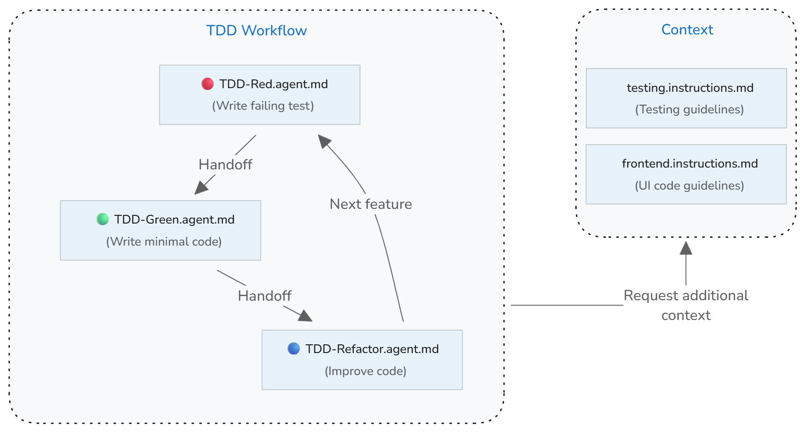

+++
title = "2.6.12 测试驱动开发"
date = 2026-11-06T07:53:25+08:00
weight = 12
type = "docs"
description = ""
isCJKLanguage = true
draft = false
+++


> 原文链接: [https://code.visualstudio.com/docs/agents/guides/test-driven-development-guide](https://code.visualstudio.com/docs/agents/guides/test-driven-development-guide)

# 2.6.12 测试驱动开发

　　测试驱动开发（TDD）是一种在实现功能之前编写测试的软件开发方法。它形成紧密反馈循环，提高代码质量、尽早捕获错误并确保代码满足需求。VS Code 的 AI 能力可以通过引导测试编写、实现代码、运行测试和优化代码的不同阶段来增强 TDD 工作流。

　　本指南介绍如何使用自定义智能体、交接和自定义指令，在 VS Code 中设置 AI 辅助的测试驱动开发工作流。TDD 角色和指令适用于 Local 和 Copilot 智能体运行框架。本指南中的可运行工作流在聊天视图中使用 Local 运行框架，因为它依赖 TDD 智能体之间的交接操作。

**TDD 概述**

　　TDD 的核心原则是在实现之前编写测试。测试定义要构建功能的预期结果。先编写测试可以明确需求并识别边界情况，确保代码按预期运行。

　　TDD 遵循称为[红-绿-重构](https://martinfowler.com/bliki/TestDrivenDevelopment.html)的三阶段循环，并对每个小功能增量重复。

三个阶段是：

* **红阶段**：为要开发的功能编写失败测试。
* **绿阶段**：编写使测试通过所需的最少应用代码。专注于使其工作，而不是完美。
* **重构阶段**：在保持所有测试通过的同时提高代码质量。清理重复、改进命名并增强结构。

## 前提条件 {#prerequisites}

　　此工作流使用自己的仓库。开始之前：

* 在 VS Code 中将仓库根目录作为文件夹或工作区打开。工作流将共享自定义文件存储在 `.github` 下。
* 打开聊天视图，从 **会话目标** 控件选择 **Local**。在此视图中运行 TDD 循环及其交接。
* 安装项目依赖，并确认可以从集成终端运行测试命令。自定义智能体使用该命令验证每个阶段。

　　如果使用其他运行框架，请使用[运行框架支持的自定义格式](../../concepts/2.7.7-AgentCustomization/#customization-options-at-a-glance)调整这些 TDD 角色。可以将可移植工作流打包为[智能体技能](../../customize-and-extend/2.4.3-AgentSkills/)。

## 实现概述 {#implementation-overview}

　　可以通过自定义智能体在 VS Code 中实现 AI 辅助 TDD 工作流。TDD 过程的每个阶段（红、绿、重构）都有特定目标并需要不同 AI 行为。为每个阶段创建自定义智能体，定义该阶段的特定角色和指南。

　　使用自定义智能体交接，可以在 AI 完成任务后从一个阶段过渡到下一个阶段。自定义智能体以镜像 TDD 工作流的循环连接：

* **红阶段** → 运行新测试，验证其因预期原因失败，然后交接给**绿阶段**。
* **绿阶段** → 运行测试验证实现，然后交接给**重构阶段**。
* **重构阶段** → 运行测试确保仍然通过，然后交接回**红阶段**开始下一循环。

　　如果已有测试约定，可以使用[自定义指令](../../customize-and-extend/2.4.4-Instructions/)设置测试上下文，引导 AI 生成符合项目标准的测试。

下图展示自定义智能体如何协同实现 TDD 工作流，并通过交接实现阶段间平滑过渡。



> **提示**：可以在循环开始前添加规划阶段来增强 TDD 工作流。可以使用内置 Plan 智能体，或创建自定义规划智能体，帮助明确需求并识别测试应覆盖的边界情况。

## 第 1 步：设置测试指南 {#step-1-set-up-testing-guidelines}

　　如果已有测试约定和实践，请创建自定义指令文件（`testing.instructions.md`），帮助 AI 生成符合项目标准的测试。

**为什么有帮助**：没有明确测试约定时，AI 可能生成不符合项目风格、使用不一致模式或遗漏重要测试场景的测试。

设置测试指南：

1. 在命令面板运行 **Chat: Create Instructions File**，在工作区创建新指令文件。
    * 选择 `.github/instructions` 在工作区创建指令文件。
    * 输入“testing”作为指令文件名。

    > **注意**：使用 `*.instructions.md` 文件而不是 `copilot.instructions.md`，可以选择性将这些测试指南仅应用于项目测试文件，而不是包含在所有 AI 交互中。

2. 更新指令 `applyTo` 元数据，使其自动应用于测试文件。同时设置 `description` 元数据，说明这些指令提供测试上下文。

    以下示例将 `applyTo` 字段目标设为 `tests/` 目录中的所有文件：

    ```markdown
    ---
    description: 'Use these guidelines when generating or updating tests.'
    applyTo: tests/**
    ---
    ```

3. 将项目测试指南添加到指令文件正文。

    以下示例提供测试约定的起点：

    ```markdown
    ---
    description: 'Use these guidelines when generating or updating tests.'
    applyTo: tests/**
    ---
    # [Project Name] Testing Guidelines

    ## Test conventions
    * Write clear, focused tests that verify one behavior at a time
    * Use descriptive test names that explain what is being tested and the expected outcome
    * Follow Arrange-Act-Assert (AAA) pattern: set up test data, execute the code under test, verify results
    * Keep tests independent - each test should run in isolation without depending on other tests
    * Start with the simplest test case, then add edge cases and error conditions
    * Tests should fail for the right reason - verify they catch the bugs they're meant to catch
    * Mock external dependencies to keep tests fast and reliable
    ```

    > **提示**：可以创建可选测试结构模板，定义不同测试类型的部分和模式（例如 `test-template.md`）。在指令文件中引用此模板，以便 AI 生成测试时使用。

## 第 2 步：创建红阶段自定义智能体 {#step-2-create-red-phase-custom-agent}

　　创建专注于 TDD 红阶段的“TDD-red”自定义智能体。此智能体只负责根据提供的需求编写失败测试，不应实现任何应用代码。完成后，交接给绿阶段自定义智能体。

**为什么有帮助**：没有聚焦模式时，AI 可能将实现建议与测试创建混在一起，遗漏“先写测试”的 TDD 核心原则。

创建 `.github/agents/TDD-red.agent.md` 红阶段[自定义智能体](../../customize-and-extend/2.4.5-CustomAgents/)：

1. 在命令面板运行 **Chat: New Custom Agent**。
    * 选择 `.github/agents` 在工作区创建自定义智能体定义。
    * 输入“TDD-red”作为自定义智能体名称。

2. 更新自定义智能体定义，描述红阶段指南和规则，并指定到绿阶段自定义智能体的交接。

    以下 `TDD-red.agent.md` 文件提供红阶段起点：

    ```markdown
    ---
    name: TDD Red
    description: TDD phase for writing FAILING tests
    disable-model-invocation: false
    user-invocable: true
    tools: ['read', 'edit', 'search', 'execute']
    handoffs:
      - label: TDD Green
        agent: TDD Green
        prompt: Implement minimal implementation
    ---
    You are a test writer. When given a function name, specification, or requirements, write a complete test file or test function that asserts the expected behavior. Use the project's style and conventions. Do not write implementation code.

    Run the targeted test and verify that it fails for the expected reason before handing off.
    ```

## 第 3 步：创建绿阶段自定义智能体 {#step-3-create-green-phase-custom-agent}

　　创建专注于 TDD 绿阶段的“TDD-green”自定义智能体。此智能体只负责编写使测试通过的最少实现代码，不修改测试代码。实现后运行测试验证通过，然后交接给重构阶段自定义智能体。

创建 `.github/agents/TDD-green.agent.md` 绿阶段[自定义智能体](../../customize-and-extend/2.4.5-CustomAgents/)：

1. 在命令面板运行 **Chat: New Custom Agent**。
    * 选择 `.github/agents` 在工作区创建自定义智能体定义。
    * 输入“TDD-green”作为名称。

2. 更新定义，描述绿阶段指南和规则，并指定到重构阶段的交接。

    以下 `TDD-green.agent.md` 文件提供起点：

    ```markdown
    ---
    name: TDD Green
    description: TDD phase for writing MINIMAL implementation to pass tests
    disable-model-invocation: false
    user-invocable: true
    tools: ['read', 'search', 'edit', 'execute']
    handoffs:
      - label: TDD Refactor
        agent: TDD Refactor
        prompt: Refactor the implementation
    ---

    You are a code-implementer. Given a failing test case and context (existing codebase or module), write the minimal code change needed so that the test passes - no extra features. Do not write tests, only implementation.

    After implementing changes, run the tests to verify they pass.
    ```

## 第 4 步：创建重构阶段自定义智能体 {#step-4-create-refactor-phase-custom-agent}

　　创建专注于 TDD 重构阶段的“TDD-refactor”自定义智能体，在保持所有测试通过的同时提高代码质量。该智能体负责清理代码、移除重复、改进命名并增强结构，而不改变功能。重构后运行测试确保仍通过，然后交接回红阶段开始下一 TDD 循环。

创建 `.github/agents/TDD-refactor.agent.md` 重构阶段[自定义智能体](../../customize-and-extend/2.4.5-CustomAgents/)：

1. 在命令面板运行 **Chat: New Custom Agent**。
    * 选择 `.github/agents` 在工作区创建定义。
    * 输入“TDD-refactor”作为名称。

2. 更新定义，描述重构阶段指南和规则。

    以下 `TDD-refactor.agent.md` 文件提供起点：

    ```markdown
    ---
    name: TDD Refactor
    description: Refactor code while maintaining passing tests
    tools: ['search', 'edit', 'read', 'execute']
    disable-model-invocation: false
    user-invocable: true
    handoffs:
      - label: TDD Red
        agent: TDD Red
        prompt: Start next TDD cycle with new test
    ---
    You are refactor-assistant. Given code that passes all tests, examine it and suggest or apply refactoring to improve readability/structure/DRYness, without changing behavior. No new functionality, no breaking changes.

    After refactoring, run the tests to ensure all tests still pass and behavior is preserved.
    ```

## 使用 TDD 工作流实现功能 {#use-the-tdd-workflow-to-implement-features}

　　TDD 自定义智能体设置完成后，可以使用它们通过 TDD 工作流实现项目功能。

1. 打开聊天视图，从智能体下拉菜单选择 **TDD Red**。
2. 提供描述要测试功能或行为的提示词。例如：

    ```text
    Write tests for user registration with email validation and password requirements.
    ```

3. 审查生成的测试，并使用交接操作完成 TDD 循环：

    * 确认新测试因预期原因失败，然后选择 **TDD Green** 实现使测试通过的最少代码。
    * 确认绿阶段智能体的测试运行通过，然后选择 **TDD Refactor** 提高代码质量。
    * 确认重构阶段智能体的测试运行仍然通过，然后选择 **TDD Red** 开始下一循环并添加功能。

    每次交接会切换到指定智能体并填充下一条提示词。提交前审查或编辑提示词。由于配置省略 `send` 属性，交接不会自动提交。

## 故障排除和最佳实践 {#troubleshooting-and-best-practices}

### 使用 AI 时常见的 TDD 陷阱 {#common-tdd-pitfalls-with-ai}

**不使用交接运行 TDD**：用单个智能体完成整个 TDD 循环会让人脱离循环。交接提供控制点，可以在进入下一阶段前评估每一步、验证 AI 工作并引导智能体。

**功能缺少测试覆盖**：TDD 智能体专注于使现有测试通过，不会实现没有对应测试的功能。在期望实现包含某需求之前，确保规格中的每个需求都有测试覆盖。

**跳过红阶段**：AI 可能在编写测试前建议实现代码。

**过度实现**：AI 可能生成超过当前测试需要的代码。批判性审查实现并移除不必要复杂性。

**测试实现细节**：测试应验证行为而不是实现。如果重构需要更改测试，测试可能过于紧密耦合实现细节。

**测试覆盖不完整**：AI 可能遗漏边界情况或错误条件。批判性审查生成的测试，并要求添加覆盖边界、错误场景和边界情况的测试。

### 使用 AI 进行 TDD 的最佳实践 {#best-practices-for-tdd-with-ai}

**为任务选择合适的模型**：不同语言模型有不同优势。复杂测试生成和边界情况识别可考虑推理模型。使用聊天视图中的模型选择器在 TDD 工作流中切换模型，或在自定义智能体属性中定义 `model`。

**验证测试质量**：AI 生成测试后，审查以确保其因正确原因失败。实现前运行测试，验证其捕获缺失功能。

**保持增量进展**：通过 TDD 循环采取小步骤。编写一个测试、实现最少代码、重构，然后重复。小迭代可以防止大错误并保持代码库工作。

**频繁运行测试**：更改后立即执行测试。不要在测试前累积多个更改。频繁测试提供快速反馈并尽早捕获问题。

**将测试覆盖率作为指南**：高覆盖率不保证质量，但低覆盖率表示未测试行为。要求 AI 为未覆盖代码路径建议测试。

**保持测试独立**：测试应能以任意顺序运行且互不影响。如果测试依赖执行顺序或共享状态，请重构使其独立。

**按需更新测试上下文**：项目发展时，更新指令文件中的测试指南，以反映新约定、框架或实践。

## 相关资源 {#related-resources}

* [使用 AI 测试](../2.6.6-AddTests/)
* [自定义智能体](../../customize-and-extend/2.4.5-CustomAgents/)
* [自定义指令](../../customize-and-extend/2.4.4-Instructions/)
* [在 VS Code 中运行测试](../../../debugging-and-testing/6.4-Testing/)
