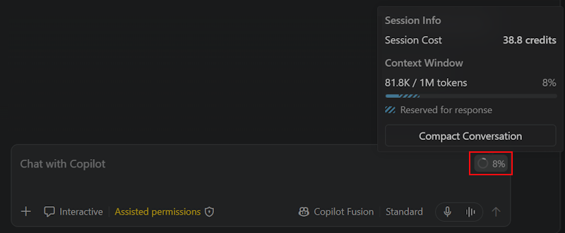
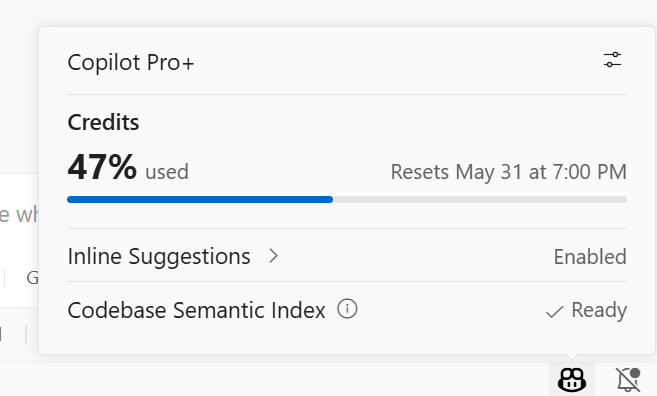

+++
title = "2.6.14 减少 AI 点数使用量"
date = 2026-11-06T07:53:25+08:00
weight = 14
type = "docs"
description = ""
isCJKLanguage = true
draft = false
+++

> 原文链接: [https://code.visualstudio.com/docs/agents/guides/optimize-usage](https://code.visualstudio.com/docs/agents/guides/optimize-usage)

# 2.6.14 减少 AI 点数使用量

　　每个 GitHub Copilot 套餐都包含每月 [AI 点数](https://docs.github.com/en/copilot/concepts/billing/usage-based-billing-for-individuals)额度。不同操作根据模型和处理令牌数量，以不同速率消耗点数。本指南介绍在 VS Code 中充分利用 AI 点数的实用方法。

## 根据证据选择模型 {#choose-models-based-on-evidence}

　　成本最低的模型不一定产生成本最低的结果。需要重试或造成返工的模型，可能比可靠完成任务的能力更强模型花费更多。反过来也成立：并非每个任务都需要复杂的推理模型，将简单或重复任务路由到更轻量的模型，可以避免为不需要的能力付费。

　　从 [AI 模型比较表](https://docs.github.com/en/copilot/reference/ai-models/model-comparison)和[模型选择最佳实践](../../getting-started/2.1.6-BestPractices/#choose-the-right-model)开始，然后使用自己工作中的代表性任务比较点数使用量和响应质量：

1. 定义预期结果以及如何评估质量。
2. 每个任务运行多次，因为模型输出具有不确定性。
3. 比较任务完成情况、输出质量、可靠性、时长和点数消耗。
4. 选择持续满足要求的最低成本模型，并随着模型变化重新评估。

　　对于低维护默认值，请使用**自动模型选择**，让 VS Code 根据任务复杂度、模型健康状况和可用性将每个请求路由到高效模型。对于可重复工作流，在[自定义智能体](../../customize-and-extend/2.4.5-CustomAgents/)中配置首选模型。

　　聊天中的模型选择器会在悬停菜单中显示成本详情，包括每种令牌类型的成本和通用成本层级标签（低、中、高）。使用[智能体调试日志](../../reference-and-help/troubleshooting/2.8.2.2-DebugChatInteractions/)比较测试运行中的令牌用量、工具调用、错误和时长。

　　更多信息请参阅[选择和配置语言模型](../../choose-models-and-agents/2.3.1-ChooseAndConfigureModels/)。

## 实现前规划和委派 {#plan-and-delegate-before-you-implement}

　　直接进入代码生成可能在方法错误时浪费点数。将规划、实现和审查分开，使每个阶段使用合适的模型：

1. 使用 [Plan 智能体](../../work-with-ai/plan-and-run-tasks/2.2.10.1-PlanWork/)和较强的推理模型研究任务并创建结构化实现计划。
2. 智能体编写代码之前，审查和完善计划。
3. 将已批准计划划分为范围明确的实现任务。
4. 将这些任务委派给[作为子智能体运行的自定义智能体](../../work-with-ai/plan-and-run-tasks/2.2.10.4-Subagents/#run-a-custom-agent-as-a-subagent)。为每个工作智能体配置高性价比模型、聚焦指令和所需工具。
5. 让主智能体评估结果，并解决需要更广泛上下文或更强推理的工作。

　　这种协调者-工作者模式让主智能体专注于规划和评估，同时由低成本模型执行有界任务。委派本身也消耗令牌，因此当隔离和更便宜模型无法抵消编排开销时，小任务应留在主会话中。

　　更多信息请参阅[先规划，再实现](../../getting-started/2.1.6-BestPractices/#plan-first-then-implement)。

## 使用默认思考强度 {#use-thinking-effort-defaults}

　　思考强度控制模型对每个请求应用多少推理。更高强度会产生更多思考令牌，增加延迟和点数消耗。VS Code 根据评估设置默认强度，并启用自适应推理，模型会根据每个请求的复杂度动态决定思考多少。

　　对于大多数任务，默认值已足够。只为真正复杂的问题（例如架构规划或多步骤调试）提高思考强度。

　　更多信息请参阅[配置思考强度](../../choose-models-and-agents/2.3.1-ChooseAndConfigureModels/#configure-thinking-effort-and-context-size)。

## 为新任务开始新聊天 {#start-new-chats-for-new-tasks}

　　对话增长时会累积先前消息、工具输出和文件内容的上下文。在同一会话切换到无关任务时，模型仍会处理所有无关历史，消耗令牌而没有改善结果。

　　更改主题时开始[新的智能体会话](../../work-with-ai/sessions/2.2.11.1-ManageSessions/)，为模型提供专注于当前任务的干净上下文窗口。

## 分叉对话 {#fork-conversations}

　　当希望探索替代方法或询问旁支问题时，请[分叉对话](../../work-with-ai/sessions/2.2.11.1-ManageSessions/#fork-a-chat-session)，而不是从头重新提示。分叉会创建继承现有对话历史的新会话，因此无需重新建立上下文。

* 在聊天输入框中输入 `/fork`，分叉当前消息之前的整个会话。
* 将鼠标悬停在之前的消息上，选择 **分叉对话**，从特定检查点分叉。

## 保持工具目录聚焦 {#keep-the-tool-catalog-focused}

　　大量工具会增加输入上下文，并使工具选择更复杂。工具调用还会将其输出添加到[上下文窗口](../../concepts/2.7.2-HowModelsWork/#context-window)。只公开当前任务相关的工具：

* 使用聊天输入框中的 **配置工具** 按钮，为当前请求选择单个工具或 MCP 服务器。搜索工具选择器，并在任务需要时添加另一个工具。
* 在[自定义智能体](../../customize-and-extend/2.4.5-CustomAgents/)中，使用 `tools` 属性为每个智能体提供狭窄的任务特定工具集。

　　对于拥有大型内部工具目录的组织，可以考虑为常见工作流提供精选命令行接口。智能体可以通过终端工具调用命令，而无需将每个操作加载为单独的 MCP 工具。此方法要求组织维护并保护命令行接口。

　　更多信息请参阅[在智能体中使用工具](../../work-with-ai/plan-and-run-tasks/2.2.10.2-UseTools/)。

## 批处理重复操作 {#batch-repetitive-operations}

　　重复的提交、轮询和检索工具调用会将中间结果添加到模型上下文。对于确定性或批量工作流，请使用脚本或命令行工具在智能体对话之外运行循环，只返回最终结果。

　　例如，不要要求智能体逐个发出并检查许多相似数据库查询，而是使用经过审查的脚本运行查询批次并生成简洁摘要。使用终端工具运行脚本，然后将摘要交给模型分析。请对脚本版和交互版工作流进行基准测试，因为节省取决于工具、结果和任务。

## 在广泛探索前为智能体提供依据 {#ground-the-agent-before-broad-exploration}

　　相关上下文帮助智能体避免失败搜索、不必要的工具调用和错误更改。在广泛探索之前：

* 确保[工作区语义索引](../../reference-and-help/reference/2.8.1.11-AgentHostArchitecture/#semantic-search)可用，并在希望将请求明确建立在已索引代码库上时使用 `#codebase`。
* 在提示词中提供相关文件、错误、约束和成功标准。
* 使用符号感知搜索以及聚焦的 MCP 或命令行工具获取权威项目和组织数据。
* 将稳定的项目约定添加到[自定义指令](../../customize-and-extend/2.4.4-Instructions/)，以免智能体在每个会话中重新发现它们。

　　提供依据应缩小搜索空间，而不是预加载所有可用来源。包含让智能体完成任务所需的最小权威上下文。

## 从聊天上下文中排除文件 {#exclude-files-from-chat-context}

　　大型生成文件、构建输出或无关目录会增加令牌用量而没有价值。排除这些文件以保持智能体上下文聚焦：

* 使用 `.gitignore` 将文件从[工作区索引](../../reference-and-help/reference/2.8.1.11-AgentHostArchitecture/)以及智能体文本搜索和 grep 中排除。
* 使用 `files.exclude` 设置将文件从 VS Code 中完全隐藏，这也会将其从索引和智能体搜索工具中排除。
* 使用 `search.exclude` 设置将文件从智能体文本搜索和 grep 中排除，同时在资源管理器中保持可见；例如希望手动打开但不纳入搜索结果的日志文件。

　　即使智能体不打开匹配文件，搜索匹配片段也会计入上下文窗口。排除嘈杂路径可以减少搜索结果中的无关令牌。

　　更多信息和示例配置请参阅[使用排除设置改善智能体搜索](../../reference-and-help/reference/2.8.1.11-AgentHostArchitecture/#improve-agent-search-with-exclusion-settings)。

## 使用压缩管理上下文 {#manage-context-with-compaction}

　　对话变长时，使用 `/compact` 总结较早部分并回收上下文窗口空间。可以添加指令引导摘要，例如 `/compact focus on the API design decisions`。

　　更多信息请参阅[上下文压缩](../../work-with-ai/sessions/2.2.11.1-ManageSessions/#compact-conversation-context)。

## 监控使用量 {#monitor-your-usage}

　　可以在 VS Code 中监控特定聊天请求的 AI 点数使用量、会话累计使用量以及每月总消耗。这有助于了解哪些请求更昂贵、发现高成本对话并长期管理使用量。

　　要查看单个请求成本，请将鼠标悬停在聊天响应上，查看该轮的点数消耗。这有助于了解哪些请求更昂贵，并相应调整提示词或模型选择。

　　要查看整个会话的累计成本和令牌明细，请将鼠标悬停或选择聊天输入框中的上下文窗口控件。会话信息弹窗显示总点数成本和整个会话的累计上下文窗口令牌用量，补充单个请求已显示的每轮点数消耗。

　　要查看每月总消耗，请从 VS Code 状态栏打开 Copilot 状态仪表板。仪表板显示已使用的每月 AI 点数额度百分比（以及 Copilot Free 套餐的内联建议额度）。

　　关于[监控使用量和权益](https://docs.github.com/en/copilot/managing-copilot/monitoring-usage-and-entitlements/monitoring-your-copilot-usage-and-entitlements)，请访问 GitHub Copilot 文档。

　　也可以在任何聊天会话中运行 `/chronicle:cost-tips` 命令，根据最近活动获取个性化 AI 点数优化建议。详细了解[会话见解和 chronicle 命令](../../work-with-ai/sessions/2.2.11.1-ManageSessions/)。

## 检查令牌用量和缓存 {#inspect-token-usage-and-caching}

　　使用[智能体调试日志](../../reference-and-help/troubleshooting/2.8.2.2-DebugChatInteractions/)了解会话中哪些内容消耗点数：

* **摘要视图** 显示会话的聚合令牌用量，包括工具调用总数和总时长。
* **[缓存浏览器视图](../../reference-and-help/troubleshooting/2.8.2.3-DiagnosePromptCaching/)** 显示提示词缓存命中率以及复用了多少输入令牌。提示词缓存让模型提供商复用与之前请求匹配的请求前缀，从而降低延迟和令牌成本。

将这些测量用作优化循环：

1. 运行代表性任务，记录质量、可靠性、点数、令牌、时长、工具调用和错误。
2. 更改变量，例如模型、可用工具、委派策略或依据来源。
3. 重复任务并比较结果。
4. 保留在最低成本下满足质量阈值的配置。

## 相关内容 {#related-content}

* [AI 点数和模型成本](../../concepts/2.7.2-HowModelsWork/#ai-credits-and-model-costs)
* [选择和配置语言模型](../../choose-models-and-agents/2.3.1-ChooseAndConfigureModels/)
* [GitHub Copilot 最佳实践](../../getting-started/2.1.6-BestPractices/)
* [GitHub Copilot 套餐](https://docs.github.com/en/copilot/get-started/plans)
* [基于用量的计费](https://docs.github.com/en/copilot/concepts/billing/usage-based-billing-for-individuals)
