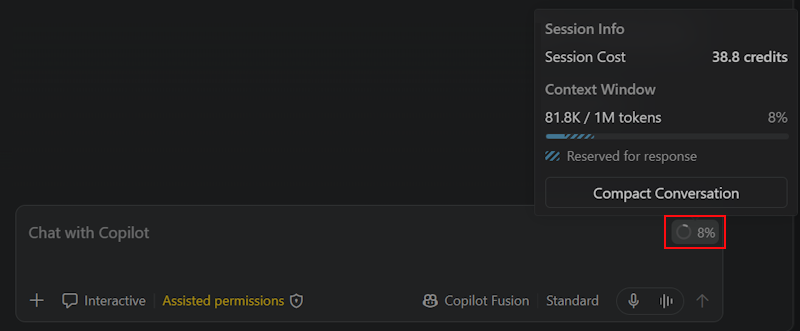

+++
title = "2.5.1 继续会话"
date = 2026-11-06T07:53:25+08:00
weight = 1
type = "docs"
description = ""
isCJKLanguage = true
draft = false
+++


> 原文链接: [https://code.visualstudio.com/docs/agents/run/sessions/manage-sessions](https://code.visualstudio.com/docs/agents/run/sessions/manage-sessions)

# 2.5.1 继续会话

　　使用会话列表返回智能体任务、监控进行中的工作并收起已完成工作。本文介绍如何在聊天视图和智能体窗口中管理会话。

　　[会话](../../concepts/2.7.5-SessionsAndChats/)将任务的工作区、代码更改和对话分组。每个对话有自己的历史和上下文。如果开始第一个任务，请遵循[智能体快速入门](../../getting-started/2.1.3-AgentsQuickstart/)。

## 查找并恢复会话 {#find-and-resume-a-session}

　　打开现有会话继续其对话，而不是重新开始任务。

1. 在使用的界面中打开会话列表：

    | 界面 | 位置和范围 |
    |---|---|
    | 聊天视图 | 列表在视图顶部，显示当前工作区的会话，按时间分组。没有打开工作区时，显示跨工作区会话。 |
    | 智能体窗口 | 列表在左侧边栏，显示跨工作区会话。默认按工作区分组。 |

2. 选择会话打开其对话。
3. 如果会话已完成，可能不在活动会话列表中。将筛选器从活动会话改为 **已归档**（聊天视图）或 **已完成**（智能体窗口）。
4. 发送后续消息前审查之前消息和更改。对于已归档会话，请先[恢复它](#archive-sessions)。

　　如果聊天视图中列表不可见，请右键单击空白聊天区域并选择 **显示会话**。显示选项请参阅[会话列表布局](../../work-with-ai/2.2.2-ChatView/#sessions-list-layout)。

### 查找缺失会话 {#find-a-missing-session}

创建替代会话前检查：

* **工作区和主机**：打开原始工作区或连接到会话运行的主机。智能体窗口允许跨工作区浏览。
* **状态筛选器**：包含 **已归档** 或 **已完成** 会话，而不仅是活动会话。
* **其他应用程序**：检查[外部筛选器和发现限制](#view-sessions-from-other-applications)。
* **受支持界面**：Local 运行框架会话和 OpenAI Codex 扩展会话仅在编辑器中可用。检查[哪些会话支持两个界面](../../concepts/2.7.5-SessionsAndChats/#sessions-across-surfaces)。

　　要按主题、文件或拉取请求查找较早工作，而不是浏览列表，请[查询会话历史](../2.5.4-SessionHistory/)。同步历史本身不提供运行中智能体的访问权限。

### 在聊天视图和智能体窗口之间继续 {#continue-between-the-chat-view-and-agents-window}

　　受支持的 Copilot 和 Anthropic Claude 会话在两个界面中都可用。OpenAI Codex 需要[实验性 Agent Host 集成](../../choose-models-and-agents/2.3.2-ChooseAnAgentHarness/#codex)。切换界面不会更改会话的运行框架、工作区或工作树。

对于有项目的 Copilot 会话：

* **从智能体窗口**：选择标题栏中的 **在编辑器中打开**。编辑器打开项目，会话可在聊天视图中使用。
* **从聊天视图**：选择应用标题栏中的 **在智能体中打开**，然后从会话列表选择现有会话。

　　要改为更改运行框架，请参阅[使用不同运行框架继续](../../choose-models-and-agents/2.3.2-ChooseAnAgentHarness/#continue-with-a-different-harness)。

> **注意**：当 [GitHub Copilot 企业托管设置生效](../../../enterprise/7.2-ManageAISettings/#claude-and-codex-availability)时，Anthropic Claude 和 OpenAI Codex 运行框架会被禁用。现有会话不会被删除。请联系部署设置的 IT 团队讨论访问权限。

### 查看其他应用程序的会话 {#view-sessions-from-other-applications}

　　可以在任一界面打开来自 GitHub Copilot CLI、GitHub Copilot 应用、Claude Code 和 OpenAI Codex 的受支持本地会话。

打开会话列表筛选器，选择 **外部** 以选择显示哪些发现的会话：

| 筛选器 | 显示的会话 |
|---|---|
| **无** | 不显示外部会话。 |
| **最近** | 最近七天内最多两个最近更新的外部会话。启动时，早于第二近的本地更新会话的会话会被隐藏。 |
| **最近 24 小时** | 过去 24 小时内更新的会话。 |
| **最近 7 天**（默认） | 过去七天内更新的会话。 |
| **最近 30 天** | 过去 30 天内更新的会话。 |

　　筛选器适用于两个界面，也可以通过 `chat.agentSessions.showExternal`（实验性）配置。发现还有单独限制：即使选择 **最近 30 天**，Copilot 也只考虑过去七天内更新的受支持本地会话。

　　在智能体窗口中打开外部会话时，一次性横幅会标识其来源，并让你选择显示哪些外部会话。如果该选择隐藏了打开的会话，会要求确认。从 VS Code 发送消息后，会话不再是外部会话，**外部** 筛选器不再控制其可见性。

　　对于外部 OpenAI Codex 会话，一次只有一个应用程序可以写入聊天。如果显示 **此聊天已在另一个应用中打开**，请完全退出另一个应用并选择 **重试**。消息记录、草稿和附件仍可用，但发送、排队和重新发送会被阻止。重试不会发送草稿。横幅消失后请自行发送。

### 从终端使用 GitHub Copilot CLI {#use-copilot-cli-from-the-terminal}

　　如果会话上下文菜单包含 **在终端中恢复**，请选择它以在 GitHub Copilot CLI 中继续。并非每个运行框架或会话类型都提供此操作。否则，请在受支持的 VS Code 界面中继续。

　　要开始单独的终端对话，请[启动新的 CLI 会话](../../work-with-ai/2.2.2-ChatView/#start-a-copilot-cli-session)。启动新 CLI 会话不会恢复现有对话。

### 在另一台设备或云中继续 {#continue-on-another-device-or-in-the-cloud}

| 会话运行位置 | 如何继续 |
|---|---|
| 远程主机 | 使用 [GitHub Environments（预览）、SSH 或开发隧道](../2.5.2-RemoteAgentSessions/#choose-how-to-connect)，然后打开现有会话。主机必须保持运行并可访问。 |
| 受管理云环境 | [重新连接现有云会话](../2.5.3-CloudSessions/#continue-an-existing-cloud-session)。执行保留在受管理环境中。 |

　　要从本地工作转到云执行，请[启动单独云会话](../2.5.3-CloudSessions/#start-a-cloud-session)。

　　动手演练请遵循[在云会话中启动任务并从终端使用 Copilot CLI 继续](../../getting-started/2.1.5-CloudContinuityTutorial/)。

## 开始新对话或相关对话 {#start-a-new-or-related-conversation}

根据是否需要目前讨论选择对话：

| 目标 | 操作 |
|---|---|
| 继续同一任务 | [恢复现有对话](#find-and-resume-a-session)。 |
| 使用全新上下文开始相关工作 | 在支持时[创建嵌套会话](#run-multiple-chats-in-a-session)。 |
| 使用目前讨论探索另一种方法 | [分叉对话](#fork-a-chat-session)。 |
| 提问但不加入主对话 | 在支持时[开始侧边聊天](#ask-side-questions)。 |
| 开始无关工作 | [启动新会话](#start-an-agent-session)。 |

> **重要**：单独对话不隔离文件更改。使用相同文件夹或工作树的对话可以编辑相同文件。更改必须隔离时，请在支持时为嵌套或顶级会话选择 **新工作树**。

### 启动智能体会话 {#start-an-agent-session}

　　对于独立任务，请按照步骤在聊天视图中编辑器旁启动会话，或在智能体窗口中跨工作区启动。发送第一条提示词前选择工作区、运行框架和代码隔离。

　　Windows 上，也可以右键单击 VS Code 任务栏图标，选择 **智能体窗口** 打开。

### 在会话中运行多个聊天 {#run-multiple-chats-in-a-session}

　　嵌套会话是分组在现有会话下的单独交互对话。它从空白开始，不含其他聊天历史。默认使用父会话运行框架和主机。运行框架必须支持多个聊天，父会话不能已归档。

　　使用提供[会话管理工具](../../work-with-ai/plan-and-run-tasks/2.2.10.2-UseTools/)的运行框架时，要求智能体在当前会话中启动单独聊天。这在聊天视图和智能体窗口中都可工作。例如：

```text
在此会话中启动单独聊天审查身份验证流程。复用当前工作区，不要修改文件。
```

　　或者使用智能体窗口中的控件：

1. 将鼠标悬停在父会话上，选择 **+**（**新建嵌套会话**），使用其上下文菜单，或在会话聚焦时按 `Ctrl + Shift + N`。

2. 如果启用了[混合运行框架聊天](#use-different-harnesses-in-a-session)，请从输入框上方选择运行框架。先选运行框架再选工作文件夹，因为可用工作区选项取决于运行框架。

3. 在输入框上方选择工作文件夹：
    * 保留预选文件夹以共享父文件夹或工作树。
    * 选择最近文件夹或 **打开文件夹...** 使用其他文件夹。
    * 选择 **无工作区** 使用单独临时文件夹。快速聊天默认选择此项。无工作区聊天之间不共享临时文件。

    仅支持一个文件夹的运行框架将选择限制为父文件夹，或快速聊天的 **无工作区**。

4. 对于 Git 文件夹，选择 **分支** 直接在文件夹中工作，或选择 **新工作树** 和基础 branch 隔离更改。普通文件夹和 **无工作区** 不提供这些控件。

5. 输入提示词并按 `Enter`。嵌套会话出现在列表父会话下方。

　　每个聊天有自己的标题、历史和智能体或模型选择。要使用隔离更改的动手工作流，请遵循[委派两个任务而不混合更改](../../tutorials-and-guides/2.6.8-RunParallelTasks/)。

#### 在会话中使用不同运行框架 {#use-different-harnesses-in-a-session}

　　启用 `chat.agentHost.multipleChatProviders.enabled`（默认关闭），在智能体窗口中使用不同运行框架时保持相关聊天在一起。例如，在 Copilot 聊天中实现更改，并在同一会话的 Anthropic Claude 聊天中审查。

　　在发送第一条提示词前，从新嵌套会话的选择器中选择运行框架。可用运行框架取决于其[设置要求和组织策略](../../choose-models-and-agents/2.3.2-ChooseAnAgentHarness/#requirements-and-setup)。

　　每个聊天使用自己运行框架的模型选项和权限控制。更改一个聊天的模型或权限不会更改其他聊天。重启 VS Code 后，每个聊天保留其运行框架、模型和权限设置。

### 分叉聊天会话 {#fork-a-chat-session}

　　分叉保留源对话历史，让你探索替代方案而不丢失原始讨论。输入 `/fork` 复制完整对话，或将鼠标悬停在较早请求上，选择 **分叉对话**，只包含到该检查点的请求。


　　在智能体窗口的多聊天 Copilot 会话中，分叉作为嵌套会话打开。在单聊天会话和不支持多聊天的运行框架中，它作为单独会话打开。Copilot 工作树会话的分叉使用原始工作树，因此分叉不隔离代码更改。

　　在[混合运行框架会话](#use-different-harnesses-in-a-session)中，分叉保留源聊天的运行框架、模型和权限设置，即使父会话使用其他运行框架。

受支持的 Agent Host 会话（例如 Copilot）还接受以下形式：

| 命令 | 结果 |
|---|---|
| `/fork <title>` | 命名分叉而不发送提示词。 |
| `/fork prompt <prompt>` | 分叉并立即发送提示词和附加上下文。 |

例如：

```text
/fork prompt 将此设计与事件驱动方法比较。不要更改任何文件。
```

　　带提示词的分叉使用源对话的智能体和模型，不使用新的输入选择器选择。显式标题会保留。否则，分叉可能根据原始标题和新提示词自动生成标题。

### 询问旁支问题 {#ask-side-questions}

　　询问响应特定部分时，选择将后续问题保留在当前对话还是启动侧边聊天。侧边聊天在受支持的 Copilot 和 Anthropic Claude 会话的两个界面中可用。

**智能体窗口**

　　在智能体响应中选择文本打开选择菜单（实验性），然后选择：

* **引用**：将选中文本作为 Markdown 块引用追加到当前聊天输入框，保留现有草稿。添加问题并发送以继续同一对话。选择 **引用** 不会自动发送消息。
* **在侧边聊天中询问**：在 **提问** 中输入问题并按 `Enter`。新的侧边聊天在源对话旁打开，选中片段作为上下文。

　　如果选择直接显示 **提问**，请在那里输入问题启动侧边聊天。`chat.agentSessions.responseSelectionMenu.enabled` 设置控制是否显示选择菜单，默认开启。

**聊天视图**

　　在智能体响应中选择文本，右键单击并选择 **在侧边聊天中询问...**。在 **提问** 中输入问题并按 `Enter`。侧边聊天在相邻编辑器中打开。与智能体窗口不同，选择文本不会自动打开菜单。

　　在两个界面中，也可以输入 `/btw <question>` 从最新轮次（包括进行中的响应）启动侧边聊天，而无需选择片段。

　　侧边聊天通过源轮次继承源对话的智能体、模型和上下文。继承消息不会显示在其记录中。问题和答案保留在侧边聊天而不是源对话。侧边聊天倾向于解释，除非要求更改或操作。

　　侧边聊天不适用于 Local 运行框架会话或 OpenAI Codex 扩展会话。

## 监控进度并切换对话 {#monitor-progress-and-switch-conversations}

　　使用会话列表检查会话状态、运行框架和文件更改。选择会话检查响应或提供输入。整合工作前，请[审查代码编辑并验证结果](../../work-with-ai/2.2.8-ReviewAndRevertChanges/)。

　　对于有多个聊天的会话，进度和未读指示器属于每个聊天。任何聊天工作时会话保持进行中，会话标题 **更改** 胶囊合并其编辑。

**智能体窗口**

　　在列表中选择嵌套会话，或在 **多个** 呈现中选择其聊天选项卡。使用 **聊天** 下拉列表显示或隐藏聊天。要重新打开最后关闭的聊天，按 `Ctrl + Shift + T`。

　　要重命名聊天，请从其选项卡上下文菜单选择 **重命名**。聊天标题独立于会话标题。

　　要保持对话一起可见，请[在拆分组的聊天选项卡中排列](../../work-with-ai/2.2.9-ConfigureTheAgentsWindow/#arrange-chat-tabs-and-groups)。对于单独顶级会话，请[在网格中排列会话](../../work-with-ai/2.2.3-AgentsWindow/#arrange-sessions-in-a-grid)。

**聊天视图**

　　在[并排布局](../../work-with-ai/2.2.2-ChatView/#sessions-list-layout)中显示会话列表，展开主聊天行，选择嵌套会话。选择主行返回主对话。切换时每个聊天保留消息和未发送草稿。

　　右键单击嵌套会话，选择 **在编辑器中打开** 作为编辑器选项卡，或 **在侧边打开** 到另一个编辑器组。

　　侧边聊天也会在会话列表中显示在父会话下方。使用智能体窗口查看[只读子智能体聊天](../../work-with-ai/plan-and-run-tasks/2.2.10.4-Subagents/#agents-window)。

　　可选跟踪工作方式：配置[应用程序图标徽章（预览）](../../work-with-ai/2.2.9-ConfigureTheAgentsWindow/#monitor-sessions-from-the-application-icon-preview)、[标题栏状态指示器（实验性）](../../work-with-ai/2.2.2-ChatView/#session-status-indicator-experimental)或[会话欢迎页](../../work-with-ai/2.2.2-ChatView/#view-sessions-on-the-welcome-page)。

　　要让智能体创建会话、读取其他对话上下文或发送后续消息，请参阅[使用工具跨会话协调工作](../../work-with-ai/plan-and-run-tasks/2.2.10.2-UseTools/)。

## 保持长对话聚焦 {#keep-long-conversations-focused}

　　聊天输入框中的上下文窗口控件显示活动聊天使用的上下文量。将鼠标悬停其上可查看令牌数、类别明细和会话总 AI 点数。可用上下文取决于模型。



### 压缩对话上下文 {#compact-conversation-context}

　　压缩总结较早历史以释放上下文空间并减少后续请求发送的令牌。上下文窗口填满时对话会自动压缩。要关闭此功能，请将 `github.copilot.chat.summarizeAgentConversationHistory.enabled` 设置为 `false`。

　　在 Local、Copilot 或 Anthropic Claude 会话中手动压缩：

* 输入 `/compact`，可选添加要保留的内容，例如 `/compact focus on the database schema decisions`。
* 选择上下文窗口控件，然后选择 **压缩对话**。

　　要获得全新对话而不是摘要，请[启动嵌套会话或新会话](#start-a-new-or-related-conversation)。两者都不会清除已保存文件、自定义指令或持久记忆。要撤销代码更改，请[审查并还原](../../work-with-ai/2.2.8-ReviewAndRevertChanges/)。

　　稳定上下文和分叉可以保留提示词缓存以降低成本和延迟。了解 [AI 点数使用量](../../tutorials-and-guides/2.6.14-ReduceCreditUsage/)，并使用[缓存浏览器](../../reference-and-help/troubleshooting/2.8.2.3-DiagnosePromptCaching/)调查缓存命中。

## 组织会话 {#organize-sessions}

　　将鼠标悬停在会话上可将其固定到列表顶部。右键单击可执行其他操作，取决于运行框架和状态。在智能体窗口中，还可以按工作区或时间范围分组会话并折叠组标题。

### 创建自定义组 {#create-a-custom-group}

　　在智能体窗口中，将相关顶级会话和[快速聊天](../../work-with-ai/2.2.3-AgentsWindow/#start-a-quick-chat)分组，包括跨项目工作：

1. 右键单击会话、快速聊天或列表空白区域，选择 **创建组**。
2. 输入名称并按 `Enter`。
3. 右键单击另一个会话，选择 **添加到组** > 你的组，如果已属于某个组则选择 **移动到组**。

　　也可以将多个选中会话拖入组。使用 **创建子组** 创建子组，或将组拖入另一个组。拖动会话和组或工作区标题重新排序，或将会话放到 **已固定** 上固定。

　　将鼠标悬停在组标题上，可在该组中启动会话或将其中会话标记为完成。自定义组组织顶级会话，而不是单个嵌套会话。

　　要视觉区分组，请[设置自定义组图标和颜色](../../work-with-ai/2.2.9-ConfigureTheAgentsWindow/#set-a-group-icon-and-color)。

### 在会话之间移动聊天（实验性） {#move-chats-between-sessions-experimental}

　　在智能体窗口中启用 `chat.agentHost.moveChats.enabled` 以重新组织对话。Insiders 中默认开启。

> **注意**：这些移动更改对话分组方式，不改变工作位置。历史和工作文件夹（包括工作树和临时文件夹）会保留。共享工作树的对话在移动或提升后仍共享文件更改。

**重新排序嵌套会话**：选择 **筛选会话** > **排序** > **创建时间** 保留手动顺序。将嵌套会话拖到同级上方或下方，或使用其上下文菜单中的 **上移** 和 **下移**。行聚焦时，使用 `Alt + ↑` 或 `Alt + ↓`。可用命令取决于行位置，顺序在重新打开窗口后保留。

**移动对话**：

* 从嵌套会话上下文菜单选择 **移动到会话...** 选择目标会话。
* 将嵌套会话放到另一个会话上以追加，或放到嵌套行上半/下半部分以插入。悬停在折叠目标上可展开。
* 从嵌套会话上下文菜单选择 **移动到新会话**，或将其拖到列表下方空白或节标题。移动到新会话前至少发送一条提示词。
* 将仅包含一个聊天的顶级会话拖到另一个会话中心，或嵌套行上方/下方，以嵌套它。

　　源和目标必须使用同一主机，目标必须支持多个聊天，两个会话都不能已归档。默认还必须使用同一运行框架。启用[混合运行框架聊天](#use-different-harnesses-in-a-session)以在不同运行框架会话之间移动。移动的聊天保留其运行框架、模型和权限设置，不采用目标会话设置。

　　在 **已固定** 和自定义组中，放到顶级行顶部边缘附近可能重新排序而不是嵌套。插入线表示重新排序，高亮目标表示嵌套。

　　移动到新会话的聊天继承父会话自定义组，但不继承固定状态。无工作区对话移动到顶级会话后出现在 **聊天** 中。

　　移动不会请求确认。通知显示进度和结果。10 秒内选择 **撤销** 恢复之前的父会话和位置。流式响应在移动后继续。链接的子智能体对话、拉取请求和 Agent Merge 监控随对话保留，包括撤销后。

　　要更改工作文件而不是分组，请[将聊天移动到另一个文件夹或工作树](#move-a-chat-to-another-folder-or-worktree)。

## 完成和恢复会话 {#finish-and-restore-sessions}

选择与要保留内容匹配的操作：

| 操作 | 效果 |
|---|---|
| 关闭聊天选项卡 | 隐藏对话而不删除。需要时重新打开。 |
| 归档或标记完成 | 从活动列表移除已完成工作，同时保留对话。工作树或容器资源可以如下所述移除。 |
| 删除 | 永久移除对话。相关工作树或容器也可能移除。 |

### 归档会话 {#archive-sessions}

1. 将鼠标悬停在会话上，选择 **归档**（聊天视图）或 **标记为完成**（智能体窗口）。
2. 要稍后找到它，请选择 **已归档** 或 **已完成** 列表筛选器。
3. 要继续，请右键单击会话，选择 **取消归档**（聊天视图）或 **恢复**（智能体窗口）。


　　对于工作树会话，归档会在移除工作树文件夹前将未提交更改提交到会话 branch。如果更改无法保留或文件夹无法移除，工作树保留。branch 和提交保留，因此恢复会重新创建工作树。

　　对于 [Dev Container 会话](../../work-with-ai/2.2.3-AgentsWindow/#run-a-session-in-a-dev-container)，标记完成会移除容器而不等待空闲关闭，但仅在没有其他会话或未发送草稿使用时。恢复会启动替代容器并保留对话。

> **注意**：由[企业运行时策略强制执行](../../../enterprise/7.2-ManageAISettings/)自动归档的 Local 会话在策略适用期间保持只读。请改为在其替代 Copilot 会话中继续。

### 将单个聊天标记为完成 {#mark-an-individual-chat-as-done}

　　在智能体窗口中，展开父会话，右键单击额外交聊，选择 **标记为完成**。这会从活动列表隐藏它并关闭其选项卡，不影响父会话或其他聊天。重新加载后标题和记录保留。

　　要恢复，请选择全局 **已完成** 筛选器，或右键单击父会话并选择 **显示已完成聊天**。右键单击已完成聊天并选择 **恢复**。

　　主聊天、侧边聊天和子智能体聊天不能独立标记完成。

### 删除会话 {#delete-sessions}

> **警告**：删除是永久性的。请先整合或提交工作树更改：仅存在于已移除工作树中的未提交文件可能丢失。要隐藏会话而不删除，请改为归档。

　　右键单击会话，选择 **删除**。对于 Copilot 运行框架会话，这还会移除为会话创建的相关工作树。共享工作树在另一个会话仍使用时保留，仅在最后一个链接会话删除或归档后移除。

　　对于 Dev Container 会话，仅在没有其他会话或未发送草稿使用时删除容器，即使自动空闲关闭已关闭。

　　要在智能体窗口 **多个** 呈现中删除单个聊天，请在其选项卡上下文菜单中选择 **删除聊天**，或在聚焦时按 `Ctrl + Shift + W`。

### 清理会话工作树 {#clean-up-session-worktrees}

　　运行 **Chat: Open Worktree Cleanup** 从非活动或遗留会话工作树回收磁盘空间。


1. 选择非活动筛选器，必要时选择工作区。
2. 审查所选工作树，包括 branch、路径和估计大小。清除要保留的工作树选择。
3. 保存所选工作树中的打开文件编辑，然后确认清理。

　　普通清理会将列出的会话标记完成，将非忽略的未提交更改提交到 branch，并计划移除工作树文件夹。branch 和会话历史保留，因此恢复列出的会话会重新创建工作树。已移除工作树中的忽略文件会删除。普通清理保护其他会话或聊天使用的工作树。

清理编辑器还包括：

* **已完成或已归档会话的遗留工作树。** 标记会话完成不保证其工作树已移除。符合条件的遗留项可以清理，即使未测量存储大小。
* **没有列出会话的托管工作树。** 托管 `<repository>.worktrees` 目录下 Git 注册的会话工作树可以清理并保留 branch，即使存储和上次使用时间未知。任意外部工作树和未注册文件夹会被排除。

　　存储大小是估计值。未变化空闲估计会在刷新和重启间复用；新的、更改的或活动工作树按需测量。未知大小不表示零存储或已确认移除。

　　如果清理失败，请审查错误并对符合条件的失败使用 **重试失败的工作树**。如果指示，请恢复会话并再次标记完成。失败或未解决的清理不能确认工作树已移除。

> **警告**：**强制移除** 会永久丢弃未提交更改，并可能移除其他会话或聊天使用的工作树。请审查单独确认并在继续前保留所需工作。

　　打开 **清理设置** 配置自动完成、删除保留或存储建议。

**存储建议（实验性）**：启用 `chat.agentSessions.sessionStorageCleanupSuggestion.enabled`，在非活动工作树使用至少 5 GiB 或有 20 个工作树符合条件时，在智能体窗口中显示建议。选择它会打开清理编辑器。可以为当前窗口关闭，或选择 **不再显示** 或运行 **Chat: Disable Session Storage Cleanup Suggestions** 关闭。

### 自动清理已合并会话 {#automatically-clean-up-merged-sessions}

　　对于 Copilot、Anthropic Claude 和实验性 OpenAI Codex 集成，配置两个单独非活动期。两者默认 `0`（关闭）。使用正整数天，建议 `15`：

* `chat.agentSessions.autoMarkAsDoneMergedSessionsAfterDays`：符合条件的会话自动标记完成前的天数。
* `chat.agentSessions.autoDeleteMarkedAsDoneMergedSessionsAfterDays`：自动完成后永久删除前的宽限期。

　　符合条件的会话不在进行中、超过非活动阈值、至少有一个已合并拉取请求且没有相关打开拉取请求。外部会话不符合条件。任一设置开启时，检查在启动和每小时运行。

　　只有自动完成的会话才有资格自动删除。手动完成会话不符合。恢复自动完成会话会清除其删除资格。

　　与手动归档不同，自动清理仅在 branch 跟踪上游且没有传出提交或未提交更改时移除工作树。未知 Git 状态或未满足条件时保留工作树。它绝不会强制移除。

　　当已合并拉取请求使会话符合条件时，**标记为完成** 建议中的 **配置自动清理** 会打开两个设置而不开启它们。

　　要单独保留或共享对话内容，请[将会话导出为 JSON 或将消息复制为 Markdown](../2.5.4-SessionHistory/)。共享前审查内容。

## 将聊天移动到另一个文件夹或工作树 {#move-a-chat-to-another-folder-or-worktree}

　　在智能体窗口中，在另一个文件夹或新工作树中继续任务而不丢失对话历史。这需要具有一个本地文件夹的单聊天 Agent Host 会话。使用 Copilot 运行框架，或 [OpenAI Codex（实验性）](../../choose-models-and-agents/2.3.2-ChooseAnAgentHarness/#codex)的交互模式。

要求智能体移动聊天。没有单独的移动按钮：

```text
将此聊天移动到 <absolute folder path> 并在此继续当前任务。
```

　　目标必须位于同一主机。要在更改前隔离实现，请改为请求新工作树：

```text
在实现之前，在当前仓库的新 Git 工作树中继续此任务。
```

　　确认目标以及是直接使用还是创建工作树。审查工具审批和工作区信任请求。智能体完成回合并移动聊天。等待工作区更改通知和自动继续，然后再发送提示词。

　　文件夹移动使用目标现有文件，不移动或复制原始文件。新工作树从已提交 Git 状态开始，需要至少一次提交。未提交更改保留在原始文件夹，除非配置的工作树包含规则复制文件。请参阅[代码隔离前提条件和文件复制行为](../../choose-models-and-agents/2.3.2-ChooseAnAgentHarness/)。

## 相关资源 {#related-resources}

* [理解会话和聊天](../../concepts/2.7.5-SessionsAndChats/)
* [使用聊天发送和引导请求](../../work-with-ai/2.2.5-UseChat/)
* [委派两个任务而不混合更改](../../tutorials-and-guides/2.6.8-RunParallelTasks/)
