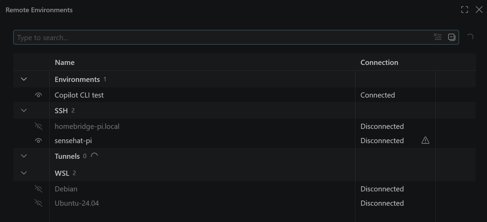
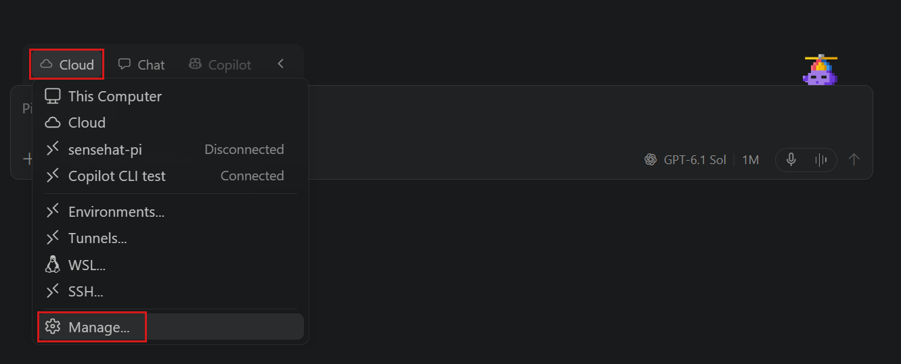
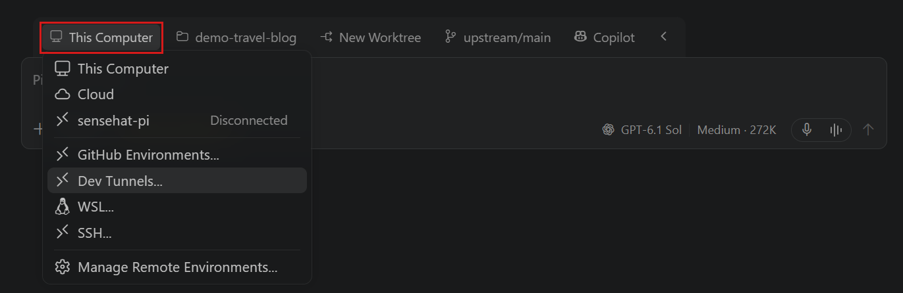

+++
title = "2.5.2 远程智能体会话"
date = 2026-11-06T07:53:25+08:00
weight = 2
type = "docs"
description = ""
isCJKLanguage = true
draft = false
+++


> 原文链接: [https://code.visualstudio.com/docs/agents/run/remote-agent-sessions](https://code.visualstudio.com/docs/agents/run/remote-agent-sessions)

# 2.5.2 远程智能体会话

　　从另一个应用或设备继续智能体工作，同时工作区、工具和运行中的会话保留在开发机器上。使用 GitHub Environments 让该机器可供受支持的 Copilot 客户端访问，或使用 SSH 和开发隧道从 VS Code 连接。

　　本文帮助你选择连接方式、共享主机、管理远程环境并在不重新开始的情况下继续现有远程会话。

　　要阻止此客户端连接远程智能体主机，请关闭 `chat.remoteAgentHostsEnabled`。

## 选择连接方式 {#choose-how-to-connect}

根据希望与会话交互的位置以及如何访问其主机选择：

| 连接 | 使用时机 |
|------------|----------------|
| **[GitHub Environments（预览）](#github-environments-preview)** | 注册机器，以便从受支持的 Copilot 客户端远程访问智能体，包括 VS Code、GitHub Copilot 应用、Copilot CLI、GitHub.com 和 GitHub Mobile。可用会话类型和操作因客户端而异。 |
| **[SSH](#connect-via-ssh)** | 通过 SSH 将智能体窗口连接到远程主机。 |
| **[开发隧道](#connect-via-dev-tunnel)** | 从 VS Code 或[基于浏览器的智能体窗口](#use-the-agents-window-in-the-browser)通过经过身份验证的隧道连接到主机。 |

　　SSH 和开发隧道在这些工作流中提供 VS Code 特定的客户端到主机访问。GitHub Environments 提供机器注册，支持跨受支持 Copilot 界面访问，而不仅是另一个 VS Code 实例。

　　文件和开发工具保留在智能体运行的机器上。保持该机器开机且可访问，并保持其 agent host 运行。对于由桌面 VS Code 托管的会话，请保持应用程序运行。

　　连接不会移动本地会话或将工作区复制到另一台机器。要继续现有远程会话，请连接到其已运行的主机。对于不依赖保持自己主机在线的受管理计算，请使用[云会话](../2.5.3-CloudSessions/)。

## 管理远程环境（实验性） {#manage-remote-environments-experimental}

　　使用智能体窗口中的远程环境编辑器在一个地方查找和管理远程机器。表格分组已知 SSH 主机、开发隧道和 Windows 上的 WSL 发行版。GitHub Environments 可用且启用时，**环境** 组还会列出已注册机器，包括离线机器。这些是用户共享机器，不是云会话使用的受管理环境。

　　远程环境管理需要 `sessions.chat.experimental.environmentPicker`、`sessions.chat.experimental.environmentPickerManageRemotes` 和 `chat.remoteAgentHostsEnabled`。三个设置默认开启。



### 打开远程环境管理 {#open-remote-environment-management}

　　从命令面板（`Ctrl + Shift + P`）运行 **Agents: Manage Remote Environments**，或从会话列表 **更多操作**（`...`）菜单选择 **管理远程环境**。

　　也可以从 **环境** 选择器打开编辑器：

1. 在智能体窗口中创建新聊天或会话。
2. 打开 **环境** 选择器并选择 **管理**。



### 查找和组织远程机器 {#find-and-organize-remote-machines}

　　使用表格搜索、连接和组织远程机器。请记住以下行为：

* 断开连接不会停止运行中的任务。刷新会发现机器而不连接。
* 重命名或隐藏机器只影响此客户端。隐藏不会断开连接或移除会话。名称留空可恢复默认。
* **删除** 仅适用于 GitHub Environments。它移除注册并断开此客户端，但不删除文件。如果拥有应用程序再次注册，环境可能重新出现。

## GitHub Environments（预览） {#github-environments-preview}

　　GitHub Environments 支持跨应用和设备连续性：使用 GitHub 账户注册开发机器，然后从另一个客户端访问其受支持智能体会话。注册不会配置新机器或复制代码。

**前提条件**：

* 使用同一 GitHub 账户登录主机和连接客户端。
* 如果该选项受管理或不可用，请检查[组织控制](../../../enterprise/7.2-ManageAISettings/)。

### 注册机器 {#register-your-machine}

在包含工作区并运行智能体的机器上：

1. 在智能体窗口标题栏或编辑器聊天视图输入区域打开 **远程连接**。
2. 选择 **GitHub Environments**。选择此方法会开始共享机器。完成登录或确认提示。
3. 检查菜单中的已注册环境名称。选择名称可重命名环境，以便在其他设备上识别。

> **重要**：连接的客户端获得主机会话、工具和工作区资源的受信任所有者访问权限。会话操作会镜像到 GitHub 以存储目录和历史，对话内容不是端到端加密的。共享机器前请审查[远程连接安全](../../work-with-ai/permissions-and-security/2.2.12.3-AISecurity/)。

　　`chat.agentHost.remoteConnections` 设置记录首选连接方式。直接更改设置会关闭共享。要开始共享，请在 **远程连接** 中选择方式。

### 从另一个客户端连接 {#connect-from-another-client}

在另一个桌面 VS Code 实例中：

1. 使用注册主机时的同一 GitHub 账户登录。
2. 打开命令面板（`Ctrl + Shift + P`），运行 **Connect to Environment...**。
3. 选择已注册机器。如果尚未出现，请在选择器中使用 **刷新环境**。
4. 连接后[选择现有远程会话](#continue-an-existing-remote-session)。

　　其他受支持 Copilot 客户端请使用其环境连接控件。注册使机器可被发现，但不保证每个客户端支持相同运行框架、会话或操作。

　　桌面 VS Code 上，发现机器不会首次自动连接，需要显式连接。启用 `chat.remoteAgentHostsAutoConnect` 后，以前连接过的在线环境可以为相同配置文件和账户重新连接。显式断开连接会抑制自动重连，直到再次手动连接。

### 断开连接或停止共享 {#disconnect-or-stop-sharing}

* **断开客户端** 结束该客户端连接，不停止主机或其运行中的任务。
* 在主机上打开 **远程连接**，选择 **关闭** 可 **停止共享主机**。这会停止共享而不改变首选连接方式。
* 要停止活动工作，请在会话中 **停止智能体任务**。断开连接或关闭共享不是取消任务操作。

　　需要远程访问时，请保持主机唤醒、在线，并保持其拥有应用程序或 Agent Host 运行。连接离线的已注册机器不会启动主机。

### 排查 GitHub Environments {#troubleshoot-github-environments}

| 症状 | 检查内容 |
|---------|---------------|
| GitHub Environments 或连接命令缺失 | 检查预览可用性、`chat.agentHost.githubEnvironments.enabled`、`chat.remoteAgentHostsEnabled` 和组织策略。 |
| 机器未列出 | 确认主机共享已开启且两个客户端使用同一账户。刷新环境选择器。 |
| 环境离线或无法连接 | 保持主机唤醒、在线，并运行其应用程序或 Agent Host。仅注册不会保持主机运行。 |
| 会话缺失 | 检查连接的主机、受支持会话类型、工作区组和[会话列表筛选器](../../work-with-ai/sessions/2.2.11.1-ManageSessions/)。启动新会话不会恢复缺失会话。 |
| 记录可见但无法接受消息 | 重新连接主机。缓存记录或[同步历史](../2.5.4-SessionHistory/)不是活动连接。 |

## 通过 SSH 连接 {#connect-via-ssh}

**前提条件**：远程机器必须可通过 SSH 访问。VS Code 会在需要时在远程机器安装所需 CLI。

通过 SSH 连接：

1. 选择 **新建** 或按 `Ctrl + N`。
2. 在环境下拉列表中选择 **SSH**。已设置 SSH 连接时，它们会作为选项出现。

    

3. 输入远程机器的 SSH 连接字符串（例如 `user@hostname`）。

连接后[打开现有远程会话或启动新会话](#continue-an-existing-remote-session)。

## 通过开发隧道连接 {#connect-via-dev-tunnel}

**前提条件**：远程机器上已有运行中的开发隧道。设置说明请参阅[使用远程隧道开发](../../../remote/8.4-Tunnels/)。

通过开发隧道连接：

1. 选择 **新建** 或按 `Ctrl + N`。
2. 在环境下拉列表中选择 **开发隧道**，选择账户类型。

    

3. 从列表选择活动开发隧道。

连接后[打开现有远程会话或启动新会话](#continue-an-existing-remote-session)。

> **重要**：确保开发隧道需要身份验证（GitHub 或 Microsoft 账户）。如果隧道允许匿名访问，任何发现 URL 的人都可以访问机器并启动智能体会话。自动批准模式激活时尤其危险，因为未授权用户可以使用你的凭据触发 AI 辅助命令执行。更多信息请参阅[安全](../../work-with-ai/permissions-and-security/2.2.12.3-AISecurity/)。

## 继续现有远程会话 {#continue-an-existing-remote-session}

　　连接主机后，从智能体窗口[会话列表](../../work-with-ai/sessions/2.2.11.1-ManageSessions/)选择现有会话。如果会话不可见，请检查主机、工作区组和列表筛选器。

　　在智能体窗口中，要求智能体将任务委派给已连接的远程机器。启用 `chat.remoteAgentHostsEnabled` 和 `chat.remoteSessions.tools.enabled`，并连接智能体可用的机器。无需在工作区选择器中选择目标机器。

远程委派工具允许智能体：

* 使用 `list_agent_hosts` 发现已连接远程机器、可用模型、资源容量和会话负载。
* 使用 `create_remote_session` 在特定远程机器启动会话或自动选择目标。自动放置时指定 Windows、Linux 或 macOS、最低内存、逻辑 CPU 数和可选模型等条件。匹配机器中优先选择运行中会话和待创建会话最少的机器。没有连接机器满足所有条件时，工具报告错误而不是选择不匹配机器。
* 使用 `get_remote_session` 检查远程会话状态和最新响应。
* 使用 `send_remote_message` 将后续工作或结果和问题发送回确切来源聊天。来源聊天繁忙时，消息在队列中等待。

　　对于仓库工作，请直接或在新 Git 工作树中指定目标机器上现有受信任文件夹。工具不会将协调会话工作区克隆或复制到远程机器。未指定工作区时，远程会话在无工作区状态下启动。

　　委派工作和消息仍适用正常审批要求。批准工具调用前审查所选主机、文件夹和工作树，尤其是智能体使用自动放置时。

　　委派工作运行时，保持协调智能体窗口打开并连接，以便消息在会话之间流动。远程会话的最终响应不会自动转发。请要求远程智能体使用 `send_remote_message` 报告结果。

　　关闭 `chat.remoteSessions.tools.enabled` 会移除远程委派工具，但不会断开远程机器或停止已运行的远程会话。

## 在远程 Dev Container 中运行会话 {#run-a-session-in-a-remote-dev-container}

　　在远程项目的 Dev Container 中运行智能体，以使用其配置的工具和依赖项，而无需直接安装到远程机器。从 VS Code 1.139 开始，桌面智能体窗口中的 SSH、Tunnel 和 WSL 连接支持此功能。

开始前启用 `chat.agentHost.devContainer.enabled`。远程主机必须安装并运行 Docker，项目必须包含 [Dev Container 配置](https://code.visualstudio.com/docs/devcontainers/create-dev-container)。

在远程 Dev Container 中运行会话：

1. 通过 SSH、隧道或 WSL 连接，并在工作区选择器中选择项目文件夹。
2. 展开远程文件夹菜单，选择 **使用 Dev Container**。工作区标签会增加 **- Dev Container** 后缀。
3. 选择可用智能体运行框架，配置会话并输入提示词。

　　**使用 Dev Container** 选项仅在源机器声明支持 Dev Container 时出现。不支持机器或源嵌套在另一个远程环境中的文件夹不提供。前提条件、切回源机器和故障排除请参阅[在 Dev Container 中运行会话](../../work-with-ai/2.2.3-AgentsWindow/#run-a-session-in-a-dev-container)。

## 在浏览器中使用智能体窗口 {#use-the-agents-window-in-the-browser}

　　智能体窗口也可作为 Web 客户端在 <https://insiders.vscode.dev/agents> 使用，因此可以从任何带浏览器的设备管理智能体会话。这适合离开主开发机器、使用移动设备，或希望检查远程机器上运行的会话而无需在本地安装 VS Code。

　　浏览器仅作为聊天、审查更改和管理会话的客户端。智能体会话运行在开发机器上。通过[开发隧道](../../../remote/8.4-Tunnels/)连接，或使用 [GitHub Environments（预览）](#github-environments-preview)访问已注册机器。浏览器不会直接通过 SSH 连接。

### 设置开发隧道 {#set-up-a-dev-tunnel}

要使用开发隧道路由，请在要连接的机器上启动隧道：

1. 在远程机器上运行以下命令启动开发隧道：

    ```bash
    code-insiders tunnel
    ```

    如果使用稳定版，请运行 `code tunnel`。

    首次运行时会提示使用 GitHub 或 Microsoft 账户进行身份验证。出于安全考虑，隧道默认要求身份验证。

2. 隧道运行后，在任何设备的浏览器中打开 <https://insiders.vscode.dev/agents>。
3. 提示时使用 **Continue with GitHub** 登录。已认证时智能体窗口会直接加载。
4. 隧道主机会出现在窗口顶部主机栏中。选择它连接。
5. 从会话列表选择现有会话继续。新任务请选择远程机器上的文件夹、选择智能体并输入提示词。

### 主机管理 {#host-management}

　　对于开发隧道连接，基于浏览器的智能体窗口主机栏显示配置了隧道的机器。每台机器显示连接状态：

* **在线**：主机可访问，可以启动或继续会话。
* **离线**：主机上的隧道未运行。请在主机上启动隧道以恢复在线。

　　可以直接通过主机栏连接和断开机器。活动会话期间机器离线时，会话显示断开状态。机器恢复在线后，会话自动重连。

## 在远程主机上启动无工作区聊天 {#start-a-chat-without-a-workspace-on-a-remote-host}

　　当任务需要远程主机的资源或环境但不需要仓库时，请使用无工作区聊天。首先通过 SSH 或开发隧道连接主机。

启动无工作区聊天：

1. 选择 **新建** 或按 `Ctrl + N` 启动新的智能体会话。
2. 在工作区选择器中，为已连接远程主机选择 **聊天** 条目而不选择文件夹。该条目标识聊天运行的主机。
3. 选择智能体运行框架，输入提示词并按 `Enter`。

　　主工作区选择器还会在本地文件夹旁显示已连接远程主机的文件夹。任务需要现有工作区时，请在那里选择远程文件夹。

## 在远程 Dev Container 中运行会话（功能标志） {#run-a-session-in-a-remote-dev-container-feature-flag}

　　在远程项目的 Dev Container 中运行智能体，以使用其配置的工具和依赖项，而无需直接安装到远程机器。从 VS Code 1.139 开始，智能体窗口中的 SSH、Tunnel 和 WSL 连接支持此功能。

　　Dev Container 支持（`chat.agentHost.devContainer.enabled`）默认开启。远程主机必须安装并运行 Docker，项目必须包含 [Dev Container 配置](https://code.visualstudio.com/docs/devcontainers/create-dev-container)。

在远程 Dev Container 中运行会话：

1. 通过 SSH、隧道或 WSL 连接，并在工作区选择器中选择项目文件夹。
2. 展开远程文件夹菜单，选择 **使用 Dev Container**。工作区标签会增加 **- Dev Container** 后缀。
3. 选择可用智能体运行框架，配置会话并输入提示词。

　　**使用 Dev Container** 选项仅在源机器声明支持 Dev Container 时出现。不支持机器或源嵌套在另一个远程环境中的文件夹不提供。前提条件、切回源机器和故障排除请参阅[在 Dev Container 中运行会话](../../work-with-ai/2.2.3-AgentsWindow/#run-a-session-in-a-dev-container)。

## 预览远程 Web 应用 {#preview-a-remote-web-app}

　　在智能体窗口中，使用集成浏览器预览会话远程主机上运行的 Web 应用，而无需转发端口。启用 `workbench.browser.enableRemoteProxy`，将 `workbench.browser.dataStorage` 保持为 `default`，并打开应用的原始 localhost URL。

　　选择 **与智能体共享** 让智能体与页面交互，或要求它打开应用并验证用户流程。支持的主机、存储行为和连接故障排除请参阅[通过远程 agent host 浏览](../../../debugging-and-testing/6.5-IntegratedBrowser/)。

## 将任务委派给远程机器（实验性） {#delegate-tasks-to-remote-machines-experimental}

　　在智能体窗口中，要求智能体将任务委派给已连接远程机器。开启 `chat.remoteSessions.tools.enabled` 并连接智能体可用的机器。无需在工作区选择器中选择目标机器。

远程委派工具允许智能体：

* 使用 `list_agent_hosts` 发现已连接远程机器、可用模型、资源容量和会话负载。
* 使用 `create_remote_session` 在特定远程机器启动会话或自动选择目标。自动放置时指定 Windows、Linux 或 macOS、最低内存、逻辑 CPU 数和可选模型等条件。匹配机器中优先选择运行中会话和待创建会话最少的机器。没有连接机器满足所有条件时，工具报告错误而不是选择不匹配机器。
* 使用 `get_remote_session` 检查远程会话状态和最新响应。
* 使用 `send_remote_message` 将后续工作或结果和问题发送回确切来源聊天。来源聊天繁忙时，消息在队列中等待。

　　对于仓库工作，请直接或在新 Git 工作树中指定目标机器上现有受信任文件夹。工具不会将协调会话工作区克隆或复制到远程机器。未指定工作区时，远程会话在无工作区状态下启动。

　　委派工作和消息仍适用正常审批要求。批准工具调用前审查所选主机、文件夹和工作树，尤其是智能体使用自动放置时。

　　委派工作运行时，保持协调智能体窗口打开并连接，以便消息在会话之间流动。远程会话的最终响应不会自动转发。请要求远程智能体使用 `send_remote_message` 报告结果。

　　关闭 `chat.remoteSessions.tools.enabled` 会移除远程委派工具，但不会断开远程机器或停止已运行的远程会话。

## 相关资源 {#related-resources}

* [使用智能体窗口](../../work-with-ai/2.2.3-AgentsWindow/)：跨多个项目的智能体优先工作流。
* [使用远程隧道开发](../../../remote/8.4-Tunnels/)：设置和管理开发隧道。
* [Agent Host 架构](../../reference-and-help/reference/2.8.1.11-AgentHostArchitecture/)：远程连接和会话执行的技术细节。
