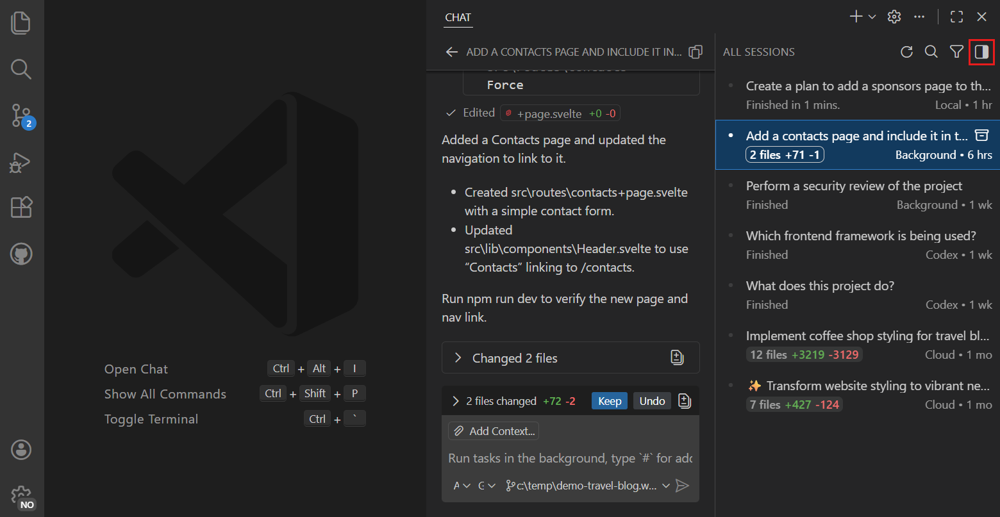
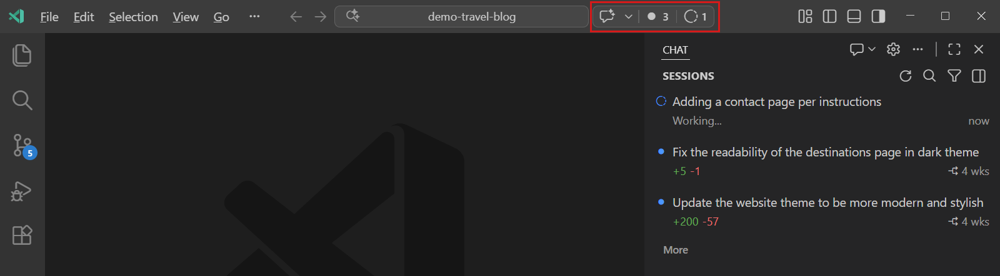

+++
title = "2.2.2 聊天视图"
date = 2026-11-06T07:53:25+08:00
weight = 2
type = "docs"
description = ""
isCJKLanguage = true
draft = false
+++

> 原文链接: [https://code.visualstudio.com/docs/agents/run/chat-view](https://code.visualstudio.com/docs/agents/run/chat-view)

# 2.2.2 聊天视图

　　聊天视图在主 VS Code 窗口中的代码旁运行智能体。当你希望在当前工作区中围绕代码协作，同时保持编辑器、调试器、测试、终端、扩展和笔记本可用时，请使用它。

　　可以先从关于项目的问题开始，准备好后请求更改，并在代码旁检查结果。本文介绍如何启动会话、与智能体协作，以及围绕编辑器安排聊天。要与在智能体窗口中协调任务的方式进行比较，请参阅[选择工作方式](../../#choose-how-you-work)。

## 前提条件 {#prerequisites}

* 已安装 Visual Studio Code。[下载 VS Code](https://code.visualstudio.com/download)。

* 通过受支持的设置访问 AI 模型：

    * 对于 GitHub Copilot 提供的模型，请[在 VS Code 中设置 GitHub Copilot](../../getting-started/2.1.2-SetUpCopilot/)。
    * 要使用 Anthropic Claude、OpenAI Codex 或自己的模型凭据进行受支持的工作流，请查看[智能体运行框架身份验证选项](../../choose-models-and-agents/2.3.2-ChooseAnAgentHarness/#requirements-and-setup)和[语言模型设置](../../choose-models-and-agents/2.3.1-ChooseAndConfigureModels/)。

## 打开聊天视图 {#open-the-chat-view}

　　聊天视图在辅助侧边栏中打开，位于编辑器旁边。使用以下任一方法打开：

* 选择 VS Code 标题栏中的 **聊天** 菜单，然后选择 **打开聊天**。

* 使用键盘快捷键 `Ctrl + Alt + I`（macOS：`Ctrl + Cmd + I`）。

* 从命令行运行 `code chat`，在 VS Code 外部启动聊天。详细了解[从命令行启动聊天](../../../editor/3.3-ConfigureTheEditor/3.3.10-CommandLineInterface/#start-chat-from-the-command-line)。

## 启动会话 {#start-a-session}

> **注意**：当 [GitHub Copilot 企业托管设置生效](../../../enterprise/7.2-ManageAISettings/#claude-and-codex-availability)时，Claude 和 Codex 运行框架会被禁用。请联系部署这些设置的 IT 团队。

1. 打开要处理的项目，选择 **新建聊天**（`+`）或按新聊天快捷键。

2. 发送第一条提示词之前，在聊天输入框中选择 **会话目标**、**智能体**、**语言模型** 和 **权限**。可用选项取决于账户、已安装的提供商和组织策略。

    对于第一个编码任务，请按照[智能体快速入门](../../getting-started/2.1.3-AgentsQuickstart/)，使用 **Copilot**、**智能体**、**自动** 和 **手动审批**。要使用其他设置，请[比较智能体运行框架](../../choose-models-and-agents/2.3.2-ChooseAnAgentHarness/#compare-agent-harnesses)。

3. 输入问题或描述任务，然后按 `Enter`。

### 启动 Copilot CLI 会话 {#start-a-copilot-cli-session}

要在编辑器中启动新的 GitHub Copilot CLI 对话，可以使用以下选项之一：

* 打开 **GitHub Copilot CLI** 终端配置文件。
* 从命令面板（`Ctrl + Shift + P`，macOS：`Cmd + Shift + P`）运行 **Chat: New Copilot CLI Session**。
* 在集成终端中输入 `copilot`。

　　如果未安装 CLI，`copilot` 会提示安装。也可以在 [macOS 配置](../../../advanced-setup/9.3-macOS/#configure-path-with-vs-code)或 [Windows 设置](../../../advanced-setup/9.4-Windows/#set-up-the-copilot-command)期间将命令添加到 PATH。

　　新会话会出现在会话列表中。如果要继续现有对话，请在可用时使用[在终端中恢复](../sessions/2.2.11.1-ManageSessions/#use-copilot-cli-from-the-terminal)。

## 与智能体协作 {#work-with-the-agent}

　　在工作时，将代码及其检查保持在对话旁边：

1. **提供相关上下文**：指出要讨论的文件、符号或行为，并描述需要的结果。了解如何[向请求添加上下文](../2.2.7-AddPromptContext/)。

2. **请求解释或更改**：例如，在请求修复之前询问某个行为在哪里实现。对于只读任务，请遵循[代码库探索指南](../../tutorials-and-guides/2.6.2-ExploreACodebase/)；要在自己的项目中规划并实现更改，请遵循[添加功能指南](../../tutorials-and-guides/2.6.3-AddAFeature/)。

3. **审查并引导工作**：使用编辑器、终端、调试器和测试检查智能体的响应、提议的操作和更改。在 Copilot 运行框架会话中，展开聊天输入框上方的工作集，审查跟踪的编辑并使用 **保留** 或 **撤销**。编辑已经保存；**保留** 会清除其待审查状态。也可以在响应中选择已更改的文件，查看其差异。有关修订、审批以及在工作运行时发送更正的信息，请参阅[使用聊天](../2.2.5-UseChat/)。

4. **整合前验证**：检查智能体的测试结果，并亲自运行相关检查。请参阅[审查 AI 生成的代码编辑](../2.2.8-ReviewAndRevertChanges/)，了解反馈、检查点和恢复。

　　Copilot 工作集不需要 Git，但只列出通过跟踪的编辑工具所做的更改，不包含终端命令。请单独审查其他已更改文件。完整工作流请参阅[按运行框架和界面划分的审查控件](../2.2.8-ReviewAndRevertChanges/)。

　　要在每次请求后显示已更改文件摘要，请启用 `chat.checkpoints.showFileChanges`。支持的工具取决于运行框架和已安装的扩展。例如，在安装所需工具后可以[处理 Jupyter 笔记本](../../tutorials-and-guides/2.6.13-JupyterNotebooks/)。在[远程工作区](../../../remote/)中，会话使用该项目的远程上下文和工具。

## 在其他界面继续 {#continue-in-another-interface}

　　需要跨项目协调工作时，选择应用程序标题栏中的 **在智能体中打开**，然后从会话列表中选择现有的受支持会话。无需重新开始任务。请先查看[受支持的会话类型和继续步骤](../sessions/2.2.11.1-ManageSessions/#continue-between-the-chat-view-and-agents-window)：Local 会话和 OpenAI Codex 扩展的会话仍只在编辑器中可用。

　　也可以继续使用[内联建议](../../../editor/3.2-WriteCode/3.2.3-InlineSuggestions/)，或使用[内联聊天](../2.2.4-InlineChatAndQuickChat/)进行聚焦编辑。这些方法补充对话，而不是替代对话。

## 布局选项 {#layout-options}

　　聊天视图在主 VS Code 窗口中提供多种布局。请选择最适合工作流的布局：

* **侧边栏**（默认）：选择 **新建聊天 (+)** > **新建聊天**，或运行 **Chat: New Chat** 命令。最适合让聊天与代码并排可见。

* **编辑器选项卡**：选择 **新建聊天 (+)** > **新建聊天编辑器**，或运行 **Chat: New Chat Editor** 命令。最适合为聊天提供更多空间或并排比较会话。

* **单独窗口**：选择 **新建聊天 (+)** > **新建聊天窗口**，或运行 **Chat: New Chat Window** 命令。最适合多显示器设置。

## 界面概述 {#interface-overview}

　　聊天视图让智能体位于代码旁边，因此你可以在同一窗口中提示、审查和编辑。聊天视图包含以下主要区域：

1. **会话列表**：位于视图顶部，可查看和管理当前工作区的会话。详细了解[会话列表](../sessions/2.2.11.1-ManageSessions/)。

2. **聊天对话**：位于中间，显示对话历史和智能体的响应，包括它对代码所做的更改。

3. **聊天输入框**：位于底部，可输入提示词，并使用 **会话目标**、**智能体**、**语言模型** 和 **权限** 控件配置会话。

> **提示**：要使用键盘或屏幕阅读器检查聊天响应，请运行 **Open Accessible View**（`Alt + F2`，macOS：`Option + F2`）。详细了解[可访问视图](../../../editor/3.3-ConfigureTheEditor/3.3.9-Accessibility/3.3.9.1-Accessibility/#accessible-view)。

### 会话列表布局 {#sessions-list-layout}

　　使用聊天视图右上角的切换控件在两种布局之间切换：

* **紧凑**：会话列表和对话共享同一面板。选择会话将其打开，然后使用返回按钮回到列表。

* **并排**：会话列表保持在对话旁边可见。选择会话打开其详情。使用 `chat.viewSessions.orientation` 设置配置方向。

　　要隐藏或显示列表，请右键单击空白聊天区域并切换 **显示会话**，或使用 `chat.viewSessions.enabled` 设置。有关筛选器和会话操作，请参阅[查找并恢复会话](../sessions/2.2.11.1-ManageSessions/#find-and-resume-a-session)。

### 在会话中切换聊天 {#switch-chats-within-a-session}

　　在支持多个聊天的运行框架中，一个会话可以包含主聊天和嵌套会话。在 **会话** 视图中展开主聊天行，选择嵌套会话，即可在聊天视图中打开其对话。

　　可以继续在智能体窗口中创建的嵌套会话，而无需开始新对话。有关创建步骤、导航选项和界面特定控件，请参阅[在会话中运行多个聊天](../sessions/2.2.11.1-ManageSessions/#run-multiple-chats-in-a-session)。

## 会话状态指示器（实验性） {#session-status-indicator-experimental}

　　使用 `chat.agentsControl.enabled` 在标题栏命令中心显示会话状态指示器。它让你无需切换视图即可访问会话。

* 选择 **未读会话徽章**，将会话列表筛选为有新消息的对话。
* 选择 **进行中会话徽章**，筛选出智能体正在运行的会话。
* 选择 **闪光图标** 获取聊天和会话管理选项。

## 在欢迎页查看会话 {#view-sessions-on-the-welcome-page}

　　将 `workbench.startupEditor` 设置为 `agentSessionsWelcomePage`，在启动时的欢迎页显示最近会话、用于新任务的嵌入式聊天组件和快速操作。当没有从上一个会话恢复的编辑器时，会打开启动页。

## 后续步骤 {#next-steps}

* [聊天交互控件](../2.2.5-UseChat/)：发送和引导请求、添加上下文并浏览对话。
* [管理智能体会话](../sessions/2.2.11.1-ManageSessions/)：组织、归档和分叉会话。
* [使用智能体窗口](../2.2.3-AgentsWindow/)：跨多个项目与智能体协作。
