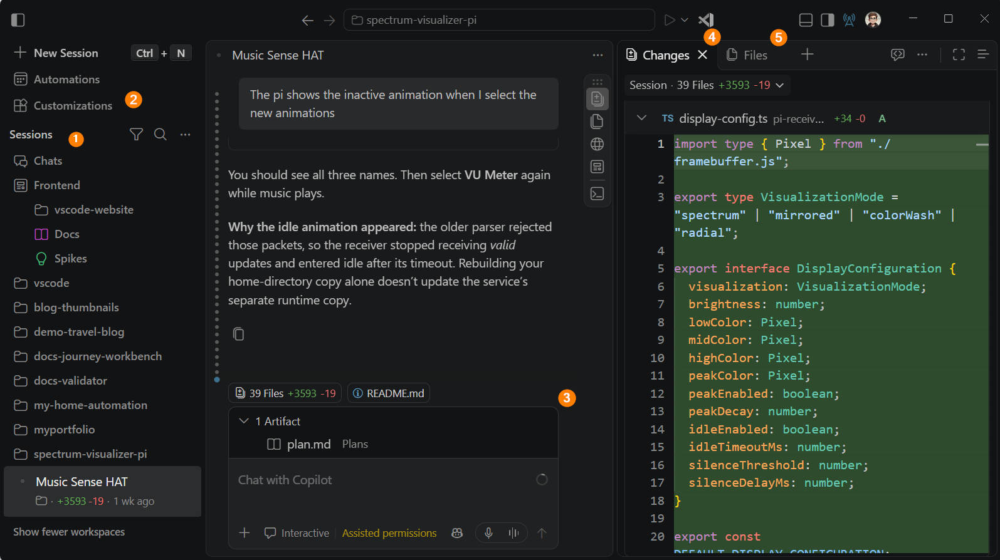
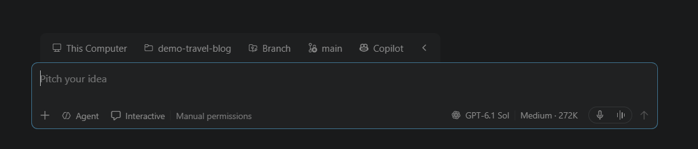
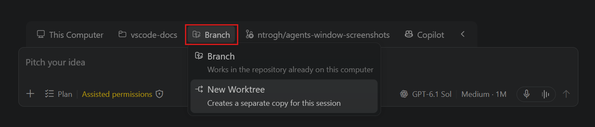
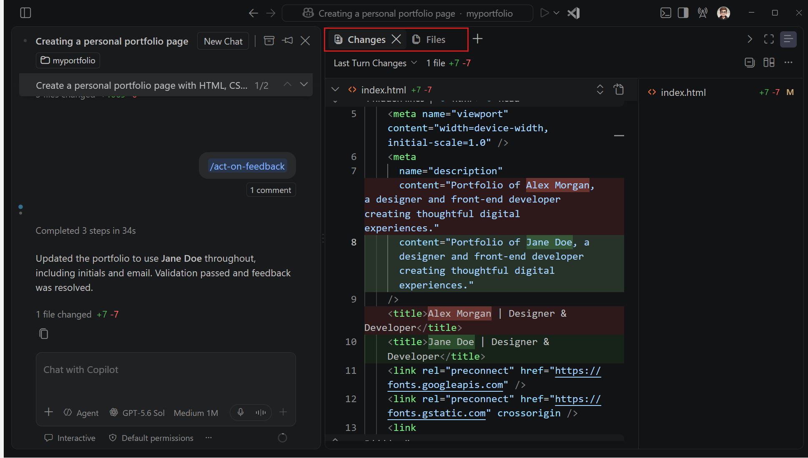
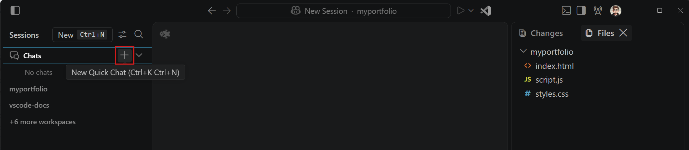
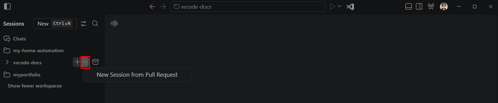

+++
title = "2.2.3 智能体窗口"
date = 2026-11-06T07:53:25+08:00
weight = 3
type = "docs"
description = ""
isCJKLanguage = true
draft = false
+++

> 原文链接: [https://code.visualstudio.com/docs/agents/run/agents-window](https://code.visualstudio.com/docs/agents/run/agents-window)

# 2.2.3 智能体窗口

　　智能体窗口在 VS Code 中提供以智能体为先的界面，用于跨项目委派和协调任务。可以并行运行独立任务、监控进度，并在一处审查结果。当你想在编辑或调试代码时与智能体协作，请使用[编辑器中的聊天](../2.2.2-ChatView/)。

　　本指南按照从选择智能体更改位置，到监控、验证和整合工作的流程展开。先处理一个任务，然后按需添加独立任务。如果你不熟悉智能体辅助编码，请先完成[智能体快速入门](../../getting-started/2.1.3-AgentsQuickstart/)。

> **提示**：如果要通过动手教程构建应用，请按照[智能体编码教程](../../getting-started/2.1.4-AgentsTutorial/)操作。

## 打开智能体窗口 {#open-the-agents-window}

　　选择 VS Code 标题栏中的 **在智能体中打开**，或从命令面板（`Ctrl + Shift + P`）运行 **Chat: Open Agents Window**。该窗口会与主编辑器窗口并排打开。

　　如果你已在 VS Code 中登录 GitHub，打开智能体窗口时也会自动登录。从命令行启动时，使用 `code --agents`。

## 智能体窗口界面概述 {#agents-window-interface-overview}

　　智能体窗口将跨项目的工作管理与单个任务的处理分开。使用主侧边栏组织会话并访问自动化和自定义项，使用中央会话区域与智能体协作，使用辅助侧边栏检查和验证活动会话的工作。

| 区域 | 用途 |
|------|--------------------|
| **主侧边栏** | 启动和切换跨项目会话。打开 **自动化** 管理自动任务，或打开 **自定义项** 配置智能体和工作流。 |
| **会话区域** | 发送提示词、回答问题、审查响应并指导智能体。可以并排排列多个会话，以监控并行工作。 |
| **辅助侧边栏** | 使用 **文件** 浏览工作区、使用 **更改** 审查编辑、使用 **搜索** 查找代码，并使用 **浏览器** 检查应用。在可用时，**画布** 提供智能体的交互式内容。 |

　　可用工具取决于会话和已启用的功能。

### 了解活动会话 {#understand-the-active-session}

　　选择会话会使其成为**活动会话**，并确定会话工具应用于哪个项目和对话。当多个会话窗格可见时，选择窗格使其成为活动会话。活动会话在会话列表中突出显示。

　　发送反馈或运行命令之前，请确认哪个会话处于活动状态。终端命令和任务在该会话的文件夹或工作树中运行，浏览器选项卡属于打开它的会话。

　　[快速聊天](#start-a-quick-chat)没有项目工作区，因此不显示工作区专用的文件和更改。

## 启动智能体会话 {#start-an-agent-session}

　　选择一个具有明确结果和可运行检查的任务。以下步骤在本地项目中启动会话。有关其他环境或没有项目的任务，请参阅[其他启动会话的方式](#other-ways-to-start-a-session)。

1. 选择侧边栏顶部的 **新建会话**，或按 `Ctrl + N`。要直接在特定工作区中开始，请将鼠标悬停在会话列表中的工作区上，选择 **+**（新建会话）。

2. 从输入框上方的环境选择器中选择 **这台计算机**。在工作区选择器中选择最近的文件夹，或选择 **打开文件夹**。

    如果工作区未受信任，请先查看[工作区信任](../../../editor/3.2-WriteCode/3.2.8-Workspaces/3.2.8.3-WorkspaceTrust/)提示。

3. 对于 Git 仓库，选择 **分支** 在当前文件夹中工作，或选择 **新工作树** 保持更改隔离。发送提示词之前，请查看[隔离选项和要求](#choose-where-an-agent-makes-changes)。

4. 审查输入工具栏中的权限级别。它控制哪些操作需要批准，与文件隔离相互独立。详细了解[权限级别](../permissions-and-security/2.2.12.1-ApprovalsAndPermissions/#permission-levels)。

5. 描述想要的结果、约束以及智能体应如何检查工作。按 `Enter` 提交提示词。

    要添加更多上下文，请选择 **添加上下文**（**+**）。如有提示，请先选择仓库。将议题或拉取请求 URL 粘贴到提示词中，也会将其添加为上下文附件。

    可选更改[智能体运行框架](../../choose-models-and-agents/2.3.2-ChooseAnAgentHarness/#compare-agent-harnesses)、智能体或模型。

> **提示**：要在后台启动会话而不导航到其中，请按 `Alt + Enter`，或按住 `Alt` 并选择 **发送**。发送提示词后，会话会出现在会话列表中。

### 选择智能体更改的位置 {#choose-where-an-agent-makes-changes}

　　对于 Git 工作区，可以选择在当前分支或新工作树中应用更改。使用输入框上方的隔离下拉列表选择智能体编辑文件的位置。

| 方面 | **分支** | **新工作树** |
|--------|------------|------------------|
| 最适合 | 使用当前文件和未提交更改 | 并行运行的独立任务 |
| 编辑位置 | 当前文件夹 | 单独的 [Git 工作树](../../../source-control/4.5-BranchesWorktrees/#understanding-worktrees) |
| 起点 | 当前文件或其他现有本地分支 | 所选基础分支中已提交的文件 |
| 要求 | **切换分支时**工作树干净 | 至少有一次提交的 Git 仓库 |
| 未提交和未跟踪文件 | 在当前文件夹中可用 | 不会从当前文件夹复制 |
| 整合 | 编辑已在所选文件夹中 | 之后整合已审查的工作树分支 |

　　为 **新工作树** 选择基础分支不会切换活动工作区中的分支。

　　Git 忽略的文件（包括依赖项和本地配置）默认也不会出现在新工作树中。请运行项目的设置步骤，或[配置要包含的忽略文件](#configure-isolation-defaults)。

　　Dev Container 会话直接在容器工作区中工作，不支持 **新工作树**。请参阅[在 Dev Container 中运行会话](#run-a-session-in-a-dev-container)。

> **重要**：工作树隔离的是工作文件，而不是智能体对计算机或外部服务的访问。两种隔离模式都支持运行框架提供的权限级别。对于操作系统级限制，请配置[智能体沙盒](../permissions-and-security/2.2.12.2-AgentSandboxing/)或使用[云会话](../../work-across-apps-and-machines/2.5.3-CloudSessions/)。

## 使用多个会话 {#work-with-multiple-sessions}

　　可以在同一项目或不同项目中并行运行多个智能体会话。每个会话有自己的对话和任务上下文，因此可以委派独立工作，并在审查一个结果时让另一个会话继续运行。例如，一个会话在一个项目中实现功能，另一个会话在另一个项目中调查错误。

　　对于希望分别跟踪和审查的独立任务，请使用单独的会话。对于希望放在一起的相关对话，请[在一个会话中使用多个聊天](#work-with-multiple-chats-in-a-session)。

　　要添加另一个任务，请选择 **新建会话**，选择其项目并提交提示词。无需等待其他会话完成。可以在会话列表中切换，以检查进度、回答问题或提供反馈。会话可以并行运行，无需并排显示。当希望保持多个对话可见时，可[在网格中排列会话](#arrange-sessions-in-a-grid)。

　　对于同一仓库中的并行更改，请[使用单独的工作树](#choose-where-an-agent-makes-changes)保持编辑隔离。单独会话或聊天不会自动隔离文件：使用同一文件夹的会话可以编辑相同文件。请选择可以独立推进的任务。如果一个任务依赖另一个任务的结果，请先完成前置任务。完整演练请参阅[委派两个任务而不混合更改](../../tutorials-and-guides/2.6.8-RunParallelTasks/)。

　　使用会话列表检查状态和更改统计信息。选择会话检查其对话：

* 如果需要输入，请回答其问题或审查审批请求。
* 在工作期间，检查其更改是否保持在任务范围内。将更正发送到该会话，而不是另一个任务的对话。
* 完成时[审查并验证结果](#review-and-finish-an-agent-session)。完成的响应并不证明任务正确。

　　发送反馈或运行命令之前，请确认[活动会话](#understand-the-active-session)。有关引导和停止请求，请参阅[使用聊天](../2.2.5-UseChat/)。有关分组、固定或查找会话，请参阅[组织会话](../sessions/2.2.11.1-ManageSessions/#organize-sessions)。

### 在网格中排列会话 {#arrange-sessions-in-a-grid}

　　要保持两个会话可见，请右键单击列表中的会话，选择 **在侧边打开**。要在不替换当前窗格的情况下启动另一个会话，请按住 `Alt`（macOS 上为 `Option`）并选择 **新建会话**。

　　将会话拖到另一个会话的上、下、左或右边缘，可以创建水平或垂直拆分。放置预览会显示会话出现的位置。

<video src="https://code.visualstudio.com/assets/docs/agents/agents-window/sessions-grid.mp4" title="视频展示智能体窗口中以网格排列的智能体会话。" autoplay loop controls muted></video>

　　一次只能有一个窗格处于活动状态。在列表中选择另一个会话会替换未固定的活动视图。

　　多个窗格可见时，使用会话标题栏的 **会话布局** 菜单排列或调整大小。**最大化** 会扩展一个窗格，**恢复大小** 会返回网格。这些操作与 **会话布局** 是分开的。

## 审查并完成智能体会话 {#review-and-finish-an-agent-session}

　　智能体完成任务后，使用智能体窗口审查其更改、请求修订并验证结果。工作满足要求后，提交更改并将其整合到项目中，可以在本地或通过拉取请求完成。

　　选择要审查的会话，使其文件、更改和工具处于活动状态。

　　如需更深入的编码或调试，请选择 **在编辑器中打开**，[在主编辑器窗口中继续受支持的项目会话](#continue-in-another-interface)，同时使用编辑器、调试器和其他开发工具。

### 检查工作区文件和更改 {#inspect-workspace-files-and-changes}

　　在**辅助侧边栏**中，使用 **文件** 浏览工作区或工作树，使用 **更改** 审查编辑。在 **更改** 中，选择 **分支** 查看分支差异，选择 **未提交** 查看待处理更改，选择 **会话** 查看会话编辑，或选择 **上一轮** 查看最近一轮。审查完整的相关更改，而不仅是最近的响应。

　　检查结果是否满足请求的结果、保留了必需行为，并且没有无关编辑。

　　要立即提供反馈，请打开文件差异，选择范围，并使用反馈控件向智能体留下基于范围的反馈。有关详细审查和恢复控件，请参阅[审查 AI 生成的代码编辑](../2.2.8-ReviewAndRevertChanges/)。

### 验证更改 {#validate-changes}

　　运行项目的测试、构建和任何必要的手动检查，以验证请求的行为。检查输出中是否有失败或跳过的检查，不要只依赖智能体的摘要。

* 在会话活动栏中选择 **终端**，在该会话的文件夹或工作树中运行命令。
* 使用应用标题栏中的任务控件运行已配置任务，或定义新任务。
* 对于 Web 应用，选择 `localhost` 链接，或在[集成浏览器](../../../debugging-and-testing/6.5-IntegratedBrowser/)中打开 HTML 文件。也可以要求智能体[使用浏览器工具](../plan-and-run-tasks/2.2.10.3-BrowserTools/)，然后亲自验证结果。

　　如果检查失败，请将证据发送到同一会话，请求更正，并重复受影响的检查。

### 提交更改 {#commit-changes}

　　对于未提交的更改，打开 **更改**，从更改集下拉列表中选择 **未提交**，然后选择 **提交**。VS Code 会生成提交消息，并提交会话 Git 仓库中的所有当前更改，因此请先审查它们。可用 Git 操作取决于会话类型。

　　即使会话使用其他提供商的凭据，生成提交消息也需要[登录 GitHub Copilot](../../../advanced-setup/9.1-GitHubCopilotSetup/)。

> **重要**：**提交** 操作使用 `git commit --no-verify`，会跳过 `pre-commit` 和 `commit-msg` 钩子。通过 **创建 PR** 创建的提交也会跳过这些钩子。使用任一操作前，请运行项目要求的检查。

### 整合结果 {#integrate-the-result}

　　提交会记录更改，但不一定会将其放入所需分支：

* 使用 **分支** 隔离时，编辑已在所选文件夹中。请遵循正常的 branch 和拉取请求工作流。
* 使用 **新工作树** 时，编辑保留在单独的工作树中。请在本地将已审查分支整合到目标分支，或[创建拉取请求](#create-a-pull-request)。并行工作示例请参阅[整合并重新测试](../../tutorials-and-guides/2.6.8-RunParallelTasks/#6-integrate-and-retest)。

　　合并多个会话的更改后，请在组合结果上重新运行相关检查。在验证完成之前保持会话可用，然后[将已完成的会话标记为完成](../sessions/2.2.11.1-ManageSessions/#finish-and-restore-sessions)。

### 创建拉取请求 {#create-a-pull-request}

　　如果会话尚未关联拉取请求：

1. 选择标题栏中的 **创建 PR**。审查仓库、源分支和目标分支，以及生成的标题和描述。可以在生成完成时编辑文本。

2. 如果更改尚未准备好审查，请选择 **创建为草稿**。

3. 在 **创建后** 下选择 **手动合并** 以保留合并控制权，或选择 **自动合并**，让 GitHub 在必需检查和批准通过后合并。对于自动合并，请选择合并方法。自动合并不适用于草稿，也不会修复失败的检查或审查反馈。

    可选的 **Agent Merge** 选项（实验性）可以要求智能体处理阻塞项。选择之前，请审查其[配置和防护措施](#finish-a-pull-request-with-agent-merge)。

4. 选择 **创建 PR**。创建拉取请求之前，任何未提交更改都会被提交，并推送分支。

　　如果希望由智能体创建拉取请求，请在表单中选择 **拉取请求操作** > **发送创建 PR 消息**。这会要求智能体自己生成标题和描述，而不使用表单文本，并使用所选的草稿状态和合并选项。

### 从会话中移除拉取请求 {#remove-a-pull-request-from-a-session}

　　要从会话中移除拉取请求工件，而不关闭 GitHub 上的拉取请求，请右键单击聊天输入框上方的胶囊，选择 **从会话中移除拉取请求工件**。如果胶囊包含多个拉取请求，请打开其下拉列表，为相关拉取请求选择操作。

　　单独的关联（例如从拉取请求启动会话时创建的关联）保持不变。

## 其他启动会话的方式 {#other-ways-to-start-a-session}

　　当任务需要不同的起点或执行环境时，请使用以下工作流。

### 启动快速聊天 {#start-a-quick-chat}

　　快速聊天不限定于项目。可用于不需要工作区的问题或任务。它们出现在会话列表顶部的 **聊天** 组中。

1. 在 **聊天** 标题上选择 **+**，或从命令面板运行 **新建快速聊天**。

    

2. 选择可用运行框架，输入提示词并提交。

　　在支持时，快速聊天也支持[嵌套会话](#work-with-multiple-chats-in-a-session)。选择 **无工作区** 时，每个嵌套会话使用自己的临时文件夹。

#### 在工作区中继续快速聊天 {#continue-a-quick-chat-in-a-workspace}

　　如果快速聊天变得与项目相关，可以在不丢失对话历史的情况下在本地工作区继续。

> **注意**：这适用于 GitHub Copilot 和 OpenAI Codex 运行框架的快速聊天。对于 OpenAI Codex，请使用交互模式。工作树隔离需要至少有一次提交的本地 Git 仓库。

1. 要求智能体在特定本地文件夹中继续。
2. 确认文件夹，并选择直接编辑还是使用工作树。
3. 审查并批准 **设置工作区** 确认和任何工作区信任提示。

　　设置完成后，聊天会移动到工作区的组中，智能体继续处理请求。对于已有工作区的聊天，请参阅[将聊天移动到另一个文件夹或工作树](../sessions/2.2.11.1-ManageSessions/#move-a-chat-to-another-folder-or-worktree)。

### 不登录 GitHub 打开（实验性） {#open-without-github-sign-in-experimental}

　　在桌面版中，可以使用受支持的提供商凭据而不是 GitHub 登录来运行会话：

* 按照 [Anthropic Claude BYOK 设置](../../choose-models-and-agents/2.3.2-ChooseAnAgentHarness/#claude)配置受支持的 API 密钥或提供商。
* 按照 [OpenAI Codex 设置](../../choose-models-and-agents/2.3.2-ChooseAnAgentHarness/#codex)使用 ChatGPT 登录。
* 为智能体窗口配置[受支持的 BYOK 模型](../../choose-models-and-agents/2.3.1-ChooseAndConfigureModels/#bring-your-own-language-model-key)。

> **注意**：当[企业托管设置生效](../../../enterprise/7.2-ManageAISettings/#claude-and-codex-availability)时，即使使用单独凭据，Anthropic Claude 和 OpenAI Codex 运行框架也会被禁用。现有会话不会被删除。请联系部署设置的 IT 团队。

　　如果未配置提供商，请在窗口中选择 **添加模型** 或 **登录**。需要 GitHub 身份验证的模型和操作会在需要时提示。基于浏览器的智能体窗口需要 GitHub 登录。

### 在其他环境中运行 {#run-in-another-environment}

　　对于 GitHub 仓库，请在工作区选择器中选择 **在仓库中工作**。要在另一台计算机上工作，请从环境选择器中选择 **SSH** 或 **开发隧道**，并按照[远程会话设置](../../work-across-apps-and-machines/2.5.2-RemoteAgentSessions/)操作。

　　对于独立于本地计算机运行的受管理计算资源，请[启动云会话](../../work-across-apps-and-machines/2.5.3-CloudSessions/#start-a-cloud-session)。要稍后返回其工作，请[重新打开现有会话](../../work-across-apps-and-machines/2.5.3-CloudSessions/#continue-an-existing-cloud-session)。

　　也可以[使用基于浏览器的智能体窗口](../../work-across-apps-and-machines/2.5.2-RemoteAgentSessions/#use-the-agents-window-in-the-browser)，从另一台设备访问远程会话。

### 在 Dev Container 中运行会话 {#run-a-session-in-a-dev-container}

　　使用 Dev Container 在项目工具和依赖项环境中运行智能体。桌面版支持本地文件夹以及已配置 SSH、隧道或 WSL 主机上的文件夹，但浏览器窗口不支持。

开始之前：

* 在包含该文件夹的主机上[安装并运行 Docker](../../../remote/8.5-DevContainers/)，确保其 CLI 在 `PATH` 中。
* 在 `.devcontainer/devcontainer.json` 或 `.devcontainer.json` 中添加 [Dev Container 配置](https://code.visualstudio.com/docs/devcontainers/create-dev-container)。
* 对于远程文件夹，请[配置连接](../../work-across-apps-and-machines/2.5.2-RemoteAgentSessions/)到支持 Dev Container 会话的主机。

1. 选择 **新建会话**。
2. 在工作区选择器中展开符合条件的文件夹菜单，选择 **使用 Dev Container**。工作区标签会增加 **- Dev Container** 后缀。
3. 选择可用运行框架并提交提示词。

　　要在开始前切换回来，请从文件夹菜单中选择 **使用这台计算机** 或 **使用远程主机**。Dev Container 会话直接编辑容器工作区，不支持 **新工作树**。有关命令限制，请参阅[在 Dev Container 中使用沙盒](../permissions-and-security/2.2.12.2-AgentSandboxing/#use-sandboxing-in-dev-containers)。

　　如果启动失败，请检查工作区专用的 **Dev Container** 输出通道。对于不支持的主机或嵌套在另一个远程环境中的文件夹，选择器选项不可用。Dev Container 支持默认通过 `chat.agentHost.devContainer.enabled` 启用。

　　没有会话在工作、等待输入或持有未发送草稿时，空闲容器会在五分钟后停止。继续会话会重新启动容器而不丢失对话。使用 `chat.agentHost.devContainer.idleTimeout` 更改超时（默认 300 秒，`0` 表示关闭自动关闭）。将会话标记为完成或删除仍可能移除容器。

### 从拉取请求启动会话 {#start-a-session-from-a-pull-request}

　　对于本地 GitHub 支持的 Workspace，可以从现有拉取请求开始，提出问题或继续其更改。会话包含拉取请求详情、更改和评论，并使用跟踪其分支的隔离工作树。

1. 按工作区对会话列表分组。
2. 将鼠标悬停在工作区上，展开 **+**（新建会话）操作，选择 **从拉取请求新建会话**。

    

3. 选择一个拉取请求。会话会以其标题打开，并在 **更改** 中显示其更改。
4. 提出问题或请求修订。[审查、验证并提交](#review-and-finish-an-agent-session)任何新更改，然后在标题栏中选择 **同步更改** 更新现有拉取请求分支。

> **注意**：不支持来自 fork 的拉取请求，它们不会出现在选择器中。

### 在一个会话中使用多个聊天 {#work-with-multiple-chats-in-a-session}

　　对于相关对话，请在受支持会话的行上选择 **+**（新建嵌套会话）。保留其文件夹，或选择其他文件夹、**新工作树** 或 **无工作区**（在支持时）。嵌套会话默认使用父会话的运行框架，并留在同一主机上。

　　有关共享上下文、聊天选项卡、侧边聊天和移动对话，请参阅[在一个会话中运行多个聊天](../sessions/2.2.11.1-ManageSessions/#run-multiple-chats-in-a-session)。要选择其他运行框架，请参阅[混合运行框架聊天](../sessions/2.2.11.1-ManageSessions/#use-different-harnesses-in-a-session)。

### 比较模型结果（预览） {#compare-model-results-preview}

　　使用多个模型或运行框架运行同一提示词，比较响应或隔离的代码更改。有关设置、判断和综合选项，请参阅[比较模型结果](../../choose-models-and-agents/2.3.4-CompareModelResults/)。

## 在其他界面继续 {#continue-in-another-interface}

　　要在受支持的项目对话旁编辑或调试，请选择标题栏中的 **在编辑器中打开**。要返回，请选择 **在智能体中打开**，然后选择现有会话。请查看[受支持的会话类型和继续要求](../sessions/2.2.11.1-ManageSessions/#continue-between-the-chat-view-and-agents-window)。

　　要跨应用和设备保持连续性，请使用 [GitHub Environments（预览）](../../work-across-apps-and-machines/2.5.2-RemoteAgentSessions/#github-environments-preview)。对于 VS Code 专用的远程访问，请使用 [SSH 或开发隧道](../../work-across-apps-and-machines/2.5.2-RemoteAgentSessions/#choose-how-to-connect)。保持主机及其所需应用或服务运行。

## 自动化后续工作 {#automate-follow-up-work}

### 使用 Agent Merge 完成拉取请求 {#finish-a-pull-request-with-agent-merge}

　　Agent Merge 会监控会话的拉取请求，并要求智能体处理阻塞项。它可以处理审查、修复失败的必需检查、解决冲突或更新分支，并可选合并结果。它需要 `chat.agentMerge.enabled` 和受支持的会话。

> **警告**：Agent Merge 会启动智能体轮次、更改并同步拉取请求分支，并消耗模型请求。启用后，会话会切换为 [Autopilot](../permissions-and-security/2.2.12.1-ApprovalsAndPermissions/#how-autopilot-works) 和[辅助权限](../permissions-and-security/2.2.12.1-ApprovalsAndPermissions/#permission-levels)。启用自动合并前请审查其选项。

1. 启用 `chat.agentMerge.enabled`，并打开与拉取请求关联的会话。
2. 选择标题栏中的 **Agent Merge**，然后选择 **启用 Agent Merge**。
3. 审查其菜单中的选项。也可以从命令面板运行 **为活动会话配置 Agent Merge**。

    * **阻塞项**：选择 **处理审查**、**修复 CI 失败** 或 **解决冲突和落后分支**。
    * **合并拉取请求**：选择 **关闭** 将合并留给你，选择 **未更改时** 仅在智能体未做更改时合并，或选择 **准备好时** 在所选工作和必需检查及批准完成后合并。

　　这些选项也可在[创建 PR 表单](#create-a-pull-request)中选择 **Agent Merge** 时使用。完整选项请参阅 [Agent Merge 设置](../../reference-and-help/reference/2.8.1.3-SettingsReference/#agent-sessions)。

　　对于草稿拉取请求，准备好审查时在 **更改** 中选择 **标记为就绪**。处理阻塞项期间，此操作位于操作菜单中。

　　Agent Merge 会等待必需检查通过，并在合并或加入合并队列前重新检查就绪状态。如果会话开始跟踪另一个分支或拉取请求，它会关闭。

　　要审查最近一次 Agent Merge 修复周期的更改，请打开 **更改** 视图，从更改集下拉列表中选择 **Agent Merge 更改**。此更改集将最近完成的 Agent Merge 修复轮次与前一个完成的用户轮次进行比较。发送最新消息后，在 Agent Merge 完成另一次修复轮次之前，它仍为空。

　　要停止监控拉取请求，请选择标题栏中的 **Agent Merge**，然后选择 **禁用 Agent Merge**。

### 计划重复任务 {#schedule-recurring-tasks}

　　自动化按计划运行保存的智能体任务；对于云自动化，还可以响应受支持的仓库事件。选择侧边栏中的 **自动化** 开始。了解如何[创建和管理智能体自动化](../plan-and-run-tasks/2.2.10.5-Automations/)。

## 配置智能体窗口 {#configure-the-agents-window}

　　可以个性化聊天、调整窗口布局、配置设置和扩展，以及选择 Markdown 文件打开方式。所有窗口专用选项请参阅[配置智能体窗口](../2.2.9-ConfigureTheAgentsWindow/)。

　　其他交互选项包括 [Voice Mode](../../../editor/3.3-ConfigureTheEditor/3.3.9-Accessibility/3.3.9.2-Voice/#use-voice-mode) 和[画布](../2.2.6-Canvases/)（在支持时）。

　　默认情况下，即使 **聊天** 组为空也会保持可见。将 `sessions.list.showEmptyDefaultGroups` 设置为 `false` 可隐藏空默认组。

### 配置隔离默认值 {#configure-isolation-defaults}

　　`sessions.useWorktree` 设置控制尚未启动过会话的工作区的初始隔离选项。启动会话后，VS Code 会改为记住该工作区的隔离选择。分支选择不会被记住。

　　使用 `git.worktreeIncludeFiles` [将忽略文件复制到新工作树](../../../source-control/4.5-BranchesWorktrees/#include-files-when-creating-a-worktree)。对于大型文件夹，`git.worktreeSymlinkFolders`（实验性）可以[为文件夹创建符号链接](../../../source-control/4.5-BranchesWorktrees/#symlink-ignored-folders-when-creating-a-worktree)。通过符号链接所做的更改会影响原始文件夹，因此不要用于必须保持隔离的文件。

## 限制 {#limitations}

* 使用[实验性 Codex 集成](../../choose-models-and-agents/2.3.2-ChooseAnAgentHarness/#codex)的会话可以同时运行在智能体窗口和主编辑器窗口中。Local 运行框架会话和 OpenAI 扩展的 Codex 会话仅在主编辑器窗口中运行。
* Copilot Cloud 会话仅支持 GitHub 支持的仓库。对于非 GitHub 项目，仍可以在智能体窗口中使用 Copilot。
* 智能体下拉列表目前没有计划智能体。可以在 Copilot 或 Claude 智能体会话中使用 `/plan` 命令。在 Copilot 运行框架会话中，要求它创建计划时也会自动调用计划智能体。
* 单个会话中运行多个聊天目前支持使用 Copilot 或 Claude 运行框架的会话。
* 智能体窗口尚不支持多根会话。可以要求智能体在单个会话中跨项目工作。

## 后续步骤 {#next-steps}

* [在 VS Code 中使用聊天](../2.2.5-UseChat/)：发送和引导请求、添加上下文并浏览对话。
* [管理智能体会话](../sessions/2.2.11.1-ManageSessions/)：组织、分叉、归档和导出会话。
* [审查 AI 生成的代码编辑](../2.2.8-ReviewAndRevertChanges/)：检查、修订或撤销智能体更改。
