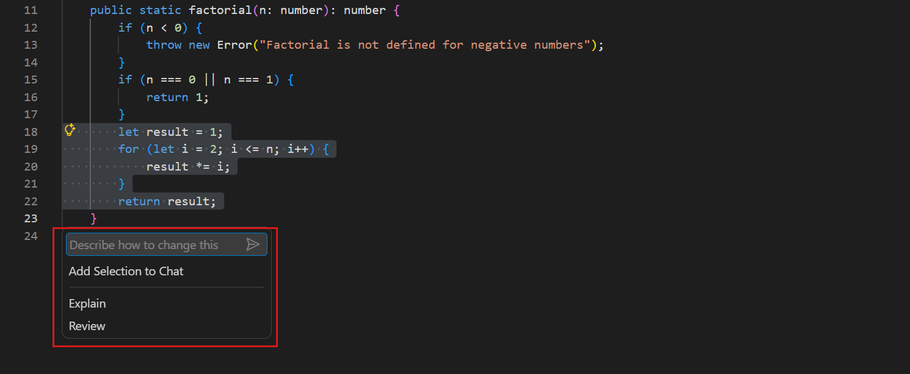
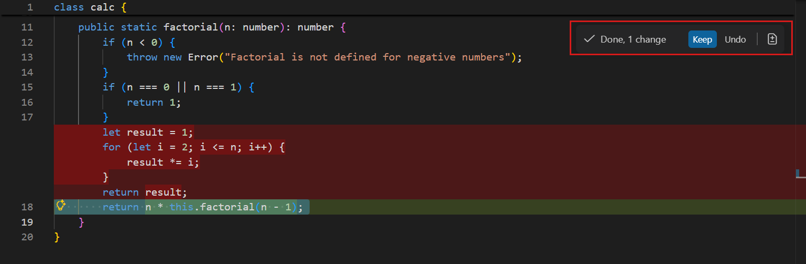
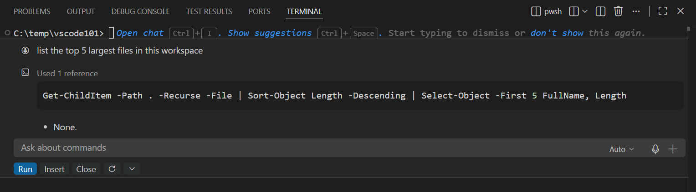

+++
title = "2.2.4 内联聊天和快速聊天"
date = 2026-11-06T07:53:25+08:00
weight = 4
type = "docs"
description = ""
isCJKLanguage = true
draft = false
+++

> 原文链接: [https://code.visualstudio.com/docs/chat/inline-chat](https://code.visualstudio.com/docs/chat/inline-chat)

# 2.2.4 内联聊天和快速聊天

　　内联聊天和快速聊天提供无需打开完整聊天视图即可与 AI 交互的轻量方式。使用内联聊天直接在编辑器中生成代码或进行编辑，或者在集成终端中获取 shell 命令帮助。使用快速聊天进行简短问题和交互。

　　当希望在可见代码上下文中快速进行有针对性的编辑时，请使用内联聊天。对于多步骤任务、多文件更改或更广泛的代码库探索，请改用[聊天视图](../2.2.2-ChatView/)。

## 使用编辑器内联聊天 {#use-editor-inline-chat}

　　使用编辑器内联聊天时，提示词的作用域是活动编辑器中的代码。内联聊天可能使用工作区中其他文件的内容作为提示词上下文。

要使用编辑器内联聊天：

1. 在编辑器中打开一个文件。

2. 使用 `Ctrl + I`（macOS：`Cmd + I`） 键盘快捷键打开编辑器内联聊天，或从标题栏的 **聊天** 菜单中选择 **打开内联聊天**。

3. 在聊天输入框中输入提示词，然后按 `Enter`。

    

    > **提示**：在编辑器中选择一段代码，将提示词限制在该代码范围内。

4. VS Code 会在编辑器中内联显示代码建议的差异。使用 **保留** 或 **撤销** 接受或拒绝更改。

    

### 活动编辑会话中的内联聊天 {#inline-chat-in-active-editing-sessions}

　　当文件属于活动的聊天编辑会话时，按 `Ctrl + I`（macOS：`Cmd + I`） 会打开聊天视图中的“在聊天中询问”，而不是常规内联聊天。这会将提示词路由到现有会话，使其可以使用完整对话上下文。对于这些文件，编辑器上下文菜单也会显示 **在聊天中询问**，而不是 **打开内联聊天**。

　　要始终使用常规内联聊天，即使文件属于聊天会话，请将 `inlineChat.askInChat` 设置为 `false`。

　　对于不属于任何聊天会话的文件，`Ctrl + I`（macOS：`Cmd + I`） 始终打开常规内联聊天，无论该设置如何。

### 在文本选择上显示视觉提示（实验性） {#show-a-visual-hint-on-text-selection-experimental}

　　在编辑器中选择文本时，VS Code 可以显示视觉提示，帮助你为所选代码启动内联聊天。使用 `inlineChat.affordance` 设置控制提示的显示方式：

* `off`：选择文本时不显示提示。
* `editor`：提示显示在选择区域内的光标位置，并与代码操作灯泡集成。

　　提示会显示一个内联聊天输入框，以及将选择添加到聊天、解释代码和启动所选代码审查的操作。

## 使用终端内联聊天 {#use-terminal-inline-chat}

　　可以在[集成终端](../../../terminal/5.2-TerminalBasics/)中打开终端内联聊天，以获取 shell 命令帮助或询问终端相关问题。

要使用终端内联聊天：

1. 通过选择 **视图** > **终端** 菜单项，或使用 `Ctrl + 反引号` 快捷键，在 VS Code 中打开终端。

2. 使用 `Ctrl + I`（macOS：`Cmd + I`） 键盘快捷键启动终端内联聊天，或在命令面板中运行 **Terminal Inline Chat** 命令。

3. 在聊天输入框中输入提示词，然后按 `Enter`。

    

4. 审查响应，并选择 **运行** 在终端中执行命令。

    也可以选择 **插入**，将命令插入终端并在运行前修改。

## 更改内联聊天的模型 {#change-the-model-for-inline-chat}

　　可以更改编辑器内联聊天使用的语言模型。要配置内联聊天的默认模型，请使用 `inlineChat.defaultModel` 设置。该设置列出模型选择器中的所有可用模型。

　　如果在内联聊天会话期间更改模型，选择会在该会话剩余时间内保持有效。重新加载 VS Code 后，模型会重置为 `inlineChat.defaultModel` 设置中指定的值。

　　详细了解[为任务选择合适的模型](../../concepts/2.7.2-HowModelsWork/#model-selection)。

## 使用快速聊天 {#use-quick-chat}

　　快速聊天提供一个轻量聊天面板，在编辑器顶部打开。可用于快速问题和简短交互，无需打开完整聊天视图或离开当前工作流。

> **注意**：编辑器窗口中的快速聊天不同于[智能体窗口中的快速聊天](../2.2.3-AgentsWindow/#start-a-quick-chat)，后者是无工作区对话，出现在会话列表中。

要打开快速聊天，请按 `Ctrl + Shift + Alt + L`（macOS 上为 `Cmd + Shift + Alt + L`），或从标题栏的 **聊天** 菜单中选择 **快速聊天**。

　　输入提示词并按 `Enter` 获取响应。快速聊天支持与聊天视图相同的 `#` 提及和 `@` 提及来添加上下文。选择 **在聊天视图中打开** 按钮，在完整聊天视图中继续对话。

## 相关资源 {#related-resources}

* [在 VS Code 中使用聊天](../2.2.5-UseChat/)
* [向聊天提示词添加上下文](../2.2.7-AddPromptContext/)
* [审查 AI 生成的代码编辑](../2.2.8-ReviewAndRevertChanges/)
* [VS Code 中的 AI 语言模型](../../choose-models-and-agents/2.3.1-ChooseAndConfigureModels/)
