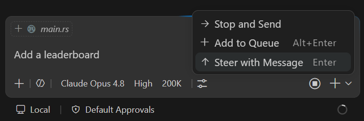
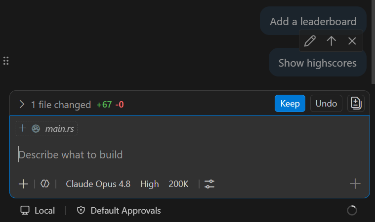
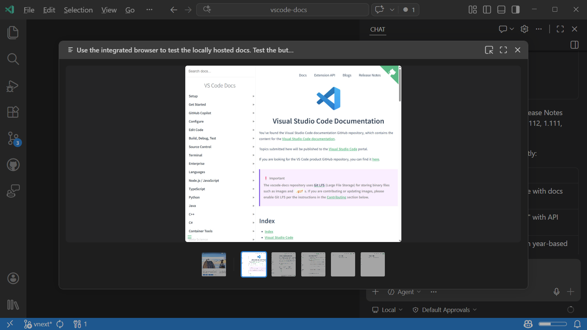

+++
title = "2.2.5 使用聊天"
date = 2026-11-06T07:53:25+08:00
weight = 5
type = "docs"
description = ""
isCJKLanguage = true
draft = false
+++


> 原文链接: [https://code.visualstudio.com/docs/chat/chat-overview](https://code.visualstudio.com/docs/chat/chat-overview)

# 2.2.5 使用聊天

　　VS Code 中的聊天让你用自然语言与 AI 智能体交互。你可以通过对话界面询问代码问题、理解复杂逻辑、生成新功能、修复错误等。

　　本文介绍 VS Code 中聊天界面共用的交互机制，包括发送和引导请求、添加上下文、生成和编辑图像、浏览对话以及个性化聊天显示。关于 AI 工作流、智能体和可用界面的介绍，请参阅[使用 AI 构建](../)。

## 选择聊天位置 {#choose-where-to-chat}

　　本文中的交互机制适用于聊天视图、聊天编辑器选项卡和智能体窗口。聊天视图和智能体窗口都可以运行智能体。要在当前工作区中围绕代码协作与跨项目协调工作之间选择，请参阅[选择你的工作方式](../../#choose-how-you-work)。

　　对于轻量交互，请使用[内联聊天](../2.2.4-InlineChatAndQuickChat/)就地编辑代码或获取终端建议，或打开[快速聊天](../2.2.4-InlineChatAndQuickChat/#use-quick-chat)进行临时对话。

## 发送聊天请求 {#send-a-chat-request}

　　在聊天输入框中输入消息，按 `Enter` 或选择 **发送** 按钮。智能体可以回答问题、分析代码、运行工具、进行更改并返回摘要。然后可以用后续消息继续对话。例如，可以要求智能体进行以下更改：

```text
为注册表单添加输入验证
```

　　如需免提交谈，请从聊天输入框启动[语音模式](../../../editor/3.3-ConfigureTheEditor/3.3.9-Accessibility/3.3.9.2-Voice/#use-voice-mode)。语音模式会监听后续请求并朗读智能体的响应。*（语音模式为实验性功能。）*

　　要提供额外的项目专用上下文，可以使用 `#` 提及引用文件、符号或其他信息来[为提示词添加上下文](#add-context-to-your-prompts)。

　　对于常见任务，可以使用斜杠命令作为常用提示词的快捷方式，或调用[智能体技能](../../customize-and-extend/2.4.3-AgentSkills/)。在聊天输入框中输入 `/` 查看所有可用命令。

　　可以并行运行多个会话，并在不丢失上下文的情况下切换。详细了解[管理智能体会话](../sessions/2.2.11.1-ManageSessions/)。

　　每个会话都有控制智能体响应方式的选项：**会话目标**、**智能体**、**语言模型** 和 **权限**。了解如何[比较智能体运行框架](../../choose-models-and-agents/2.3.2-ChooseAnAgentHarness/#compare-agent-harnesses)以及[为会话选择一个](../../choose-models-and-agents/2.3.2-ChooseAnAgentHarness/#select-a-harness)。

> **提示**：要获得最佳结果，请具体说明想要什么、提供相关上下文并编写清晰的指令。更多信息请参阅[获得更好的响应](#get-better-responses)。

## 从聊天运行终端命令 {#run-terminal-commands-from-chat}

　　以 `!` 开头发送消息，可以直接从聊天视图或智能体窗口运行终端命令。`!` 必须是第一个字符，并且后面必须跟命令。

例如，输入以下消息运行测试：

```shell
!npm test
```

　　命令会在会话的默认 shell 中立即运行，不会发送给智能体或请求批准。它使用会话文件夹或工作树作为工作目录。命令输出和退出状态会显示在聊天记录中。

> **注意**：Local 运行框架会话、云会话和基于扩展的智能体集成不支持 `!` 命令。请改用[集成终端](../../../terminal/5.2-TerminalBasics/)自行运行命令。

## 在请求运行期间发送消息 {#send-messages-while-a-request-is-running}

　　不必等待响应完成再发送下一条消息。请求进行期间，**发送** 按钮会变为下拉列表，为你提供三种处理新消息的方式。



* **添加到队列**：消息等待，并在当前响应完成后自动发送。当前响应会不中断地完成。
* **通过消息引导**：通知当前请求在完成当前工具执行后让出控制权。当前响应停止，新消息立即处理。用于在智能体方向错误时重定向。
* **停止并发送**：完全取消当前请求，并立即发送新消息。

　　停止请求不会撤销已完成的文件编辑、终端命令或其他操作。要恢复受影响的工作区文件和聊天历史，请[恢复检查点](../2.2.8-ReviewAndRevertChanges/#restore-a-checkpoint)。检查点不会撤销对外部服务所做的更改。

　　关于何时引导或停止请求以及如何编写有针对性的纠正，请参阅[让智能体回到正轨](../../tutorials-and-guides/2.6.9-GetBackOnTrack/#redirect-a-running-request)。

　　**发送** 按钮的默认操作可以配置。使用 `chat.requestQueuing.defaultAction` 将其设置为 `steer`（默认）或 `queue`。

### 重新排序待处理消息 {#reorder-pending-messages}

　　当有多条待处理消息（排队或引导）时，可以拖动它们来更改处理顺序。同一类型有多条待处理消息时，悬停会显示拖动手柄。



## 向提示词添加上下文 {#add-context-to-your-prompts}

　　提供正确的上下文有助于 AI 生成更相关、更准确的响应。

* **隐式上下文**：VS Code 可以包含或建议编辑器上下文，例如活动文件或选区。行为取决于界面、运行框架和上下文设置。请显式附加重要文件，不要假设打开文件就会将内容添加到请求中。了解[隐式上下文如何工作](../../concepts/2.7.3-Context/)。
* **`#` 提及**：在聊天输入框中输入 `#`，显式引用文件（`#file`）、文件夹、符号、代码库（`#codebase`）、终端输出（`#terminalSelection`）或 `#fetch` 等工具。
* **视觉**：附加图像，例如截图或 UI 模型稿，作为提示词上下文。
* **浏览器元素**：从[集成浏览器](../../../debugging-and-testing/6.5-IntegratedBrowser/)选择元素，将 HTML、CSS 和截图上下文添加到提示词。

　　详细了解[为 AI 管理上下文](../2.2.7-AddPromptContext/)。

## 生成和编辑图像（实验性） {#generate-and-edit-images-experimental}

　　可以直接在聊天中生成插图、UI 模型稿或其他图像资产。在 Copilot 运行框架会话中，智能体使用专用的图像生成模型，与对话选择使用的语言模型分开。

1. 确认 `chat.copilot.imageGeneration.model` 设置为图像生成模型。

2. 要求智能体生成图像。描述主题、风格和用途。例如：

    ```text
    为我的应用欢迎屏幕生成一幅宽幅山景插图。使用柔和色彩，并在左侧为标题留出空间。
    ```

3. 审查结果并发送后续请求编辑它：

    ```text
    改成夜晚，并添加几颗星星，同时保留标题所需的空间。
    ```

4. 在聊天中选择图像旁的 **保存**，将其下载到设备。

　　要编辑现有图像，请[将图像附加为上下文](../../../ai-in-vs-code/work-with-ai/2.2.7-AddPromptContext/)并描述更改。也可以要求生成多张图像，例如同一插图使用不同配色方案的三个版本。

　　图像生成需要访问图像模型，并遵循[工具权限控制](../permissions-and-security/2.2.12.1-ApprovalsAndPermissions/)。提示词和所选参考图像会发送给图像模型。生成和编辑会消耗 AI 点数，这些点数是在对话模型消耗之外额外产生的。请查看模型设置的当前费率，并展开图像生成工具调用以审查其 AI 点数使用量、持续时间和输入/输出使用情况。

　　要在生成或编辑的图像上显示“Made with AI”标签，请开启 `chat.copilot.imageGeneration.watermark`。该设置默认为 `false`，适用于新的和现有的 Copilot 会话，不会开启图像生成。图像模型负责生成标签，因此不保证出现。关闭该设置不会移除参考图像上的现有标签。

　　要关闭图像生成，请将 `chat.copilot.imageGeneration.model` 设置为 **关闭**。这会阻止未来的图像生成工具调用，但不会阻止智能体通过编写代码创建 SVG 或其他图形。

## 图像轮播 {#image-carousel}

　　可以在聊天响应中选择图像或视频，打开专用轮播视图。来自工具结果（例如集成浏览器、Playwright 或其他 MCP 服务器）以及助手消息中内联的媒体文件，都可以从轮播中访问。



　　要禁用图像轮播，请将 `imageCarousel.chat.enabled` 设置为 `false`。

## 审查和管理更改 {#review-and-manage-changes}

　　AI 修改文件后，在提交或整合之前审查并验证结果。在编辑器窗口的 Copilot 运行框架会话中，展开聊天输入框上方的工作集以审查跟踪的编辑，并使用 **保留** 或 **撤销**。这不需要 Git，但不会列出通过终端命令所做的编辑。**保留** 会清除已保存编辑的待审查状态。

　　也可以在响应中选择已更改的文件，打开其差异。在智能体窗口中，请使用 **更改** 面板而不是编辑器工作集。审查控件取决于运行框架和界面。

　　要通过键盘和屏幕阅读器访问差异，请使用[可访问差异查看器](../../../editor/3.3-ConfigureTheEditor/3.3.9-Accessibility/3.3.9.1-Accessibility/#diff-editor-accessibility)。

　　关于特定运行框架的审查控件、请求修订、恢复检查点以及整合文件夹或工作树更改，请参阅[审查 AI 生成的代码编辑](../2.2.8-ReviewAndRevertChanges/)。

## 获取聊天响应通知 {#get-notified-about-chat-responses}

　　在另一个窗口或应用程序中工作时，VS Code 可以发送操作系统通知，让你了解重要的聊天事件，无需频繁查看。

　　使用 `chat.notifyWindowOnResponseReceived` 配置收到聊天响应时发送操作系统通知的时机。通知包含响应预览，选择它会将焦点移到聊天会话。

　　使用 `chat.notifyWindowOnConfirmation` 配置智能体需要输入或确认才能继续时发送通知的时机。

　　两个设置都有三个值：

* `off`：从不显示通知。
* `windowNotFocused`（默认）：仅在 VS Code 窗口未聚焦时显示。
* `always`：即使 VS Code 窗口已聚焦也显示。

> **提示**：如果希望在其他 VS Code 区域工作时仍了解聊天活动，例如在后台运行长时间智能体任务，请将值设置为 `always`。

## 在聊天会话中查找文本 {#find-text-in-a-chat-session}

　　按 `Ctrl + F` 搜索整个对话。查找功能在聊天视图、聊天编辑器选项卡和智能体窗口中可用。它会搜索提示词和响应，包括屏幕外内容和代码块。

　　使用 `F3` 和 `Shift + F3` 在匹配项之间导航。当匹配项位于折叠的 **已完成 N 个步骤** 区域中时，导航到它会展开该区域。使用 **匹配大小写**、**全字匹配** 和 **正则表达式** 选项细化结果。

> **注意**：快速聊天和内联聊天不支持查找。它不会搜索工具胶囊或折叠推理中的文本。

## 在聊天会话中的提示词之间导航 {#navigate-between-prompts-in-a-chat-session}

使用以下键盘快捷键在聊天会话中的提示词之间导航：

* **上一个用户提示词**：转到聊天会话中的上一个提示词。
* **下一个用户提示词**：转到聊天会话中的下一个提示词。
* **上一个代码块**：转到聊天会话中的上一个代码块。
* **下一个代码块**：转到聊天会话中的下一个代码块。

　　要使用键盘或屏幕阅读器逐字符或逐行检查聊天响应，请运行 **打开可访问视图**（`Alt + F2`）。详细了解[可访问视图](../../../editor/3.3-ConfigureTheEditor/3.3.9-Accessibility/3.3.9.1-Accessibility/#accessible-view)。

## 个性化聊天 {#personalize-chat}

　　调整聊天内容的显示方式、添加交互式宠物，或在智能体窗口中设置装饰性背景。

### 自定义聊天显示 {#customize-the-chat-display}

使用以下设置调整聊天记录：

| 显示选项 | 设置 |
|----------------|----------|
| Markdown 字体 | 使用 `chat.fontFamily` 设置字体系列，使用 `chat.fontSize` 设置字号。 |
| 代码块字体和布局 | 使用 `chat.editor.fontFamily`、`chat.editor.fontSize`、`chat.editor.fontWeight` 和 `chat.editor.lineHeight` 设置字体系列、字号、字重和行高。使用 `chat.editor.wordWrap` 控制换行。 |
| 粘性提示词 | 使用 `chat.stickyScroll.enabled` 在滚动时将当前提示词固定在记录顶部。 |
| 请求时间戳 | 使用 `chat.verbose` 显示或隐藏请求和完成时间戳。将鼠标悬停在完成时间戳上可查看响应用时。 |
| 持续进度（实验性） | 使用 `chat.persistentProgress` 让进度指示器保持可见，直到智能体响应完成。选择彩色或单色 **Draw** 动画，或关闭指示器。 |

　　要调整推理和工具调用详情，请在聊天视图中选择 **更多操作** > **查看模式**，或使用 `chat.persistentProgressVerbosity`（实验性）。**紧凑**（默认）会在工具调用运行时预览并折叠已完成的组，**详细** 会保持工具调用展开，**对话** 会将推理和工具调用分组到折叠区域。

　　持续进度默认为 **Draw**。当持续进度为 **关闭** 时，详细程度设置无效。

　　更多聊天首选项请参阅 [AI 设置参考](../../reference-and-help/reference/2.8.1.3-SettingsReference/#chat-experience)。

### 自定义智能体窗口聊天背景 {#customize-the-agents-window-chat-background}

　　为智能体窗口的聊天区域添加装饰性背景，而不更改主 VS Code 窗口中的聊天。

要设置背景，请从命令面板（`Ctrl + Shift + P`）运行 **Chat: Set Background...** 命令，或右键单击聊天空白区域。然后选择：

* **无背景**：移除当前颜色主题的背景。
* **Codicons**：使用主题感知的内置 VS Code 图标图案。
* **图像...**：从计算机选择图像。
* **最近使用**：复用最近五张背景图像之一。

　　对于图像背景，运行 **Chat: Change Background Layout...**，为当前颜色主题设置重复、拉伸、居中或沿边缘/角落定位。浏览布局选项时会预览每种效果。选择选项保存，或关闭选择器恢复之前的布局。

> **注意**：浅色和深色主题有独立的背景和图像布局。这些选择存储在当前计算机上，不会跨设备同步。

　　在高对比度主题中背景会隐藏，以保持聊天可读性。高对比度主题激活时，背景命令也不可用。

#### 生成聊天背景（实验性） {#generate-a-chat-background-experimental}

　　可以通过文本描述生成背景，而不必自己寻找图像。请[配置图像生成](#generate-and-edit-images-experimental)，并保持 `chat.agentSessions.appearanceTools.enabled` 开启。

　　在智能体窗口的 Copilot 运行框架会话中，要求智能体生成图像并将其应用为聊天背景。例如：

```text
生成一幅柔和的山景，并将其设置为我的聊天背景。
```

　　如果没有指定颜色，智能体会以当前主题为指导，并尽量保持聊天消息可读。提示词中显式指定的颜色和设计偏好优先于主题。

> **注意**：图像生成需要访问所选模型，并会消耗 AI 点数，这些点数在对话模型使用量之外。浏览器版智能体窗口不支持此工作流。

## 获得更好的响应 {#get-better-responses}

聊天提供多种提高 AI 响应质量和相关性的方式：

* **编写有效的提示词**：具体说明需求，引用相关文件和符号，并使用 `/` 命令处理常见任务。可以从[提示词示例](../../tutorials-and-guides/2.6.15-PromptExamples/)获取灵感，或阅读完整的[提示词工程指南](../../getting-started/2.1.6-BestPractices/)。
* **自定义 AI**：通过添加[自定义指令](../../customize-and-extend/2.4.4-Instructions/)、创建可复用的[提示词文件](../../customize-and-extend/2.4.10-PromptFiles/)或为专门工作流构建[自定义智能体](../../customize-and-extend/2.4.5-CustomAgents/)，让 AI 适应项目。例如，创建一个“代码审查者”智能体，对代码质量和团队编码标准提供反馈。
* **扩展工具**：连接 [MCP 服务器](../../customize-and-extend/2.4.7-AddMCPServers/)或安装贡献工具的扩展，让智能体可以访问外部服务、数据库或 API。

　　更多信息请参阅[在 VS Code 中自定义智能体行为](../../customize-and-extend/2.4.1-Overview/)。

## 排查聊天交互问题 {#troubleshoot-chat-interactions}

　　使用[智能体日志和聊天调试视图](../../reference-and-help/troubleshooting/2.8.2.2-DebugChatInteractions/)检查发送提示词时发生的情况。智能体日志按时间顺序显示工具调用、LLM 请求和提示词文件发现事件。聊天调试视图显示每次交互的原始系统提示词、用户提示词、上下文和工具负载。这些工具有助于理解 AI 为什么以某种方式响应，或排查意外结果。

## 支持 {#support}

　　GitHub Copilot Chat 的支持由 GitHub 提供，可访问 <https://support.github.com>。

　　要了解 Copilot 的安全性、隐私、合规性和透明度，请参阅 [GitHub Copilot 信任中心常见问题](https://copilot.github.trust.page/faq)。

## 相关资源 {#related-resources}

* [创建和管理智能体会话](../sessions/2.2.11.1-ManageSessions/)
* [选择智能体运行框架](../../choose-models-and-agents/2.3.2-ChooseAnAgentHarness/)
* [提示词示例](../../tutorials-and-guides/2.6.15-PromptExamples/)
