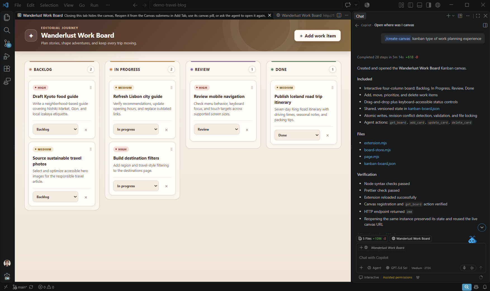

+++
title = "2.2.6 画布"
date = 2026-11-06T07:53:25+08:00
weight = 6
type = "docs"
description = ""
isCJKLanguage = true
draft = false
+++


> 原文链接: [https://code.visualstudio.com/docs/agents/run/canvases](https://code.visualstudio.com/docs/agents/run/canvases)

# 2.2.6 画布

　　画布是交互式可视化界面，你和智能体可以在 VS Code 中共同使用。例如在 Kanban 板上规划工作、检查智能体更新的图表，或调整会将值反馈给智能体的控件。你可以直接与画布交互，而不必在聊天中描述每个更改。

　　每个画布都由画布扩展提供。本指南介绍如何查找画布、在 Copilot 会话中打开它，以及管理其扩展。



## 前提条件 {#prerequisites}

　　画布目前需要智能体会话，不能独立于会话打开。画布适用于 VS Code 桌面版中使用 Copilot 运行框架的会话。对于在本机托管的会话，可以在聊天视图和智能体窗口中使用；智能体窗口还支持远程智能体宿主上的画布。

1. 开启 `chat.canvases.enabled`。
2. 启动新会话并选择 Copilot 运行框架。画布设置的更改应用于新创建的会话。
3. 发送第一条消息初始化会话，然后打开画布菜单或管理画布扩展。

> **注意**：Claude、Codex、Local 运行框架会话、浏览器客户端和辅助窗口不支持画布。

### 在远程智能体宿主上使用画布 {#use-canvases-on-a-remote-agent-host}

1. 在 VS Code 中开启 `chat.canvases.enabled` 和 `workbench.browser.enableRemoteProxy`。
2. 连接到远程宿主，启动新的 Copilot 会话并发送消息。
3. 要求智能体打开该主机上扩展提供的画布。

## 获取画布 {#get-a-canvas}

### 安装画布扩展 {#install-a-canvas-extension}

1. 在 Copilot 会话处于活动状态时，从命令面板运行 **Chat: Open Customizations**，或在智能体窗口侧边栏选择 **自定义项**。
2. 选择 **浏览**，然后选择 **画布** 筛选结果。筛选会列出元数据标识为画布提供程序的插件。
3. 选择一个插件，审查发布者和内容，然后选择 **安装**。

### 为项目创建画布 {#create-a-canvas-for-your-project}

　　如果会话中提供 `/create-canvas` 技能，请在聊天中输入该命令并描述所需界面。该技能会创建工作区画布扩展并打开其画布。例如：

```text
/create-canvas 为此项目创建一个 Kanban 板，包含 Backlog、In progress 和 Done 列。
```

## 打开画布 {#open-a-canvas}

　　要求智能体列出可用画布并打开一个。对于不需要输入的画布，也可以：

| 位置 | 操作 |
|----------|--------|
| 任一窗口的聊天输入框 | 选择 **添加上下文 (+)** > **画布...**。 |
| 聊天视图标题栏 | 选择 **新建聊天 (+)** > **画布**。 |
| 智能体窗口编辑器区域 | 选择 **添加选项卡 (+)** > **画布**。 |
| 智能体自定义项编辑器 | 选择 **画布**，双击标记为 **可打开** 的画布。 |

　　标记为 **需要输入** 的画布必须由智能体打开并提供必要信息。

## 与画布交互 {#interact-with-a-canvas}

* **直接交互**：使用画布控件检查或更改内容，例如在 Kanban 板上创建卡片或移动卡片。
* **要求智能体更改**：在聊天中描述要更新的内容，智能体可以使用画布公开的操作检查或更新状态。
* **返回画布**：扩展支持时，可以关闭并重新打开活动画布。

　　根据扩展不同，你的交互也会更新智能体会话。

## 管理画布扩展 {#manage-canvas-extensions}

1. 选择活动的本地 Copilot 会话，打开智能体自定义项编辑器。
2. 选择 **画布**。
3. 展开用户、工作区、插件或其他来源组，然后展开扩展以查看其画布。
4. 使用更多操作打开扩展源文件夹，或查看插件详情。
5. 使用扩展开关启用或禁用扩展。开关作用于整个扩展，而不是单个画布。工作区扩展不能在此编辑器中开启或关闭。

## 故障排除 {#troubleshooting}

| 问题 | 检查内容 |
|---------|---------------|
| 不显示画布菜单 | 检查 `chat.canvases.enabled`，启动新的 Copilot 会话并发送消息。安装画布扩展。远程宿主还需检查 `workbench.browser.enableRemoteProxy`。 |
| 提示画布仅在会话中可用 | 选择活动的本地 Copilot 会话，然后重新打开智能体自定义项编辑器。 |
| 画布标记为需要输入 | 要求智能体打开并提供所需信息。不能直接从列表打开。 |
| 扩展已列出但画布无法打开 | 检查扩展是否已关闭。扩展关闭后，最近已知条目可能仍然可见。 |

## 相关资源 {#related-resources}

* [示例画布扩展](https://awesome-copilot.github.com/extensions/)
* [在 GitHub Copilot 应用中使用画布扩展](https://docs.github.com/en/copilot/how-tos/github-copilot-app/working-with-canvas-extensions)
