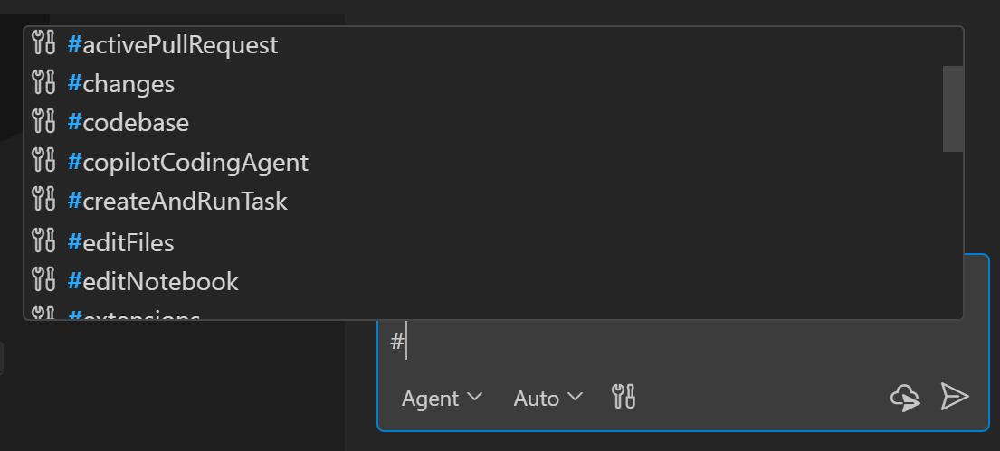

+++
title = "2.2.7 为提示词添加上下文"
date = 2026-11-06T07:53:25+08:00
weight = 7
type = "docs"
description = ""
isCJKLanguage = true
draft = false
+++

> 原文链接: [https://code.visualstudio.com/docs/chat/copilot-chat-context](https://code.visualstudio.com/docs/chat/copilot-chat-context)

# 2.2.7 为提示词添加上下文

　　提供相关上下文有助于 AI 给出更准确的响应。当你希望 AI 考虑特定细节时，可以将文件、文件夹、符号、图像、Web 内容和其他信息直接添加到提示词中。

> **注意**：除非另有说明，本页功能同时适用于聊天视图和智能体窗口。

　　关于上下文是什么以及 VS Code 如何组装上下文，请参阅[上下文概念](../../concepts/2.7.3-Context/)。

## `#` 提及 {#-mentions}

　　可以通过输入 `#` 后跟要提及的上下文项，显式向提示词添加上下文。VS Code 支持不同类型的上下文项：文件、文件夹、代码符号、工具、终端输出、源代码管理更改等。

　　在聊天输入框中输入 `#` 查看可用上下文项列表，或在聊天视图中选择 **添加上下文**（`+` 图标）打开上下文选择器。

　　关于工具名称和上下文引用，请参阅[工具和上下文参考](../../reference-and-help/reference/2.8.1.2-ToolsAndContext/)。

### 将文件添加为上下文 {#add-files-as-context}

　　智能体可以使用工作区搜索和文件读取工具收集相关上下文。工作区索引有助于定位代码，但不会将每个文件都附加到对话中。当你知道智能体应考虑哪些来源时，请使用 `#` 提及或上下文选择器添加特定文件、文件夹或符号。

要将特定文件、文件夹或符号作为上下文，请使用以下方法将它们添加到聊天：

* 在聊天消息中输入 `#` 后跟文件、文件夹或符号名称，以提及它们。要引用符号，请先在编辑器中打开包含该符号的文件。

* 从资源管理器视图、搜索视图或编辑器选项卡拖动文件或文件夹到聊天视图，将其添加为上下文。

* 选择 **添加上下文**（`+` 图标），然后选择 **文件** 从磁盘选择文件，或选择 **符号** 选择代码符号。

　　使用 `#codebase` 请求在工作区中搜索相关代码。它不会将整个代码库添加到模型上下文。了解[工作区搜索和索引](../../reference-and-help/reference/2.8.1.11-AgentHostArchitecture/)。

#### 从磁盘附加文件 {#attach-files-from-disk}

　　使用文件选择器附加工作区之外的文件，例如桌面上的截图或 UI 模型稿。无需将其文件夹添加到工作区，也不需要先打开工作区。

1. 在聊天输入框中选择 **添加上下文**（`+` 图标）> **文件**。
2. 选择一个或多个文件，包括文本文件或支持的图像，然后选择 **附加**。
3. 确认附件出现在聊天输入框中，然后输入关于它们的提示词。

　　如果所选会话仅支持图像附件，**文件** 会将选择器筛选为支持的图像。它不会为这些会话启用普通本地文件传输。

　　在沙盒 Copilot 运行框架会话中，附加文件可以为会话授予读取权限，而无需更改沙盒设置。它不会授予写入权限，也不会覆盖组织限制。请参阅[读取附加的文件和文件夹](../permissions-and-security/2.2.12.2-AgentSandboxing/#read-attached-files-and-folders)。

### 添加项目和 GitHub 上下文 {#add-project-and-github-context}

　　在智能体窗口中启动会话时，你选择的第一个文件夹或仓库是主执行工作区。它决定智能体运行和更改文件的位置。

可以将项目和 GitHub 上下文附加到请求：

* 在智能体窗口中，选择 **文件夹** 或 **仓库** 附加另一个项目。附加的项目提供请求上下文，不会成为另一个工作区根目录。
* 在任何聊天输入框中，选择 **添加上下文**（`+` 图标），然后选择 **议题...** 或 **拉取请求...**。如果有多个 GitHub 仓库可用，请先选择仓库，再选择议题或拉取请求。
* 将 GitHub 议题或拉取请求 URL 直接粘贴到提示词中。URL 会保留在提示词中，VS Code 会自动将该项添加为上下文附件。

　　可以附加多个项目。附件会保留在草稿中，并在发送请求时包含。详细了解[在智能体窗口中启动智能体会话](../2.2.3-AgentsWindow/#start-an-agent-session)。

### 引用 Web 内容 {#reference-content-from-the-web}

　　可以在聊天提示词中引用 Web 内容，例如获取最新 API 参考或代码示例。

　　可以直接在提示词中包含 URL 以获取该网页的信息，或使用 `#fetch` 工具表示要从 Web 检索内容。例如：

* `“最新 VS Code 版本有哪些亮点 #fetch”`
* `“将 asp.net 应用更新到 .net 9 #fetch https://learn.microsoft.com/en-us/aspnet/core/migration/80-90”`

　　VS Code 会在有限时间内缓存网页内容以提高性能。如果页面内容发生变化，可以重启 VS Code 强制刷新。如果无法访问页面，缓存会在一小段时间后过期（约五分钟）。

　　VS Code 在访问外部 URL 之前会请求确认，以保护隐私和安全。详细了解[配置 URL 自动批准](../permissions-and-security/2.2.12.1-ApprovalsAndPermissions/#url-approval)。

　　详细了解[在智能体中使用工具](../plan-and-run-tasks/2.2.10.2-UseTools/)。

## `@` 提及 {#-mentions-1}

　　使用 `@name` 调用的聊天参与者已弃用，Copilot 运行框架不支持它们。它们仍可用于 Local 运行框架兼容性。

　　直接向 Copilot 询问代码、终端输出或编辑器设置，并附加相关上下文。对于领域专用集成，请使用带技能和 MCP 工具的插件，或在需要编辑器上下文时使用扩展工具。请参阅[替换聊天参与者](../../customize-and-extend/2.4.11-MigrateExistingCustomizations/#replace-chat-participants)。

## 视觉 {#vision}

　　聊天支持视觉能力，因此可以将图像作为上下文附加到聊天提示词并提问。例如，附加一段代码的截图并请求解释，或附加 UI 草图并要求智能体实现。

　　视觉功能分析图像输入，不生成图像输出。要创建图像或编辑现有图像，请在 Copilot 运行框架会话中使用[图像生成](../2.2.5-UseChat/#generate-and-edit-images-experimental)。

> **提示**：可以从 Web 浏览器将图像拖放到聊天视图，将其添加为上下文。

## 添加浏览器上下文 {#add-browser-context}

　　使用[集成浏览器](../../../debugging-and-testing/6.5-IntegratedBrowser/)预览网页，并将当前页面的信息附加到提示词。

　　浏览器工具栏有一个 **添加到聊天** 拆分按钮，可将当前页面的不同类型上下文附加到聊天提示词：

* **将元素添加到聊天**：从页面选择 HTML 元素作为上下文，包括其 CSS 样式和截图。
* **将截图添加到聊天**：捕获当前浏览器视口的截图并作为图像附加。
* **将控制台日志添加到聊天**：捕获页面的控制台输出，作为调试运行时错误的上下文。

　　了解如何[向聊天添加浏览器上下文](../../../debugging-and-testing/6.5-IntegratedBrowser/#add-context-to-ai-chat)。要允许智能体与页面交互，而不是将其作为提示词上下文附加，请参阅[智能体浏览器工具](../../../debugging-and-testing/6.5-IntegratedBrowser/#browser-tools-for-agents)。

## 相关资源 {#related-resources}

* [使用聊天视图](../2.2.2-ChatView/)
* [管理智能体会话](../sessions/2.2.11.1-ManageSessions/)
* [提示词示例](../../tutorials-and-guides/2.6.15-PromptExamples/)
* [提示词工程指南](../../getting-started/2.1.6-BestPractices/)
* [调试聊天交互](../../reference-and-help/troubleshooting/2.8.2.2-DebugChatInteractions/)
* [使用缓存浏览器诊断提示词缓存](../../reference-and-help/troubleshooting/2.8.2.3-DiagnosePromptCaching/)
