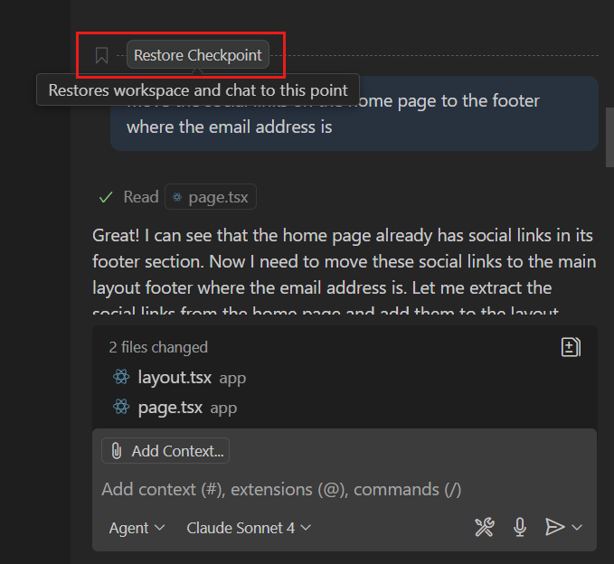

+++
title = "2.2.8 审查和还原更改"
date = 2026-11-06T07:53:25+08:00
weight = 8
type = "docs"
description = ""
isCJKLanguage = true
draft = false
+++


> 原文链接: [https://code.visualstudio.com/docs/agents/run/review-code-edits](https://code.visualstudio.com/docs/agents/run/review-code-edits)

# 2.2.8 审查和还原更改

　　本指南介绍如何在文件夹、工作树或云会话中审查智能体更改、请求修订并撤销不需要的编辑。

## 选择审查方式 {#choose-your-review-approach}

　　可以通过差异审查智能体更改。根据运行框架和窗口不同，工作集还可以让你保留或撤销单个更改、文件或所有待处理编辑。使用下表找到适用于你的设置的审查控件。

| 设置 | 主要审查方式 |
|-------|-------------------------|
| 编辑器窗口中的 GitHub Copilot 运行框架 | [在工作集中审查待处理编辑](#review-pending-edits-with-the-working-set)。也可以[比较差异](#review-changes-by-comparing-diffs)。 |
| 编辑器窗口中的 Claude 或 Codex 运行框架 | [在差异中比较已保存的更改](#compare-editor-session-changes)。 |
| 智能体窗口 | [在 **更改** 视图中比较差异](#review-changes-in-the-agents-window)。 |
| 云会话 | [审查拉取请求差异](#review-sessions-and-cloud-pull-requests)。 |
| Local 运行框架 | [审查待处理编辑](#review-pending-edits-with-the-working-set)。另请参阅 [Local 特定行为](#local-harness-specific-behavior)。 |

　　要检查会话使用的运行框架，请参阅[识别当前智能体运行框架](../../choose-models-and-agents/2.3.2-ChooseAnAgentHarness/#identify-your-current-harness)。

　　智能体可以通过编辑工具、终端命令、脚本和 MCP 工具更改文件。提交或整合之前，请审查生成的文件，包括可能不会出现在工具专用列表中的更改。

　　要使用键盘和屏幕阅读器访问差异，请使用[可访问差异查看器](../../../editor/3.3-ConfigureTheEditor/3.3.9-Accessibility/3.3.9.1-Accessibility/#diff-editor-accessibility)，它以统一补丁格式呈现更改。

## 使用工作集审查待处理编辑 {#review-pending-edits-with-the-working-set}

　　在编辑器窗口中使用 Copilot 和 Local 运行框架会话时，受支持的文件编辑会作为待审查（工作集）进行跟踪。**保留** 会保留更改并清除其待审查状态。**撤销** 会还原它们，但不会回退智能体对话。

　　待处理编辑已经保存到磁盘，因此运行应用或测试会使用已更改的文件。审查不需要 Git，**保留** 也不会暂存或提交更改。

要审查待处理编辑：

1. 从聊天视图的已更改文件列表打开文件。
2. 在编辑器中审查突出显示的更改。使用编辑器覆盖层中的向上和向下控件在编辑之间导航。
3. 在单个更改旁选择 **保留** 或 **撤销**，或使用文件级或所有文件审查控件一次处理多个待处理编辑。

　　在源代码管理视图中暂存更改会自动保留相应的待处理编辑。

> **注意**：工作集只跟踪受支持智能体编辑工具的更改。通过终端命令、脚本或其他未跟踪工具所做的更改不会出现。请单独审查这些更改，并在文件夹使用 Git 时使用源代码管理检查已更改和未跟踪文件。

### 配置审查控件 {#configure-review-controls}

* `chat.editor.workingSet.enabled`（仅 Copilot，实验性）：显示工作集。默认为 `true`。
* `chat.editing.revealNextChangeOnResolve`：设置为 `false`，在保留或撤销编辑后停留在当前更改，而不是导航到下一个待处理更改。

## 通过比较差异审查更改 {#review-changes-by-comparing-diffs}

　　对于编辑器窗口中的 Claude 或 Codex 运行框架会话、智能体窗口和云会话，请比较差异，而不是保留或撤销待处理编辑。

在编辑器窗口中，聊天输入框上方的胶囊会显示受影响文件数量和差异统计信息。Copilot 运行框架会话可以从工作集上下文菜单中选择 **显示胶囊** 使用此呈现方式。

使用以下任一审查选项：

* 选择已更改文件胶囊，打开包含所有更改的多文件差异编辑器。
* 在智能体响应中选择已更改文件，打开其差异。
* 在编辑器中，使用[源代码管理视图](../../../source-control/4.3-StagingCommits/)审查已更改和未跟踪文件（文件夹使用 Git 时）。

### 在智能体窗口中审查更改 {#review-changes-in-the-agents-window}

1. 使用标题栏中的布局控件，或使用 `Ctrl + Alt + B` 快捷键，在侧面板中打开 **更改** 视图。
2. 在 **更改** 视图中选择文件，打开智能体编辑的差异。

    **其他文件** 会分组显示工作区之外的编辑，例如会话计划，它们不会随工作区更改一起提交。还要检查源代码管理中的未跟踪文件以及在受跟踪编辑工具之外所做的更改。

    > **提示**：使用 **分支更改** 下拉列表选择要审查的更改集。

3. 在文件工具栏中选择 **标记为已审查**，跟踪 **分支更改** 更改集中已审查的文件。

　　如果文件再次被你或智能体更改，已审查状态会清除。

### 审查云更改 {#review-cloud-changes}

　　在 GitHub 上审查会话的拉取请求，或在本地检出其分支以检查和修订更改。

### 自定义智能体窗口中的更改审查 {#customize-change-review-in-the-agents-window}

　　默认情况下，在 **更改** 视图中选择文件会打开包含会话所有更改的多文件差异编辑器。要打开聚焦的单文件差异，请启用 `sessions.changes.openSingleFileDiff`。

　　使用差异工具栏在聊天旁或模态窗口中显示编辑器。选择 **更多操作**（**...**）> **差异视图**，选择 **内联**、**并排** 或 **自动**。**自动** 在编辑器太窄而无法并排显示时切换为内联。

#### 配置差异编辑器中的自动换行 {#configure-word-wrap-in-diff-editors}

　　使用 `sessions.diffEditor.wordWrap` 控制 **更改** 视图中的差异编辑器如何换行长行。此设置有以下值：

* `inherit`（默认）：遵循 `editor.wordWrap` 设置。
* `on`：在编辑器视口宽度处换行。
* `off`：从不换行。

　　此设置独立于[代码编辑器中的自动换行](../2.2.9-ConfigureTheAgentsWindow/#configure-word-wrap-for-code-editors)。

　　要从差异编辑器更改，请选择 **更多操作**（**...**）> **自动换行**。

## 提供反馈并请求修订 {#provide-feedback-and-request-revisions}

　　可以从任何审查工作流要求智能体修订工作。发送后续提示词、直接编辑文件，或在智能体窗口中提供内联反馈。

### 向智能体提供内联反馈 {#provide-inline-feedback-to-the-agent}

1. 在智能体窗口中，从 **更改** 视图打开文件。
2. 在差异中选择一段代码，并在内联评论框中输入反馈。
3. 按需为其他更改添加反馈，然后选择 **提交反馈**，将所有评论发送给智能体。

　　智能体会读取评论、进行请求的编辑并解决每条评论。已解决的评论会从差异视图中消失。

### 添加拉取请求审查评论 {#add-pull-request-review-comments}

　　在智能体窗口中，当会话使用 GitHub Copilot 或 Claude 运行框架，或使用[实验性 Codex 集成](../../choose-models-and-agents/2.3.2-ChooseAnAgentHarness/#codex)时，可以将审查评论发布到会话打开的 GitHub 拉取请求。

1. 启用 `chat.experimental.agentsWindowPRComments` 设置。
2. 从 **更改** 视图打开已更改文件，并选择一段代码。
3. 选择 **添加反馈**，输入评论。
4. 选择 **添加 PR 评论** 发布审查评论。如果会话关联多个拉取请求，操作会将目标标识为 `owner/repository#number`。

　　所选范围必须只包含拉取请求差异中的行。如果范围不符合条件，VS Code 会提示无法为该行添加拉取请求评论。

　　**添加 PR 评论** 会将评论发布到 GitHub，不会发送给智能体。要请求代码更改，请将评论添加为反馈并选择 **提交反馈**。

### 使用 Rubber Duck 获取第二意见 {#get-a-second-opinion-with-rubber-duck}

　　在 Copilot 运行框架会话中，Rubber Duck 使用互补模型审查计划、代码和测试中的实质性问题。它是只读的，不会编辑文件或运行会改变环境的命令。

　　运行框架可能在非平凡工作中自动咨询 Rubber Duck。要自行请求审查，请询问：

```text
对目前所做的更改给出第二意见。
```

　　也可以输入 `/rubber-duck <问题>`，例如 `/rubber-duck 缺少哪些边界情况？`。运行框架会总结批评意见并决定如何处理。

> **注意**：Rubber Duck 要求主会话使用 Claude 或 GPT 模型，并有可用的互补模型。额外的模型调用会增加延迟和模型用量。

　　详细了解 [Rubber Duck 智能体](https://docs.github.com/en/copilot/concepts/agents/copilot-cli/rubber-duck)。

## 在正确的范围撤销更改 {#undo-changes-at-the-right-scope}

根据要撤销的工作量选择恢复操作：

| 操作 | 适用于 | 效果 |
|--------|------------|--------|
| [**撤销** 待处理编辑](#review-pending-edits-with-the-working-set) | Copilot 编辑器工作集 | 还原单个更改、文件或所有待处理编辑，而不回退对话。 |
| [编辑之前的请求](#edit-a-previous-chat-request) | 支持请求编辑的会话 | 还原该请求及后续请求的文件更改，然后重新发送修订后的请求。 |
| [恢复检查点](#restore-a-checkpoint) | 有 **恢复检查点** 的会话 | 将受影响的工作区文件恢复到检查点，并移除后续对话轮次。 |
| [使用源代码管理放弃更改](../../../source-control/4.3-StagingCommits/#discard-changes) | 使用 Git 的文件夹 | 还原所选仓库更改，而不更改对话。 |
| 使用外部服务的恢复控制 | 部署、议题、数据库和其他外部状态 | 撤销检查点和 Git 无法控制的影响。 |
| [**撤销** 待处理编辑](#review-pending-edits-with-the-working-set) | Local 运行框架会话 | 还原单个更改、文件或所有待处理编辑，而不回退对话。 |

　　有关选择操作的帮助，请参阅[让智能体回到正轨](../../tutorials-and-guides/2.6.9-GetBackOnTrack/#choose-a-recovery-action)。

### 编辑之前的聊天请求 {#edit-a-previous-chat-request}

　　在支持请求编辑的会话中，可以编辑对话历史中的之前请求。VS Code 会还原该请求及后续请求所做的文件更改，然后将更新后的请求发送给语言模型。

　　重新发送请求之前，请审查受影响的更改，了解将移除哪些工作。在对话中选择请求，修改并重新发送。使用 `chat.editRequests` 配置或关闭请求编辑。

<video src="https://code.visualstudio.com/assets/docs/agents/chat-checkpoints/chat-edit-request.mp4" title="视频展示在聊天视图中编辑之前的聊天请求。" loop controls muted></video>

### 恢复检查点 {#restore-a-checkpoint}

　　支持的聊天会话默认启用检查点。处理每个请求之前，VS Code 会创建受影响工作区文件的快照。使用 `chat.checkpoints.enabled` 控制检查点。

要将工作区恢复到较早的检查点：

1. 在对话中导航到之前的请求。
2. 将鼠标悬停在该请求上，选择 **恢复检查点**。

    

3. 确认要恢复检查点。

　　VS Code 会从对话历史中移除后续请求，并将工作区文件恢复到检查点时的状态。

> **重要**：检查点会恢复受影响的工作区文件和聊天历史。它不会撤销已完成的终端命令、网络请求、部署或工具对外部服务所做的更改。对于这些影响，请使用 Git 和外部服务的恢复控制。

## 在敏感编辑前要求批准 {#require-approval-before-sensitive-edits}

　　敏感文件批准发生在智能体保存编辑之前，而不是审查期间。使用 `chat.tools.edits.autoApprove` 和 glob 模式，要求对敏感文件的编辑提供差异并批准。

以下示例自动批准编辑，但 `.vscode` 文件夹中的 JSON 文件和名为 `.env` 的文件除外：

```json
"chat.tools.edits.autoApprove": {
  "**/*": true,
  "**/.vscode/*.json": false,
  "**/.env": false
}
```

## Local 运行框架的特定行为 {#local-harness-specific-behavior}

　　Local 运行框架会话和现有扩展宿主会话使用[共享审查流程](#review-pending-edits-with-the-working-set)。在这些会话中，在源代码管理中放弃更改也会放弃其待处理编辑。

### 自动接受编辑 {#auto-accept-edits}

　　对于 Local 运行框架会话，使用 `chat.editing.autoAcceptDelay` 在可配置延迟后自动保留待处理编辑。将鼠标悬停在编辑器覆盖层控件上可停止倒计时。

> **重要**：如果自动保留所有编辑，请在源代码管理中提交之前审查更改。详细了解[在 VS Code 中使用 AI 的安全注意事项](../permissions-and-security/2.2.12.3-AISecurity/)。

## 相关资源 {#related-resources}

* [委派两个任务而不混合更改](../../tutorials-and-guides/2.6.8-RunParallelTasks/)
* [智能体会话](../sessions/2.2.11.1-ManageSessions/)
* [在 VS Code 中使用 AI 的安全注意事项](../permissions-and-security/2.2.12.3-AISecurity/)
