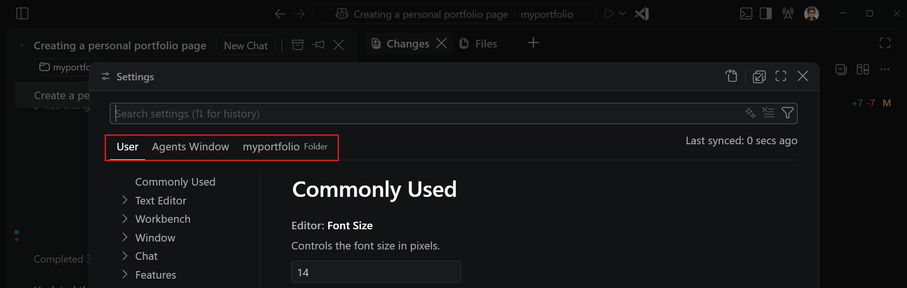
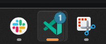

+++
title = "2.2.9 配置智能体窗口"
date = 2026-11-06T07:53:25+08:00
weight = 9
type = "docs"
description = ""
isCJKLanguage = true
draft = false
+++


> 原文链接: [https://code.visualstudio.com/docs/agents/run/agents-window-configuration](https://code.visualstudio.com/docs/agents/run/agents-window-configuration)

# 2.2.9 配置智能体窗口

　　智能体窗口使用 VS Code 中配置的 AI 提供商和账户，并与主 VS Code 窗口共享设置和默认配置文件。本文介绍共享账户选项以及窗口专用的布局、编辑器、设置和扩展配置。

　　关于启动和使用会话的说明，请参阅[使用智能体窗口](../2.2.3-AgentsWindow/)。

## 管理 AI 提供商和账户 {#manage-ai-providers-and-accounts}

　　智能体窗口使用 VS Code 中可用的账户和模型凭据：

* **GitHub Copilot**：选择右上角的账户图标，然后登录 GitHub。要切换账户，请退出登录，然后使用其他 GitHub 账户进行身份验证。
* **Claude**：为 Claude 配置 Claude API 密钥或其他受支持的 BYOK 选项。
* **Codex**：选择账户图标，然后选择 **登录 ChatGPT**。
* **自带密钥（BYOK）**：在语言模型编辑器中添加模型，并启用 `chat.agentHost.byokModels.enabled`，使其在桌面版智能体窗口中可用。了解如何[配置 BYOK 模型](../../choose-models-and-agents/2.3.1-ChooseAndConfigureModels/#bring-your-own-language-model-key)。

　　关于账户要求、计费选项和集成设置，请参阅[智能体运行框架要求和设置](../../choose-models-and-agents/2.3.2-ChooseAnAgentHarness/#requirements-and-setup)。

> **注意**：当 [GitHub Copilot 企业托管设置生效](../../../enterprise/7.2-ManageAISettings/#claude-and-codex-availability)时，即使使用单独的提供商凭据，Claude 和 Codex 运行框架也会被禁用。请联系部署设置的 IT 团队讨论访问权限。

　　Anthropic Claude、基于 ChatGPT 的 OpenAI Codex 和 BYOK 模型可以在配置受支持的提供商凭据后，无需 GitHub 登录即可在桌面版智能体窗口中运行。需要 GitHub 身份验证的功能会在需要时提示登录。基于浏览器的智能体窗口始终需要 GitHub 登录。

## 配置智能体窗口的设置 {#configure-settings-for-the-agents-window}

　　智能体窗口共享所有 VS Code 设置。如果希望智能体窗口和编辑器窗口使用不同行为，可以只为智能体窗口覆盖单个设置，而不影响主 VS Code 设置。

　　要仅为智能体窗口覆盖设置，请编辑设置文件，并将值限定在智能体窗口部分。在智能体窗口中打开设置编辑器（`Ctrl + ,`，macOS：`Cmd + ,`），查看设置适用于哪个作用域。



### 配置代码编辑器的自动换行 {#configure-word-wrap-for-code-editors}

　　使用 `sessions.editor.wordWrap` 控制智能体窗口中代码编辑器如何换行长行。此设置有以下值：

* `inherit`（默认）：遵循 `editor.wordWrap` 设置。
* `on`：在编辑器视口宽度处换行。
* `off`：从不换行。

　　要从代码编辑器更改此设置，请选择 **更多操作**（**...**）> **自动换行**。要临时覆盖当前文件的自动换行，请使用 `Alt + Z`（macOS：`Option + Z`）。此快捷键不会更改 `sessions.editor.wordWrap`。

　　此设置不影响 **更改** 视图中的差异编辑器。要配置这些编辑器的自动换行，请参阅[配置差异编辑器中的自动换行](../2.2.8-ReviewAndRevertChanges/#configure-word-wrap-in-diff-editors)。

## 配置新会话体验 {#configure-the-new-session-experience}

### 个性化欢迎标题（实验性） {#personalize-the-welcome-heading-experimental}

　　启用 `sessions.chat.experimental.welcomePhrases`，在智能体窗口的新会话输入框上方显示轮换的欢迎短语。

要个性化标题，请选择铅笔图标（**自定义欢迎消息...**），然后选择：

* **名称**：设置欢迎短语中使用的名称。清除名称后，将使用 GitHub 配置文件中的名字（如果可用），否则省略名称。也可以使用 `sessions.chat.experimental.welcomeName` 设置名称。名称会跨设备同步。
* **短语**：打开 `sessions.chat.experimental.welcomeMessages`，添加自定义短语或替换默认短语。

以下示例向默认短语添加两个自定义短语：

```json
"sessions.chat.experimental.welcomeMessages": {
    "mode": "append",
    "phrases": ["准备好了吗，{name}？", "开始交付吧"]
}
```

　　将 `mode` 设置为 `append` 使用自定义短语和默认短语，设置为 `replace` 只使用自定义短语。可以在短语任意位置使用 `{name}` 插入配置的名称或 GitHub 配置文件名称。如果没有可用名称，VS Code 会移除占位符及其相邻分隔符。

　　要隐藏标题，请右键单击它并选择 **隐藏欢迎消息**。此操作会关闭 `sessions.chat.experimental.welcomePhrases`。重新启用该设置可再次显示标题。

　　当屏幕阅读器优化模式激活时，输入框出现时会朗读一次标题。关闭 `accessibility.verbosity.newSessionWelcome` 可省略朗读。

### 聚焦工作区和运行框架选择器 {#focus-the-workspace-and-harness-pickers}

　　启用统一工作区选择器后，使用 `sessions.focusNewSessionWorkspacePicker` 聚焦工作区选择器，或使用 `sessions.focusNewSessionHarnessPicker` 聚焦运行框架选择器。要分配键绑定，请使用选择器上下文菜单中的 **配置键绑定** 操作。

## 调整窗口布局 {#adjust-the-window-layout}

### 排列聊天选项卡和组 {#arrange-chat-tabs-and-groups}

　　对于支持[多个聊天](../sessions/2.2.11.1-ManageSessions/#run-multiple-chats-in-a-session)的会话，使用 `sessions.showChatTabs` 选择对话的显示方式：

* **多个**：将每个打开的聊天显示为选项卡，并支持拆分组。
* **单个**：将会话视图显示为活动聊天。选择嵌套会话会替换未固定的聊天窗格。显式在侧边打开的聊天会保持可见，关闭最后一个嵌套会话窗格不会重新打开主聊天。

　　在 **多个** 模式下，可以使用鼠标或键盘排列聊天组：

* 将选项卡拖到另一个组的中心，将其移动到该组。
* 将选项卡拖到组的左、右、上或下边缘，在该方向创建组。
* 从命令面板（`Ctrl + Shift + P`，macOS：`Cmd + Shift + P`）运行 **Sessions: Split Chat Group Right**、**Sessions: Split Chat Group Down**、**Sessions: Move Chat to Previous Group** 或 **Sessions: Move Chat to Next Group**。
* 按 `sessions.focusPreviousChatGroup` 或 `sessions.focusNextChatGroup` 在组之间移动焦点。

　　移动或关闭组中的最后一个聊天会关闭该组并扩展其余组。切换会话或重新加载窗口时，会恢复可见和隐藏的聊天、历史、组分配、活动聊天和拆分大小。

　　要改为排列单独的最高层会话，请参阅[在网格中排列会话](../2.2.3-AgentsWindow/#arrange-sessions-in-a-grid)。

　　要隐藏会话侧边栏，请选择左上角的 **切换侧边栏**，或按 `Ctrl + B`（macOS：`Cmd + B`）。

## 查看和编辑 Markdown 文件 {#view-and-edit-markdown-files}

　　智能体窗口支持 `.md` 文件的 Markdown 预览和 Markdown 编辑器。默认打开哪个编辑器取决于 `workbench.editor.markdownDefaultEditorInAgentsWindow`：

* 启用时，`.md` 文件使用 **Markdown 编辑器** 打开。
* 禁用时，`.md` 文件使用 **Markdown 预览** 打开。

　　此设置只更改智能体窗口中的默认值。要在任何窗口中打开和使用该编辑器，请参阅 [Markdown 编辑器](https://code.visualstudio.com/docs/languages/markdown#markdown-editor)。

## 在智能体窗口中使用 VS Code 扩展 {#use-vs-code-extensions-in-the-agents-window}

　　选择哪些已安装的 VS Code 扩展在智能体窗口中运行，而不更改它们在编辑器窗口中的启用状态。扩展必须安装在默认 VS Code 配置文件中。

　　只贡献静态内容的扩展，例如主题、语法、语言和键绑定，会自动激活。

### 管理扩展（实验性） {#manage-extensions-experimental}

　　使用智能体自定义编辑器的 **扩展** 部分，为智能体窗口打开或关闭已安装的扩展。此实验性部分需要 `extensions.experimental.agentsWindowManagement`。如果该部分不可见，请开启此设置。

1. 在智能体窗口中选择侧边栏中的 **自定义项**，或从命令面板（`Ctrl + Shift + P`，macOS：`Cmd + Shift + P`）运行 **Chat: Open Customizations**。
2. 选择 **扩展**。
3. 在列表中查找扩展，或使用搜索字段，然后将其打开或关闭。
4. 如果出现 **需要重启** 或 **需要重新加载**，请选择 **重启扩展** 或 **重新加载窗口** 应用更改。

　　列表按扩展对智能体窗口的支持情况进行分组：

* **AI 功能**：贡献工具、MCP 服务器或技能等 AI 功能，但尚未声明支持智能体窗口的扩展。
* **受支持**：支持智能体窗口的扩展。这些扩展默认启用。
* **其他扩展**：尚未声明支持智能体窗口的其他已安装扩展。

　　`extensions.experimental.agentsWindowSuggestions` 设置控制是否为智能体窗口显示扩展建议。

　　未声明支持的扩展可能无法按预期工作，尤其是依赖编辑器视图或调试的扩展。

### 按 ID 覆盖扩展支持 {#override-extension-support-by-id}

　　除了 **扩展** 部分，还可以使用 `extensions.supportAgentsWindow` 覆盖单个扩展 ID 的支持情况：

```json
"extensions.supportAgentsWindow": {
    "myextension.id": true
}
```

　　将扩展 ID 设置为 `true`，即使原本会被禁用也启用它；设置为 `false`，即使默认受支持也禁用它。更改后请重新加载智能体窗口。这些覆盖不会影响编辑器窗口。

　　扩展支持仍在发展。如果扩展行为不符合预期，请[提交议题](https://github.com/microsoft/vscode/issues)。

## 个性化聊天 {#personalize-chat}

　　添加装饰性聊天背景、使用交互式 VS Code 宠物，或调整聊天内容的显示方式。了解如何[个性化聊天](../2.2.5-UseChat/#personalize-chat)。

### 设置组图标和颜色 {#set-a-group-icon-and-color}

　　为[自定义会话组](../sessions/2.2.11.1-ManageSessions/#create-a-custom-group)设置独特的图标和颜色，便于在繁忙列表中识别相关工作。

　　右键单击组标题，选择 **更改图标...** 搜索图标，或选择 **更改颜色...** 从主题感知调色板中选择颜色。

　　要恢复任一默认值，请打开其选择器并选择 **重置为默认值**。重置一个不会更改另一个。两种选择在重新加载后都会保留。

## 从应用程序图标监控会话（预览） {#monitor-sessions-from-the-application-icon-preview}

　　启用 `sessions.showApplicationBadge`，在 macOS 程序坞、Linux 启动器或 Windows 任务栏图标上显示需要关注的未归档会话数量。该设置在 Insiders 中默认为 `true`，在 Stable 中默认为 `false`。



　　徽章会计数以下会话：

* 有未读结果且不再进行中的会话。
* 正在等待输入的会话。
* 打开的未草稿拉取请求存在失败的 CI 检查，且会话不再进行中。

　　仍在进行中的未读会话不计入。读取或归档会话后，如果不再需要关注，它会从计数中移除。

## 后续步骤 {#next-steps}

* [选择智能体运行框架](../../choose-models-and-agents/2.3.2-ChooseAnAgentHarness/)：比较选项、选择运行框架并查看设置要求。
* [使用智能体窗口](../2.2.3-AgentsWindow/)：跨工作区启动、监控、审查和完成智能体会话。
* [AI 设置参考](../../reference-and-help/reference/2.8.1.3-SettingsReference/)：查看智能体和聊天的设置。
