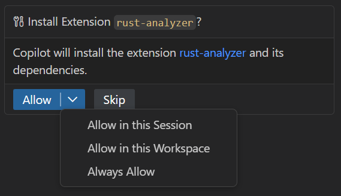
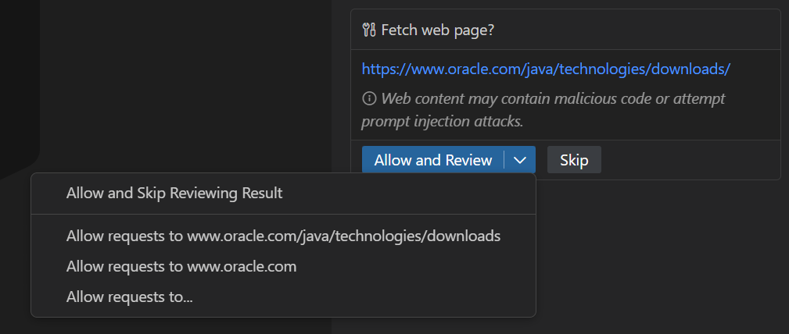

+++
title = "2.2.12.1 审批和权限"
date = 2026-11-06T07:53:25+08:00
weight = 1
type = "docs"
description = ""
isCJKLanguage = true
draft = false
+++


> 原文链接: [https://code.visualstudio.com/docs/agents/run/approvals](https://code.visualstudio.com/docs/agents/run/approvals)

# 2.2.12.1 审批和权限

　　VS Code 中的智能体可以编辑文件、运行终端命令并调用外部工具。VS Code 使用两层安全机制帮助你控制这些操作：

* **审批** 决定操作是自动运行还是需要你确认。
* **沙盒** 限制智能体终端命令可以访问的文件系统和网络资源，即使命令已获批准。

　　本文解释这两层如何协同，以及如何配置权限级别、工具和 URL 审批、终端自动批准和沙盒。关于这些控制背后的安全概念，请参阅[信任和安全](../../../concepts/2.7.9-TrustAndSafety/)。

| 机制 | 控制内容 | 关键设置 |
|---|---|---|
| [权限级别](#permission-levels) | 聊天会话的审批行为 | `chat.permissions.default` |
| [工具审批](#tool-approval) | 哪些工具在运行前或运行后需要确认 | `chat.tools.eligibleForAutoApproval` |
| [URL 审批](#url-approval) | 可以请求哪些 URL 以及哪些响应可以进入聊天上下文 | `chat.tools.urls.autoApprove` |
| [终端审批](#automatically-approve-terminal-commands) | 哪些终端命令无需确认即可运行 | `chat.tools.terminal.autoApprove` |
| [沙盒](../2.2.12.2-AgentSandboxing/) | 终端命令的文件系统和网络边界 | `chat.agent.sandbox.enabled` |

## 权限级别 {#permission-levels}

　　权限级别控制智能体如何处理当前聊天会话的审批。在聊天输入框的权限下拉列表中选择级别。可以随时更改。

　　以下级别描述 Copilot 运行框架会话。其他运行框架请参阅 [Claude 权限模式](#claude-permission-modes)和 [Codex 审批预设](#codex-approval-presets)。

　　新会话使用 `chat.permissions.default` 配置的级别。组织可以为 Copilot 运行框架会话设置不同的托管默认值。如果托管默认值不可用，新会话使用 **手动审批**。托管默认值不会阻止你切换到组织允许的其他级别。

　　在 Copilot 运行框架会话的聊天输入权限选择器中选择 **辅助审批**。Local 运行框架会话不提供此选项。

　　在编辑器聊天视图中，会话已在当前工作区中工作，没有可配置的隔离选择器。单独工作树选择适用于智能体窗口。工作树会话始终使用 **全部允许**。

| 权限级别 | 说明 |
|---|---|
| **手动审批**（默认） | 使用工具、URL 和终端审批设置。未自动批准的操作需要确认。 |
| **辅助审批** | 使用 LLM 评判器评估每个工具调用。评判器未批准的调用需要确认。 |
| **全部允许** | 运行所有工具调用，无需确认。 |

　　组织可以使用[企业托管设置控制权限级别](../../../../enterprise/7.2-ManageAISettings/#manage-permission-levels)。在聊天视图和智能体窗口中，受策略阻止的受支持权限级别仍然可见但被禁用。运行框架不支持的权限级别不会显示。

　　沙盒独立于权限级别。**全部允许** 和 **Autopilot** 跳过审批提示，但启用的沙盒仍限制终端文件系统和网络访问。沙盒不覆盖所有工具，因此请使用工具和 URL 审批在 **手动审批** 下控制其他操作。

> **重要**：**辅助审批** 减少审批中断，但不能替代你的判断。基于模型的风险评估可能出错。首次选择此级别时，会显示警告对话框要求确认。

> **警告**：**全部允许** 和 **Autopilot** 会跳过潜在破坏性操作的确认，包括文件编辑、终端命令和外部工具调用。首次选择任一选项时会显示警告。只在你信任工作区并理解[安全影响](../2.2.12.3-AISecurity/)时使用。

### Autopilot 如何工作 {#how-autopilot-works}

　　**Autopilot** 是智能体模式，不是权限级别。从聊天输入框的模式选择器中选择它，让智能体自主工作，直到确定任务完成。Autopilot：

* 自动批准所有工具，类似 **全部允许**。
* 遇到错误时重试。
* 自动回答否则会阻止进度的问题。

> **注意**：**对于 Local 运行框架会话：** **Autopilot** 是权限级别而不是智能体模式。请从权限选择器中选择。

### 高级 Autopilot（实验性） {#advanced-autopilot-experimental}

　　高级 Autopilot 将完成决定委托给单独模型。每轮后，一个小型快速模型评估原始请求是否完成，并在需要更多工作时指导下一轮。将 `chat.autopilot.advanced.enabled` 设置为 `true` 使用此实验性功能。

> **注意**：Autopilot 会像交互式聊天一样消耗 AI 点数。详细了解[基于用量的计费](https://docs.github.com/en/copilot/concepts/billing/usage-based-billing-for-individuals)。

### Claude 权限模式 {#claude-permission-modes}

> **注意**：当 [GitHub Copilot 企业托管设置生效](../../../../enterprise/7.2-ManageAISettings/#claude-and-codex-availability)时，包括托管权限或沙盒设置，Claude 和 Codex 运行框架会被禁用。其权限模式不能覆盖该限制。请联系部署设置的 IT 团队讨论访问权限。

　　[Claude 运行框架会话](../../../choose-models-and-agents/2.3.2-ChooseAnAgentHarness/#claude)支持以下权限模式：

* **自动编辑**：应用更改而不请求批准。
* **请求批准**：应用更改前询问。
* **Plan**：在实现前概述方法。

> **警告**：`github.copilot.chat.claudeAgent.allowDangerouslySkipPermissions` 设置会绕过所有权限检查。仅在无 Internet 访问的隔离沙盒环境中使用。

### Codex 审批预设 {#codex-approval-presets}

　　[直接 Codex 集成](../../../choose-models-and-agents/2.3.2-ChooseAnAgentHarness/#codex)提供以下审批预设。基于扩展的集成请使用 OpenAI Codex 扩展文档。

* **默认权限**：读取和编辑工作区文件，运行常规本地命令。Codex 在使用 Internet 或访问工作区外资源前询问。
* **自动审查**：使用与 **默认权限** 相同的工作区访问权限，但将审批请求发送给自动审查器，而不是提示你。
* **完全访问**：编辑工作区外文件并使用 Internet，无需询问。

> **警告**：**完全访问** 给 Codex 不受限制的磁盘和网络访问权限。仅在你打算给智能体完全访问计算机时使用。

### 全局允许所有工具 {#allow-all-tools-globally}

　　要跨所有工作区自动批准工具，请启用 `chat.tools.global.autoApprove`。要仅绕过当前受支持本地或 GitHub Copilot CLI 会话的审批，请使用 `/yolo` 或 `/autoApprove`。使用 `/disableYolo` 或 `/disableAutoApprove` 恢复会话默认权限级别。

　　不需要在每个工作区自动批准时，优先使用会话作用域的 **全部允许** 级别。

> **警告**：全局自动批准会在每个工作区移除确认提示。只有理解[安全影响](../2.2.12.3-AISecurity/)时才启用。首次启用时会显示警告对话框要求确认。

## 工具审批 {#tool-approval}

　　某些工具可以修改环境或访问外部服务。其结果也可能包含提示词注入尝试。工具审批可防范这两种风险。

　　需要审批时，请审查工具名称和输入参数，然后批准单次使用或选择更广泛的批准。可用范围取决于工具和[智能体运行框架](../../../choose-models-and-agents/2.3.2-ChooseAnAgentHarness/)。



　　对于包含机密或敏感配置的文件，请要求[对敏感文件的编辑](../../2.2.8-ReviewAndRevertChanges/#require-approval-before-sensitive-edits)显式批准。

> **重要**：批准前始终仔细审查工具参数，尤其是修改文件、运行命令或访问外部服务的工具。请参阅[安全注意事项](../2.2.12.3-AISecurity/)。

### 在 Copilot 会话中限定审批范围 {#scope-approvals-in-copilot-sessions}

　　在 **手动审批** 的 **Copilot** 运行框架会话中，可以减少重复提示，而无需批准工具的每次使用。**允许一次** 是终端命令、Web 获取和文件访问请求的默认操作。使用下拉列表为确认中显示的命令、站点或路径授予批准。

| 操作 | 限定批准覆盖范围 |
|---|---|
| 终端命令 | 建议的命令前缀（例如 `npm run build`）或确切命令。批准前缀会覆盖该前缀的其他参数，不覆盖无关命令。 |
| Web 获取 | 显示的主机。批准 `https://example.com` 不覆盖 `http://example.com` 或 `https://sub.example.com`。 |
| 文件读取或编辑 | 所选文件，或在提供时选择文件夹。文件夹范围覆盖最近的父 Git 仓库，没有仓库时覆盖文件父文件夹。读取和编辑批准分开。 |

　　选择 **在此会话中** 选项将授权限制到当前会话。选择 **始终允许** 将限定授权保存到同一 Agent Host 的未来会话，包括重启后。文件和文件夹提示也提供持久批准，而不仅是会话批准。

　　在你的计算机上，终端和 URL 批准与**用户**设置保持同步：

* 终端命令的 **始终允许** 会更新 `chat.tools.terminal.autoApprove`。
* **始终允许获取** 会在 `chat.tools.urls.autoApprove` 中更新请求批准，但不会启用响应自动批准。
* 对这些用户设置的更改也会应用到本地 Agent Host。工作区设置不会被复制。

　　远程智能体会话保留自己的批准。本地设置不会推送到远程主机，在那里选择 **始终允许** 不会更改本地设置。

　　**Local** 运行框架会话保留现有审批选项，包括受支持时的工作区作用域批准。

### 管理工具审批 {#manage-tool-approvals}

　　从命令面板（`Ctrl + Shift + P`）运行 **Chat: Manage Tool Approval** 审查和配置审批。工具按来源分组，例如 MCP 服务器或扩展。

| 审批 | 效果 |
|---|---|
| **预批准**（“无需批准”） | 运行工具而不显示确认对话框。 |
| **后批准**（“无需审查结果”） | 将工具结果添加到聊天上下文而不审查。对可能包含提示词注入的外部数据要谨慎。 |

　　展开来源配置单个工具的审批，或选择顶级复选框一次信任特定 MCP 服务器或扩展的所有工具。

### 防止工具被自动批准 {#prevent-tools-from-being-auto-approved}

　　在 `chat.tools.eligibleForAutoApproval` 中将工具设置为 `false`，始终要求手动批准。确认对话框随后不会为该工具提供自动批准选项。

　　组织还可以使用设备管理策略强制特定工具的手动批准。更多信息请参阅[企业文档](../../../../enterprise/7.2-ManageAISettings/)。

### 重置工具确认 {#reset-tool-confirmations}

　　从命令面板运行 **Chat: Reset Tool Confirmations** 清除所有已保存批准。要更改单个批准，请使用 [**Chat: Manage Tool Approval**](#manage-tool-approvals)。

## URL 审批 {#url-approval}

　　在 **Local** 运行框架会话中，`#web/fetch` 等工具将 URL 审批分为两个决定。**Copilot** 运行框架的 Web 获取请参阅[在 Copilot 会话中限定审批范围](#scope-approvals-in-copilot-sessions)。

| 步骤 | 批准内容 | 保护 |
|---|---|---|
| **请求批准** | 联系 URL 或域 | 防止数据发送到不受信任站点。 |
| **响应批准** | 将获取内容添加到聊天上下文 | 帮助防止不受信任内容的提示词注入。 |



　　每个步骤可以批准一次，或自动批准该 URL 或域的未来请求或响应。批准请求不等于批准响应。

　　请求批准使用[受信任域](../../../../editor/3.2-WriteCode/3.2.5-CodeNavigation/#outgoing-link-protection)列表。受信任域不需要请求批准，但其响应仍需审查，除非单独自动批准该域的响应。

　　使用 `chat.tools.urls.autoApprove` 存储确切 URL、glob 模式或通配符。将模式设置为布尔值控制两个步骤，或使用 `approveRequest` 和 `approveResponse` 分别控制。

URL 自动批准示例：

```jsonc
{
  "chat.tools.urls.autoApprove": {
    "https://www.example.com": false,
    "https://*.contoso.com/*": true,
    "https://example.com/api/*": {
      "approveRequest": true,
      "approveResponse": false
    }
  }
}
```

## 自动批准终端命令 {#automatically-approve-terminal-commands}

　　智能体使用一个工具运行任何[终端命令](../plan-and-run-tasks/2.2.10.2-UseTools/)。为避免给该工具不受限制的批准，VS Code 会分别评估每个命令。

　　默认情况下，常见只读命令自动运行，而 `rm` 和 `del` 等风险命令需要审批。向 `chat.tools.terminal.autoApprove` 添加规则改变此行为：

* 将命令设置为 `true` 自动批准。
* 将命令设置为 `false` 要求批准。
* 用 `/` 字符包裹正则表达式以匹配命令模式。

例如：

```jsonc
{
  // Allow the `mkdir` command
  "mkdir": true,
  // Allow `git status` and commands starting with `git show`
  "/^git (status|show\\b.*)$/": true,

  // Always require approval for the `del` command
  "del": false,
  // Always require approval for commands containing "dangerous"
  "/dangerous/": false
}
```

　　`false` 规则要求批准，不会阻止命令。将此工作流移到 Copilot 时，请审查共享运行时的[钩子决定和失败行为](../../../customize-and-extend/2.4.9-Hooks/#decisions-and-failures)。`preToolUse` 拒绝可以阻止工具调用，但复制 Local 钩子不会保留其工具名称、参数或输出契约。

　　默认情况下，规则匹配每个子命令。复合命令只有在所有子命令都匹配 `true` 规则且没有匹配 `false` 规则时才自动批准。评估这些规则时，`false` 规则优先于 `true` 规则或会话批准。

　　要评估完整命令行，请使用对象语法并将 `matchCommandLine` 设置为 `true`。

> **注意**：在 **Copilot** 运行框架会话中，运行时可以在评估终端审批规则之前批准只读命令或沙盒命令。这些调用不会提示，即使匹配 `false` 规则或启用了 `chat.tools.terminal.ignoreDefaultAutoApproveRules`。审批规则不能替代[沙盒](../2.2.12.2-AgentSandboxing/)。

相关设置：

* 禁用 `chat.tools.terminal.enableAutoApprove` 以关闭基于规则的终端自动批准。
* `chat.tools.terminal.blockDetectedFileWrites` 默认值为 `outsideWorkspace`，要求对检测到的工作区外写入进行批准。会话级命令批准激活时，操作系统临时文件夹（macOS/Linux 上 `/tmp`，Windows 上 `%TEMP%`）除外。
* 启用实验性 `chat.tools.terminal.ignoreDefaultAutoApproveRules` 设置以忽略内置规则，只使用你的规则。内置拒绝规则旨在防范危险命令。

> **警告**：终端自动批准是尽力而为的便利功能，不是安全边界。命令检测有以下限制：
>
> * PowerShell 和 bash tree-sitter 语法可能无法识别每个子命令。
> * zsh 和 fish 命令使用 bash 语法解析，可能遗漏语法差异。
> * 文件写入检测有限，混淆命令可以逃避匹配。
>
> 如果担心提示词注入或在高风险环境中工作，请[沙盒智能体命令](#sandbox-agent-commands)或在容器中运行 VS Code。

## 沙盒智能体命令 {#sandbox-agent-commands}

> **注意**：智能体沙盒在 macOS、Linux 和 WSL2 上处于预览阶段，在 Windows 上处于实验阶段。

　　智能体沙盒限制终端命令的文件系统和网络访问。它独立于所选权限级别，因此启用的沙盒在 **全部允许** 和 **Autopilot** 下仍限制终端命令。

　　在 Copilot 运行框架会话中，在权限选择器中选择 **终端沙盒** 以为该会话打开或关闭沙盒。新会话使用命令运行机器上的有效沙盒配置，恢复会话时显式会话选择会保留。托管设置可以要求沙盒并禁用切换。

　　更改 `chat.agent.networkFilter`、`chat.agent.allowedNetworkDomains` 或 `chat.agent.deniedNetworkDomains` 后，请重启 VS Code，确保新的集成浏览器会话使用更新后的网络策略。

　　了解如何[配置智能体终端沙盒](../2.2.12.2-AgentSandboxing/)，包括平台前提条件、文件系统和网络限制、会话行为和回退控制。

## 相关资源 {#related-resources}

* [在智能体中使用工具](../plan-and-run-tasks/2.2.10.2-UseTools/)
* [VS Code 中使用 AI 的安全注意事项](../2.2.12.3-AISecurity/)
* [信任和安全概念](../../../concepts/2.7.9-TrustAndSafety/)
