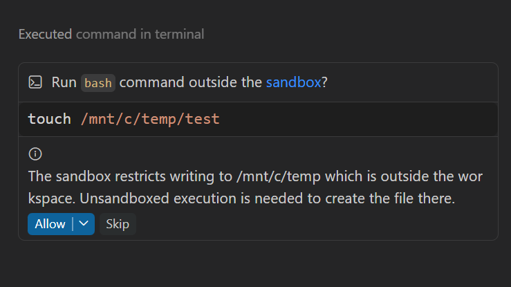

+++
title = "2.2.12.2 智能体沙盒"
date = 2026-11-06T07:53:25+08:00
weight = 2
type = "docs"
description = ""
isCJKLanguage = true
draft = false
+++


> 原文链接: [https://code.visualstudio.com/docs/agents/run/agent-sandboxing](https://code.visualstudio.com/docs/agents/run/agent-sandboxing)

# 2.2.12.2 智能体沙盒

　　Copilot 会话可以在你的计算机或连接的远程机器上运行终端命令并启动语言或工具服务器。智能体沙盒将这些进程限制在你于其运行机器上配置的文件系统和网络访问范围内。

　　本文帮助你理解安全边界、开启沙盒、授予最少必要访问权限、管理证书信任、检查会话有效策略并排查沙盒失败。

　　以下设置和行为适用于使用共享运行时默认工具的 Copilot 运行框架会话。

　　此进程级保护不同于[云会话](../../../work-across-apps-and-machines/2.5.3-CloudSessions/)——后者提供运行和继续智能体会话的受管理云环境。该工作流请使用云会话指南，而不是下面的本地沙盒设置。

> **注意**：**对于 Local 运行框架会话和自定义终端工具：** 设置和行为与本文不同。兼容性详情请参阅 [Local 运行框架会话和自定义终端工具](#local-harness-sessions-and-custom-terminal-tools)。

## 理解沙盒边界 {#understand-the-sandbox-boundary}

　　沙盒和审批提供独立保护层：

| 保护 | 用途 |
|---|---|
| [审批](../2.2.12.1-ApprovalsAndPermissions/) | 决定操作是自动运行还是需要你确认。 |
| 沙盒 | 限制受支持智能体操作可以访问的文件系统和网络资源。 |

　　沙盒适用于终端命令及其子进程。配置后，也适用于为会话启动或管理的 MCP 和语言服务器。不启动操作系统进程的内置工具使用自己的权限检查。

　　沙盒不是虚拟机或用户账户边界，也不能替代终端安全。沙盒进程仍以你的账户在执行主机上运行。网络访问、额外路径、凭据、开发工具访问以及允许在沙盒外运行的权限都会削弱隔离。只授予任务需要的访问权限。

　　根据操作和平台，限制使用操作系统保护或运行智能体的进程内检查。沙盒不能替代云会话或 Dev Container 提供的隔离。[每服务器 MCP 沙盒](../../../customize-and-extend/2.4.8-ManageMCPServers/#sandbox-mcp-servers)是单独功能，有自己的配置和平台支持。

　　关于安全模型和沙盒帮助缓解的威胁，请参阅[信任和安全](../../../concepts/2.7.9-TrustAndSafety/#agent-sandboxing)。

> **重要**：开启沙盒默认不会阻止出站网络访问。`chat.agent.sandbox.network.allowNetwork` 默认为 `true`。配置的允许和拒绝网络域仍会限制目标。如需限制出站连接，请单独[配置网络访问](#configure-network-access)。

## 检查平台可用性 {#check-platform-availability}

　　根据以下前提条件检查命令运行的操作系统。对于远程会话，请在远程机器而不是连接机器上安装依赖和操作系统更新。

| 平台 | 前提条件 |
|---|---|
| macOS | macOS 15 或更高版本，内置 Seatbelt。无需额外沙盒包。 |
| 基于 glibc 的 Linux 和 WSL2 | `bubblewrap` 0.5.0 或更高版本、`slirp4netns`、util-linux 2.35 或更高版本以及兼容的 `iptables` 工具。请参阅[安装缺少的沙盒依赖项](#install-missing-sandbox-dependencies)。 |
| Windows | Windows 11 及 BaseContainer 和所需 OS 能力。请参阅下面的更新基线。 |
| Alpine Linux 和其他基于 musl 的发行版 | 此运行时不支持沙盒 shell 执行。请使用受支持的基于 glibc 的 Linux 环境。 |

　　不支持 WSL 版本 1，因为它不提供 `bubblewrap` 所需的 Linux 内核功能。

Windows 上记录的更新基线：

* Windows 11 25H2：[KB5124010](https://support.microsoft.com/en-us/servicing/os/windows-11/2026/09/kb5124010-windows-11-24h2-25h2-update)，版本 26200.9550 或更高。
* Windows 11 26H1：[KB5124006](https://support.microsoft.com/en-us/servicing/os/windows-11/2026/09/kb5124006-windows-11-26h1-update)，版本 28000.3086 或更高。

> **注意**：Windows 支持处于实验阶段。单独的[每服务器 MCP 沙盒功能](../../../customize-and-extend/2.4.8-ManageMCPServers/#sandbox-mcp-servers)在 Windows 上不可用。

> **提示**：如果本地沙盒不可用，或希望让智能体执行远离你的计算机，请考虑[云会话](../../../work-across-apps-and-machines/2.5.3-CloudSessions/)。它们在受管理云环境中运行智能体工具。可用性取决于账户和组织。

## 在命令运行位置开启沙盒 {#turn-on-sandboxing-where-commands-run}

　　`chat.agent.sandbox.enabled` 设置控制所有受支持平台上的沙盒。它接受 `off` 或 `on`，默认为 `off`。

　　请在会话运行命令的机器上配置沙盒。对于远程会话，远程机器平台决定沙盒实现和前提条件。设置在该机器上解析，所有配置路径都指向其文件系统。

> **注意**：沙盒设备策略不会为 Copilot 运行框架会话强制执行这些控制。管理员应使用 [Copilot 托管设置](../../../../enterprise/7.2-ManageAISettings/)要求沙盒。

1. 在执行主机上满足[平台前提条件](#check-platform-availability)。
2. 在该主机的设置中将 `chat.agent.sandbox.enabled` 设置为 `on`。
3. 启动新的 Copilot 运行框架会话。
4. [检查有效沙盒策略](#inspect-the-effective-sandbox-policy)验证会话限制。

在设置 JSON 中启用沙盒：

```json
{
    "chat.agent.sandbox.enabled": "on"
}
```

　　如果操作系统依赖不可用，命令不会在没有沙盒的情况下静默运行。请按照通知安装缺少的依赖。

### 控制当前会话的沙盒 {#control-sandboxing-for-the-current-session}

　　打开 **权限**，选择 **终端沙盒** 更改当前会话的沙盒。此控件不会更新用户或工作区设置、更改其他会话或设置新会话默认值。

　　新会话继承其执行主机的有效配置。恢复会话时显式会话选择会保留，除非组织托管限制覆盖它。

　　组织托管策略启用沙盒时，`sandbox.allowBypass` 控制此选择。如果为 `true`，可以关闭当前会话沙盒。如果为 `false` 或省略，沙盒保持开启且控件锁定。更改会话切换不会更改托管策略或影响其他会话。

　　沙盒独立于所选[权限级别](../2.2.12.1-ApprovalsAndPermissions/#permission-levels)。例如，选择 **全部允许** 时沙盒仍限制进程。

### 跨窗口和机器使用沙盒 {#use-sandboxing-across-windows-and-machines}

　　Copilot 会话可在智能体窗口和编辑器窗口中使用。它们默认使用共享运行时的内置 shell，无需更改终端实现即可使用沙盒。

　　对于远程会话，使用[会话切换](#control-sandboxing-for-the-current-session)更改当前会话沙盒状态。新会话默认值来自远程机器的沙盒配置，而不是连接机器。

### 在 Dev Container 中使用沙盒 {#use-sandboxing-in-dev-containers}

　　要在 [Dev Container](../../2.2.3-AgentsWindow/#run-a-session-in-a-dev-container)中运行沙盒，容器需要默认容器没有的 Docker 选项。新 Dev Container 会话开启沙盒时，VS Code 会在启动容器时添加：

| Docker 选项 | 沙盒需要的原因 |
|---|---|
| `--security-opt seccomp=unconfined` | Docker 默认 seccomp 配置阻止创建沙盒命名空间的系统调用。 |
| `--security-opt apparmor=unconfined` | Docker 默认 AppArmor 配置阻止设置沙盒的挂载操作。 |
| `--security-opt systempaths=unconfined` | Docker 屏蔽的 `/proc` 和 `/sys` 路径阻止沙盒挂载自己的 `/proc`。 |
| `--device /dev/net/tun` | `slirp4netns` 用于为沙盒提供网络访问。 |

> **警告**：这些选项会放松容器与主机的隔离。智能体运行的终端命令仍在沙盒内运行。

　　要在未使用这些选项启动的现有容器中使用沙盒，请在开启沙盒的情况下重新创建容器。

## 沙盒设置 {#sandbox-settings}

以下设置配置使用默认工具的 Copilot 运行框架会话沙盒。共享设置名称不意味着其他运行框架行为相同。

| 设置 | 默认值 | 用途 |
|---|---|---|
| `chat.agent.sandbox.enabled` | `off` | 在所有受支持平台启用沙盒。 |
| `chat.agent.sandbox.network.allowNetwork` | `true` | 允许出站网络访问，受配置主机名限制。 |
| `chat.agent.sandbox.network.allowLocalNetwork` | `false` | 允许访问本地网络主机。 |
| `chat.agent.sandbox.network.allowedDomains` | `[]` | 配置允许的网络目标。 |
| `chat.agent.sandbox.network.deniedDomains` | `[]` | 配置阻止的网络目标。 |
| `chat.agent.sandbox.fileSystem.userConfiguredPaths` | 空路径列表 | 自定义读写、只读和拒绝路径。 |
| `chat.agent.sandbox.fileSystem.allowDevToolAccess` | `true` | 授予常见开发工具、配置和缓存访问。 |
| `chat.agent.sandbox.mcpServers` | `true` | 沙盒启用时在沙盒中运行本地启动的 MCP 服务器。 |
| `chat.agent.sandbox.lspServers` | `true` | 沙盒启用时在沙盒中运行语言服务器。 |
| `chat.agent.sandbox.credentials.authenticategit` | `true` | 在沙盒内 HTTPS Git 操作使用你的凭据。 |
| `chat.agent.sandbox.credentials.authenticategh` | `true` | 在沙盒内 `gh` 命令使用你的 GitHub 账户。 |
| `chat.agent.sandbox.allowUnsandboxedCommands` | `true` | 允许确认后在沙盒外运行请求。 |

## 检查有效沙盒策略 {#inspect-the-effective-sandbox-policy}

　　在 Copilot 运行框架会话中运行 `/sandbox policy` 验证沙盒是否激活，或调查进程为何被阻止。此命令在 Local 运行框架会话中不可用。

* 在聊天输入框中输入 `/sandbox policy` 并提交。报告会自动以 Markdown 预览在编辑器中打开。在响应中选择 **打开沙盒策略** 可重新打开。

　　生成的 `sandbox-policy.md` 报告描述执行主机、沙盒是否启用、操作系统沙盒实现以及有效文件系统和网络策略。也可以在沙盒关闭时运行命令，此时报告会指出沙盒限制未激活。

　　该命令不会启动模型轮次或更改沙盒设置。

　　更改后再次运行 `/sandbox policy` 刷新报告。命令会更新同一会话报告，因此较早链接也会打开最新报告。要检查新会话默认值，请先启动新会话再运行。

## 配置文件系统访问 {#configure-file-system-access}

　　沙盒自动授予当前工作目录读写访问权限。使用 `chat.agent.sandbox.fileSystem.userConfiguredPaths` 在所有受支持平台自定义路径权限：

| 属性 | 访问 |
|---|---|
| `readwritePaths` | 读写访问。 |
| `readonlyPaths` | 只读访问，无写入。 |
| `deniedPaths` | 无访问。 |

　　如果路径出现在多个属性中，`deniedPaths` 优先于 `readonlyPaths`，后者优先于 `readwritePaths`。路径指智能体运行命令的机器，包括远程会话。

以下示例授予构建输出文件夹读写、共享源代码只读，并阻止敏感数据访问：

```jsonc
{
    "chat.agent.sandbox.fileSystem.userConfiguredPaths": {
        "readwritePaths": ["/path/to/build-output"],
        "readonlyPaths": ["/path/to/shared-source"],
        "deniedPaths": ["/path/to/sensitive-data"]
    }
}
```

　　数组默认为空。

　　`chat.agent.sandbox.fileSystem.allowDevToolAccess` 默认为 `true`。它授予对 `PATH` 上工具目录、工具链目录、开发工具配置和缓存（包括注册表令牌）的读取访问，以及对共享构建缓存的读写访问。设置为 `false` 移除这些自动开发工具授权，并按需添加更窄路径。

　　使用 `/sandbox policy` 检查有效权限，包括运行时默认值和组织托管限制。

### 读取附加的文件和文件夹 {#read-attached-files-and-folders}

　　在启用沙盒的 Copilot 运行框架会话中，你显式[附加到消息](../../2.2.7-AddPromptContext/#add-files-as-context)的文件和文件夹可以为会话获得读取访问权限。授权覆盖附加文件或附加文件夹内容。此额外访问是只读的，绝不会保存到沙盒设置。

　　在 **手动审批** 中，读取这些附件不需要额外的工作区外读取批准。附加它们不会授予写入权限。写入仍遵循现有权限和审批规则。

以下限制仍然适用：

* 拒绝路径即使附加也保持阻止。
* 如果组织托管沙盒策略提供显式只读路径列表，附件不能扩展该列表。
* 附加文件夹不会授予其外部符号链接目标的访问权限。这些目标需要单独权限。
* 附加工作区或其他可写文件夹的父级不会授予整个父级访问权限。请附加具体文件。现有写入权限保持不变。

## 配置托管服务器和凭据 {#configure-managed-servers-and-credentials}

沙盒开启时，这些设置控制会话可用的服务器和凭据：

* `chat.agent.sandbox.mcpServers` 默认为 `true`，对为会话启动或管理的 MCP 服务器应用沙盒。
* `chat.agent.sandbox.lspServers` 默认为 `true`，对为会话启动或管理的语言服务器应用沙盒。
* `chat.agent.sandbox.credentials.authenticategit` 默认为 `true`，为沙盒进程提供 Git 身份验证。
* `chat.agent.sandbox.credentials.authenticategh` 默认为 `true`，为沙盒进程提供 GitHub CLI 身份验证。

　　这些服务器控制适用于 [Agent Host](../../../reference-and-help/reference/2.8.1.11-AgentHostArchitecture/)管理的进程，即运行会话的进程。它们不覆盖你独立启动的服务器。关闭 MCP 或语言服务器沙盒会使相应托管服务器进程留在沙盒外。

　　关闭任务不需要的凭据访问。拥有凭据的进程可以以关联账户权限操作。

## 配置网络访问 {#configure-network-access}

文件系统和网络隔离是独立控制：

* `chat.agent.sandbox.network.allowNetwork` 默认为 `true`，允许出站网络访问。设置为 `false` 阻止出站访问，包括集成浏览器。
* `chat.agent.sandbox.network.allowLocalNetwork` 默认为 `false`，控制对本地网络主机的访问。
* `chat.agent.sandbox.network.allowedDomains` 和 `deniedDomains` 在启用出站访问时限制目标。

　　仅在任务必须连接执行主机或专用网络上的服务时才允许本地网络访问。使用 `/sandbox policy` 检查当前会话有效网络策略。

要在域筛选下启用出站访问：

```jsonc
{
    "chat.agent.sandbox.network.allowNetwork": true,
    "chat.agent.sandbox.network.allowedDomains": [
        "api.github.com"
    ],
    "chat.agent.sandbox.network.deniedDomains": [
        "example.com"
    ]
}
```

> **重要**：在 Windows 上，代理、主机名限制或凭据掩码要求 `chat.agent.sandbox.network.allowLocalNetwork` 为 `true`。沙盒使用主机回环访问本地监听器。如果该配置禁用本地网络访问，沙盒命令不会启动。仅在你接受额外本地网络访问时启用。

> **警告**：进程可以对允许的网络目标执行操作，而不仅是读取数据。网络访问还可能暴露凭据或工作区内容。只授予任务需要的目标。

　　组织可以强制你无法通过本地设置放松的网络限制。请参阅 [Copilot 托管沙盒设置](../../../../enterprise/7.2-ManageAISettings/)。

## 控制审批和回退行为 {#control-approval-and-fallback-behavior}

　　如果命令被阻止，请先检查适用的[文件系统](#configure-file-system-access)或[网络](#configure-network-access)限制。只授予任务需要的访问权限，而不是关闭沙盒。

　　如果命令无法在沙盒内运行，智能体可以请求确认在沙盒外运行。`chat.agent.sandbox.allowUnsandboxedCommands` 设置控制此回退：

* `true`（默认）：智能体可以请求在沙盒外运行。在提供时，可以批准一次操作或当前会话。仅在你信任命令可以在没有沙盒文件系统和网络限制的情况下运行时批准。
* `false`：不提供 **在沙盒外允许**，沙盒外运行请求会失败而不是提示批准。符合沙盒策略的命令仍可运行。

　　沙盒命令失败或沙盒限制阻止时，智能体会请求批准。拒绝确认会阻止命令在沙盒外运行。



> **警告**：批准在沙盒外运行会移除该操作的文件系统和网络限制。如果批准会话级绕过，该会话后续终端命令也会在没有这些限制的情况下运行，直到重新开启沙盒。

## 排查智能体沙盒 {#troubleshoot-agent-sandboxing}

　　如果聊天报告 **沙盒可能无法按预期工作**，或沙盒工具无法启动或连接，请检查会话运行命令环境中的依赖和操作系统要求。即使所有依赖已安装，证书错误也可能需要单独检查。

### 安装缺少的沙盒依赖项 {#install-missing-sandbox-dependencies}

　　在智能体运行环境中安装依赖和操作系统更新。VS Code 可以远程连接该环境，因此它可能与智能体运行在不同机器上。

　　请遵循智能体操作系统的安装步骤。远程工作区并不总意味着智能体远程运行。如果智能体本地运行，请本地安装。

在智能体运行位置安装包和操作系统更新：

* **本地 Agent Host**：在 VS Code 同一机器安装。
* **WSL**：在运行智能体的 Linux 发行版内安装，而不是 Windows。
* **远程主机、Dev Container 或 Codespace**：在该主机或环境内安装。

Debian 和 Ubuntu 上更新包索引：

```bash
sudo apt-get update
```

更新成功后安装所需包：

```bash
sudo apt-get install bubblewrap slirp4netns util-linux iptables
```

Fedora 上：

```bash
sudo dnf install bubblewrap slirp4netns util-linux iptables-nft
```

Arch Linux 上，以下命令还会执行系统升级。批准前审查更改：

```bash
sudo pacman -Syu bubblewrap slirp4netns util-linux iptables
```

其他基于 glibc 的发行版，请使用发行版包管理器或管理员安装提供以下内容的包：

* `bwrap` 0.5.0 或更高版本和 `slirp4netns`。
* util-linux 2.35 或更高版本中的 `unshare` 和 `nsenter`。
* 全部四个防火墙命令：`iptables`、`ip6tables`、`iptables-restore` 和 `ip6tables-restore`，以及兼容防火墙后端。

　　Linux 还需要非特权用户和网络命名空间以及对 `/dev/net/tun` 的读写访问。`unshare` 命令必须支持 `--map-current-user` 和 `--keep-caps`。如果包已安装但这些设施被阻止或不可用，请管理员或容器所有者修复环境。仅安装包不会增加对 Alpine Linux 或其他基于 musl 发行版的支持。

　　macOS 上无需额外沙盒包。打开 **系统设置 > 通用 > 软件更新** 安装适用更新。

　　Windows 上没有独立沙盒包。打开 **设置 > Windows 更新 > 检查更新**，安装适用更新，并在提示时重启 Windows。支持基线请检查[平台前提条件](#check-platform-availability)。

### 检查 Windows 沙盒代理访问 {#check-windows-sandbox-proxy-access}

　　Windows 上沙盒代理要求 `chat.agent.sandbox.network.allowLocalNetwork` 为 `true`，以便沙盒工具访问代理本地监听器。如果本地网络访问被阻止，需要代理的命令无法启动。

　　打开设置，搜索 `@id:chat.agent.sandbox.network.allowLocalNetwork`，仅在你接受额外本地网络访问时开启。如果组织管理此设置，请联系管理员。安全影响请参阅[配置网络访问](#configure-network-access)。

### 在 Windows 和 macOS 上信任沙盒 CA 证书 {#trust-the-sandbox-ca-certificate-on-windows-and-macos}

　　如果聊天报告 **未安装沙盒受信任 CA**，依赖操作系统证书存储的工具可能因证书、HTTPS 或身份验证错误失败。

　　Copilot 沙盒凭据代理让工具向批准的服务进行身份验证，而不向沙盒进程暴露真实身份验证令牌。某些工具需要在操作系统信任存储中安装代理的**证书颁发机构（CA）证书**才能成功连接。

**安装是可选的，可改善工具兼容性。** 它不是使用 VS Code 或运行沙盒命令的一般要求。

#### 为什么需要证书信任 {#why-certificate-trust-is-needed}

　　启用凭据掩码时，Copilot 为沙盒工具提供占位凭据而不是真实令牌。对于批准的凭据目标，本地代理用真实凭据替换占位符。

　　由于 HTTPS 加密请求标头，凭据替换要求代理与工具和目标建立单独的加密连接。代理向工具提供自己的 TLS 证书，并在转发凭据前独立验证目标证书。

　　工具必须信任代理提供的证书。Copilot 为支持的工具提供**每进程证书包**。将 CA 安装到操作系统信任存储可改善依赖 OS 信任的工具兼容性。

　　仅域筛选不需要安装 CA。内置本地代理可以在不解密的情况下检查目标并隧道 HTTPS 流量。

#### 安装什么 {#what-gets-installed}

　　Copilot 生成一个本地自签名 CA，不由公共证书颁发机构签发。

　　安装仅将**公共 CA 证书**添加到 OS 信任。它不会安装身份验证令牌。私钥保留在 Copilot 本地存储中，不会传递给沙盒工具。

　　安装证书本身不会重定向或拦截其他应用流量。

#### 在 VS Code 中管理证书信任 {#manage-certificate-trust-in-vs-code}

　　沙盒证书信任管理适用于运行 Windows 或 macOS 的 agent host。

　　缺少信任且支持安装时，VS Code 会显示可关闭的 **未安装沙盒受信任 CA** 通知和 **安装** 选项。

　　也可以从命令面板运行 **Sandbox: Manage Trusted CA**，为最近聚焦聊天的 agent host 安装、轮换或移除信任。每个操作都会请求确认并标识目标主机。

* **安装**：将公共 CA 证书添加到 OS 信任。安装可能需要操作系统授权。
  * **Windows**：使用机器受信任根证书存储，需要管理员批准。信任适用于该机器所有用户。仅安装到当前用户存储不足以供沙盒工具使用。
  * **macOS**：使用登录钥匙串。macOS 可能要求登录密码授权信任更改。
* **轮换**：替换 CA，配置的凭据目标变化时可能需要。替换受信任 CA 也会更新 OS 信任，可能需要授权。
* **移除**：移除 OS 信任，但保留本地存储的证书和私钥。使用 Copilot 证书包的工具仍可继续工作。

　　证书更改后可能需要重启沙盒工具。

　　如果 **安装** 不可用、安装失败或组织管理证书信任，请联系管理员或支持。从 OS 信任中移除 CA 可能导致依赖它的工具停止工作。

> **注意**：Linux 上运行时提供每进程 CA 包，不安装系统信任根。

#### 不安装时继续 {#continuing-without-installation}

　　缺少信任不会阻止聊天启动或发送消息，打开聊天也绝不会更改证书信任。

　　支持 Copilot 证书包的工具可以在没有 OS 安装的情况下继续工作。仅依赖 OS 信任的工具在使用凭据掩码时可能报告证书验证或身份验证错误。这些错误不一定表示账户或令牌无效。

> **警告**：不要通过禁用 TLS 证书验证来绕过这些错误。

#### 安全注意事项 {#security-considerations}

> **警告**：只为你信任的 agent host 批准安装。安装根 CA 会更改应用信任的证书，包括使用该存储的沙盒外应用。Windows 上该信任适用于设备所有用户，macOS 上适用于当前用户。

　　Copilot CA 受限于配置的凭据目标及其 DNS 子域，并限于 TLS 服务器身份验证，而不是代码签名或客户端身份验证。

　　私钥未加密存储，受文件系统权限保护。以同一用户运行的其他程序可以访问它。请保护 Copilot 本地存储并遵循组织证书管理策略。不要手动复制智能体证书文件或私钥。

#### 远程环境 {#remote-environments}

　　证书操作影响运行 agent host 的机器，可能与显示 VS Code 的机器不同。本地安装 CA 不会自动在远程主机、容器或 WSL 环境中建立信任。

　　确认操作前，请检查 VS Code 显示的目标主机。

## Local 运行框架会话和自定义终端工具 {#local-harness-sessions-and-custom-terminal-tools}

　　Local 运行框架会话和自定义终端工具有不同的沙盒行为。以下兼容性设置不配置本文描述的 Copilot 运行框架沙盒：

* 原 `chat.agent.sandbox.allowNetwork` 设置迁移到 `chat.agent.sandbox.network.allowNetwork`。
* `chat.agent.sandbox.retryWithAllowNetworkRequests` 是 Local 运行框架终端工具的已弃用设置，可在该工具沙盒内提供启用网络的重试，不适用于 Copilot 运行框架默认工具。
* `chat.agent.sandbox.fileSystem.mac` 和 `.linux` 是已弃用的平台特定设置，Copilot 运行框架默认工具会忽略。

　　Local 运行框架只在 macOS 和 Linux 上沙盒终端命令。沙盒内运行的命令会自动批准，除非命令需要确认在沙盒外运行或使用不受限制的网络访问。禁用 `chat.tools.terminal.enableAutoApprove` 会关闭基于规则的终端自动批准，但不会阻止沙盒命令自动批准或通过会话级权限批准。

　　域允许和拒绝控制适用于兼容终端工具。其能力因实现和平台而异。对于 Copilot 运行框架会话，请使用[有效沙盒策略报告](#inspect-the-effective-sandbox-policy)，而不是从其他工具行为推断限制。

## 组织管理沙盒时 {#when-your-organization-manages-sandboxing}

　　托管沙盒强制执行处于预览阶段。策略将 `sandbox.enabled` 设置为 `true` 时，`sandbox.allowBypass` 决定会话切换是否可编辑：`true` 允许关闭当前会话沙盒，`false` 或省略则保持开启并锁定切换。会话选择不会更改托管策略或其他会话。组织还可以限制网络访问。

　　如果组织要求沙盒但执行主机不支持，终端命令无法运行。请遵循[沙盒故障排除指导](#troubleshoot-agent-sandboxing)满足主机要求，或请管理员审查策略。

　　如果设置被锁定或需要策略拒绝的访问，请联系管理员。策略详情请参阅[企业智能体沙盒](../../../../enterprise/7.2-ManageAISettings/)。

## 相关资源 {#related-resources}

* [管理审批和权限](../2.2.12.1-ApprovalsAndPermissions/)
* [理解 AI 智能体的信任和安全](../../../concepts/2.7.9-TrustAndSafety/)
* [审查 AI 设置](../../../reference-and-help/reference/2.8.1.3-SettingsReference/)
