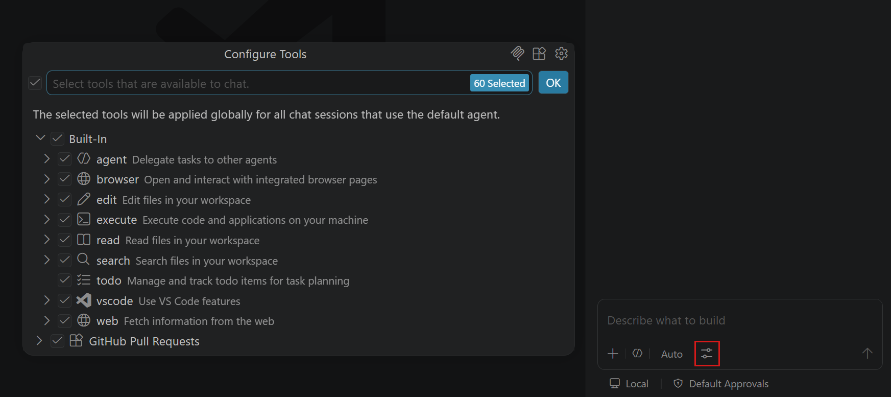
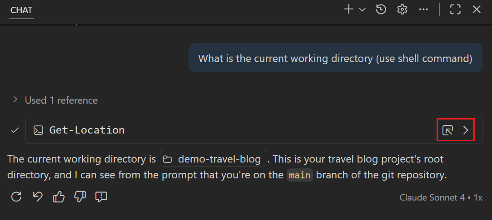

+++
title = "2.2.10.2 使用工具"
date = 2026-11-06T07:53:25+08:00
weight = 2
type = "docs"
description = ""
isCJKLanguage = true
draft = false
+++


> 原文链接: [https://code.visualstudio.com/docs/agents/run/tools](https://code.visualstudio.com/docs/agents/run/tools)

# 2.2.10.2 使用工具

　　工具让智能体检查项目并验证结果，而不仅是建议代码或命令让你应用。例如，它可以读取失败测试背后的实现、进行更改并运行测试检查更改是否有效。

　　从会话中已有的工具开始。VS Code 支持内置工具、模型上下文协议（MCP）工具和扩展工具。当任务需要这些工具无法提供的能力时，使用 [Copilot 连接器](../../../customize-and-extend/2.4.6-CopilotConnectors/)将受支持服务连接到 Copilot 运行框架、[添加 MCP 服务器](../../../customize-and-extend/2.4.7-AddMCPServers/)、[安装捆绑 MCP 服务器的智能体插件](../../../customize-and-extend/2.4.2-Plugins/)或安装提供工具的扩展。

　　关于工具类型和工具在智能体循环中如何工作的背景知识，请参阅[工具概念](../../../concepts/2.7.4-Tools/)。

　　本文介绍如何使用工具完成任务、将智能体引导到特定工具、控制可用工具并审查工具调用。

## 在请求中使用工具 {#use-tools-in-a-request}

　　默认情况下，智能体根据请求和当前上下文从已启用工具中选择。无需在开始前命名或选择每个工具。

使用工具完成任务：

1. 在聊天输入框中，从智能体选择器选择 **Agent**。
2. 输入描述目标以及智能体应如何验证工作的提示词。例如：

    ```text
    查找此项目中失败测试的原因，修复它，并运行相关测试验证更改。
    ```

3. 智能体工作时审查每个工具调用。出现审批提示时，展开工具详情审查输入，然后选择一次性批准选项（例如 **允许一次**）运行。
4. 展开对话中的工具摘要，检查调用及其输出。任务完成后，审查智能体响应、代码更改和验证结果。

　　要控制哪些调用需要审批以及智能体的自主程度，请参阅[管理审批和权限](../../permissions-and-security/2.2.12.1-ApprovalsAndPermissions/)。

**更改聊天中工具调用的分组方式**

　　默认情况下，工具调用详情在聊天对话中折叠。使用 `chat.agent.thinking.collapsedTools`（实验性）更改分组行为。`off` 保持工具调用分开，`withThinking` 在可用时将工具与思考分组，`always` 始终分组。当 `chat.agent.thinkingStyle` 设置为 `collapsed` 时，推理和分组工具调用可以显示在单独的可折叠部分。

## 显式引用工具 {#reference-a-tool-explicitly}

　　在聊天输入框中输入 `#` 引用可用工具。当希望将智能体引导到特定能力而不是让它选择时，请使用显式引用。工具名称取决于运行框架。

例如，使用 `#web/fetch` 工具检索特定网页：

```text
使用 #web/fetch 总结 code.visualstudio.com/updates 上的最新发行说明。
```

　　`#` 菜单还包含上下文项，例如文件、文件夹和编辑器选区。上下文项为请求提供信息，而工具为智能体提供收集信息或执行操作的能力。详细了解[向聊天提示词添加上下文](../../2.2.7-AddPromptContext/)。

> **注意**：用户定义工具集已弃用，Copilot 运行框架不支持。对于可复用工具选择，请配置自定义智能体。请参阅[替换工具集](../../../customize-and-extend/2.4.11-MigrateExistingCustomizations/#replace-tool-sets)。

## 管理可用工具 {#manage-available-tools}

　　对于 Copilot 运行框架会话，请从智能体自定义编辑器管理工具。选择会保存在活动[用户配置文件](../../../../editor/3.3-ConfigureTheEditor/3.3.8-Profiles/)中，而不是只应用于一个请求：

1. 在聊天输入框中，选择 **Copilot** 运行框架。
2. 打开智能体自定义编辑器：
    * 在聊天视图中选择标题栏的 **打开自定义项**，或从命令面板（`Ctrl + Shift + P`，macOS：`Cmd + Shift + P`）运行 **Chat: Open Customizations**。
    * 在智能体窗口中选择侧边栏的 **自定义项**。
3. 选择 **工具** 选项卡。
4. 选择或取消选择工具，控制智能体可用的工具。

　　将选择限制为请求相关工具。通过 [Copilot 连接器](../../../customize-and-extend/2.4.6-CopilotConnectors/)、[添加 MCP 服务器](../../../customize-and-extend/2.4.7-AddMCPServers/)或[安装捆绑 MCP 服务器的智能体插件](../../../customize-and-extend/2.4.2-Plugins/)添加 MCP 工具。扩展也可以提供工具。

　　要为工作流定义可复用工具选择，请在[自定义智能体](../../../customize-and-extend/2.4.5-CustomAgents/)中指定工具。其他运行框架请检查其[设置要求和配置选项](../../../choose-models-and-agents/2.3.2-ChooseAnAgentHarness/#requirements-and-setup)。

### 管理 Copilot 运行框架的工具可用性 {#manage-tool-availability-for-the-copilot-harness}

　　默认情况下，所有客户端工具都可用于 Copilot 运行框架。在 **工具** 选项卡中，工具组织为可折叠组。可以：

* 在搜索框中输入文本，筛选工具组和单个工具。
* 选择工具组复选框，启用或禁用组中所有工具。
* 展开组并选择单个工具。仅启用部分工具时，组复选框显示混合状态。
* 审查每个组显示的已启用和工具总数。

　　自定义项导航中 **工具** 旁的数字包括已启用客户端工具，不包括 Copilot 运行框架内置的只读工具。

　　**Copilot** 组列出运行框架内置工具。这些工具在 Copilot 运行时中运行，在 **工具** 选项卡中只读。其他工具在 VS Code 客户端中运行，仅在客户端连接时对智能体可用。

　　工具可用性独立于工具审批。启用工具使其对智能体可用，但不会绕过配置的[审批和权限控制](../../permissions-and-security/2.2.12.1-ApprovalsAndPermissions/)。

### 为 Copilot 运行框架添加扩展工具 {#add-extension-tools-for-the-copilot-harness}

　　在主 VS Code 窗口中，可以查找提供语言模型工具的扩展：

1. 打开 **工具** 选项卡，选择 **浏览 Marketplace**。
2. 搜索扩展并选择它，查看详情和提供的工具。
3. 安装扩展。其工具会出现在工具列表中，可以在那里管理可用性。

　　智能体窗口显示工具可用性列表，但不包含 Marketplace 浏览。

　　要从工具列表移除扩展，请右键单击其工具组，选择 **卸载扩展**。

> **警告**：卸载工具扩展会移除整个扩展，包括非工具贡献。

**为 Local 运行框架请求选择工具**

　　对于 Local 运行框架会话，请从聊天视图中为单个请求选择工具：

1. 在聊天输入框中选择 **Local** 运行框架，然后从智能体选择器选择 **Agent**。
2. 选择 **配置工具**。

    

3. 选择或取消选择工具，控制当前请求可用的工具。使用搜索框筛选列表。

　　也可以在[提示词文件](../../../customize-and-extend/2.4.10-PromptFiles/)或[自定义智能体](../../../customize-and-extend/2.4.5-CustomAgents/)中指定工具。详细了解[工具列表优先级](../../../reference-and-help/reference/2.8.1.5-CustomAgentFileReference/#tool-list-priority)。

## 编辑工具参数 {#edit-tool-parameters}

　　对于需要审批的工具调用，展开确认对话框审查输入参数。通用和终端工具确认是只读的。如果调用需要不同参数，请拒绝并告诉智能体要更改什么。

**在 Local 运行框架和扩展工具确认中编辑参数**

　　Local 运行框架和扩展提供工具的确认可以支持参数编辑。确认提供可编辑字段时：

1. 工具确认对话框出现时，选择工具名旁的箭头展开详情。
2. 按需编辑工具输入参数。
3. 选择 **允许** 使用修改后的参数运行工具。

## 常见内置工具工作流 {#common-built-in-tool-workflows}

### 跨会话协调工作 {#coordinate-work-across-sessions}

　　在使用 Copilot 或 Anthropic Claude 运行框架的会话中，智能体可以使用内置会话管理工具协调相关工作。这些工具也可用于[实验性 OpenAI Codex 集成](../../../choose-models-and-agents/2.3.2-ChooseAnAgentHarness/#codex)。

智能体可以：

* 列出会话并检查其状态、工作区和文件更改。
* 创建会话或嵌套会话。
* 读取其他对话的最近上下文。
* 发送消息启动或引导后续工作。

　　请说明任务之间的关系以及新工作应在哪里运行：

* **相关工作**：请求嵌套会话，复用当前工作区和检出，用于可共享文件的研究或规划。
* **独立工作**：请求单独会话。不需要仓库文件时省略工作区，或选择受信任文件夹。代码更改必须隔离时请求新工作树。

相关只读工作：

```text
在此会话下创建嵌套会话，复用当前工作区和检出审查身份验证流程。不要修改文件。
```

没有仓库文件的无关工作：

```text
创建一个无工作区的独立会话，研究另一个项目的许可选项。
```

已知项目中的隔离实现：

```text
在 vscode 工作区中创建一个带新工作树的独立会话，实现并测试身份验证更改。
```

　　工具使用 `currentSession` 表示嵌套工作，`independent` 表示单独会话。项目名可以标识工作区，而不是绝对路径或 URI。名称有歧义时，智能体会报告匹配项目而不是选择一个。也支持远程工作区 URI 和多根项目工作目录。

　　工具创建或定位会话时，**打开会话** 胶囊可让你跳转。要自行监控和完成工作，请参阅[管理智能体会话](../../sessions/2.2.11.1-ManageSessions/)。

请记住这些限制：

* 向其他会话发送消息始终需要确认。
* 智能体不能向当前运行的聊天发送消息。
* 创建和消息限制防止无界扩散。
* 除非明确请求，归档会话会从列表中排除。

　　实验性 `chat.agentHost.agentOrchestrationLimits` 设置默认 `on`。它限制每个源会话创建的会话和聊天数量、在滑动一小时窗口内发送的消息数量以及递归会话创建深度。繁忙会话不会消耗另一个会话的额度，随着早期操作离开窗口，容量会恢复。

　　设置为 `off` 会移除这些限制，但不改变确认要求或输入验证。更改无需重启 Agent Host 即可生效。达到限制不会中断已运行的工作。

### 使用浏览器工具 {#use-browser-tools}

　　浏览器工具为智能体提供验证 Web 应用的交互方式。智能体可以运行应用、在集成浏览器中打开、执行用户流程、检查页面内容和控制台错误，并修复发现的问题。

　　浏览器工具内置于 VS Code，不需要外部 MCP 服务器。当任务在 Web 界面中有可观察结果时（例如验证表单、重现视觉错误、检查响应式行为或测试完整用户旅程），请使用它们。

```text
启动应用，在浏览器中打开，并测试密码重置流程。修复发现的问题并重复流程验证修复。
```

　　了解如何[在智能体中使用浏览器工具](../2.2.10.3-BrowserTools/)，包括浏览器会话、页面共享、隐私控制和有效提示模式。

### 运行终端命令 {#run-terminal-commands}

　　在所有内置工具中，终端工具是最常用的之一。智能体使用它作为工作流的一部分运行命令，例如安装依赖、运行构建或执行测试。由于终端命令可以更改环境，VS Code 在[审批](../../permissions-and-security/2.2.12.1-ApprovalsAndPermissions/)行为之上提供额外控件来审查、运行和监控。

　　Copilot 运行框架会话默认使用内置 shell 工具。工作区命令在会话环境中运行，你在聊天中审查结果。要在每条命令前加载 shell 配置文件，请参阅[配置 shell 初始化](#configure-shell-initialization)。下面的集成终端控件适用于 Local 运行框架会话和使用集成终端工具的配置。

**集成终端控件**

　　智能体决定运行命令时，使用内置终端工具在 VS Code 的集成终端中执行。

　　在聊天对话中，智能体显示运行的命令。可以选择命令旁的 **显示输出**（`>`）在聊天中内联查看输出。也可以选择 **显示终端** 在集成终端中查看完整输出。



**更改终端输出位置**

　　使用 `chat.tools.terminal.outputLocation`（实验性）在聊天中内联显示终端命令输出或直接在集成终端中显示。

　　终端输出预览默认重排以适应聊天宽度。关闭 `chat.tools.terminal.outputReflow` 以保留终端列宽，并对长行使用水平滚动。此设置只更改聊天中的预览，不更改运行命令的终端。

#### 在后台继续终端命令 {#continue-terminal-commands-in-background}

　　智能体运行长时间终端命令（例如启动开发服务器或监视模式构建）时，可以将命令推到后台。这使智能体无需等待命令完成即可继续其他任务。

　　命令运行时，聊天对话中终端命令旁会出现 **在后台继续** 按钮。选择它将命令移到后台。命令继续运行，智能体之后可以检查输出或使用终端执行其他任务。

　　智能体还可以在运行终端命令时指定超时。达到超时后，智能体停止等待并返回目前已收集的输出。使用 `chat.tools.terminal.enforceTimeoutFromModel` 设置控制是否强制执行智能体指定的超时值。

　　智能体也可以选择直接在后台运行命令，无需用户交互。未显示的​​后台终端会在命令完成后自动清理，防止长会话中积累陈旧终端。要在命令完成后显示后台终端并保持打开，请选择聊天工具调用标题中的 **显示** 链接。终端清理后，终端输出仍会显示在聊天对话中。

> **提示**：要自动批准终端命令或限制智能体命令的文件系统和网络访问，请参阅[管理审批和权限](../../permissions-and-security/2.2.12.1-ApprovalsAndPermissions/)。

#### 配置 shell 初始化 {#configure-shell-initialization}

　　通过加载 shell 配置文件，使智能体 shell 命令与开发环境一致。在运行于你计算机并使用 SDK 内置 shell 工具的 [Copilot 运行框架会话](../../../choose-models-and-agents/2.3.2-ChooseAnAgentHarness/#copilot)中，启用 `chat.agentHost.shellTool.initScript.enabled`，在每条命令前加载 macOS/Linux 上的 `~/.bashrc` 或 Windows 上的 PowerShell 配置文件。

　　安装 [Python Environments](https://code.visualstudio.com/docs/python/environments#_terminal-settings)并将 `python-envs.terminal.autoActivationType` 设置为 `shellStartup` 后，所选工作区环境也会激活。

　　此设置不适用于远程会话或自定义终端工具覆盖。

## 控制桌面应用程序（实验性） {#control-desktop-applications-experimental}

　　当任务需要智能体其他工具无法访问的桌面应用时，请使用计算机使用。GitHub 的计算机使用插件让智能体查看应用窗口、单击、输入和滚动。对于 Web 应用，请改用[浏览器工具](#use-browser-tools)。

　　计算机使用适用于 macOS 和 Windows 上的本地 [Copilot 运行框架会话](../../../choose-models-and-agents/2.3.2-ChooseAnAgentHarness/#copilot)。不适用于 Local、Claude 或 Codex 运行框架、Linux、远程或云主机。

> **警告**：计算机使用可以读取和更改工作区外应用中的内容。只批准任务需要的应用访问，并避免在应用窗口中暴露敏感内容。请参阅[桌面应用访问风险](../../permissions-and-security/2.2.12.3-AISecurity/)。

### 开启计算机使用 {#turn-on-computer-use}

　　计算机使用是实验性的，默认关闭。使用步骤：

1. 在设置中开启 `chat.agentHost.computerUse.enabled`，并重启 VS Code。
2. 在聊天视图或智能体窗口中启动新的本地 Copilot 聊天。插件首次使用时自动下载。
3. 要求智能体在桌面应用中执行任务。例如：

    ```text
    打开计算器并用它计算 12 乘以 7。
    ```

4. 智能体询问 **开启计算机使用？** 时，审查原因并选择 **开启**。
5. 在 macOS 上[授予所需系统权限](#grant-macos-permissions)。在两个平台上，请求时批准每个应用访问。

　　也可以在 Copilot 聊天中运行 `/computer on`。如果选择 **暂不**，智能体会在没有计算机使用的情况下继续，并且不会在该聊天中再次询问。改变主意时运行 `/computer on`。

> **重要**：开启计算机使用不限于当前聊天。它会在此计算机上为 Copilot（包括 Copilot CLI）保持开启，直到运行 `/computer off`。

### 授予 macOS 权限 {#grant-macos-permissions}

　　macOS 上，计算机使用需要 **Copilot Computer Use** 辅助应用的两项权限：

* **辅助功能**：在应用中单击和输入。
* **屏幕录制**：查看应用窗口。

授予权限：

1. 在聊天卡片中选择 **设置计算机使用**。
2. 对于当前权限，选择 **在设置中允许**，遵循 macOS 提示或在系统设置中开启 **Copilot Computer Use**。如果应用未列出，请将 **Copilot Computer Use** 从设置对话框拖到系统设置权限列表。
3. 返回 VS Code。对话框会检查权限，授予后显示对勾。对下一项权限重复。也可以选择刷新图标再次检查当前权限。

　　两项权限确认后，对话框关闭，智能体继续任务。

### 关闭计算机使用 {#turn-off-computer-use}

　　在 Copilot 聊天中运行 `/computer off` 关闭计算机使用，包括同一计算机上的 Copilot CLI。

　　要停止在 VS Code 中提供集成，请关闭 `chat.agentHost.computerUse.enabled` 并重启。

### 排查计算机使用 {#troubleshoot-computer-use}

* **未提供计算机使用**：检查受支持平台和运行框架，确认设置已开启，并在开始新聊天前重启。首次使用时，留出插件下载时间。
* **智能体未询问开启**：Autopilot 或自动回复聊天中不显示激活提示。请自行运行 `/computer on`。如果之前选择 **暂不**，智能体不会在该聊天中再次询问。
* **macOS 设置对话框在完成前关闭**：等待的工具调用结束时对话框会关闭。在系统设置中完成授权，然后要求智能体重试任务。权限仍缺失时会显示新设置卡片。
* **“在设置中允许”未打开提示**：重启后，macOS 可能不再显示已显示过的权限提示。再次选择 **在设置中允许** 打开系统设置。
* **组织阻止计算机使用**：请联系管理员。开启设置不会覆盖组织限制。

## 内置工具和上下文参考 {#built-in-tools-and-context-reference}

　　单个名称、说明和可用性请参阅[工具和上下文参考](../../../reference-and-help/reference/2.8.1.2-ToolsAndContext/)。该参考按用途分组工具，并单独列出上下文项。

## 常见问题 {#frequently-asked-questions}

**如何知道哪些工具可用？**

　　在聊天输入框中输入 `#` 浏览可用工具和上下文项。对于 Copilot 运行框架会话，打开智能体自定义编辑器并选择 **工具** 选项卡查看和管理已启用工具。对于 Local 运行框架会话，请使用聊天输入框中的 **配置工具**。

**收到“每个请求不能超过 128 个工具”错误。**

　　聊天请求一次最多可启用 128 个工具。如果看到超过 128 个工具的错误：

* 在聊天视图中打开工具选择器，取消选择一些工具或整个 MCP 服务器以减少数量。
* 或者使用 `github.copilot.chat.virtualTools.threshold` 设置启用虚拟工具，自动管理大量工具集。

**为什么智能体未使用我配置的终端 shell？**

　　智能体使用你配置为终端默认 shell 的 shell，但 Windows 上的 `cmd`（命令提示符）和 macOS/Linux 上的 `sh` 除外。这是因为这些 shell 不支持[shell 集成](../../../../terminal/5.4-ShellIntegration/)，智能体对终端内部情况可见性非常有限。它需要依赖超时和等待终端空闲来继续，导致缓慢且不稳定的体验。

　　仍可以通过终端配置文件设置让智能体使用这些 shell，但体验不如 Windows 上的 PowerShell 或 macOS/Linux 上的 `bash`/`zsh`。

* `chat.tools.terminal.terminalProfile.windows` - 覆盖 Windows shell
* `chat.tools.terminal.terminalProfile.osx` - 覆盖 macOS shell
* `chat.tools.terminal.terminalProfile.linux` - 覆盖 Linux shell

**可以创建自己的工具吗？**

　　可以，有两种方式：

* **开发 VS Code 扩展**，使用 [Language Model Tools API](https://code.visualstudio.com/api/extension-guides/ai/tools)提供工具。
* **创建 MCP 服务器**提供工具。请参阅 [MCP 工具扩展性概述](https://code.visualstudio.com/api/extension-guides/ai/ai-extensibility-overview#mcp-tool)。

## 相关资源 {#related-resources}

* [AI 功能速查表](../../../reference-and-help/reference/2.8.1.1-CheatSheet/)
* [迁移现有自定义项](../../../customize-and-extend/2.4.11-MigrateExistingCustomizations/)
* [VS Code 中使用 AI 的安全注意事项](../../permissions-and-security/2.2.12.3-AISecurity/)
