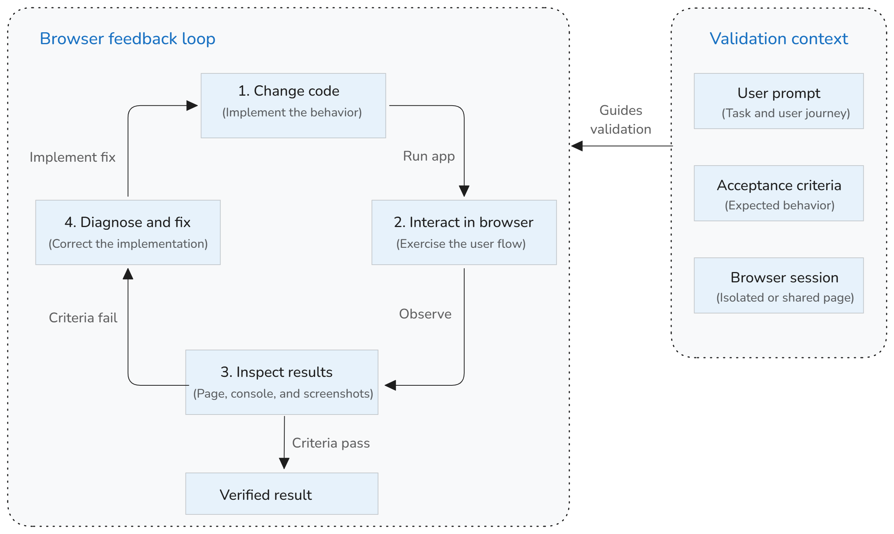

+++
title = "2.2.10.3 浏览器工具"
date = 2026-11-06T07:53:25+08:00
weight = 3
type = "docs"
description = ""
isCJKLanguage = true
draft = false
+++


> 原文链接: [https://code.visualstudio.com/docs/agents/run/browser-tools](https://code.visualstudio.com/docs/agents/run/browser-tools)

# 2.2.10.3 浏览器工具

　　浏览器工具为智能体提供 Web 开发的视觉和交互反馈循环。智能体可以更改代码、运行应用、在集成浏览器中交互、检查结果并修复发现的问题。此闭环帮助智能体验证实际行为，而不是仅从源代码推理。

　　浏览器工具内置于 VS Code，不需要外部模型上下文协议（MCP）服务器。例如，可以要求：

```text
启动应用，在浏览器中打开，测试注册流程，并修复发现的问题。完成前验证修复。
```

## 浏览器反馈循环如何工作 {#how-the-browser-feedback-loop-works}

　　智能体使用浏览器工具时，可以在连续循环中完成并验证 Web 开发任务：

1. 智能体更改应用代码。
2. 智能体启动开发服务器或定位正在运行的应用。
3. 浏览器工具打开应用并与之交互。
4. 智能体分析页面内容、截图、控制台错误和交互结果。
5. 智能体修复问题并重复检查。

　　智能体会报告测试内容和结果。保留更改前，请审查其代码更改和验证结果。



## 智能体可以在浏览器中做什么 {#what-agents-can-do-in-the-browser}

　　浏览器工具支持常见 Web 开发和验证任务：

| 目标 | 智能体可以 |
|------|-----------------------|
| 导航 | 打开页面、导航到 URL 并跟随路由之间的链接。 |
| 理解 | 读取页面内容和可访问元素，检查控制台错误。 |
| 交互 | 选择按钮、输入文本、悬停元素、拖动元素并处理对话框。 |
| 视觉验证 | 截取屏幕截图以检查布局和视觉结果。 |
| 自动化复杂流程 | 当流程需要更多控制时运行有针对性的 Playwright 代码。 |

内置浏览器工具包括：

* **页面导航**：`openBrowserPage`、`navigatePage`。
* **页面内容和外观**：`readPage`、`screenshotPage`。
* **用户交互**：`clickElement`、`hoverElement`、`dragElement`、`typeInPage`、`handleDialog`。
* **自定义浏览器自动化**：`runPlaywrightCode`。

　　智能体根据提示词和可用上下文选择工具。可以在聊天对话中审查工具调用及其参数。

## 开始使用 {#get-started}

　　浏览器工具默认通过 `workbench.browser.enableChatTools` 设置启用。

1. 在聊天视图或智能体窗口中启动新的智能体会话。
2. 要求智能体启动或定位 Web 应用、测试特定用户流程并报告结果。
3. 包含预期行为，并告诉智能体是否修复和验证发现的问题。

例如：

```text
启动开发服务器并在浏览器中打开应用。添加名为“审查浏览器工具”的任务，将其标记为完成，
并重新加载页面。验证已完成任务仍然存在。如果任一步骤失败，请修复问题并重复流程。
```

> **提示**：只选择与任务相关的工具。详细了解[为智能体选择工具](../2.2.10.2-UseTools/)。

## 选择浏览器会话 {#choose-a-browser-session}

　　智能体可以在隔离会话中打开新页面，也可以共享你打开的浏览器页面。根据任务是否需要现有浏览器状态选择。

| 会话 | 智能体可用数据 | 最适合 |
|---------|-----------------------------|----------|
| 智能体打开的页面 | 私有的内存中会话，不与其他浏览器选项卡共享 cookie 或存储。 | 本地应用、公共页面和未认证流程。 |
| 你共享的页面 | 该选项卡的现有会话，包括 cookie、存储和登录状态。 | 需要现有会话的已认证或有状态流程。 |

### 让智能体打开页面 {#let-the-agent-open-a-page}

　　要求智能体打开 URL 或测试正在运行的应用。智能体打开的页面使用隔离的临时会话，保护其他浏览器选项卡中的数据。

　　在智能体窗口中，浏览器选项卡按会话隔离。智能体只能读取和交互属于其会话的选项卡。

### 共享现有页面 {#share-an-existing-page}

　　默认情况下，智能体不能访问你打开的浏览器页面。要授予页面访问权限：

1. 在[集成浏览器](../../../../debugging-and-testing/6.5-IntegratedBrowser/)中打开页面。
2. 选择浏览器工具栏中的 **与智能体共享**。
3. 确认要共享页面。
4. 要求智能体读取或交互页面。

　　视觉指示器显示页面已共享。再次选择 **与智能体共享** 立即撤销访问。

　　如果智能体需要访问未共享选项卡，它可以请求你共享。Autopilot 模式下，VS Code 会自动拒绝这些请求以保护隐私。

## 在远程 agent host 上测试应用 {#test-apps-on-remote-agent-hosts}

　　在智能体窗口中，智能体可以通过会话的远程主机测试应用，而无需将应用端口转发到本地机器。启用[远程浏览器代理](../../../../debugging-and-testing/6.5-IntegratedBrowser/)，然后要求智能体启动应用并打开其原始 localhost URL。

例如：

```text
在此会话的远程主机上启动应用，在集成浏览器中打开其 localhost URL，并测试注册流程。
修复问题并验证结果。
```

　　也可以自行打开远程应用，选择 **与智能体共享**，让智能体测试同一页面。

## 从网页提供反馈 {#give-feedback-from-a-web-page}

　　集成浏览器让你指向渲染结果，而不是仅用文本描述视觉或运行时问题。可以选择页面内容、附加诊断信息，并为智能体提供元素级指令。

使用浏览器工具栏中的 **添加到聊天** 操作提供：

* **页面元素**：选择渲染元素并附加其 HTML、CSS 和可选截图。
* **元素评论**：选择一个或多个元素，并为每个元素关联特定更改请求。
* **截图**：捕获当前视口、选定区域或完整页面。
* **控制台日志**：附加运行时错误和其他控制台输出。

例如，为页面多个部分提供反馈，然后让智能体验证工作：

1. 在集成浏览器中打开应用。
2. 打开 **添加到聊天** 下拉列表，选择 **评论元素**。
3. 选择导航菜单并输入 `在窄屏上将此导航折叠为菜单按钮。`
4. 选择表单并输入 `对齐这些字段，并在每个输入下方显示验证错误。`
5. 在聊天输入框中添加总体说明并发送提示词。
6. 要求智能体实现反馈，并使用浏览器工具在桌面和移动视口尺寸验证结果。

　　也可以选择 **与智能体共享**，让智能体继续与同一页面交互，包括当前浏览器状态。这形成协作循环：你在渲染应用中发现问题，智能体实现更改，浏览器工具验证结果。

　　详细过程和浏览器设置请参阅[向 AI 聊天添加浏览器上下文](../../../../debugging-and-testing/6.5-IntegratedBrowser/)。

## 比较浏览器和聊天上下文工作流 {#compare-browser-and-chat-context-workflows}

浏览器工具不同于手动将浏览器内容添加到聊天提示词：

| 工作流 | 谁控制浏览器 | 最适合 |
|----------|--------------------------|----------|
| 浏览器工具 | 智能体自主导航和交互。 | 端到端验证和迭代修复。 |
| 添加到聊天 | 你选择元素、截图或控制台日志附加到提示词。 | 指出特定视觉或运行时问题。 |
| 与智能体共享 | 你授予智能体访问现有浏览器选项卡。 | 已认证或有状态浏览器会话。 |

　　希望自己选择确切浏览器上下文时，请使用 **添加到聊天** 操作。详细了解[向聊天添加浏览器上下文](../../../../debugging-and-testing/6.5-IntegratedBrowser/)。

## 编写有效的浏览器提示词 {#write-effective-browser-prompts}

　　描述可观察结果，让智能体知道要执行什么以及如何判断任务完成。包含：

* 如何启动应用以及打开哪个 URL。
* 要遵循的用户旅程。
* 预期结果。
* 重要边界情况或视口尺寸。
* 智能体是否应修复发现的问题。
* 修复后应重复的检查。

以下模式覆盖常见浏览器工作流。

**构建并验证功能**

```text
根据需求实现个人资料表单。启动应用并使用浏览器验证有效更改会保存、
无效输入显示错误、取消会恢复原始值。修复问题并再次验证完整流程。
```

**重现并修复错误**

```text
打开 http://localhost:3000 并重现此问题：两次提交结账表单会创建重复订单。
找到原因、修复，并重复相同浏览器步骤验证只创建一个订单。
```

**审查响应式行为**

```text
打开仪表板并在桌面和移动视口尺寸检查。验证导航仍可用且内容不溢出。
修复布局问题并截取最终结果截图。
```

**检查辅助功能**

```text
审查登录页面的可访问名称、标题结构和键盘操作。不使用鼠标执行表单，
修复发现的问题并再次验证流程。
```

　　浏览器工具在智能体会话期间提供交互式验证。当检查需要在持续集成中一致运行或防范回归时，请在仓库中保留可重复的 Playwright 或其他自动化测试。

## 隐私和企业控制 {#privacy-and-enterprise-controls}

　　VS Code 提供浏览器访问控制：

* 你明确批准共享自己打开的浏览器选项卡。
* 智能体打开的选项卡使用隔离临时存储。
* 在不受信任工作区中，集成浏览器始终使用临时存储。
* 管理员可以使用 `BrowserChatTools` 策略关闭浏览器工具。
* 管理员可以使用智能体网络筛选限制智能体工具可访问的域。

　　详细了解[审批和权限](../../permissions-and-security/2.2.12.1-ApprovalsAndPermissions/)、[浏览器会话存储](../../../../debugging-and-testing/6.5-IntegratedBrowser/)和[AI 企业控制](../../../../enterprise/7.2-ManageAISettings/)。

## 排查浏览器工具 {#troubleshoot-browser-tools}

**为什么缺少浏览器工具？**

　　确认 `workbench.browser.enableChatTools` 已开启。然后在聊天输入框中选择 **配置工具**，并在 **内置** > **浏览器** 下选择工具。组织策略也可能关闭这些工具。

**为什么智能体无法访问我登录的页面？**

　　智能体打开的页面使用隔离会话，不继承登录状态。在集成浏览器中打开页面，使用 **与智能体共享** 授予该已认证选项卡访问权限。

**为什么智能体打开了单独的浏览器选项卡？**

　　除非你共享现有选项卡，智能体会打开自己的隔离选项卡。打开的选项卡匹配请求的域和端口时，VS Code 可以提示你共享它。

**为什么智能体无法访问某个域？**

　　智能体网络筛选或组织策略可能阻止该域。检查工具调用中的错误；如果设置由组织管理，请联系管理员。

## 后续步骤 {#next-steps}

* 遵循[使用浏览器工具构建并验证 Web 应用教程](../../../tutorials-and-guides/2.6.7-TestWebApps/)。
