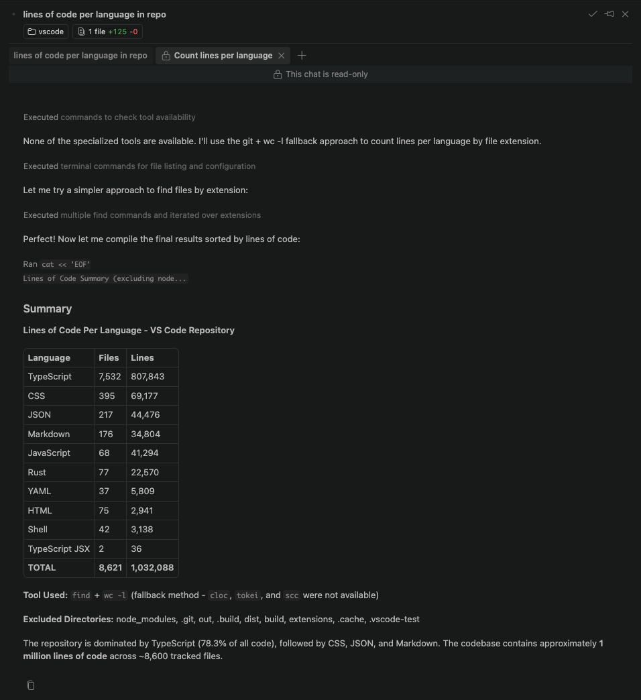

+++
title = "2.2.10.4 子智能体"
date = 2026-11-06T07:53:25+08:00
weight = 4
type = "docs"
description = ""
isCJKLanguage = true
draft = false
+++


> 原文链接: [https://code.visualstudio.com/docs/agents/run/subagents](https://code.visualstudio.com/docs/agents/run/subagents)

# 2.2.10.4 子智能体

　　使用子智能体研究主题、比较方法或审查代码，而不用中间工作填满主对话。子智能体在自己的上下文中工作，并向主智能体返回聚焦结果。详细了解[子智能体概念](../../../concepts/2.7.1-Agents/#subagents)。

　　本文介绍如何委派任务并在 VS Code 中跟踪进度。请使用[对应运行框架的指导](#subagents-by-harness)，然后了解如何使用共享聊天控件[跟踪子智能体进度](#what-you-see-in-chat)。

## 何时使用子智能体 {#when-to-use-subagents}

　　委派范围明确且能产生主智能体可用结果的工作：

* **实现前研究**：查找相关文件、现有模式或库选项，然后返回建议。
* **比较方法**：调查独立解决方案，或使用[不同模型](#select-the-model-for-a-subagent)研究同一问题。
* **审查更改**：检查不同关注点，例如正确性和性能，然后合并发现。

　　对于快速查找或小编辑，直接请求通常就足够。委派会增加模型用量和协调成本，请权衡将中间工作排除主上下文的收益和成本。

## 按运行框架划分的子智能体 {#subagents-by-harness}

　　[智能体运行框架](../../../choose-models-and-agents/2.3.2-ChooseAnAgentHarness/)决定子智能体如何运行以及支持哪些配置选项。提交第一条提示词前请[选择运行框架](../../../choose-models-and-agents/2.3.2-ChooseAnAgentHarness/#select-a-harness)。

> **注意**：当 [GitHub Copilot 企业托管设置生效](../../../../enterprise/7.2-ManageAISettings/#claude-and-codex-availability)时，Claude 和 Codex 运行框架会被禁用。请联系部署设置的 IT 团队讨论访问权限。
>
> 提供商文档也覆盖 CLI 工作流。VS Code 中的命令和配置选项可能不同。集成特定设置和限制请使用[运行框架指南](../../../choose-models-and-agents/2.3.2-ChooseAnAgentHarness/)。

**Copilot**

　　**Copilot** 运行框架管理对内置或自定义子智能体的委派。在提示词中请求子智能体，或让主智能体决定何时委派。原生智能体行为和配置请参阅 [Copilot 中的内置和自定义智能体](https://docs.github.com/en/copilot/concepts/agents/copilot-cli/about-custom-agents)。

　　Copilot 使用原生 `task` 工具委派，而不是 Local 的 `runSubagent`。迁移协调者智能体时，请审查命名工具的指令和智能体工具列表。不要假设工具接受相同参数。请参阅[子智能体迁移常见问题](../../../customize-and-extend/2.4.11-MigrateExistingCustomizations/)。

**Claude**

　　**Claude** 运行框架管理自己的子智能体，具有单独上下文和可配置指令与工具。在提示词中请求委派，或让智能体选择合适的子智能体。原生配置和行为请参阅 [Claude 子智能体](https://code.claude.com/docs/en/sub-agents)。

**Codex**

　　**Codex** 运行框架使用提供商原生子智能体运行独立任务并收集结果。在提示词中要求 Codex 委派。原生配置和行为请参阅 [Codex 子智能体](https://developers.openai.com/codex/multi-agent)。可用性和集成设置请参阅[使用 Codex 运行框架](../../../choose-models-and-agents/2.3.2-ChooseAnAgentHarness/#codex)。

## Local 运行框架会话中的子智能体 {#local}

　　**Local** 运行框架使用 VS Code 的 `runSubagent` 工具。以下说明涵盖工具选择、自定义智能体配置、模型选择和此运行框架的嵌套子智能体。

### 调用子智能体 {#invoke-a-subagent}

在 Local 运行框架会话中尝试只读研究任务：

1. 打开项目，在聊天视图中为新手会话[选择 **Local** 运行框架](../../../choose-models-and-agents/2.3.2-ChooseAnAgentHarness/#select-a-harness)和 **Agent** 角色。
2. 选择 **配置工具**，确保选中 **运行子智能体**（`agent/runSubagent`）。详细了解[选择工具](../2.2.10.2-UseTools/#use-tools-in-a-request)。
3. 输入显式请求子智能体的提示词：

    ```text
    使用子智能体查找此代码库中的身份验证如何工作。不要更改文件。
    返回相关文件、身份验证流程以及任何未解决问题。
    ```

4. [跟踪子智能体进度](#what-you-see-in-chat)，然后审查主智能体对发现的总结。

#### 子智能体如何被调用 {#how-subagents-are-invoked}

　　你用自然语言请求委派，主智能体调用子智能体工具。主智能体也可以在没有显式请求时决定委派。它向子智能体传递任务、接收结果并使用该结果继续你的工作。

　　Local 子智能体不继承主对话历史。通过指定以下内容使委派任务自包含：

* **目标**：要回答的问题或要完成的工作。
* **上下文**：相关文件、约束和已做决策。
* **允许的操作**：仅研究还是进行更改。
* **预期结果**：要返回的发现、建议或更改。

　　每次 Local 调用都是无状态的：主智能体不能向同一子智能体发送后续消息。进一步工作需要带相关上下文的新调用。用于提出澄清问题和管理待办事项的内置工具对 Local 子智能体不可用。

#### 在提示词文件中调用子智能体 {#invoke-a-subagent-in-a-prompt-file}

　　对于可复用 Local 工作流，请将 `agent` 工具集添加到[提示词文件](../../../customize-and-extend/2.4.10-PromptFiles/)的 `tools` frontmatter。在提示词正文中描述委派任务和预期结果，方法与交互式请求相同。

### 将自定义智能体作为子智能体运行 {#run-a-custom-agent-as-a-subagent}

　　在 Local 运行框架会话中，除非指定[自定义智能体](../../../customize-and-extend/2.4.5-CustomAgents/)，子智能体继承主智能体指令和所选工具。自定义智能体提供任务特定指令，并可以覆盖工具和[模型](#select-the-model-for-a-subagent)。

例如，在工作区创建 `.github/agents/codebase-researcher.agent.md`，内容如下。其他创建方式请参阅[创建自定义智能体](../../../customize-and-extend/2.4.5-CustomAgents/#create-a-custom-agent)。

```markdown
---
name: Codebase Researcher
description: Find relevant code and explain existing patterns
user-invocable: false
tools: ['read', 'search']
---
Research the requested topic without changing files.
Return relevant file paths, existing patterns, and unanswered questions.
```

　　保存文件，然后从主聊天请求它：

```text
使用 Codebase Researcher 子智能体解释此项目中的身份验证如何工作。
```

　　智能体名称区分大小写。请使用自定义智能体定义中的确切名称。

#### 控制自定义智能体的调用方式 {#control-how-a-custom-agent-is-invoked}

两个 frontmatter 属性控制智能体如何可用：

* `user-invocable` 控制智能体下拉列表中的可见性。设置为 `false` 可隐藏仅用于子智能体的助手（如 Codebase Researcher）。默认 `true`。
* `disable-model-invocation` 控制其他智能体是否可以将其作为子智能体调用。默认 `false`。

　　已弃用的 `infer` 属性由这两个属性替代。

#### 限制智能体可使用的子智能体 {#restrict-which-subagents-an-agent-can-use}

　　默认情况下，没有 `disable-model-invocation: true` 的自定义智能体可作为子智能体使用。要让协调者专注于特定工作智能体，请设置其 `agents` frontmatter：

* `agents: ['Codebase Researcher', 'Reviewer']` 只允许命名智能体。
* `agents: ['*']` 或省略属性允许所有可用智能体。
* `agents: []` 阻止子智能体使用。

> **注意**：在 `agents` 中显式列出智能体会覆盖该智能体的 `disable-model-invocation: true`。选择器可见性和子智能体可用性是分开的控件。

　　在协调者的 `tools` 属性中包含 `agent` 工具集。[协调者-工作者示例](#coordinator-and-worker-pattern)展示完整工作流。

### 为子智能体选择模型 {#select-the-model-for-a-subagent}

Local 子智能体按以下顺序选择模型：

1. 主智能体传递给 `runSubagent` 工具的显式模型参数。
2. 所选自定义智能体的 [`model`](../../../reference-and-help/reference/2.8.1.5-CustomAgentFileReference/) 属性，接受模型名称或优先级列表。
3. 启用 `chat.subagents.defaultToAuto` 且[使用 Auto 的条件](#use-auto-for-subagents)适用时的 Auto。
4. 运行主对话的模型。

　　要请求模型，请在提示词中包含它。将 `<model name>` 替换为会话中可用的模型：

```text
使用带有 <model name> 的子智能体审查此模块中的错误处理。
```

　　显式和智能体配置的模型选择会根据主模型的成本层级检查。如果选择超过该层级，子智能体不会运行，并报告可用模型。

#### 为子智能体使用 Auto {#use-auto-for-subagents}

　　启用 `chat.subagents.defaultToAuto`，在工具调用和智能体都未指定模型时使用 Auto 而不是主模型。该设置默认 `false`，不会覆盖继承的自定义智能体模型配置。

　　如果 Auto 不可用，子智能体使用主对话模型。

　　[自带密钥模型](../../../choose-models-and-agents/2.3.1-ChooseAndConfigureModels/#bring-your-own-language-model-key)的子智能体继续使用该模型，除非指定其他模型。通过此设置进行的 Auto 路由不受主模型固定成本层级限制。

### 嵌套子智能体 {#nested-subagents}

　　Local 子智能体默认不能再调用子智能体。对于递归委派工作流，请启用 `chat.subagents.allowInvocationsFromSubagents`（默认 `false`）。嵌套最大深度为五层。

　　保持递归任务有界，并包含停止条件，以免智能体反复委派相同工作。

#### 示例：递归智能体 {#example-recursive-agent}

　　递归智能体在 `agents` 属性中列出自己。启用嵌套子智能体后，将以下示例保存为 `.github/agents/recursive-processor.agent.md`，将文件列表拆分为更小的研究任务：

```markdown
---
name: Recursive Processor
description: Research independent files in small groups
tools: ['agent', 'read', 'search']
agents: ['Recursive Processor']
argument-hint: A list of files to summarize
---
Summarize the purpose of each file without changing it.
* For more than four files, split the list in half and delegate each half
  to a Recursive Processor subagent.
* For four or fewer files, or if further delegation is unavailable,
  summarize the files directly.
* Combine the results into a single summary.
```

### 编排模式 {#orchestration-patterns}

　　对于 Local 运行框架会话中的可重复多步骤工作，请使用协调者智能体将聚焦任务分配给工作智能体并合并结果。

#### 协调者-工作者模式 {#coordinator-and-worker-pattern}

　　功能构建协调者可以委派研究和审查，同时自己进行代码更改。此示例使用三个智能体文件：前面定义的 [Codebase Researcher](#run-a-custom-agent-as-a-subagent)、审查者和协调者。

创建 `.github/agents/reviewer.agent.md`：

```markdown
---
name: Reviewer
description: Review changes for correctness and missing tests
user-invocable: false
tools: ['read', 'search']
---
Review the supplied files and change summary without editing files.
Report correctness issues and missing test coverage with file references.
```

创建 `.github/agents/feature-builder.agent.md`：

```markdown
---
name: Feature Builder
description: Implement features with delegated research and review
tools: ['agent', 'edit', 'read', 'search']
agents: ['Codebase Researcher', 'Reviewer']
---
For each feature request:
1. Ask Codebase Researcher to find relevant files and existing patterns.
2. Use its findings to implement the requested change.
3. Ask Reviewer to check the changed files, passing the requirements
   and a summary of your changes.
4. Address the findings, then summarize the changes and remaining risks.
```

　　保存三个文件。在 Local 运行框架会话中，从智能体下拉列表选择 **Feature Builder** 并描述要实现的功能。工作智能体具有只读工具，协调者具有编辑工具。

　　如果需要另一次审查，协调者会启动新调用并提供更新后的上下文。较早的审查者调用不保留对话以发送后续消息。

#### 将实现委派给工作智能体 {#delegate-implementation-to-a-worker}

　　要让协调者专注于委派，请只给它 `agent` 工具集，将编辑交给实现工作智能体。此 Local 示例复用 [Codebase Researcher](#run-a-custom-agent-as-a-subagent)。

创建 `.github/agents/implementer.agent.md`：

```markdown
---
name: Implementer
description: Implement code changes based on research findings
user-invocable: false
tools: ['edit', 'read', 'search']
---
Implement the supplied requirements using the research findings.
Follow existing code patterns and make focused changes.
Return a summary of changes and any validation still needed.
```

创建 `.github/agents/research-and-implement.agent.md`：

```markdown
---
name: Research and Implement
description: Coordinate research before delegating implementation
tools: ['agent']
agents: ['Codebase Researcher', 'Implementer']
---
For each feature request:
1. Ask Codebase Researcher to find relevant files and existing patterns.
2. Pass the requirements and research findings to Implementer.
3. Summarize the implementation results and any validation still needed.
```

　　保存三个文件，在 Local 运行框架会话中选择 **Research and Implement** 并描述更改。协调者只能调用命名的工作智能体。Codebase Researcher 具有只读工具，Implementer 可以编辑文件。

　　`agents`、`tools` 和调用控件的语法与默认值请参阅[自定义智能体文件参考](../../../reference-and-help/reference/2.8.1.5-CustomAgentFileReference/)。

#### 多视角代码审查 {#multi-perspective-code-review}

　　对于一次性审查，请在提示词中分配视角，而不是创建更多智能体文件：

```text
使用两个子智能体审查当前更改而不编辑文件。让一个检查正确性，另一个检查测试覆盖。
合并发现、删除重复项并优先处理可操作问题。
```

　　单独上下文可以发现不同问题，但不保证无偏见或正确结论。行动前审查合并发现。

### 故障排除 {#troubleshooting}

对于 Local 运行框架会话，请检查这些常见原因：

| 症状 | 检查内容 |
| --- | --- |
| 主智能体不委派 | 确认 **配置工具** 中选中 **运行子智能体**，然后用聚焦任务显式请求子智能体。 |
| 自定义智能体不可用 | 检查其确切、区分大小写的名称、`disable-model-invocation` 和协调者的 `agents` 列表。`user-invocable: false` 只会从选择器隐藏它。 |
| 请求的模型未运行 | 使用错误中列出的模型之一，或移除显式偏好。请参阅[模型选择](#select-the-model-for-a-subagent)。 |
| 子智能体无法进一步委派 | 检查[嵌套子智能体设置](#nested-subagents)、深度限制以及其工具是否包含 `agent`。 |

## 在聊天中看到什么 {#what-you-see-in-chat}

　　呈现方式取决于运行框架和界面。[嵌套会话](../../../concepts/2.7.5-SessionsAndChats/#chats-within-a-session)是你独立提示的对话。子智能体聊天显示智能体委派的工作。

### 聊天视图 {#chat-view}

　　编辑器的 **会话** 视图显示嵌套会话，但该层次结构不包含子智能体聊天。要检查只读子智能体聊天，请使用[智能体窗口](#agents-window)。

> **注意**：**对于 Local 运行框架会话：** 运行中的子智能体显示为折叠工具调用，带有智能体名称和当前活动（例如读取文件或搜索代码库）。选择工具调用检查提示词、工具调用和返回结果。

### 智能体窗口 {#agents-window}

　　在智能体窗口中，子智能体显示为会话中的只读聊天。选择父聊天中的指示器打开子智能体。指示器显示其模型、已用时间和活动工具调用。

　　子智能体聊天默认从选项卡栏隐藏。也可以从 **聊天** 下拉列表、运行中子智能体指示器或发生委派的聊天中的 **打开子智能体** 打开。

要让父聊天和子智能体并排可见：

* 按住 `Alt`，选择转录中的子智能体胶囊或 **聊天** 下拉列表中的子智能体。
* 聚焦转录中的子智能体胶囊，按 `Alt + Enter`。
* 将子智能体胶囊拖到现有聊天组中心或边缘，在该方向创建组。

　　转录中的子智能体胶囊是聊天响应的一部分。它不同于聊天输入框上方的后台活动胶囊，后者打开运行中活动选择器且不可拖动。

　　只读子智能体聊天显示锁图标，不接受输入。它们会与其他聊天一起跨窗口重新加载持久存在。



### 显示设置 {#display-settings}

　　默认情况下，聊天编辑器使用丰富呈现，在独立编辑器中打开每个子智能体，而不是在父聊天中内联显示完整活动。禁用 `chat.subagents.useRichRendering` 设置可内联显示子智能体活动。

> **提示**：子智能体的 AI 点数使用量默认隐藏。要在子智能体响应胶囊、悬停详情和屏幕阅读器标签中显示 [AI 点数使用量](../../../concepts/2.7.2-HowModelsWork/#ai-credits-and-model-costs)，请启用 `chat.subagents.showCreditUsage` 设置。

## 相关资源 {#related-resources}

* [自定义智能体](../../../customize-and-extend/2.4.5-CustomAgents/)：用自己的指令和工具扩展示例。
* [优化 AI 点数使用量](../../../tutorials-and-guides/2.6.14-ReduceCreditUsage/)：平衡模型选择、上下文和成本。
* [智能体会话](../../sessions/2.2.11.1-ManageSessions/)：组织对话并管理上下文。
