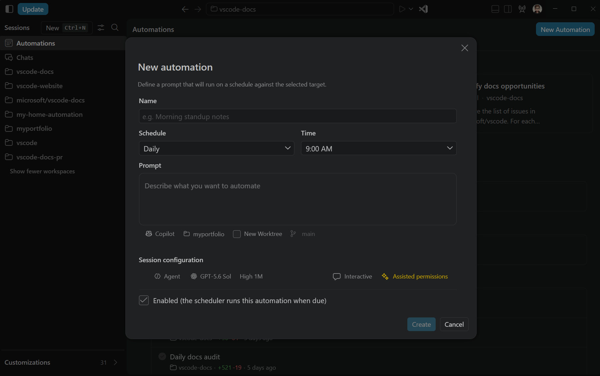

+++
title = "2.2.10.5 自动化"
date = 2026-11-06T07:53:25+08:00
weight = 5
type = "docs"
description = ""
isCJKLanguage = true
draft = false
+++


> 原文链接: [https://code.visualstudio.com/docs/agents/run/automations](https://code.visualstudio.com/docs/agents/run/automations)

# 2.2.10.5 自动化

　　自动化使用保存的提示词和会话配置运行智能体任务。用于总结仓库更改或分诊议题等工作，而无需手动启动每个会话。可以按需运行、按重复计划运行，或对于云自动化响应受支持的仓库事件。也可以从模板开始，或将其共享为可复用文件。

　　任务需要开发环境时，请在本地运行自动化。希望重复仓库工作在 VS Code 和计算机关闭时继续时，请在 GitHub 云中运行。

　　本文解释如何选择本地或云自动化，以及如何创建、监控和安全管理它们。

## 前提条件 {#prerequisites}

* 设置并打开[智能体窗口](../../2.2.3-AgentsWindow/#prerequisites)，并确保有可用智能体。
* 对于云自动化，请使用对符合条件的私有仓库具有写入权限的 GitHub.com 账户登录。Copilot 套餐和组织必须允许自动化。请参阅 [GitHub 自动化可用性和权限](https://docs.github.com/en/copilot/concepts/agent-capabilities/agent-powered-workflows-and-operations/about-automations#availability-and-permissions)。

　　自动化和云自动化管理默认开启。如果侧边栏中没有 **自动化**，请检查 `chat.automations.enabled` 是否开启。如果创建表单中没有 **在云中运行**，还要检查 `chat.automations.cloud.enabled`。开启这些设置不会授予 GitHub 服务访问权限。

## 选择自动化运行位置 {#choose-where-an-automation-runs}

| 选项 | 选择时机 | 执行要求 |
|--------|----------------|------------------------|
| **本地** | 任务需要本地工作区、工具或开发环境。 | 保持计算机唤醒，并在计划运行时智能体可用。 |
| **云端** | 希望按计划或响应受支持议题和拉取请求事件执行无人值守仓库工作。 | 在 GitHub 上运行，即使计算机关闭。需要符合条件的仓库和服务访问权限。 |

　　GitHub 服务套餐、权限、计费、安全和支持的触发器可能独立于 VS Code 变化。启用无人值守云运行前，请审查 [Copilot 自动化](https://docs.github.com/en/copilot/concepts/agent-capabilities/agent-powered-workflows-and-operations/about-automations)。

　　自动化在触发器触发时启动运行。它们不同于[云会话](../../../work-across-apps-and-machines/2.5.3-CloudSessions/)——后者启动交互任务并重新打开同一会话继续。创建云会话不会创建自动化或计划。

## 创建自动化 {#create-an-automation}

**本地**

1. 在智能体窗口侧边栏选择 **自动化**。
2. 创建新自动化或选择[入门模板](#start-from-a-template)。从模板开始会预填提示词和计划字段。
3. 保持 **在云中运行** 关闭。
4. 输入描述性 **名称** 和 **提示词**。指定任务、范围以及预期输出。例如：

    ```text
    总结当前分支过去 24 小时的提交。按功能、修复和维护工作分组。
    包含提交引用，并标记可能需要文档的更改。不要修改文件。
    ```

    如果从模板开始，请在保存前审查并调整提示词。

5. 选择智能体应工作的工作区，或为不需要项目文件的任务选择 **聊天**。可用智能体取决于此选择。
6. 选择可用智能体，并审查模型和权限等其他配置。对于 Git 工作区，智能体支持隔离时可以选择 **新工作树** 和基础 branch。了解如何[选择智能体和代码隔离](../../../choose-models-and-agents/2.3.2-ChooseAnAgentHarness/)。
7. 配置 **触发器** 指定自动化何时运行。可以选择 **手动** 或[重复计划](#set-a-recurring-schedule)。
8. 可选地在高级设置中启用或禁用自定义项。
9. 审查自动化设置，然后选择 **创建**。



> **警告**：自动化可以根据智能体权限读取文件、运行命令并进行更改。计划无人值守工作前请审查[权限级别](../../permissions-and-security/2.2.12.1-ApprovalsAndPermissions/#permission-levels)。保存自动化不会绕过组织策略，也不保证未来运行不需要你的批准。

**云端**

1. 在智能体窗口侧边栏选择 **自动化**。
2. 创建新自动化或选择[入门模板](#start-from-a-template)。
3. 开启 **在云中运行**。
4. 在工作区选择器中选择符合条件的私有 GitHub.com 仓库。可以使用本地克隆，或选择仓库而不克隆到机器。不支持公共仓库。
5. 输入描述性 **名称** 和 **提示词**。明确任务、范围、预期输出和安全约束。例如，命名为“每日仓库摘要”并使用：

    ```text
    总结过去 24 小时合并到默认分支的提交。按功能、修复和维护工作分组。
    包含提交引用，并标记可能需要文档的更改。在会话中返回摘要。
    不要修改文件、打开拉取请求或更改议题。
    ```

6. 选择可用模型。
7. 在 **工具** 中选择 **配置允许的工具**，选择自动化可用的工具。默认不选择任何工具。只授予任务需要的工具。对于摘要示例，允许读取仓库的工具，关闭更改文件、议题或拉取请求的工具。
8. 选择 **所有者**：
    * **仅我**：只有你能查看和编辑自动化定义，其运行以你的身份执行。
    * **仓库**：自动化由私有仓库拥有，以 Copilot 身份运行。有仓库读取权限的人可以查看定义，有写入权限的人可以编辑和运行。
    创建后不能更改所有者。自动化视图将个人和仓库拥有的自动化分组为 **你的自动化** 和 **共享自动化**。
9. 配置 **触发器**。可以选择 **手动**、[重复计划](#set-a-recurring-schedule)或响应[仓库事件](#run-on-repository-events)（议题或拉取请求）。
10. 审查设置并选择 **创建**。

　　对于摘要示例，请将引用的提交与仓库历史比较，确认摘要覆盖请求的时间窗口，并检查没有文件或议题更改。检查后[设置重复计划](#set-a-recurring-schedule)。

　　云服务在所选仓库中运行提示词，不使用本地工作树、未提交更改或本地开发环境。

## 从聊天创建自动化 {#create-an-automation-from-chat}

　　也可以在智能体窗口的普通聊天中要求创建自动化。描述任务、运行位置和计划。例如：

```text
为此工作区创建一个本地自动化，每天上午 9:00 运行。
总结过去 24 小时的提交，按功能、修复和维护分组。在会话中返回摘要。
不要修改文件。保存为禁用状态，以便我在启用计划运行前审查。
```

　　智能体通过正常工具审批流程创建自动化。允许创建前审查任何审批请求。然后打开 **自动化** 审查保存的提示词、执行环境、计划和权限，再启用计划运行。

　　对于自定义节奏，请指定 cron 表达式和时区：

```text
为此工作区创建一个本地 Agent Host 自动化。使用 cron 表达式
0 9,17 * * MON-FRI 在我的本地时区每周一至周五上午 9:00 和下午 5:00 运行。
总结过去 24 小时的提交。不要修改文件。保存为禁用状态，以便我在启用前审查。
```

　　Cron 计划需要本地 Agent Host，云自动化不支持。启用前请审查 [cron 计划和语法指导](#use-a-cron-schedule)。

## 从模板开始 {#start-from-a-template}

　　自动化模板提供可审查和调整的起始名称、提示词和计划：

* **内置模板** 包含 VS Code 随附的模板。
* **来自插件的模板** 包含已启用[智能体插件](../../../customize-and-extend/2.4.2-Plugins/#what-plugins-provide)的模板。每个模板显示 **插件** 徽章和来源插件。

　　没有保存自动化时模板部分默认展开，有保存自动化时折叠。**来自插件的模板** 上的蓝色标记表示已启用插件贡献了新模板。展开该部分可清除标记。

　　选择模板在 **新建自动化** 对话框中打开。审查提示词和计划，然后选择工作区、智能体、模型、权限和隔离。**启用** 复选框默认清除。仅在审查完整配置后选择它，然后选择 **创建**。

　　禁用插件会从视图中移除其模板。已从这些模板创建的自动化及其运行历史仍可用。

## 运行和审查自动化 {#run-and-review-an-automation}

　　在自动化卡片上选择 **立即运行**。自动化启动智能体会话，运行出现在 **历史** 下。

　　在 **历史** 中选择运行以打开其会话。依赖任务输出前审查响应和任何更改。会话需要批准时，请在那里审查请求。运行失败时，请检查错误和会话后重试。

　　每次运行使用所选智能体和模型，因此选择计划时请考虑重复使用量。

　　对于云自动化，运行活动时卡片和历史会更新，显示运行是排队、运行中、已完成还是失败。选择运行在智能体窗口中打开会话、审查输出并在可用时发送后续消息。后续消息继续该运行的对话，不会更新自动化保存的提示词或未来触发器。

　　选择 **刷新** 获取 GitHub 上的更改。在运行上使用 **在 GitHub 上打开** 在那里审查或管理，或会话尚未在编辑器中可用时。如果运行报告 **需要在 GitHub 上输入**，请在 GitHub 上打开响应。

## 设置重复计划 {#set-a-recurring-schedule}

　　检查第一次运行后，选择自动化名称编辑。从 **触发器** 选择计划，保持 **启用** 选中，然后选择 **保存**。

| 计划 | 运行时间 |
|---|---|
| **手动** | 仅当选择 **立即运行** 时。 |
| **每小时**（仅本地） | 每小时。 |
| **每天** | 每天选定 **时间**。 |
| **每周** | 每周选定 **星期几** 的选定 **时间**。 |
| **Cron**（仅本地） | 由五字段 cron 表达式定义的自定义计划。 |

　　每日和每周时间以本地时区显示。云计划以 UTC 存储。本地 UTC 偏移变化时（例如夏令时变化后），请审查保存的时间。

　　云自动化支持 **手动**、**每天** 和 **每周** 触发器。对于每日和每周云计划，请选择分钟为 `00`、`15`、`30` 或 `45` 的时间。

对于本地自动化，请记住这些执行要求：

* 保持运行自动化的机器唤醒且智能体可用。由 Agent Host 支持的计划需要运行中的 Agent Host 进程。其他计划需要运行中的 VS Code 窗口。不要假设退出应用后本地自动化会继续。
* 中断后，错过的计划可能触发补运行。不要依赖每个错过的事件都被重放。
* 自动化一次运行一个会话。另一个计划事件不会启动同一自动化的并行运行。

　　云计划在 GitHub 上运行，而不是通过本地调度器。可以关闭智能体窗口或关闭计算机而不停止计划。

### 使用 cron 计划 {#use-a-cron-schedule}

　　预设不适合时（例如每个工作日运行两次或每月第一天），请使用 cron 计划。云自动化不支持 cron 计划。

1. 创建或编辑本地自动化，在 **触发器** 中选择 **Cron**。
2. 在五个字段中输入表达式，或粘贴完整五字段表达式。
3. 审查表单中显示的计划说明和时区。不完整或无效表达式会保持 **创建** 或 **保存** 不可用。
4. 选择 **创建** 或 **保存**。在审查自动化并检查第一次运行前，保持 **启用** 清除。

　　新 cron 计划使用本地时区。编辑现有 cron 计划时，表单显示其保存的时区，而不是替换它。

　　保存后，即使节奏匹配预设，计划仍为 **Cron**。要切换到预设，请在 **触发器** 中显式选择。

#### Cron 表达式语法 {#cron-expression-syntax}

使用恰好五个空格分隔字段，顺序如下：

| 字段 | 接受值 |
|-------|-----------------|
| 分钟 | `0` 到 `59` |
| 小时 | `0` 到 `23` |
| 月内日 | `1` 到 `31` |
| 月 | `1` 到 `12`，或 `JAN` 到 `DEC` |
| 星期 | `0` 到 `7`，或 `SUN` 到 `SAT`。`0` 和 `7` 都表示周日。 |

每个字段支持：

* `*` 表示每个值。
* 逗号分隔列表，例如 `9,17`。
* 升序范围，例如 `MON-FRI`。
* `*` 或范围上的正步长，例如 `*/30` 或 `0-59/15`。

　　不支持从单个起始值开始的步长（例如 `5/15`）。不要包含秒字段或 `@daily` 等别名。

| 表达式 | 运行时间 |
|------------|--------------|
| `0 9,17 * * MON-FRI` | 周一至周五上午 9:00 和下午 5:00。 |
| `0 9 1 * *` | 每月第一天上午 9:00。 |
| `*/30 * * * *` | 每小时第 `00` 和 `30` 分钟。 |

　　月内日和星期都受限时，任一匹配即可。月份字段仍适用于两者。例如，`0 9 1 * MON` 在每月第一天和每周一上午 9:00 运行，而不仅是第一天为周一时。

## 在仓库事件上运行 {#run-on-repository-events}

　　云自动化可以响应 GitHub 为账户和仓库公布的事件，而不是按计划运行：

1. 创建或编辑云自动化，在可用时将 **触发器** 设置为 **议题** 或 **拉取请求**。
2. 选择要响应的事件或拉取请求事件。例如，议题获得标签或提交拉取请求审查时响应。可用事件取决于 GitHub 触发器目录。
3. 展开 **高级** 配置所选事件的筛选器。字段、允许值和必填字段取决于 GitHub 触发器目录。

    | 字段 | 用途 |
    |-------|-----------|
    | **查询** | 限制匹配哪些议题或拉取请求。 |
    | **评论文本** | 按触发评论中的文本筛选。 |
    | **添加的标签** | 匹配添加到议题或拉取请求的标签。 |
    | **负责人** | 按与事件关联的负责人筛选。 |
    | **更改的路径** | 将触发限制为拉取请求中匹配的文件路径。 |
    | **审查状态** | 按拉取请求审查状态筛选。 |

4. 在 **触发活动** 下选择 **包含没有此仓库写入权限的用户的活动**，让这些用户触发运行。清除可限制为有写入权限的用户。仓库设置可能保持此选项清除且不可用，并显示 **已被仓库设置禁用**。包含无写入权限用户活动前请审查[安全注意事项](#cloud-automation-security-and-usage)。
5. 审查所选事件的提示词和允许工具，然后在 **启用** 选中时保存。

　　在可以安全检查结果的仓库中使用受控事件测试。事件触发自动化不显示 **立即运行**。要手动测试提示词，请先创建带 **手动** 触发器的单独自动化。

　　如果现有自动化使用编辑器不支持的触发器或字段，这些触发器控件为只读。其他受支持更改会保留触发器。请使用 **在 GitHub 上打开** 管理不支持的触发器配置。

## 共享自动化 {#share-an-automation}

　　将本地自动化导出为 `.automation.md` 文件，以便在另一台机器复用或与他人共享。该文件是可读 Markdown，带 YAML frontmatter，仅包含可移植信息：

* 名称和提示词。
* 手动、每小时、每天、每周或 cron 计划。
* 文件格式版本和可移植标识符。

　　导出的 cron 计划使用 `timeZone: local`，因此导入机器使用自己的本地时区。配置时区与当前本地时区不同的 cron 计划不能导出。

　　文件不包括工作区、提供商、模型、权限、启用状态或运行历史。导入者自行选择这些选项。

　　云自动化不提供 **导出**。请在 GitHub 上管理其定义和触发器，不要依赖导出的 `.automation.md` 文件重现它们。

### 导出自动化 {#export-an-automation}

1. 在自动化卡片上选择 **更多操作** > **导出**。
2. 选择保存 `.automation.md` 文件的位置。

　　可以在编辑器中打开导出文件，在共享前审查其提示词和计划。

### 导入自动化 {#import-an-automation}

1. 在自动化视图中选择 **导入自动化**，然后选择 `.automation.md` 文件。也可以将一个 `.automation.md` 文件拖到视图任意位置。
2. 在 **新建自动化** 对话框中审查导入的名称、提示词和计划。
3. 选择工作区、智能体、模型、权限和隔离。
4. **启用** 复选框默认清除。仅在审查完整配置后选择它，然后选择 **创建**。

　　VS Code 会拒绝不支持的文件，而不是静默更改其计划或导入执行权限。

## 管理自动化 {#manage-an-automation}

* **编辑**：选择自动化名称，更新受支持字段，选择 **保存**。云自动化的仓库和 **所有者** 创建后不能更改。要使用其他仓库或所有者，请创建另一个自动化，并禁用原自动化。
* **启用或禁用未来运行**：选择 **更多操作** > **启用** 或 **禁用**。禁用不会停止进行中的运行。
* **复制**：选择 **更多操作** > **复制**，在 **新建自动化** 对话框中审查副本，选择 **创建**。在 GitHub 上复制事件触发的云自动化以保留完整配置。
* **停止活动运行**：在可用时对 **历史** 中的运行选择 **停止**。这请求取消，不回滚已完成操作。
* **导出**（仅本地）：选择 **更多操作** > **导出**。
* **在 GitHub 上打开**（仅云）：选择 **更多操作** > **在 GitHub 上打开** 打开自动化定义。在单次运行上使用此操作可改为打开该运行。
* **删除**：选择 **更多操作** > **删除** 并确认。永久删除自动化及其运行历史。

　　对于云自动化，编辑、启用、禁用和删除会更新 GitHub 上的自动化。禁用阻止未来计划运行，但不停止进行中的运行。删除会从 GitHub 移除云自动化及其计划。在 GitHub 上管理后选择 **刷新** 更新自动化视图。

> **重要**：关闭 `chat.automations.cloud.enabled` 或 `chat.automations.enabled` 会隐藏 VS Code 中的云自动化控件，但不会停止 GitHub 上已激活的计划或事件触发器。关闭设置前请禁用或删除这些云自动化。

## 云自动化安全和使用 {#cloud-automation-security-and-usage}

　　云自动化使用你允许的工具执行无人值守工作。只授予任务需要的工具，使用范围狭窄的提示词和事件筛选器，并在启用重复工作前审查手动运行。不要假设本地审批或沙盒设置适用于 GitHub 执行环境。

　　**仅我** 自动化是私有的，但其运行会话和日志可能对有仓库访问权限的人可见。不要在提示词中放置机密。使用仓库支持的机密配置，并审查 [GitHub 自动化安全](https://docs.github.com/en/copilot/concepts/agent-capabilities/agent-powered-workflows-and-operations/about-automations#security-and-safety)。

　　计划运行、事件触发运行和后续消息会消耗服务用量。启用频繁触发器前，请检查 [GitHub 自动化计费](https://docs.github.com/en/copilot/concepts/agent-capabilities/agent-powered-workflows-and-operations/about-automations#billing)和组织策略。

## 排查云自动化 {#troubleshoot-cloud-automations}

| 症状 | 检查内容 |
|---------|---------------|
| 云自动化创建不可用 | 检查两个自动化设置、GitHub.com 账户、仓库写入权限以及服务或组织资格。开启设置不会授予访问权限。 |
| 未提供某个仓库 | 使用符合条件的私有 GitHub.com 仓库。公共仓库和非 Git 文件夹不是云自动化目标。 |
| 保存的自动化缺失 | 检查登录账户和所选仓库。视图只发现已知仓库中的自动化，而不是账户中每个仓库。选择仓库后选择 **刷新**。 |
| **立即运行** 不可用 | 云自动化必须启用。事件触发自动化由匹配事件运行，而不是 **立即运行**。 |
| 触发器或工具目录未加载 | 重试加载并检查报告的错误。不要用空选择替换已保存工具或触发器来绕过加载失败。 |
| 运行需要输入或会话无法打开 | 使用 **在 GitHub 上打开**。如果会话尚不可用，请刷新并重试。 |
| 关闭编辑器设置后工作仍在继续 | 在 GitHub 上禁用或删除自动化。隐藏编辑器控件不会停止远程触发器或取消活动运行。 |

## 云自动化限制 {#cloud-automation-limitations}

　　VS Code 中的云自动化支持目前有以下限制：

* 可用仓库、事件类型、筛选器、模型和工具取决于 GitHub 服务支持和账户权限。
* 云自动化使用云模型和工具配置，不接受本地模式或审批设置、自定义智能体或本地 MCP 配置。
* 不支持的触发器配置必须在 GitHub 上管理，编辑其他受支持字段时不会被替换。

## 后续步骤 {#next-steps}

* [管理智能体会话](../../sessions/2.2.11.1-ManageSessions/)
* [发现和管理智能体插件](../../../customize-and-extend/2.4.2-Plugins/)
* [审查 AI 生成的代码编辑](../../2.2.8-ReviewAndRevertChanges/)
