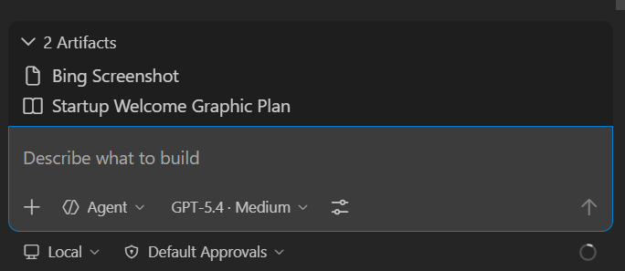

+++
title = "2.2.11.3 工件"
date = 2026-11-06T07:53:25+08:00
weight = 3
type = "docs"
description = ""
isCJKLanguage = true
draft = false
+++


> 原文链接: [https://code.visualstudio.com/docs/agents/run/artifacts](https://code.visualstudio.com/docs/agents/run/artifacts)

# 2.2.11.3 工件

　　VS Code 中的工件面板在聊天对话旁显示重要资源，例如截图、计划和文档。工件可以同时来自多个来源，并显示在按来源分组的可折叠树控件中。

> **注意**：本页功能在聊天视图和智能体窗口中均可用。

> **注意**：要启用工件面板，请将 `chat.artifacts.enabled` 设置为 `true`。



## 工件和引用 {#artifacts-and-references}

　　智能体会话可以在聊天输入框旁显示工件和引用。工件表示会话处理的重要结果或资源，引用提供会话仅查阅的支持信息。

　　对于 GitHub 议题和拉取请求，会话处理某项时该项是工件，即使它在会话开始前已存在。会话仅用于信息的议题或拉取请求是引用。

## 工件来源 {#artifact-sources}

工件可以来自不同来源，并按来源合并和分组：

* **基于规则的提取**：VS Code 根据可配置 MIME 类型模式、文件路径 glob 或记忆文件路径，自动从对话内容提取工件。例如，内置规则显示截图和计划文档。详情请参阅[配置工件提取规则](#configure-artifact-extraction-rules)。
* **智能体设置的工件**：智能体使用 `#artifacts` 工具显式设置工件。每次更新会替换之前的智能体工件列表。
* **子智能体工件**：智能体将工作委派给子智能体时，每个子智能体可以设置自己的工件，显示在带子智能体名称的单独组中。

## 配置工件提取规则 {#configure-artifact-extraction-rules}

　　基于规则的提取使用三个设置，每个将模式映射到组配置。组配置有 `groupName`（显示标签）和可选的 `onlyShowGroup` 标志（为 `true` 时仅显示组标题，不显示单个项目）。

| 设置 | 说明 | 默认值 |
|---------|-------------|---------|
| `chat.artifacts.rules.byMimeType` | 按 MIME 类型模式匹配工具结果，例如 `"image/*"`。 | `{ "image/*": { "groupName": "Screenshots", "onlyShowGroup": true } }` |
| `chat.artifacts.rules.byFilePath` | 按 glob 模式匹配工作区文件，例如 `"**/*plan*.md"`。 | `{ "**/*plan*.md": { "groupName": "Plans" } }` |
| `chat.artifacts.rules.byMemoryFilePath` | 按 glob 模式匹配记忆工具写入，例如 `"**/*plan*.md"`。 | `{ "**/*plan*.md": { "groupName": "Plans" } }` |

例如，添加规则将智能体写入的 HTML 文件显示为工件，请在设置中添加：

```json
"chat.artifacts.rules.byFilePath": {
    "**/*.html": { "groupName": "Web Pages" }
}
```

　　要完全禁用基于规则的提取，请将三个规则设置都设置为 `{}`。

## 使用工件 {#use-artifacts}

　　工件可用时，工件面板显示在对话旁。工件按来源组织为组。

* 选择工件打开相应资源。例如，选择图像工件显示预览，选择文档工件在编辑器中打开文件。
* 智能体工件在每次智能体更新时替换之前的智能体列表。
* 每个子智能体的工件显示在单独组中。可以独立清除特定子智能体的工件。
* 基于规则的工件随对话进展自动更新。更改规则设置后，工件面板反映更新后的规则。

## 移除工件或引用 {#remove-an-artifact-or-reference}

　　要移除单个记录项，请将鼠标悬停或聚焦聊天输入框旁的项目，然后选择其移除操作。如果组包含多个项目，请先选择组打开列表。重新加载或重新打开会话后移除仍保留。

　　移除项目只删除当前会话中的记录，不删除文件或网站、不回退文件更改，也不修改议题或拉取请求。

　　并非每个显示项都可移除。仅当会话提供商支持移除且记录项有稳定 ID 时，移除操作才可用。VS Code 独立发现的议题或拉取请求关联可能在移除记录项后仍然可见或重新出现。派生文件更改和独立发现的关联不能通过此操作移除。

## 要求智能体创建工件 {#ask-the-agent-to-create-artifacts}

　　可以在提示词中描述希望保留的内容，要求智能体将其存储为工件。例如：

* “截取我的应用屏幕截图并将其设置为工件”
* “编写项目计划并将其设置为工件”
* “将这些链接保存为工件”

　　智能体随后使用 `#artifacts` 工具将资源添加到工件面板。无需直接引用工具，只需描述要保留的内容，智能体决定何时将其显示为工件。

　　智能体还可以使用 `#artifactRules` 工具覆盖当前会话的提取规则。这会在会话期间替换任何基于设置的规则。

## 相关资源 {#related-resources}

* [聊天概述](../../2.2.5-UseChat/)
* [智能体工具](../../plan-and-run-tasks/2.2.10.2-UseTools/)
* [AI 设置参考](../../../reference-and-help/reference/2.8.1.3-SettingsReference/)
