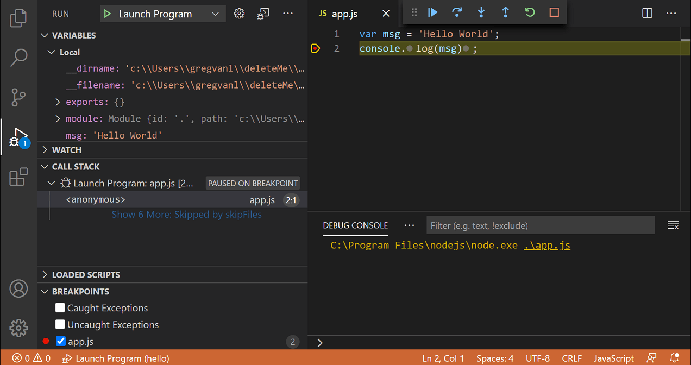

+++
title = "6.1 调试代码"
date = 2026-11-06T07:53:25+08:00
weight = 1
type = "docs"
description = ""
isCJKLanguage = true
draft = false
+++

> 原文链接: [https://code.visualstudio.com/docs/debugtest/debugging](https://code.visualstudio.com/docs/debugtest/debugging)

# 6.1 调试代码

　　使用 Visual Studio Code 调试器可以暂停应用程序、检查其状态并单步执行代码，以找到问题原因。本文介绍第一次调试会话以及用于调查问题的工具。

　　VS Code 包含适用于 JavaScript、TypeScript 和 Node.js 的调试器。对于其他语言和运行时，请安装[调试器扩展](#debugger-extensions)。

## 启动调试会话 {#start-a-debugging-session}

1. 打开要调试的源文件。

2. 在可执行代码行旁边的编辑器边距中选择，或按 `F9` 设置断点。红色圆圈表示断点。

3. 按 `F5` 开始调试，或打开 **运行和调试** 视图（`Ctrl + Shift + D`）并选择 **运行和调试**。

4. 如果出现提示，请选择适用于你的语言或运行时的调试器。

    对于简单应用程序，VS Code 会尝试运行活动文件。如果你的应用程序需要特定入口点、命令行参数、环境变量或其他自定义设置，请[6.2 调试配置](../6.2-DebuggingConfiguration/)。

5. 执行在断点处暂停时，在 **变量** 部分检查值，并在 **调用堆栈** 部分查看函数调用。

6. 使用调试工具栏继续执行、单步执行代码、重新启动应用程序或停止调试。

## 调试器用户界面 {#debugger-user-interface}

* **运行和调试**视图：检查变量和表达式、管理断点并浏览调用堆栈。
* **编辑器**：查看当前执行行、设置断点，并在内联或悬停时检查值。
* **调试工具栏**：控制应用程序的执行流程。
* **调试控制台**：查看调试器输出并计算表达式。
* **调试状态**：从状态栏选择活动调试配置。

## 调试操作 {#debug-actions}

| 操作 | 说明 |
|--------|-------------|
| 继续或暂停 `F5` | 继续执行到下一个断点，或暂停正在运行的程序。 |
| 单步跳过 `F10` | 运行当前行，不进入该行调用的函数。 |
| 单步进入 `F11` | 进入当前行调用的函数。 |
| 单步退出 `Shift + F11` | 完成当前函数，并在调用函数中暂停。 |
| 重新启动 `Ctrl + Shift + F5` | 使用当前调试配置停止并重新启动应用程序。 |
| 停止 `Shift + F5` | 结束当前调试会话。 |

　　调试多个目标时，工具栏还允许选择活动会话。

> **提示**：使用 `debug.toolBarLocation` 设置可以将调试工具栏显示为 `floating`（浮动）、`docked`（停靠在运行和调试视图中）或 `hidden`（隐藏）。

## 断点 {#breakpoints}

　　断点会在特定位置暂停应用程序，以便检查状态。断点行为因调试器和编程语言而异。

### 设置断点 {#setting-breakpoints}

　　要在当前行设置或移除断点，请选择编辑器边距或按 `F9`。断点图标指示状态：

* 实心红圆：已启用的断点。
* 实心灰圆：已禁用的断点。
* 空心灰圆：调试器无法注册断点，可能因为该行没有可执行代码，或调试器不支持该源文件。

　　使用 **运行和调试** 视图中的 **断点** 部分启用、禁用、编辑或移除断点。要按文件将断点分组为树形，请将 `debug.breakpointsView.presentation` 设置为 `tree`。要在编辑器概览标尺中显示断点，请开启 `debug.showBreakpointsInOverviewRuler`。

### 断点类型 {#breakpoint-types}

#### 条件断点 {#conditional-breakpoints}

　　条件断点仅在满足指定条件时暂停执行。可以使用：

* **表达式条件**：当表达式计算结果为 `true` 时暂停。
* **命中次数**：在到达断点指定次数后暂停。支持的语法因调试器而异。
* **等待断点**：在另一个断点命中后激活，这会创建[触发断点](#triggered-breakpoints)。

　　要添加条件断点，请打开编辑器边距上下文菜单并选择 **添加条件断点**，或从命令面板运行 **Debug: Add Conditional Breakpoint...**。选择条件类型，输入表达式、命中次数或触发断点，然后按 `Enter`。

　　要编辑现有断点，请打开断点上下文菜单并选择 **编辑断点**，或选择 **断点** 部分中的铅笔图标。

#### 触发断点 {#triggered-breakpoints}

　　触发断点在另一个断点命中后启用，适用于仅在特定代码路径或应用程序状态之后才发生故障的情况。打开编辑器边距上下文菜单，选择 **添加触发断点**，然后选择激活它的断点。

<video src="https://code.visualstudio.com/assets/docs/debugtest/debugging/debug-triggered-breakpoint.mp4" title="显示触发断点在另一个断点命中后激活的视频。" autoplay loop controls muted></video>

#### 内联断点 {#inline-breakpoints}

　　内联断点在特定列暂停，适用于包含多条语句的行（例如压缩代码）。使用 `Shift + F9` 或调试期间的编辑器上下文菜单设置内联断点。内联断点也可以带条件。

#### 函数断点 {#function-breakpoints}

　　函数断点在执行进入函数时暂停，适用于知道函数名但没有打开源代码的情况。选择 **断点** 部分中的 **+** 按钮并输入函数名。函数断点显示为红色三角形。

#### 数据断点 {#data-breakpoints}

　　数据断点在变量值更改、读取或访问时暂停，可用选项取决于调试器。打开 **变量** 部分中变量的上下文菜单，选择可用的 **中断** 操作。数据断点显示为红色六边形。

#### 日志点 {#logpoints}

　　日志点将消息写入调试控制台而不暂停执行，适合在不向源代码添加日志语句的情况下检查值。打开编辑器边距上下文菜单并选择 **添加日志点**，或从命令面板运行 **Debug: Add Logpoint...**。输入纯文本，并在花括号中包含表达式，例如 `User ID: {user.id}`。

　　日志点显示为菱形图标，可以添加条件和命中次数。要将鼠标中键设置为切换日志点，请配置 `debug.gutterMiddleClickAction`。

> **注意**：只有当调试器扩展实现日志点时，该功能才可用。

## 数据检查 {#data-inspection}

　　执行暂停时，可以在 **运行和调试** 视图中检查当前应用程序状态，或在调试控制台中计算表达式。

### 运行和调试视图 {#run-and-debug-view}

　　选定的堆栈帧决定可用的变量和表达式：

* **变量**：显示所选堆栈帧的局部和全局变量。要在会话期间修改变量值，请打开变量上下文菜单并选择 **设置值**（`Ctrl + Shift + I`？请使用变量上下文菜单中的 **设置值**）。
* **监视**：调试器每次暂停时计算表达式。对变量使用 **复制为表达式** 可添加访问该变量的表达式。
* **调用堆栈**：显示活动函数调用。选择堆栈帧可检查其源位置和变量。

　　要按名称或值筛选变量，请聚焦 **变量** 部分，使用 `Ctrl + F` 并输入搜索词。也可以将鼠标悬停在编辑器中的表达式上检查当前值。

### 调试控制台 REPL {#debug-console-repl}

　　调试控制台是活动调试会话的 REPL（读取-求值-输出循环）。它显示调试器输出，并允许在所选堆栈帧的上下文中计算表达式。使用 **View: Debug Console**（`Ctrl + Shift + Y`）打开，输入表达式并按 `Enter`。对于多行输入，使用 `Shift + Enter` 换行，然后按 `Enter` 计算完整表达式。

> **注意**：表达式语法和计算支持取决于调试器，并且需要活动的调试会话。

## 多目标调试 {#multi-target-debugging}

　　对于客户端和服务器等多进程应用程序，先启动一个调试会话，再启动另一个。有多个活动会话时：每个会话显示在 **调用堆栈** 部分的顶层；调试工具栏显示活动会话并提供切换会话的下拉列表；调试操作应用于活动会话。要创建可重复启动多个调试配置的设置，请创建[6.2 调试配置](../6.2-DebuggingConfiguration/#compound-launch-configurations)。

## 远程调试 {#remote-debugging}

　　远程调试支持取决于调试器扩展。请查看扩展文档，了解连接要求和受支持的环境。内置 Node.js 调试器支持远程调试。

## 调试器扩展 {#debugger-extensions}

　　VS Code 包含对 Node.js 以及 JavaScript、TypeScript 和编译为 JavaScript 的语言的调试支持。对于其他语言和运行时，请从 [Visual Studio Marketplace](https://marketplace.visualstudio.com/vscode/Debuggers)安装扩展，或从 **运行** 菜单中选择 **安装其他调试器**。调试器扩展定义支持的启动配置、断点类型、表达式语法和远程调试能力。

## 后续步骤 {#next-steps}

* [6.2 调试配置](../6.2-DebuggingConfiguration/)：创建和自定义可复用的 `launch.json` 配置。
* [调试 Node.js 应用程序](https://code.visualstudio.com/docs/nodejs/nodejs-debugging)：了解内置 JavaScript 和 Node.js 调试器。
* [使用 Copilot 调试和修复问题](https://code.visualstudio.com/docs/copilot/overview#fix-issues)：使用 AI 辅助工具调查并修复问题。
