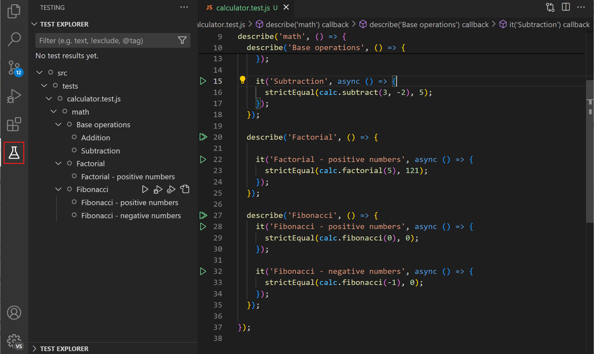
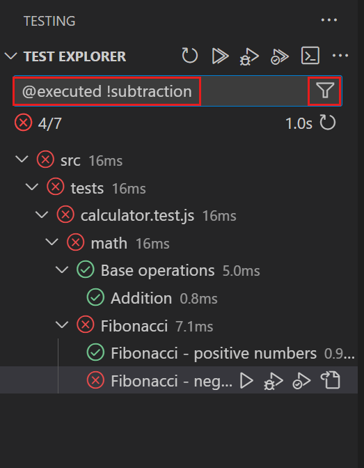
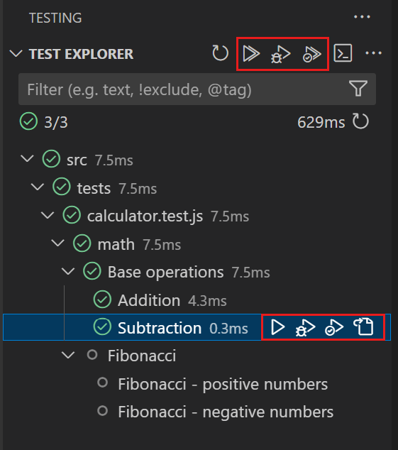
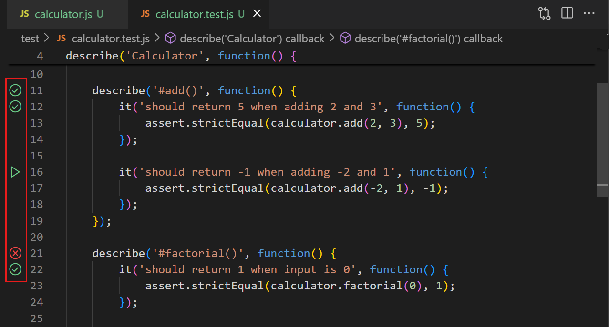
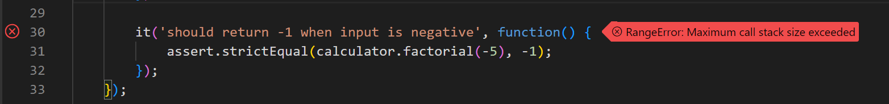
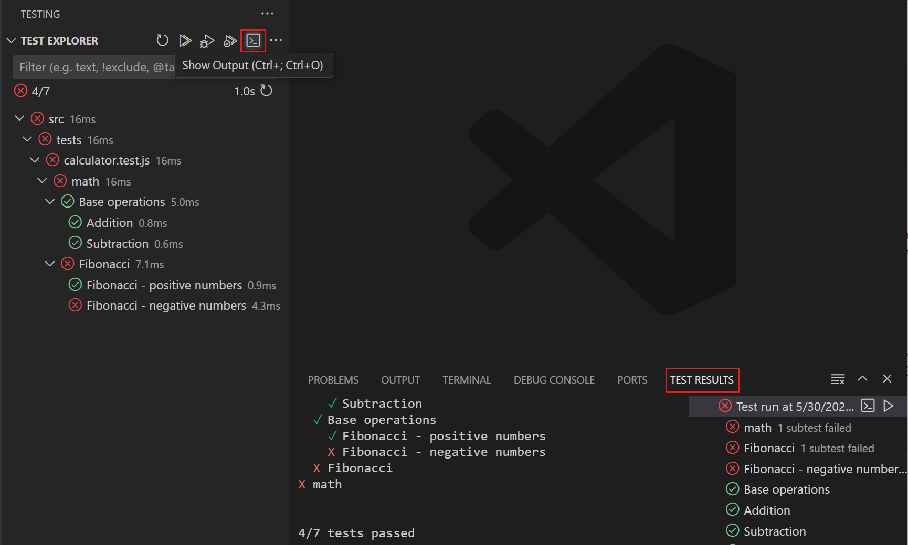
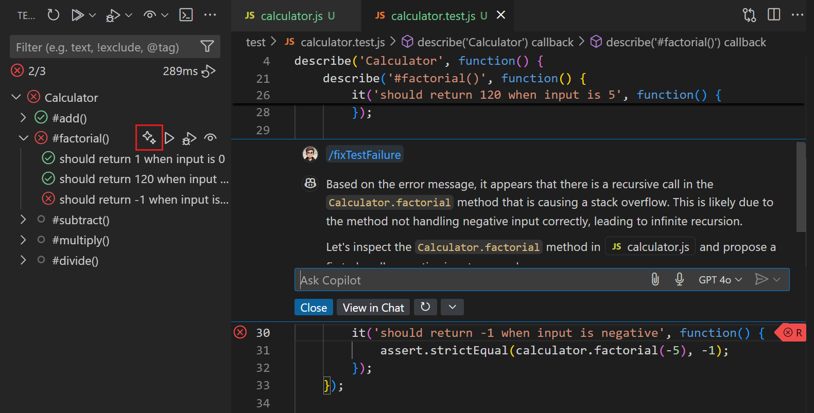
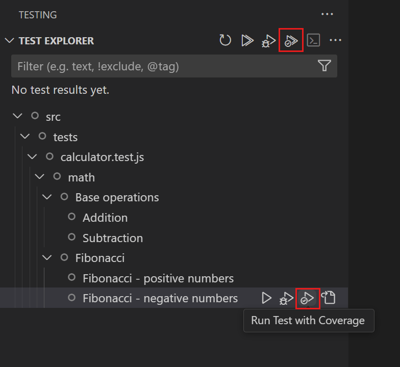
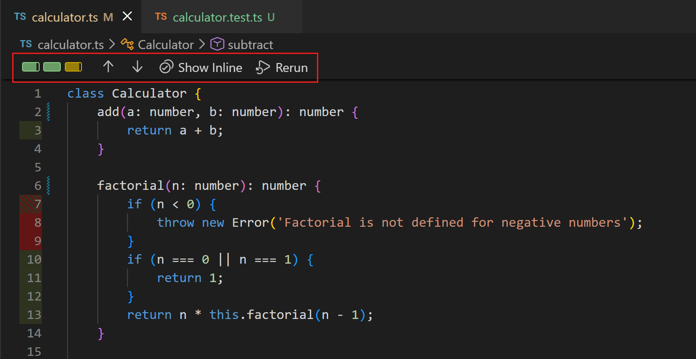

+++
title = "6.4 测试"
date = 2026-11-06T07:53:25+08:00
weight = 4
type = "docs"
description = ""
isCJKLanguage = true
draft = false
+++


> 原文链接: [https://code.visualstudio.com/docs/debugtest/testing](https://code.visualstudio.com/docs/debugtest/testing)

# 6.4 测试

　　Visual Studio Code 提供发现、运行和调试测试、检查结果以及测量代码覆盖率的工具。本文介绍测试扩展、测试执行、覆盖率以及与任务的集成。AI 协助是可选的。如果使用 GitHub Copilot，还可以[使用智能体添加测试](#write-tests-with-ai)、帮助配置测试框架并调查失败。

## VS Code 中的测试 {#about-testing-in-vs-code}

　　VS Code 的测试支持因语言而异，并取决于已安装的[测试扩展](#extensions-for-testing)。语言扩展或独立扩展可以为特定语言或测试框架实现测试功能。

* **支持多种测试框架**：语言扩展和独立测试扩展支持 Jest、Mocha、Pytest、JUnit 等各种测试运行器。
* **集中管理测试**：测试资源管理器提供集中管理和运行项目测试的位置，并可能自动发现测试。
* **集成测试结果**：在编辑器中的测试代码旁查看状态，或在测试资源管理器中查看所有测试。详细结果可在测试结果面板中查看。
* **调试**：调试测试以诊断失败，可使用断点、监视变量等功能。
* **测试覆盖率**：运行带覆盖率的测试，查看测试覆盖了多少代码。
* **AI 辅助测试**：可选地使用 Copilot 添加和审查测试、检查测试设置并调查失败。
* **任务集成**：创建任务来运行测试，也可以在更改代码时在后台运行测试。

## 开始测试 {#get-started-with-testing-in-vs-code}

1. 打开扩展视图，安装适用于项目的测试扩展。按 **Testing** 类别（`@category:"testing"`）筛选。
2. 选择活动栏中的烧杯图标打开测试资源管理器，发现项目中的测试。
3. 从测试资源管理器或编辑器中运行和调试测试。

## 测试扩展 {#extensions-for-testing}

　　可以在 [Visual Studio Marketplace](https://marketplace.visualstudio.com/search?target=VSCode&category=Testing&sortBy=Installs)中查找支持测试的扩展，或在扩展视图中按 **Testing** 类别筛选。

> **提示**：如需 AI 帮助，可以要求智能体[2.6.6 AddTests](../../ai-in-vs-code/tutorials-and-guides/2.6.6-AddTests/#identify-the-testing-setup)，仅在尚未配置框架时推荐框架。安装依赖项前请审查建议。

## 测试视图中的自动测试发现 {#automatic-test-discovery-in-testing-view}

　　测试视图提供集中管理和运行测试的位置。选择活动栏中的烧杯图标，或从命令面板运行 **Testing: Focus on Test Explorer View**。

　　如果项目包含测试，测试资源管理器会发现在工作区中列出测试。发现的测试默认以树视图显示，结构与测试的层次结构匹配。



　　可以单击播放按钮在测试资源管理器中运行测试。双击测试可导航到测试代码。选择失败的测试时，编辑器会打开测试文件、突出显示失败的测试并显示错误消息。

　　如果测试很多，可使用筛选选项按状态筛选，或只显示当前文件的测试。也可以使用搜索框按名称搜索，或使用 `@` 符号按状态搜索。



　　在 **更多操作** 菜单中，可以访问排序和显示选项。添加或更改测试后，使用 **刷新测试** 按钮或 **Test Explorer: Reload tests** 命令刷新测试列表。

> **注意**：根据测试扩展的不同，可能需要先配置测试框架或测试运行器，才能发现项目中的测试。

## 使用 AI 编写测试 {#write-tests-with-ai}

　　智能体可以帮助添加测试、运行项目的测试命令并调查失败。你仍需审查断言并验证结果。请从一个函数或模块开始，而不是要求为整个项目编写测试。

1. [9.1 设置 GitHub Copilot](../../advanced-setup/9.1-GitHubCopilotSetup/)，打开项目并安装依赖项。
2. 打开聊天视图（`Ctrl + Alt + I`，macOS：`Ctrl + Cmd + I`），开始新聊天，选择 **Copilot** 作为 **会话目标**，选择 **智能体** 作为智能体。
3. 附加源文件、有代表性的测试和相关需求，要求智能体在编辑前检查现有框架并提出用例：

    ```text
    使用项目现有框架和测试辅助工具，为附加代码提出测试。
    使用提供的需求定义预期结果，包括边界和错误情况。
    确定目标测试命令和任何设置要求。
    暂时不要编辑文件或安装依赖项。
    ```

4. 审查建议的用例。达成一致后，要求智能体添加并运行测试，不更改实现代码。要求提供确切命令、通过和失败数量以及所有跳过的测试。
5. [2.2.8 审查和还原更改](../../ai-in-vs-code/work-with-ai/2.2.8-ReviewAndRevertChanges/)并亲自运行测试。检查断言是否测试预期行为，以及无关文件是否未更改。无法运行的测试应视为未验证。

　　如果测试失败，请先确定原因是测试设置、错误预期还是实现缺陷，再接受修复。不要仅为了获得通过结果而削弱断言、跳过测试或更改预期值。

　　如需快速起点，可以使用[3.2.4 SmartActions](../../editor/3.2-WriteCode/3.2.4-SmartActions/#generate-tests)。保留之前请审查并运行生成的测试。要复用项目测试约定，请添加[2.4.4 自定义指令](../../ai-in-vs-code/customize-and-extend/2.4.4-Instructions/)。

## 运行和调试测试 {#run-and-debug-tests}

　　发现测试后，可以直接在 VS Code 中运行和调试测试，并查看结果。在测试资源管理器中使用部分标题中的控件运行或调试所有测试，也可以在树视图中选择特定测试的运行/调试图标。



　　在编辑器中查看测试代码时，可以使用边距中的播放控件运行该位置的测试。右键单击边距控件可查看调试测试等其他操作。可以使用 `testing.defaultGutterClickAction` 设置配置默认操作。



　　运行测试后，编辑器边距和树视图会显示测试状态（通过/失败）。测试失败时，错误消息会以覆盖层显示在编辑器中。



　　使用测试资源管理器中的 **显示输出** 按钮，在 **测试结果** 面板中查看输出。



> **提示**：如需当前失败的帮助，请将鼠标悬停在测试资源管理器中的失败测试上，选择 **修复测试失败**（闪光图标），或将失败输出附加到聊天。根据预期行为审查建议的更改，然后重新运行测试及相关测试。



## 测试覆盖率 {#test-coverage}

　　测试覆盖率衡量测试覆盖了多少代码，有助于发现未测试的区域。如果测试扩展支持覆盖率，VS Code 可以运行带覆盖率的测试并查看结果。

　　可以像运行和调试测试一样，通过测试资源管理器、编辑器边距或命令面板运行带覆盖率的测试。



　　运行后，可以在以下位置查看覆盖率：

* **测试覆盖率视图**：树视图显示测试及其覆盖率百分比，并用颜色指示。悬停可查看详细信息。
* **编辑器覆盖层**：边距颜色覆盖指示行是否被测试覆盖，悬停可查看执行次数。可以使用 **显示内联覆盖率** 按钮或 **Test: Show Inline Coverage** 命令切换。
* **资源管理器视图**：显示代码文件的覆盖率百分比。
* **差异编辑器**：打开差异编辑器时也会显示覆盖率结果。
* **测试覆盖率工具栏**：显示结果，允许在未覆盖代码块之间导航并切换内联覆盖率。使用 `testing.coverageToolbarEnabled` 设置启用。



## 任务集成 {#task-integration}

　　任务可以在 VS Code 中运行脚本和启动进程。可以定义运行测试的默认测试任务，并可选地创建运行测试的键盘快捷键。

　　使用 **Tasks: Configure Default Test Task** 命令配置默认测试任务。VS Code 会尝试根据 `package.json` 等自动检测测试任务。以下 `tasks.json` 将 `node --test` 命令指定为默认测试任务：

```json
{
	"version": "2.0.0",
	"tasks": [
		{
			"type": "npm",
			"script": "test",
			"group": {
				"kind": "test",
				"isDefault": true
			},
			"problemMatcher": [],
			"label": "npm: test",
			"detail": "node --test src/tests/**.js"
		}
	]
}
```

　　使用 **Tasks: Run Test Task** 命令或为其创建快捷键来运行测试任务。详细了解[6.3 任务](../6.3-Tasks/)。

> **注意**：目前任务没有与 VS Code 测试功能进行特殊集成，因此通过任务运行测试不会更新界面。各个测试扩展可以提供与 UI 集成的特定测试自动化功能。

## 测试配置设置 {#test-configuration-settings}

| 设置 ID | 详细信息 |
|-|-|
| `testing.countBadge` | 控制活动栏测试图标上的计数徽章。 |
| `testing.gutterEnabled` | 配置是否在编辑器边距中显示测试控件。 |
| `testing.defaultGutterClickAction` | 配置选择边距测试控件时的默认操作。 |
| `testing.coverageBarThresholds` | 配置测试覆盖率视图中覆盖率条阈值的颜色。 |
| `testing.displayedCoveragePercent` | 配置测试覆盖率视图中显示的百分比（总计、语句或最小值）。 |
| `testing.showCoverageInExplorer` | 配置是否在资源管理器视图中显示覆盖率百分比。 |

## 后续步骤 {#next-steps}

* 了解 [Python](https://code.visualstudio.com/docs/python/testing)、[Java](https://code.visualstudio.com/docs/java/java-testing)、[C#](https://code.visualstudio.com/docs/csharp/testing)或 [Ruby](https://code.visualstudio.com/docs/languages/ruby#run-and-debug-tests)中的测试。
* 按照工作流[2.6.6 AddTests](../../ai-in-vs-code/tutorials-and-guides/2.6.6-AddTests/)。
* 详细了解[6.3 任务](../6.3-Tasks/)。
