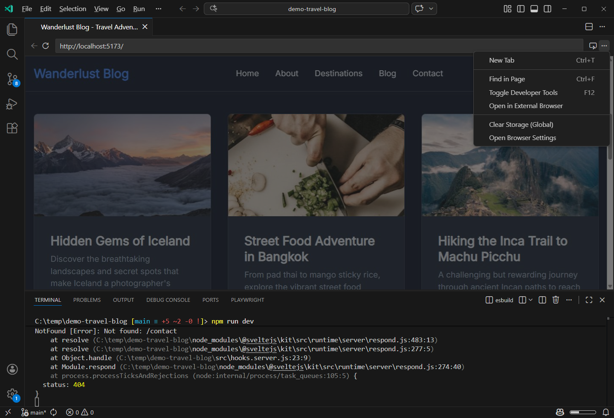

+++
title = "6.5 集成浏览器"
date = 2026-11-06T07:53:25+08:00
weight = 5
type = "docs"
description = ""
isCJKLanguage = true
draft = false
+++


> 原文链接: [https://code.visualstudio.com/docs/debugtest/integrated-browser](https://code.visualstudio.com/docs/debugtest/integrated-browser)

# 6.5 集成浏览器

　　集成浏览器让你直接在 Visual Studio Code 中打开并交互 Web 页面。可以用它预览 Web 应用程序、测试身份验证流程，并对页面元素添加评论，向智能体提供精确反馈。



## 打开浏览器 {#open-the-browser}

* 从命令面板（`Ctrl + Shift + P`，macOS：`Cmd + Shift + P`）运行 **Browser: Open Integrated Browser** 命令。
* 从菜单栏选择 **视图** > **浏览器**，或使用 `Ctrl + Alt + B` 快捷键。
* 选择 VS Code 标题栏中的地球按钮。使用 `workbench.browser.showInTitleBar` 设置控制按钮是否显示。
* 在终端或聊天等位置选择 `localhost` 链接。此行为默认启用。
* 要求智能体打开或交互网页。
* 使用 `editor-browser` 调试类型启动调试会话。

　　可以同时打开多个浏览器实例，每个实例位于自己的编辑器选项卡中。已有浏览器选项卡时，**视图** > **浏览器** 菜单项和标题栏地球按钮会打开选项卡管理快速选择，而不是创建新选项卡。

### 打开本地文件 {#open-local-files}

　　可以直接在集成浏览器中打开本地 HTML 页面（`.html` 和 `.htm`）以及保存的 Web 归档（`.mhtml` 和 `.mht`），扩展名匹配不区分大小写。

* 在资源管理器中右键单击文件，选择 **在集成浏览器中打开**。
* 右键单击文件编辑器选项卡，选择 **在集成浏览器中打开**。
* 在编辑器工具栏中选择 **在集成浏览器中打开**（地球）按钮。

　　这些操作需要本地 `file://` URL，不适用于远程或虚拟工作区资源。

## 使用外部浏览器 {#use-an-external-browser}

　　默认情况下，在终端、聊天或其他位置选择 `localhost`、`127.0.0.1`、`[::1]` 以及 `0.0.0.0`、`[::]` 等链接时，会在集成浏览器中打开。要改为在外部浏览器中打开，请禁用 `workbench.browser.openLocalhostLinks` 设置。默认使用操作系统默认浏览器；可以使用 `workbench.externalBrowser` 设置为 `edge`、`chrome`、`firefox` 或浏览器可执行文件的绝对路径。

　　如果不打算使用集成浏览器，还可以将 `workbench.browser.showInTitleBar` 设置为 `false` 隐藏按钮，或禁用 `workbench.browser.enableChatTools` 阻止聊天智能体使用浏览器工具。

## 导航 {#navigation}

　　浏览器支持 `http://`、`https://` 和 `file://` URL。使用地址栏导航到任意 URL，或使用页面链接在站点内导航。普通导航和锚点链接正常工作；`Ctrl + 单击`（macOS 上为 `Cmd + 单击`）在新浏览器选项卡中打开链接；弹窗会被阻止，但允许新选项卡。

### 更正拼写错误 {#correct-misspelled-words}

　　在可编辑字段中输入时，浏览器会为拼写错误的单词添加下划线。右键单击并选择建议的更正。选择 **添加到词典** 可将单词保存到浏览器词典；此操作仅在浏览器使用持久 `global` 或 `workspace` 会话存储时可用。

### 地址栏和建议 {#address-bar-and-suggestions}

　　选择地址栏时会打开建议选择器。输入 URL 并按 `Enter` 导航。输入时，选择器会筛选收藏和其他建议。随时运行 **Browser: Focus URL Input** 命令或使用 `Ctrl + L` 聚焦地址栏。

### 搜索 Web {#search-the-web}

　　可以像普通浏览器一样从地址栏搜索 Web。使用 `workbench.browser.searchEngine` 设置选择 Bing、Google、Yahoo 或 DuckDuckGo。默认值 `none` 禁用 Web 搜索，只将输入作为 URL。

### 收藏 {#favorites}

　　要收藏当前页面，请打开地址栏并选择星形图标。收藏的页面会出现在建议选择器中，并随输入进行筛选。

### 打开的选项卡和最近记录 {#open-tabs}

　　在尚未导航的新浏览器选项卡中，建议选择器还会列出其他打开的浏览器选项卡。选择选项卡即可切换，VS Code 会关闭新选项卡并激活所选选项卡。新选项卡的建议选择器会显示 **最近** 组，包含最近显式导航到的三个页面。输入时，**历史记录** 组会显示最多六个匹配页面。

## 浏览器历史记录 {#browser-history}

　　集成浏览器会保留访问过的页面历史记录。除临时存储外，所有会话存储模式都提供历史记录。按 `Ctrl + H`（macOS：`Cmd + Y`） 或运行 **Browser: History** 命令打开历史记录视图。历史记录按天分组，最新的页面在前，可按标题或 URL 筛选。可以删除单条记录、清除某天的记录或清除所有历史记录。

　　默认每个存储范围保留最多 200 条历史记录，使用 `workbench.browser.maxHistoryEntries` 设置更改，设置为 `0` 可禁用历史记录。

## 选项卡管理 {#tab-management}

　　使用 **Browser: Quick Open Browser Tab...** 命令（`Ctrl + Alt + T`）快速切换浏览器选项卡。快速选择按编辑器组列出所有打开的选项卡，并可按名称或 URL 筛选。可以选择选项卡、打开新选项卡、关闭选项卡或关闭全部。

| 命令 | 说明 |
|---------|-------------|
| **Browser: Close All Browser Tabs** | 关闭所有编辑器组中的浏览器选项卡。 |
| **Browser: Close All Browser Tabs in Group** | 关闭当前编辑器组中的浏览器选项卡。 |

## 选项卡位置 {#tab-placement}

　　使用 `workbench.browser.newTabPlacement` 设置控制新浏览器选项卡的位置：`activeGroup`（默认，活动编辑器组）、`sideGroup`（专用侧边组，仅用于浏览器选项卡）或 `window`（专用辅助窗口，仅用于浏览器选项卡）。

## 开发者工具 {#developer-tools}

　　从浏览器工具栏切换开发者工具，以检查元素、查看控制台输出并调试页面问题。

## 调试 {#debugging}

　　可以在 `launch.json` 中使用 `editor-browser` 调试类型，直接在集成浏览器中调试 Web 应用程序。启动带有调试器的新浏览器选项卡，或附加到已打开的选项卡。此功能在支持 VS Code 桌面版的任何地方都可用，即使没有安装外部浏览器。

> **注意**：`editor-browser` 调试类型尚不可用于 **运行和调试** 自动检测流程，需要手动添加到 `launch.json`。

### 启动调试会话 {#launch-a-debug-session}

```json
{
  "version": "0.2.0",
  "configurations": [
    {
      "type": "editor-browser",
      "request": "launch",
      "name": "Launch in integrated browser",
      "url": "http://localhost:8000"
    }
  ]
}
```

　　按 `F5` 在集成浏览器中打开 URL 并附加调试器。断点、单步执行和变量检查等标准调试功能正常工作。停止调试会话时浏览器选项卡会自动关闭。

### 附加到现有选项卡 {#attach-to-an-existing-tab}

```json
{
  "version": "0.2.0",
  "configurations": [
    {
      "type": "editor-browser",
      "request": "attach",
      "name": "Attach to integrated browser"
    }
  ]
}
```

　　没有打开的浏览器选项卡时，VS Code 会创建新选项卡并附加；只有一个选项卡时自动附加；有多个选项卡时显示选择器。停止调试会话后浏览器选项卡保持打开。要自动附加到特定 URL，请添加 `urlFilter` 属性：

```json
{
  "type": "editor-browser",
  "request": "attach",
  "name": "Attach to localhost",
  "urlFilter": "http://localhost:3000/*"
}
```

## 独立窗口 {#standalone-window}

　　右键单击编辑器选项卡并选择 **移到新窗口**，将浏览器移到自己的浮动窗口。使用浮动窗口标题栏中的 **始终置顶** 保持可见。

## 向 AI 聊天添加上下文 {#add-context-to-ai-chat}

　　浏览器工具栏有一个 **添加到聊天** 拆分按钮，可捕获当前页面的不同类型上下文并附加到聊天提示词。

### 添加元素 {#add-elements}

1. 打开集成浏览器并导航到 Web 应用。
2. 选择浏览器工具栏中的 **添加元素到聊天** 按钮进入选择模式。
3. 悬停元素并选择，将其添加到聊天提示词。

　　使用 `chat.sendElementsToChat.attachCSS` 设置包含所选元素的 CSS 样式，使用 `chat.sendElementsToChat.attachImages` 包含元素截图。

### 评论元素 {#comment-on-elements}

1. 打开 **添加到聊天** 下拉菜单，选择 **评论元素**，或按 `Ctrl + Alt + C`（macOS：`Cmd + Option + C`）。
2. 选择页面上的元素。
3. 输入反馈并按 `Enter`，或选择 **添加评论**。
4. 重复上述步骤评论更多元素，然后在聊天输入框中添加整体说明并发送提示词。

### 添加截图 {#add-a-screenshot}

　　**添加到聊天** 下拉菜单提供三种捕获模式：**添加截图到聊天**（当前视口）、**添加区域截图到聊天**（拖动选择矩形区域）和 **添加整页截图到聊天**（整个可滚动页面，包括视口外内容）。每种模式也可作为 **Browser:** 命令在命令面板中使用。

> **注意**：要启用整页截图模式，请将 `workbench.browser.experimentalUserTools.enabled` 设置为 `true`。

### 添加控制台日志 {#add-console-logs}

　　选择浏览器工具栏中的 **添加控制台日志到聊天**，或运行 **Browser: Add Console Logs to Chat** 命令，捕获当前页面的控制台输出并作为上下文附加到聊天提示词。

## 权限 {#permissions}

　　集成浏览器支持按站点设置权限。页面请求权限时，VS Code 会提示你为当前站点允许或拒绝。页面可以请求地理位置、摄像头和麦克风、传感器、剪贴板以及蓝牙、USB、串行和 HID 等设备权限。要管理当前站点的权限，请选择浏览器工具栏菜单中的 **站点权限**。

## 会话存储 {#session-storage}

　　使用 `workbench.browser.dataStorage` 设置控制集成浏览器如何存储 Cookie、登录状态、localStorage 和缓存：

| 模式 | 说明 |
|------|-------------|
| `default` | 本地浏览使用 `global` 存储，远程浏览使用 `workspace` 存储。 |
| `global` | 数据持久保存，并在所有浏览器选项卡和工作区之间共享。 |
| `workspace` | 数据在工作区内持久保存，并在不同工作区之间隔离。 |
| `ephemeral` | 数据不在选项卡之间共享，也不持久保存，类似于无痕模式。 |

　　要清除存储的数据，请选择浏览器工具栏菜单中的 **清除存储（全局）** 或 **清除存储（工作区）**，然后重新加载浏览器选项卡。在不受信任的工作区中，浏览器始终使用临时模式。

## 通过远程连接浏览 {#browse-over-remote-connections}

　　集成浏览器可以通过远程工作区或远程智能体宿主代理 `http` 和 `https` 流量。这样无需先将端口转发到本地计算机，即可预览应用并访问远程计算机上的服务。启用 `workbench.browser.enableRemoteProxy` 设置，并让 `workbench.browser.dataStorage` 保持为 `default`。使用 `global` 存储的选项卡始终使用本地网络，不会被代理。启用代理后，地址栏中会显示远程指示器。

### 远程工作区 {#remote-workspaces}

　　在 Dev Container、SSH 主机、WSL 或 GitHub Codespace 等远程工作区中工作时，浏览器流量会使用该工作区的远程连接。启用远程代理后，选择 `localhost` 链接会打开原始远程 URL；禁用时会打开转发的本地 URL。`file://` URL 不会被代理。智能体打开的选项卡也会被代理，并打开正确的远程 URL。

### 通过远程智能体宿主浏览 {#browse-through-a-remote-agent-host}

　　在智能体窗口中，浏览器选项卡可以使用会话远程 VS Code 智能体宿主的网络。支持的连接包括 SSH、开发隧道、WSL 和开发容器。启用远程代理后，连接到远程智能体宿主并启动会话，在远程主机上启动 Web 应用，然后在集成浏览器中使用其原始 localhost URL 打开应用。地址栏中的远程指示器会标识会话宿主。

## 与 Live Preview 扩展一起使用 {#use-with-the-live-preview-extension}

　　Live Preview 扩展可以使用集成浏览器预览网页。启用 `livePreview.useIntegratedBrowser` 设置，将其用作默认预览浏览器。

## 面向智能体的浏览器工具 {#browser-tools-for-agents}

　　浏览器工具为智能体提供 Web 开发的交互式反馈循环。智能体可以打开页面、执行用户流程、检查页面内容和控制台错误、截图、修复问题并验证更改，无需外部 MCP 服务器。浏览器工具与向 AI 聊天添加上下文不同：添加操作让你手动选择页面元素、截图或附加控制台日志；浏览器工具让智能体自主与网页交互以完成任务。

### 与智能体共享浏览器页面 {#share-a-browser-page-with-agents}

　　要让智能体读取并交互你打开的页面，请选择浏览器工具栏中的 **与智能体共享** 按钮。确认对话框会要求你批准共享。共享期间，浏览器选项卡会显示视觉指示器。再次选择按钮即可立即撤销访问权限。

　　共享页面使用现有浏览器会话，包括 Cookie 和登录状态。智能体打开的页面使用隔离的临时会话，不会与其他选项卡共享 Cookie 或存储。在自动模式下，共享请求会自动拒绝以保护隐私。

### 智能体发起的共享请求 {#agent-initiated-share-requests}

　　如果存在未共享的浏览器选项卡，智能体可以检测到并提示你共享一个。如果智能体尝试打开新页面，而同一域已有打开的选项卡，系统会提示共享现有选项卡，而不是打开新选项卡。只有域和端口匹配的选项卡会列出。

### 浏览器工具的企业策略 {#enterprise-policies-for-browser-tools}

　　组织可以集中关闭浏览器工具，或限制智能体工具可以访问的域。请参阅[7.2 管理 AI 设置](../../enterprise/7.2-ManageAISettings/)和[7.2 管理 AI 设置](../../enterprise/7.2-ManageAISettings/#configure-agent-network-filtering)。

## 配置集成浏览器 {#configure-the-integrated-browser}

| 设置 | 说明 |
|---------|-------------|
| `workbench.browser.openLocalhostLinks` | 控制 localhost 和全接口链接是在集成浏览器还是外部浏览器中打开。 |
| `workbench.externalBrowser` | 设置用于打开外部 HTTP/HTTPS 链接的浏览器。 |
| `workbench.browser.showInTitleBar` | 控制标题栏中集成浏览器按钮的显示。 |
| `workbench.browser.enableChatTools` | 控制聊天智能体是否可以使用浏览器工具。 |
| `workbench.browser.newTabPlacement` | 控制新浏览器选项卡的位置。 |
| `workbench.browser.searchEngine` | 设置地址栏搜索的搜索引擎。 |
| `workbench.browser.pageZoom` | 设置所有站点的默认页面缩放级别。 |
| `workbench.browser.maxHistoryEntries` | 设置浏览器历史记录的最大条目数，`0` 表示关闭。 |
| `workbench.browser.autoReloadOnFileChange` | 控制本地 `file://` 资源更改时是否自动重新加载。 |
| `workbench.browser.dataStorage` | 控制 Cookie、登录状态、localStorage 和缓存的存储方式。 |
| `workbench.browser.enableRemoteProxy` | 控制浏览器流量是否通过远程连接代理。 |

## 相关资源 {#related}

* [VS Code 中的浏览器调试](https://code.visualstudio.com/docs/nodejs/browser-debugging)
* [2.2.10.3 BrowserTools](../../ai-in-vs-code/work-with-ai/plan-and-run-tasks/2.2.10.3-BrowserTools/)
* [6.7.2 测试 Web 应用](../6.7-GuidesAndTutorials/6.7.2-TestWebApps/)
* [2.2.7 添加提示词上下文](../../ai-in-vs-code/work-with-ai/2.2.7-AddPromptContext/)
* [6.6 端口转发](../6.6-PortForwarding/)
