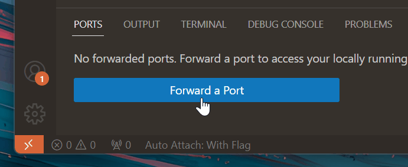
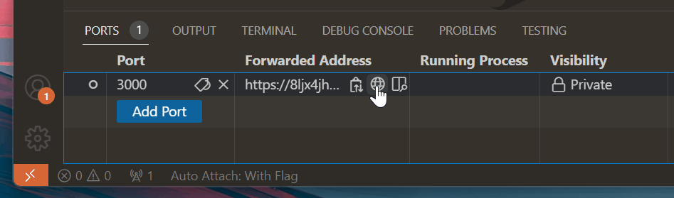

+++
title = "6.6 端口转发"
date = 2026-11-06T07:53:25+08:00
weight = 6
type = "docs"
description = ""
isCJKLanguage = true
draft = false
+++


> 原文链接: [https://code.visualstudio.com/docs/debugtest/port-forwarding](https://code.visualstudio.com/docs/debugtest/port-forwarding)

# 6.6 端口转发

　　Visual Studio Code 通过 [Microsoft dev tunnels](https://learn.microsoft.com/azure/developer/dev-tunnels/overview)内置了端口转发支持，无需扩展。运行本地 Web 服务时，可以使用**端口**视图让其他人在 Internet 上访问该服务。

## 如何使用端口转发 {#how-to-use-port-forwarding}

　　首先需要一个要转发的服务。如果还没有，但安装了 Node.js，可以运行以下命令在 3000 端口启动服务器：

```bash
npx serve
```

　　然后转到面板区域中的**端口**视图（**Ports: Focus on Ports View**），选择 **转发端口**。



　　如果之前没有登录 GitHub，系统会提示登录。输入要转发的端口（上述命令默认使用 3000）。转发开始后，**端口**视图会更新，显示转发的端口及其**转发地址**。



　　将鼠标悬停在**转发地址**上，可以使用行内操作复制地址、在浏览器中打开，或在编辑器内预览。默认情况下，转发的端口是**私有**的。访问 URL 时，需要与启动端口转发时使用相同的 GitHub 账户登录。可以右键单击端口，选择 **端口可见性 > 公共** 更改可见性。**公共**端口不需要登录。

## 常见问题 {#common-questions}

### 如果我连接到远程计算机，如何转发本地服务？ {#how-do-i-forward-local-services-if-im-connected-to-a-remote-machine}

　　端口转发目前只公开本地运行的服务，尚不支持远程连接，但计划在未来添加此功能。根据场景，可以使用 VS Code [8.4 使用远程隧道开发](../../remote/8.4-Tunnels/)扩展隧道进入远程计算机。

### 如何访问仅在远程计算机上运行的服务？ {#how-do-i-access-a-service-that-only-runs-on-a-remote-machine}

　　如果连接到远程工作区，[6.5 集成浏览器](../6.5-IntegratedBrowser/)可以通过远程连接代理 Web 流量，从而访问仅在远程计算机上可用的端口和服务，无需将端口转发到本地。

### 转发的端口如何保证安全？ {#how-are-forwarded-ports-secured}

　　默认情况下，托管和连接隧道都需要两端使用相同的 GitHub 或 Microsoft 账户进行身份验证。VS Code 会与 Azure 中托管的服务建立出站连接，通常不需要更改防火墙，也不会设置网络侦听器。

> **警告**：如果打开了**公共**端口，任何拥有链接的用户都可以访问转发的服务。避免在公共端口上托管机密信息或不安全的服务。

### 端口转发有哪些限制？ {#what-limits-are-there-on-port-forwarding}

　　端口转发对带宽使用量和活动计算机数量都有限制，这些限制可能会更改。请参阅[隧道使用限制](https://aka.ms/vscode-dev-tunnel-limit)。

### 可以在组织中配置策略吗？ {#can-i-configure-policies-across-my-organization}

　　如果组织希望控制端口转发访问，可以允许或拒绝访问域 `global.rel.tunnels.api.visualstudio.com`。对于 Windows 设备，还可以配置并部署开发隧道的组策略设置。详见 [dev tunnels 文档](https://learn.microsoft.com/azure/developer/dev-tunnels/policies)。
