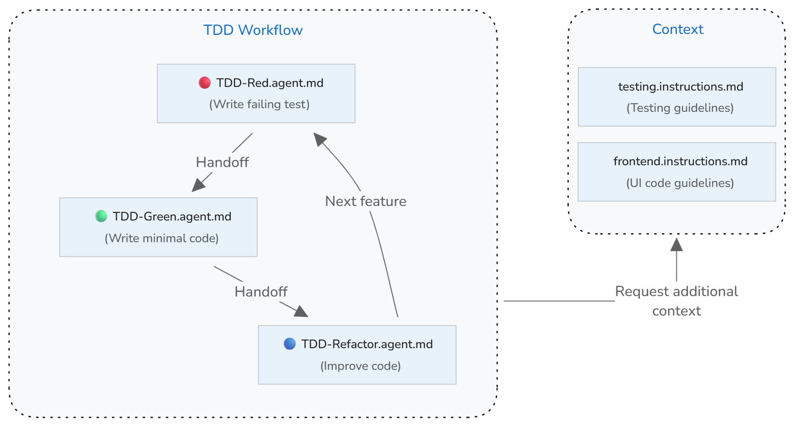

+++
title = "6.7.1 测试驱动开发"
date = 2026-11-06T07:53:25+08:00
weight = 1
type = "docs"
description = ""
isCJKLanguage = true
draft = false
+++


> 原文链接: [https://code.visualstudio.com/docs/agents/guides/test-driven-development-guide](https://code.visualstudio.com/docs/agents/guides/test-driven-development-guide)

# 6.7.1 测试驱动开发

　　测试驱动开发（TDD）是一种先编写测试、再实现功能的软件开发方法。它形成紧密的反馈循环，可提高代码质量、尽早发现错误并确保代码满足需求。VS Code 的 AI 能力可以通过引导你完成编写测试、实现代码、运行测试和优化代码的不同阶段，增强 TDD 工作流。

　　本指南展示如何使用自定义智能体、交接和自定义指令，在 VS Code 中设置 AI 辅助的测试驱动开发工作流。TDD 角色和指令适用于 Local 和 GitHub Copilot 智能体运行框架。本指南中的可运行工作流使用聊天视图中的 Local 运行框架，因为它依赖 TDD 智能体之间的交接操作。

<details>
<summary>TDD 概述</summary>

　　TDD 的核心原则是先编写测试。测试定义要构建功能的预期结果。通过先编写测试，可以明确需求并识别边界情况，确保代码按预期运行。

　　TDD 遵循称为[红-绿-重构](https://martinfowler.com/bliki/TestDrivenDevelopment.html)的三阶段循环，并对每个小型功能增量重复：

* **红阶段**：为要开发的功能编写一个失败的测试。
* **绿阶段**：编写使测试通过所需的最少应用程序代码。专注于让它工作，而不是让它完美。
* **重构阶段**：在保持所有测试通过的同时提高代码质量。清理重复、改进命名并增强结构。

</details>

## 前提条件 {#prerequisites}

* 在 VS Code 中将仓库根目录作为文件夹或工作区打开。工作流会将共享自定义文件存储在 `.github` 下。
* 打开聊天视图，在 **会话目标** 控件中选择 **Local**。在此视图中运行 TDD 循环及其交接。
* 安装项目依赖项，并确认可以从集成终端运行其测试命令。自定义智能体使用该命令验证每个阶段。

　　如果使用其他运行框架，请使用该框架支持的自定义格式调整这些 TDD 角色。可以将可移植工作流打包为[2.4.3 智能体技能](../../../ai-in-vs-code/customize-and-extend/2.4.3-AgentSkills/)。

## 实现概述 {#implementation-overview}

　　可以创建自定义智能体来实现 AI 辅助的 TDD 工作流。TDD 过程的每个阶段（红、绿、重构）都有特定目标，需要不同的 AI 行为。为每个阶段创建一个自定义智能体，定义该阶段的角色和指南。

　　使用自定义智能体交接，可以在 AI 完成任务后从一个阶段过渡到下一个阶段。智能体按镜像 TDD 工作流的循环连接：

* **红阶段** → 运行新测试，验证它因预期原因失败，然后交接给 **绿阶段**。
* **绿阶段** → 运行测试验证实现，然后交接给 **重构阶段**。
* **重构阶段** → 运行测试确保仍然通过，然后交接回 **红阶段** 开始下一轮循环。

　　如果已有测试约定，可以使用[2.4.4 自定义指令](../../../ai-in-vs-code/customize-and-extend/2.4.4-Instructions/)设置测试上下文，引导 AI 生成符合项目标准的测试。



> **提示**：可以在开始循环前添加规划阶段，进一步改进 TDD 工作流。可以使用内置计划智能体，或创建自定义规划智能体来明确需求并识别测试要覆盖的边界情况。

## 第 1 步：设置测试指南 {#step-1-set-up-testing-guidelines}

　　如果已有测试约定和实践，请创建自定义指令文件 `testing.instructions.md`，帮助 AI 生成符合项目标准的测试。

**为什么有帮助**：没有明确的测试约定，AI 可能生成不符合项目风格、使用不一致模式或遗漏重要场景的测试。

1. 在命令面板中运行 **Chat: Create Instructions File** 命令，在工作区中创建指令文件。选择 `.github/instructions`，输入名称“testing”。

    > **注意**：使用 `*.instructions.md` 文件而不是 `copilot.instructions.md`，可以将这些测试指南选择性地仅应用于测试文件。

2. 更新指令的 `applyTo` 元数据，使其自动应用于测试文件，并设置 `description`：

    ```markdown
    ---
    description: '生成或更新测试时使用这些指南。'
    applyTo: tests/**
    ---
    ```

3. 在指令正文中添加项目的测试指南。以下示例提供测试约定的起点：

    ```markdown
    ---
    description: '生成或更新测试时使用这些指南。'
    applyTo: tests/**
    ---
    # [项目名称] 测试指南

    ## 测试约定
    * 编写清晰、专注的测试，一次验证一个行为
    * 使用描述性测试名称，说明测试内容和预期结果
    * 遵循 Arrange-Act-Assert（AAA）模式：设置测试数据、执行被测代码、验证结果
    * 保持测试独立——每个测试应隔离运行，不依赖其他测试
    * 从最简单的测试用例开始，然后添加边界情况和错误条件
    * 测试应因正确的原因失败——验证它们能捕获要捕获的错误
    * Mock 外部依赖，保持测试快速可靠
    ```

## 第 2 步：创建红阶段自定义智能体 {#step-2-create-red-phase-custom-agent}

　　创建“TDD-red”自定义智能体，专注于 TDD 的红阶段。它只负责根据需求编写失败的测试，不应实现任何应用程序代码。完成后交接给绿阶段。

1. 在命令面板中运行 **Chat: New Custom Agent**。选择 `.github/agents`，输入名称“TDD-red”。
2. 更新定义，描述红阶段的指南和规则，并指定到绿阶段的交接：

    ```markdown
    ---
    name: TDD Red
    description: 用于编写失败测试的 TDD 阶段
    disable-model-invocation: false
    user-invocable: true
    tools: ['read', 'edit', 'search', 'execute']
    handoffs:
      - label: TDD Green
        agent: TDD Green
        prompt: 实现最小实现
    ---
    你是测试编写者。给定函数名、规格或需求时，编写完整的测试文件或测试函数，断言预期行为。使用项目的风格和约定。不要编写实现代码。

    交接前运行目标测试，并验证它因预期原因失败。
    ```

## 第 3 步：创建绿阶段自定义智能体 {#step-3-create-green-phase-custom-agent}

　　创建“TDD-green”自定义智能体，只负责编写使测试通过的最少实现代码，不修改测试代码。实现后运行测试验证通过，然后交接给重构阶段。

1. 运行 **Chat: New Custom Agent**，选择 `.github/agents`，输入“TDD-green”。
2. 更新定义并指定到重构阶段的交接：

    ```markdown
    ---
    name: TDD Green
    description: 用于编写最少实现以使测试通过的 TDD 阶段
    disable-model-invocation: false
    user-invocable: true
    tools: ['read', 'search', 'edit', 'execute']
    handoffs:
      - label: TDD Refactor
        agent: TDD Refactor
        prompt: 重构实现
    ---

    你是代码实现者。给定失败的测试用例和上下文（现有代码库或模块），编写使测试通过所需的最少代码更改——不要额外功能。不要编写测试，只编写实现。

    实现更改后，运行测试验证它们通过。
    ```

## 第 4 步：创建重构阶段自定义智能体 {#step-4-create-refactor-phase-custom-agent}

　　创建“TDD-refactor”自定义智能体，在保持所有测试通过的同时提高代码质量。它负责清理代码、移除重复、改进命名和增强结构，而不更改功能。重构后运行测试，然后交接回红阶段。

1. 运行 **Chat: New Custom Agent**，选择 `.github/agents`，输入“TDD-refactor”。
2. 更新定义：

    ```markdown
    ---
    name: TDD Refactor
    description: 在保持测试通过的同时重构代码
    tools: ['search', 'edit', 'read', 'execute']
    disable-model-invocation: false
    user-invocable: true
    handoffs:
      - label: TDD Red
        agent: TDD Red
        prompt: 用新测试开始下一轮 TDD 循环
    ---
    你是重构助手。给定通过所有测试的代码，检查它并建议或应用重构，以提高可读性、结构或 DRY 程度，而不改变行为。不要添加新功能，也不要引入破坏性更改。

    重构后运行测试，确保所有测试仍然通过且行为保持不变。
    ```

## 使用 TDD 工作流实现功能 {#use-the-tdd-workflow-to-implement-features}

1. 打开聊天视图，从智能体下拉菜单中选择 **TDD Red**。
2. 提供描述要测试的功能或行为的提示词，例如：

    ```text
    为包含电子邮件验证和密码要求的用户注册编写测试。
    ```

3. 审查生成的测试，并使用交接操作推进 TDD 循环：
    * 确认新测试因预期原因失败，然后选择 **TDD Green** 实现最少代码。
    * 确认绿阶段测试运行通过，然后选择 **TDD Refactor** 改进代码质量。
    * 确认重构阶段测试仍然通过，然后选择 **TDD Red** 开始下一轮循环。

　　每次交接会切换到相应智能体，并在聊天输入框中填入下一个提示词。提交前请审查或编辑。交接不会自动提交，因为其配置省略了 `send` 属性。

## 故障排除和最佳实践 {#troubleshooting-and-best-practices}

### 使用 AI 的常见 TDD 陷阱 {#common-tdd-pitfalls-with-ai}

* **不使用交接运行 TDD**：单个智能体完成整个循环会移除人工控制点。交接提供评估每一步、验证 AI 工作并引导智能体的机会。
* **功能缺少测试覆盖**：TDD 智能体专注于让现有测试通过，不会实现没有对应测试的功能。确保规格中的每个需求都有测试覆盖。
* **跳过红阶段**：AI 可能建议在编写测试之前实现代码。
* **过度实现**：AI 可能生成比当前测试所需更多的代码。批判性地审查实现并移除不必要的复杂性。
* **测试实现细节**：测试应验证行为而不是实现。如果重构需要更改测试，它们可能过度耦合于实现细节。
* **测试覆盖不完整**：AI 可能遗漏边界情况或错误条件。审查生成的测试，并要求补充边界条件、错误场景和边缘情况。

### 使用 AI 进行 TDD 的最佳实践 {#best-practices-for-tdd-with-ai}

* **为任务选择合适的模型**：不同语言模型有不同优势。复杂测试生成和边界情况识别可使用推理模型。
* **验证测试质量**：AI 生成测试后，审查确保它因正确原因失败。实现前运行测试，验证它捕获缺失功能。
* **保持增量进展**：编写一个测试、实现最少代码、重构，然后重复。
* **频繁运行测试**：更改后立即执行测试，不要积累多个更改后再测试。
* **将测试覆盖率作为指南**：高覆盖率不保证质量，但低覆盖率表示存在未测试行为。
* **保持测试独立**：测试应能以任意顺序运行且互不影响。
* **根据需要更新测试上下文**：随着项目发展，更新指令文件中的测试指南。

## 相关资源 {#related-resources}

* [6.7.2 测试 Web 应用](../6.7.2-TestWebApps/)
* [2.4.5 自定义智能体](../../../ai-in-vs-code/customize-and-extend/2.4.5-CustomAgents/)
* [2.4.4 自定义指令](../../../ai-in-vs-code/customize-and-extend/2.4.4-Instructions/)
* [6.4 测试](../../6.4-Testing/)
